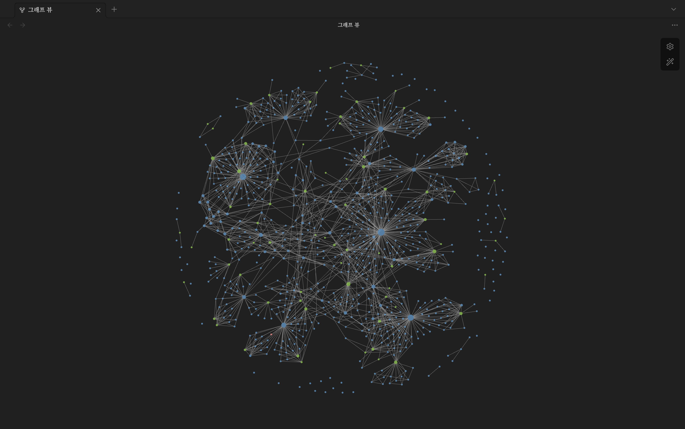

# Archive

개인 학습 기록과 기술 노트를 정리하는 Quartz 4 기반 디지털 가든입니다.

[사이트 방문](https://ken-jeong.pages.dev/)



## 로컬 실행

Node.js 22 이상, npm 10.9.2 이상이 필요합니다.

```bash
npm ci
```

`content/`에 Markdown 노트와 홈 문서(`index.md`)를 추가한 뒤 실행합니다.

```bash
npx quartz build --serve
```

배포용 파일은 `npx quartz build`로 `public/`에 생성합니다.

## 노트 동기화

`copy.sh`의 `SRC`를 Obsidian vault 경로로 설정하고 실행하면 `draft: false`인 Markdown 문서를 가져옵니다.

```bash
./copy.sh
```

> 기존 `content/` 내용은 `.gitkeep`을 제외하고 삭제됩니다. 이미지 등 첨부 파일은 별도로 복사해야 합니다.

## 주요 파일

- `content/`: 공개할 Markdown 노트
- `quartz.config.ts`: 사이트 정보, 테마, 플러그인 설정
- `quartz.layout.ts`: 화면 레이아웃
- `quartz/styles/custom.scss`: 사용자 정의 스타일

배포 전 `quartz.config.ts`의 `baseUrl`을 실제 사이트 주소에 맞춰 설정하세요.

## 라이선스

Quartz 소스 코드는 [MIT License](LICENSE.txt)를 따릅니다. 노트 재배포에는 별도 허가가 필요합니다.
