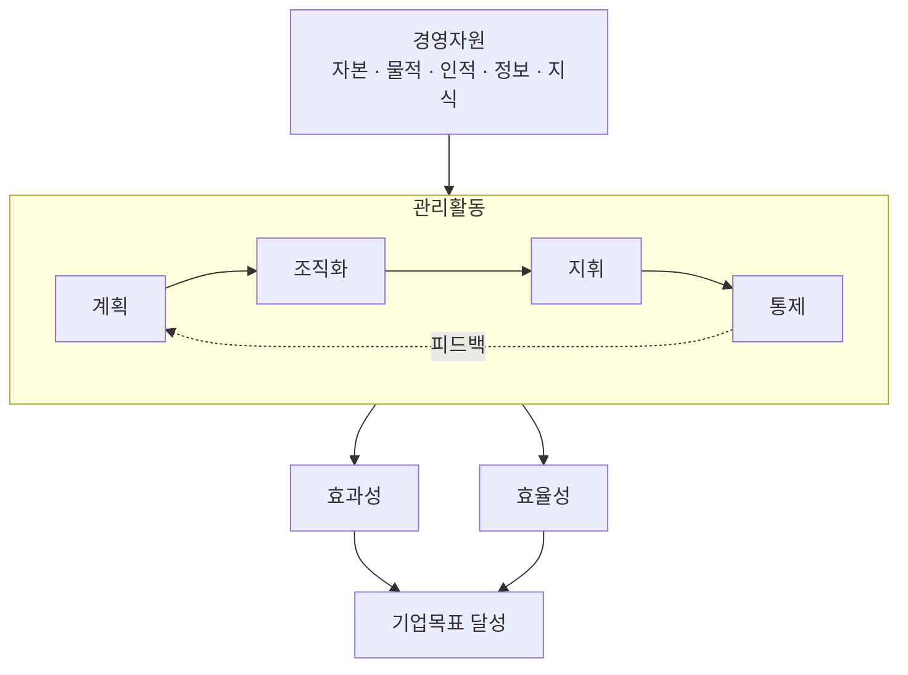
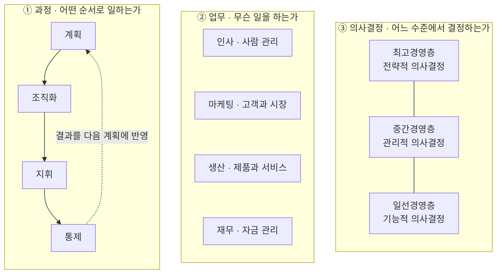
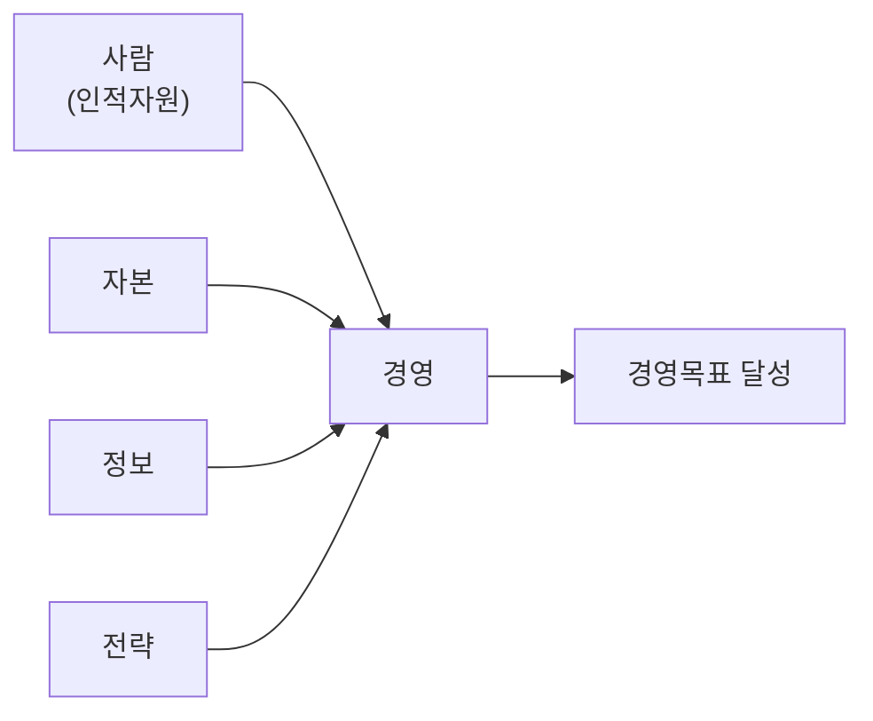

## 요약
**경영**
- 협의: **영리 조직**
- 광의: 영리 조직 및 **비영리 조직**
- 목적: 조직의 생존·발전과 **목표 달성**

**경영의 구성 요소**
1. **사람**: 경영 활동을 수행한다.
2. **자본**: 경영에 필요한 자금을 제공한다.
3. **정보**: 환경을 파악하고 판단하는 것을 돕는다.
4. **전략**: 목표 달성을 위한 방향을 정한다.

**경영 활동의 관점**
1. **과정 측면**
	1. (P) **계획**: 목표를 설정하고, 달성 방안을 찾는다.
	2. (D) **조직화**: 조직을 구성하고, 자원을 배분한다.
	3. (D) **지휘**: 구성원의 동기를 유발하고 이끈다.
	4. (C) **통제**: 진행 상황 확인을 확인하고, 문제가 있으면 수정한다.
2. **업무 측면**
	1. **인사**: 사람 (인적자원 관리)
	2. **마케팅**: 고객의 욕구와 교환 (가치 창출, *기획*)
	3. **생산**: 제품·서비스의 창출
	4. **재무**: 자금 (조달·운용·투자)
3. **의사결정 측면**
	1. **전략적** 의사결정: 조직 전체의 장기목표·자원배분에 관한 결정
	2. **관리적** 의사결정: 자원 확보·사용
	3. **기능적** 의사결정: 특정 업무 수행

## 1. 경영이란 무엇인가?
**경영** (經營; 계획할 경, 실행할 영; Management)
- 조직의 목표를 달성하기 위해
- 가용 자원을
- 효율적·효과적으로
- ==계획하고, 조직화하고, 지휘하고, 통제하는 가치 창출의 연속적 과정==이다.

> 조직의 구성 요소 4가지
> 1. 2인 이상의 사람
> 2. 합일화된 공동의 목표(영리/비영리)
> 3. 분업화된 역할
> 4. 상호 체계성(시스템)

- **목적**: 조직의 생존·발전과 목표 달성
- **활용 자원**: 인적 자원, 물적 자원, 자본 등
- **활동**: 계획 → 조직화 → 지휘 → 통제
- **핵심 기준**: 효율성과 효과성의 균형

### 1.1. 효과성과 효율성
| 구분     | 효과성 (Effectiveness)    | 효율성 (Efficiency)   |
| ------ | ---------------------- | ------------------ |
| 핵심 의미  | 올바른 목표를 설정하고 달성하는 것    | 자원을 낭비하지 않고 활용하는 것 |
| 중점     | 목표의 적절성과 달성 여부         | 자원 투입과 성과의 관계      |
| 기억할 표현 | 올바른 목표 달성              | 최소 비용으로 최대 성과      |
| 영어 표현  | Doing the right things | Doing things right |

> 효율성은 ‘자원을 어떻게 쓰는가’,
> 효과성은 ‘어떤 목표를 달성하는가’에 초점을 둔다.
> 경영자는 두 가지를 함께 고려해야 한다.

### 1.2. 경영의 적용 범위
**협의의 경영**
- **영리조직**(기업)의 운영

**광의의 경영**
- 영리조직뿐 아니라,
- **비영리조직**(가계·국가·학교·종교 단체 등)까지 포함한 운영

따라서 **경영은 모든 조직을 운영하는 기본 원리**이다.

**ESG 경영**
- 이윤뿐 아니라 **ESG**(환경·사회·지배구조)와 같은 지속 가능한 가치도 고려해야 한다.

## 2. 경영을 보는 세 가지 관점
동일한 경영활동을 **과정·업무·의사결정**이라는 서로 다른 기준으로 살펴볼 수 있다.

| 관점 | 구분 기준 | 구성 요소 |
| --- | --- | --- |
| 과정 측면 | 어떤 과정을 거치는가? | 계획·조직화·지휘·통제 |
| 업무 측면 | 어떤 성격의 일을 하는가? | 인사·마케팅·생산·재무 |
| 의사결정 측면 | 어느 계층에서 어떤 범위의 결정을 하는가? | 전략적·관리적·기능적 의사결정 |

### 2.1. 과정 측면: 계획·조직화·지휘·통제
| 활동                      | 의미                                         | 핵심 질문                      |
| ----------------------- | ------------------------------------------ | -------------------------- |
| **계획** (Planning)    | 경영목표를 설정하고 이를 달성하기 위한 가장 좋은 방안을 찾는 활동      | 무엇을 달성하고, 어떻게 실행할 것인가?     |
| **조직화** (Organizing) | 조직의 형태를 정하고 사람·물자·자본·정보·지식 등을 배분하고 조정하는 활동 | 누가 맡고, 자원을 어떻게 배분할 것인가?    |
| **지휘** (Leading)     | 구성원이 필요한 업무를 잘 수행하도록 동기를 유발하고 이끄는 활동       | 구성원이 잘 실행하도록 어떻게 이끌 것인가?   |
| **통제** (Controlling) | 업무가 제대로 추진되는지 확인하고 문제가 있으면 수정하는 활동         | 제대로 진행되고 있는가? 무엇을 고쳐야 하는가? |

> 조직화 활동과 지휘 활동 실천활동(Doing)으로 보기도 한다.
> 이 경우 Planning → Doing → Controlling, 즉 PDC가 된다.

### 2.2. 업무 측면: 인사·마케팅·생산·재무
| 업무      | 핵심 대상      | 주요 내용                                           |
| ------- | ---------- | ----------------------------------------------- |
| **인사**  | 사람         | 인력 확보·개발·보상·유지, 인적자원 관리와 노사관계 관리             |
| **마케팅** | 고객의 욕구와 교환 | 고객 니즈 파악, 가치 창출, 교환 촉진과 ==지속적인 교환관리==        |
| **생산**  | 제품과 서비스    | 가용 자원을 활용해 고객이 원하는 제품·서비스를 창출하고 생산 프로세스를 설계·효율화 |
| **재무**  | 자본         | 필요한 자금을 합리적으로 조달하고 효과적으로 운용하며 투자를 결정         |

### 2.3. 의사결정 측면: 전략적·관리적·기능적 의사결정
| 구분           | 주 담당 계층    | 핵심 내용                           | 판단 범위      |
| ------------ | ---------- | ------------------------------- | ---------- |
| **전략적 의사결정** | **최고경영층**  | 장기목표와 자원배분에 관한 결정               | 조직 전체의 방향  |
| **관리적 의사결정** | **중간경영층**  | 목표 달성을 위한 자원의 획득과 효율적 사용에 관한 결정 | 자원의 확보와 활용 |
| **기능적 의사결정** | **일선 경영층** | 특정 업무를 효율적·효과적으로 수행하기 위한 결정     | 구체적인 업무 수행 |

### 2.4. 세 관점의 관계
세 관점은 독립된 활동 목록이 아니라 **하나의 경영활동을 함께 설명하는 기준**이다.

- 인사·마케팅·생산·재무 **각 업무 부문에서** 계획·조직화·지휘·통제가 이루어진다.
- 그 과정에서 **경영계층별로** 전략적·관리적·기능적 의사결정이 이루어진다.
- 따라서 경영활동은 한 부분만 떼어 보기보다 **전체적인 관계 속에서 이해**해야 한다.

> **과정은 활동의 흐름, 업무는 일의 성격, 의사결정은 계층과 판단 범위이다.**

## 3. 경영에는 무엇이 필요한가?
경영의 네 구성요소는 **사람·자본·정보·전략**이다.

| 구성요소                        | 의미                         | 경영에서의 역할                                 |
| --------------------------- | -------------------------- | ---------------------------------------- |
| **사람** (Human Resources) | 경영활동을 수행하는 인적자원            | 적절한 인력을 채용하고 적재적소에 배치하여 생산성을 활용          |
| **자본** (Capital)         | 창업과 운영에 필요한 자금             | 경영활동의 기초를 제공하며, 자기자본 또는 타인자본으로 조달 가능     |
| **정보**                      | 외부환경 등을 파악하고 판단하는 데 필요한 정보 | 신속하고 정확하게 파악한 정보를 전략적으로 활용하여 경쟁력 확보      |
| **전략** (Strategy)        | 목표 달성을 위해 미래에 나아갈 방향       | 최고경영자의 의지를 담은 포괄적인 계획·비전으로서 자원의 활용 방향 제시 |

### 3.1. 구성요소 사이의 관계
==사람·자본·정보·전략 → 경영활동 → 경영목표 달성==

- 사람을 확보하는 것뿐 아니라 **적재적소에 배치**하는 것이 중요하다.
- 자본을 조달한 뒤에는 이를 바탕으로 **이윤을 창출하는 경영활동**이 이루어져야 조직이 지속될 수 있다.
- 정보는 **신속성·정확성·전략적 활용**이 중요하다.
- 전략은 이용 가능한 자원을 어떻게 활용할지 방향을 정하며, **실행으로 이어져야 한다.**
