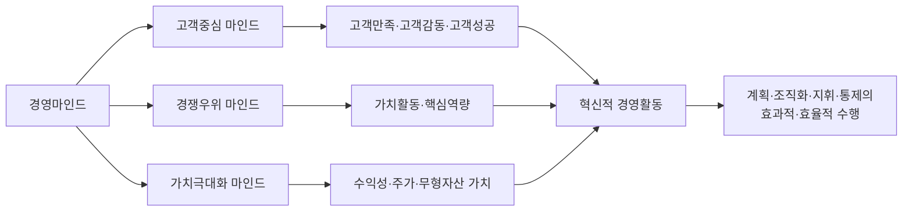
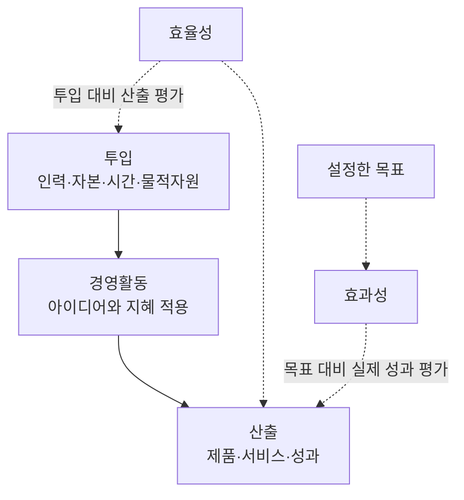

## 1. 전체 흐름 한눈에 보기
경영마인드는 **효과성과 효율성**을 추구하며, **고객중심·경쟁우위·가치극대화**를 연결하여 실제 경영활동에 적용하는 사고방식이다.

```text
경영마인드: 효과성과 효율성 추구
│
├─ 고객중심: 고객이 원하는 것은 무엇인가?
├─ 경쟁우위: 경쟁기업보다 잘할 수 있는 것은 무엇인가?
└─ 가치극대화: 수익성과 장기적인 기업가치를 어떻게 높일 것인가?
        ↓ 세 요소를 연계하여 실행
계획 → 조직화 → 지휘 → 통제
        ↓
효과적·효율적인 경영활동
```



**학습 순서**
- 효과성·효율성 구분 → 행정마인드와 비교 → 세 가지 핵심요소 이해 → 기업의 실제 경영활동과 연결

## 2. 경영마인드
### 2.1. 정의와 적용 범위
**경영 마인드 (Business Mind)**
- 기업목표를 달성하기 위해 효과성과 효율성을 높이는 아이디어나 지혜를 적용하는 것이다.
- 기업의 경영자에게만 필요한 것이 아니다. 공무원, 종업원, 가정 등 다양한 조직과 일상생활에서도 목표를 효과적·효율적으로 달성하는 데 필요하다.

### 2.2. 효과성과 효율성의 차이 ★
| 구분            | 효과성 (Effectiveness)    | 효율성 (Efficiency)                   |
| ------------- | ---------------------- | ---------------------------------- |
| 핵심 의미         | 설정한 목표를 얼마나 달성했는가      | 투입에 비해 산출을 얼마나 얻었는가                |
| 판단 기준         | 목표 달성 정도               | 투입 대비 산출의 비율                       |
| 높아지는 경우       | 목표에 더 가까워지거나 목표를 초과 달성 | 같은 투입으로 산출 증가, 또는 같은 산출에 필요한 투입 감소 |
| 기억할 질문        | **목표를 이루었는가?**         | **자원을 얼마나 잘 썼는가?**                 |
| 강의의 자동차 광고 예시 | 매출 기여도가 큰 ‘잘 팔리는 광고’   | 제작비를 절감한 ‘잘 만든 광고’                 |

**효율성의 기본 관계**
- `효율성 = 산출 ÷ 투입`

**이해를 위한 예시**
- 목표가 제품 100개 판매인데 120개를 팔았다면, 목표 달성 측면의 **효과성**이 높다.
- 같은 100개를 판매하면서 광고비를 100만 원에서 80만 원으로 줄였다면, 투입 대비 산출 측면의 **효율성**이 높아졌다.
- 비용이 적게 들었다고 목표까지 달성한 것은 아니다. **효과성과 효율성은 구분해서 판단하고, 함께 추구해야 한다.**



## 3. 경영마인드와 행정마인드 비교
**행정 마인드 (bureaucratic mind)**, 관료마인드
- **형평성과 일관성**을 추구하는 사고방식이다.
- **형평성**: 강의에서는 동일하게 `1/n`씩 배분하는 사고방식이다.
- **일관성**: 주어진 법규나 규정에 따라 일정하게 집행·운영하는 것이다.

| 비교 기준 | 경영마인드 | 행정마인드 |
|---|---|---|
| 추구 가치 | **효과성·효율성** | **형평성·일관성** |
| 현실에 대한 태도 | 현실에 도전 | 현실을 있는 그대로 수용 |
| 활동 방향 | 개혁을 통한 창조 | 현상유지를 위한 관리 |
| 시간 관점 | 먼 앞날을 계산 | 눈앞의 손익을 계산 |
| 주된 질문 | **무엇을, 왜?** | **언제, 어떻게?** |

> **보충**
> 위 비교는 강의자료의 대비를 정리한 것이다.
> 일반적으로 형평성이 언제나 똑같이 나누는 것만을 뜻하는 것은 아니며, 실제 조직에서는 성과·효율과 공정성·규정 준수를 함께 고려할 수 있다.

## 4. 경영마인드의 세 가지 핵심요소
| 핵심요소          | 핵심 목적                 | 스스로 물어볼 질문                 |
| ------------- | --------------------- | -------------------------- |
| **고객중심 마인드**  | 고객을 최우선으로 생각하고 만족을 높임 | 고객이 원하는 가치는 무엇인가?          |
| **경쟁우위 마인드**  | 경쟁에서 우위에 설 방안을 찾음     | 다른 기업보다 잘할 수 있는 근거는 무엇인가?  |
| **가치극대화 마인드** | 수익성과 기업가치를 높임         | 고객만족과 경쟁력이 기업의 성장으로 이어지는가? |

세 요소는 **종합적으로 연결되어 현장에서 실행**되어야 한다.
각각의 중요성을 아는 것만으로는 혁신적인 경영활동이 이루어지지 않는다.

### 4.1. 고객중심 마인드
**정의**: 고객을 가장 먼저 생각하고, 고객에게 제공하는 물질적·심리적 활동이 최상의 고객만족으로 이어지도록 하는 사고방식이다.

강의는 고객중심 경영의 요구가 **고객만족을 넘어 고객감동과 고객성공까지** 확장된다고 설명한다.

**고객은 최종소비자에만 한정되지 않는다.**

| 고객의 범위 | 관리해야 할 내용 |
|---|---|
| **최종소비자** | 욕구를 파악하고 고객만족을 지속적으로 관리 |
| **주주** | 투자자인 주주의 만족도 관리 |
| **종업원** | 내부 고객인 종업원의 만족도 관리 |

### 4.2. 경쟁우위 마인드
**정의**: 기업이 다른 기업과의 경쟁에서 우위에 설 수 있는 방안을 찾는 사고방식이다.

#### 세 가지 ‘우위’ 구분 ★
| 개념                                  | 강의자료의 설명                                                  | 구분 키워드          |
| ----------------------------------- | --------------------------------------------------------- | --------------- |
| **절대우위**<br>(absolute advantage)    | 특정 제품의 독점적 지위나 가장 낮은 생산비용 등을 통해 독보적 위치를 차지                | 절대적인 생산·비용상의 우위 |
| **비교우위**<br>(comparative advantage) | 모든 제품에서 절대우위 또는 절대열위에 있더라도, 상대적으로 효율적인 제품에 전문화하면 상호 이익 발생 | 상대적 효율성·전문화     |
| **경쟁우위**<br>(competitive advantage) | 특정 기업이 다른 기업과의 경쟁에서 우위에 설 수 있는지를 판단하는 개념                  | 기업 간 경쟁에서의 우위   |
> 절대우위와 비교우위는 국가를 대상으로 하고, 경쟁우위는 기업을 대상으로 한다.

> **보충**
> 비교우위는 더 정확히는 **기회비용이 낮은 활동에 갖는 우위**다.
> 따라서 절대적으로 생산성이 낮더라도 비교우위를 가질 수 있다.

#### 경쟁우위의 원천
1. **가치활동**(value activities): 창조적 경영활동
2. **핵심역량**(core competence): 기업의 경쟁력 확보에 중요한 경영자원

#### 경영자원이 경쟁우위를 갖기 위한 조건
- **희소성**: 다른 기업들이 갖지 못한 자원이어야 한다.
- **산업 내 중요성**: 현재 그 산업에서 중요한 역할을 해야 한다.

**이해를 위한 예시**
- 다른 기업이 갖지 못한 기술이라도 고객의 구매나 제품 성능에 도움이 되지 않는다면, 희소하다는 이유만으로 경쟁우위가 생기는 것은 아니다.

**암기**
- 경쟁우위의 원천은 **가치활동·핵심역량**
- 자원의 조건은 **희소성·중요성**

### 4.3. 가치극대화 마인드
**정의**
- 고객만족과 경쟁우위 확보에 더해 **수익성**을 충족하면서
- 기업이나 조직의 가치를 극대화하려는 사고방식이다.

**강의에서 설명하는 흐름**
```text
인적·물적자원과 자본 투입
→ 효과적·효율적인 아이디어 적용
→ 투입 이상의 산출 창출
→ 기업 성장과 수익성 확대
```

#### 방법 1. 주가를 통한 가치 증대
`기업가치 = 발행 주식 수 × 주가`

- 주가를 높이는 것을 기업가치를 높이는 직접적인 방법이다.
- 미래에 창출할 현금흐름과 그 현재가치가 중요하다.
- **비용 절감을 통한 단기 이익뿐 아니라 장기적으로 이익을 창출할 방안도 필요하다.**

> **보충**
> 위 식이 직접 나타내는 것은 주식의 **시가총액**이다.
> 재무에서 사용하는 기업가치 전체와 시가총액은 구분될 수 있다.
> 단기 비용 절감에 그치지 않고 미래의 이익 창출 능력을 높여야 한다.

#### 방법 2. 무형자산의 가치 증대
브랜드·특허권 등 **무형자산**의 가치를 높인다.

- 브랜드에 뚜렷한 **경영목표와 비전**을 담는다.
- **소비자의 심리와 욕구**를 정확하게 파악한다.

**브랜드 사례**
- GE: 전기를 통한 보다 나은 삶
- Audi: 독일인의 장인 정신이 담긴 승용차
- Benetton: 다양한 인종이 조화롭게 살아가는 세계

**Ford 사례**
- 1980년대 중반 소비자조사를 통해 베이비붐 세대의 **레저 선호·가족중심 성향**을 파악하고, 이에 맞춰 모델 개발부터 광고까지 일관된 전략을 추진하여 경쟁우위를 확보했다.

> 위 사례들은 강의자료에 제시된 설명이며, 각 기업의 현재 슬로건이나 전략을 뜻하지 않는다.

## 5. 경영마인드가 있는 기업과 없는 기업
| 구분     | 경영마인드가 있는 기업               | 경영마인드가 없는 기업              |
| ------ | -------------------------- | ------------------------- |
| 핵심요소   | 고객중심·경쟁우위·가치극대화 마인드를 갖춤    | 해당 요소를 실제 경영활동에 연결하지 못함   |
| 경영활동   | 계획·조직화·지휘·통제를 효과적·효율적으로 수행 | 계획·조직화·지휘·통제에 일관성과 체계가 없음 |
| 판단 포인트 | 사고방식이 체계적인 실행으로 이어지는가      | 경영활동이 일관성 없이 이루어지는가       |

**주의**
- 경영마인드가 있다는 것은 단순히 비용을 아끼거나 이익만 추구한다는 뜻이 아니다.
- **세 핵심요소를 갖추고 경영활동을 효과적·효율적으로 수행**해야 한다.
