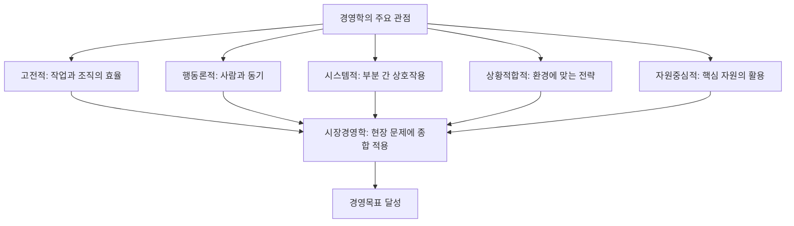
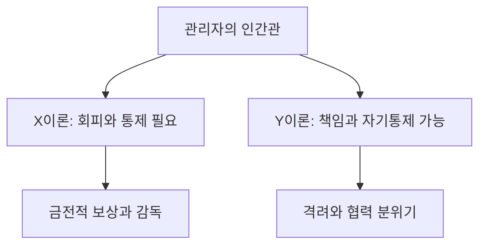
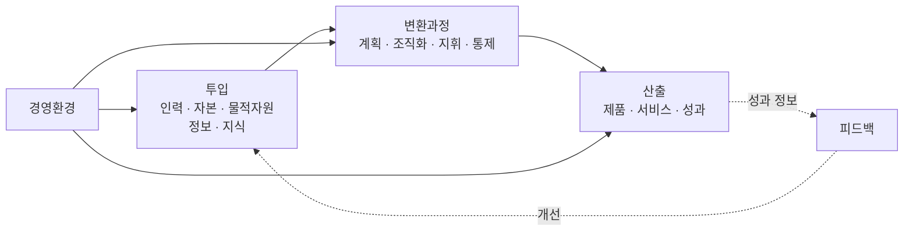
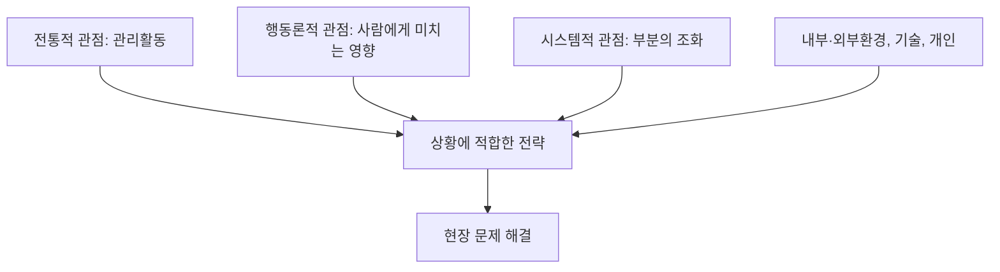
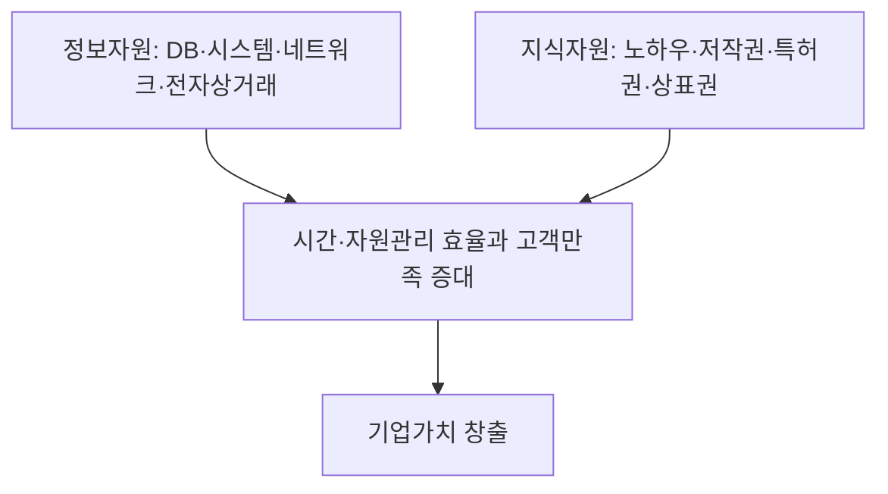

## 1. 전체 흐름 먼저 잡기
이 장에서 답해야 할 질문은 세 가지다.
1. **경영학이란 무엇인가?** → 조직의 목표를 달성하기 위해 자원을 활용하고 경영활동을 연구하는 학문이다.
2. **경영학은 어떤 성격을 가지는가?** → 이론과 실제, 과학과 기술의 성격을 함께 가진다.
3. **경영학은 어떻게 발전했는가?** → 작업의 효율성에서 출발해 인간, 시스템, 상황, 자원으로 관심이 확대되었다.

**발전 흐름 암기**
```text
고전적 → 행동론적 → 시스템적 → 상황적합적 → 자원중심적
효율성     인간       관계          상황            자원
```

이 흐름은 앞선 이론이 완전히 사라지고 다음 이론으로 교체된다는 뜻이 아니다.
자료의 발전사 도표에서도 여러 관점이 함께 이어진다.

## 2. 경영학의 개념과 대상
### 2.1. 경영학의 정의
**경영학**
- 기업목표를 달성하기 위해 여러 자원을 이용하여 **계획·조직화·지휘·통제**하는 활동을 체계적으로 연구하는 학문이다.

- **활용 자원**: 자본, 물적자원, 인적자원, 정보, 지식 등
- **학문적 특징**: 하나의 활동만 연구하는 것이 아니라 여러 관련 학문의 지식을 접목하는 **통합 학문**

경영활동의 흐름은 다음과 같이 이해하면 쉽다.

| 활동  | 쉽게 이해하기                   |
| --- | ------------------------- |
| **계획**  | 무엇을 달성하고 어떻게 실행할지 정한다.    |
| **조직화** | 일을 나누고 인력과 자원을 배치한다.      |
| **지휘**  | 구성원이 목표를 향해 행동하도록 이끈다.    |
| **통제**  | 실행 결과를 확인하고 필요한 부분을 수정한다. |

### 2.2. 효과성과 효율성
경영학을 기업의 **효과성과 효율성**을 위한 학문으로 소개한다.
두 용어는 다음처럼 구별해 이해할 수 있다.

| 구분  | 의미                   | 확인할 질문              |
| --- | -------------------- | ------------------- |
| **효과성** | 목표를 달성하는 정도          | 목표한 결과를 얻었는가?       |
| **효율성** | 투입한 자원에 비해 성과를 얻는 정도 | 자원을 얼마나 알뜰하게 사용했는가? |

### 2.3. 연구 대상
- **주된 대상**: 영리조직인 기업
- **넓은 의미의 대상**: 비영리조직까지 포함
- **이유**: 비영리조직에도 경쟁 개념이 도입되면서 경영원리를 적용할 수 있기 때문이다.

**핵심 문장**
- 경영학은 여러 자원을 활용해 조직의 목표를 효과적이고 효율적으로 달성하는 방법을 연구한다.

## 3. 경영학의 네 가지 성격
> 경영학 = **이론 + 실제 + 과학 + 기술**을 함께 지닌 종합학문

### 3.1. 이론과 실제
| 구분    | 이론으로서의 경영학         | 실제로서의 경영학          |
| ----- | ------------------ | ------------------ |
| 성격    | **이론과학·순수과학**          | **실천과학·응용과학**          |
| 목적    | 경영현상을 기술·설명·예측     | 실무에 필요한 방향과 해결책 제시 |
| 접근    | 현상을 분석해 논리적인 원리 수립 | 원리를 실제 경영문제에 적용    |
| 핵심 질문 | 경영현상이 왜 발생하는가?     | 경영을 어떻게 해야 하는가?    |

- **기술(description)**: 현상이 어떤 모습인지 서술한다.
- **설명(explanation)**: 현상이 발생한 이유를 밝힌다.
- **예측(prediction)**: 앞으로 나타날 현상을 예상한다.

**관계**
- 이론은 실무에 원리를 제공하고,
- 실제 경영은 그 원리를 활용한다.
- 따라서 둘은 **상호보완 관계**다.

### 3.2. 과학과 기술
| 구분  | 과학으로서의 경영학    | 기술로서의 경영학           |
| --- | ------------- | ------------------- |
| 영문  | Science       | Art                 |
| 근거  | 객관적 사실과 데이터   | 경영자의 직관·창의성·경험      |
| 관심  | 인과관계와 일반적 원리  | 구체적인 상황의 문제 해결      |
| 역할  | 판단의 근거와 원리 제시 | 목표 달성을 위한 실천적 처방 제시 |

> **용어 주의**
> ‘기술(Art)’은 여기서 정보기술 같은 테크놀로지가 아니라,
> 경험과 창의성을 발휘하는 실천적 역량을 뜻한다.

> 2026-10-02

## 4. 경영학 발전사 한눈에 비교
| 관점        | 핵심 관심            | 주요 이론·내용                | 기억할 단어 |     |
| --------- | ---------------- | ----------------------- | ------ | --- |
| **고전적 경영학**   | 작업과 조직을 효율적으로 관리 | 테일러의 과학적 관리론, 패욜의 경영관리론 | 효율성    |     |
| **행동론적 경영학**  | 인간의 심리와 행동       | 메이요의 호손실험, 맥그리거의 X·Y이론  | 인간     |     |
| **시스템적 경영학**  | 구성 요소의 상호작용      | 투입·변환·산출, 부분과 전체의 관계    | 연결     |     |
| **상황적합적 경영학** | 상황에 맞는 관리방법      | 내부·외부환경 고려, 글로벌경영·전략경영  | 적합성    |     |
| **자원중심적 경영학** | 핵심 자원을 활용한 경쟁우위  | 정보경영·지식경영               | 핵심 자원  | --- |



## 5. 고전적 경영학
> 작업과 조직의 효율성

1890년대 이후 작업과 조직을 효율적으로 관리하는 방법에 대한 연구를 강조하며 발전했다.

| 비교 기준 | 테일러            | 패욜             |
| ----- | -------------- | -------------- |
| 이론    | 과학적 관리론        | 경영관리론          |
| 분석 단위 | 작업자 ==개인의 직무== | ==조직 전체==      |
| 관심 위치 | 작업현장           | 최고경영층          |
| 핵심    | 작업 효율성과 생산성    | 조직 전체의 관리와 효과성 |

### 5.1. 테일러의 과학적 관리론
- **연구 초점**: 작업자 개인의 직무와 작업현장
- **목적**: 비효율적 요소를 제거하고 생산성을 높이는 것
- **강의의 핵심 표현**: **저노무비·고임금**의 실천

**비효율이 발생하는 배경**
1. 생산성이 높아지면 자신이나 동료가 일자리를 잃을 수 있다는 종업원의 두려움
2. 경영자가 설정한 불안정한 임금체계

| 관리원칙        | 핵심 내용                |
| ----------- | -------------------- |
| 과학적 작업과정 연구 | 작업과정을 과학적으로 분석한다.    |
| 종업원의 과학적 선발 | 작업에 적합한 종업원을 선발한다.   |
| 성과급 제도      | 생산량에 따라 성과급을 지급한다.   |
| 직능별 감사제도    | 자료에 제시된 직능별 관리 관련 제도 |

**쉽게 이해하기**
- 작업방식과 인력 선발, 보상, 관리체계를 합리화해 생산성을 높이려는 관점이다.
- 저노무비·고임금은 생산성 향상을 통해 노동비용을 낮추면서 종업원의 임금을 높이려는 취지로 이해한다.

### 5.2. 패욜의 경영관리론
- **연구 초점**: 기업 전체와 최고경영층
- **목적**: 조직 전체 차원의 효과성 추구
- **주요 내용**: 조직 내부활동을 체계적으로 분류하고 경영관리기법을 적용
- **기여**: 현대 경영관리이론의 발전에 중요한 역할
- **적용 범위**: 기업뿐 아니라 정부·군대·종교기관 등에도 적용 가능하다고 봄

#### 조직활동의 구분
| 구분       | 자료에 제시된 내용              |
| -------- | ----------------------- |
| **작업활동** | 기술, 영업, 재무, 안전, 회계      |
| **관리활동** | 계획 → 조직화 → 지휘 → 조정 → 통제 |

패욜은 관리활동 중 특히 **계획과 조직화**를 강조했다.
**14가지 관리원칙을 제시했다.**
원칙의 탄력적 적용도 강조한다.

> **구별**
> 일반적인 경영활동: 계획 → 조직화 → 지휘 → 통제
> 패욜의 관리요소: 계획 → 조직화 → 지휘 → **조정** → 통제

## 6. 행동론적 경영학
> 인간의 심리와 관계

과학적 관리에서 인간적 요인이 소홀히 다루어졌다는 문제의식에서 등장했다.

### 6.1. 메이요의 호손실험과 인간관계론
> 생산성을 이해할 때 **작업조건 + 인간관계 + 비공식조직**을 함께 본다.

메이요는 인간의 행동이 생산성에 미치는 영향을 네 차례의 실험을 통해 살펴보았다.

| 구분  | 자료에 제시된 조사·실험 초점       |
| --- | ---------------------- |
| **1차**  | 조명의 변화                 |
| **2차**  | 임금인상·휴식시간 등 작업 관련 요인   |
| **3차**  | 작업자의 태도와 감정            |
| **4차**  | 작업장에서 사회적으로 인정받고 싶은 욕구 |

**핵심 의미**
- 작업능률은 **물리적 환경과 경제적 조건**뿐 아니라 **태도·감정·인간관계**에도 영향을 받는다.
- 종업원 사이에 형성된 **비공식적 조직**도 생산성에 영향을 미친다.
- 이러한 관점은 **인간관계론**의 출발점이 되었다.

### 6.2. 맥그리거의 X·Y이론
X이론과 Y이론은 **인간에 대한 서로 다른 가정**이다.
각각의 가정에 따라 관리방식이 달라진다.
- X = **회피·감독·통제**
- Y = **책임·자율·창의성**

| 비교 기준 | X이론 | Y이론 |
|---|---|---|
| 일에 대한 가정 | 일을 싫어하고 가능하면 피한다. | 일을 즐길 수 있다. |
| 책임에 대한 가정 | 책임을 회피하고 명령받기를 선호한다. | 책임감을 가지고 일할 수 있다. |
| 창의성에 대한 가정 | 독창성과 문제해결의 창의성이 부족하다. | 창의력과 상상력을 발휘할 수 있다. |
| 통제 방식 | 외부의 감독과 통제가 필요하다. | 스스로 관리하고 통제할 수 있다. |
| 동기부여 | 금전적 보상 중심 | 자아실현 등 비경제적 보상도 중시 |
| 관리 방향 | 철저한 감독·통제 | 긍정적 인식과 상호협력 분위기 조성 |



## 7. 시스템적 경영학
> 부분과 전체의 연결

### 7.1. 기본 개념
**시스템**은 서로 연결되고 의존하는 여러 부분으로 이루어진 조직체다.
시스템적 경영학은 경영활동을 하나의 전체 시스템으로 보고 구성 요소 간의 관계를 살핀다.

```text
투입 → 변환과정 → 산출
```

- **투입**: 경영활동에 필요한 자원이 들어오는 단계
- **변환과정**: 투입된 자원을 활용하여 활동을 수행하는 단계
- **산출**: 활동의 결과가 나오는 단계



### 7.2. 핵심 관점
- 기업을 하나의 **유기체**처럼 이해한다.
- 내부·외부의 구성 요소가 밀접하게 연결되어 상호작용한다.
- **한 부문의 변화가 전체 성과에 영향을 미친다.**

**핵심 질문**: 각 부문이 서로 어떤 영향을 주며 전체 성과로 이어지는가?

## 8. 상황적합적 경영학
> 상황에 맞는 방법 선택
> 글로벌경영 = **세계시장과 통합 전략**
> 전략경영 = **장기목표·정책·자원 배분**

### 8.1. 기본 개념
**상황적합적 경영학**은 **환경적응적 경영학**이라고도 한다.
모든 상황에 통하는 보편적 원리보다 **해당 상황에 가장 적합한 원리**를 찾는 데 초점을 둔다.

- 기업의 **내부환경과 외부환경**을 함께 고려한다.
- 환경과 여건의 변화에 맞춰 전략과 관리방법을 선택한다.
- 도표는 외부환경·기술·개인 등을 상황 조건으로 제시한다.

| 관점        | 관리방법을 찾을 때의 관심            |
| --------- | ------------------------- |
| **과학적 관리론**   | 작업방식의 단순화와 효율화            |
| **행동론적 경영학**  | 종업원의 동기부여                 |
| **상황적합적 경영학** | 해당 상황에서 어떤 방법이 가장 적합한지 분석 |

**핵심 질문**: 지금의 환경과 조건에서 어떤 방법이 가장 적합한가?



### 8.2. 글로벌경영
**글로벌경영**은 전 세계 시장을 하나의 시장으로 보고, 상황에 맞는 통합 전략을 수립하여 경영목표를 달성하는 활동이다.

| 구분 | 글로벌화 | 국제화 |
|---|---|---|
| 핵심 의미 | 국경에 따른 시장 구분의 의미가 약해지거나 사라짐 | 한 국가의 기업이 다른 국가로 진출함 |
| 기억할 표현 | 세계시장의 통합 | 해외 진출 |

### 8.3. 전략경영
**전략경영**은 장기목표를 정하고 이를 실현하기 위한 정책을 수립하며 자원을 적절히 배분하는 경영활동이다.

```text
장기목표 결정 → 정책 수립 → 자원 배분
```

## 9. 자원중심적 경영학
> 핵심 자원의 활용

### 9.1. 기본 개념
**자원중심적 경영학**은 기업이 활용할 수 있는 **핵심 자원**을 통해 해당 산업에서 경쟁우위를 확보하는 방법에 초점을 둔다.

물적자원뿐 아니라 **정보와 지식**도 중요한 자원으로 본다. 자료는 정보사회·지식사회로의 변화와 관련하여 **정보경영과 지식경영**을 강조한다.

### 9.2. 정보경영
**정보경영**은 경쟁력을 강화하기 위해 정보자원과 정보기술을 효과적으로 이용하여 경영활동을 수행하는 것이다.

활용 항목은 다음과 같다.
- 전자문서교환(EDI)
- CALS
- 리엔지니어링(BPR)
- 전사적 자원관리(ERP)

### 9.3. 지식경영
**지식경영**은 조직이나 구성원 개인이 가진 지식과 노하우를 발굴하고 체계화하여 조직 전체가 공유·활용함으로써 경쟁력을 높이는 경영방식이다.

```text
개인이 가진 지식·노하우
        ↓ 발굴·체계화
조직이 공유할 수 있는 지식
        ↓ 공유·활용
조직 전체의 경쟁력 향상
```

특히 **암묵지를 형식지로 전환하여 공유하는 과정**을 강조한다.

| 구분 | 암묵적 지식·암묵지 | 명시적 지식·형식지 |
|---|---|---|
| 형성·표현 | 경험과 체험을 통해 개인에게 습득됨 | 말과 글 등으로 외부에 표현됨 |
| 특징 | 겉으로 드러나지 않아 전달하기 어려움 | 객관적으로 관찰·전달·공유하기 쉬움 |
| 형태 | 개인에게 내재된 노하우 | 문서·매뉴얼 등 |

클라우드·AI·빅데이터와 결합한 **지능형 지식 공유**의 흐름도 소개한다.

### 9.4. 정보경영과 지식경영 비교
| 구분    | 정보경영               | 지식경영          |
| ----- | ------------------ | ------------- |
| 중심 자원 | 정보자원과 정보기술         | 구성원의 지식과 노하우  |
| 핵심 활동 | 정보를 경영활동에 효과적으로 이용 | 지식을 발굴·체계화·공유 |
| 공통 목적 | 경쟁력 강화             | 경쟁력 강화        |

### 9.5. 자원이 기업가치로 이어지는 구조
다음 관계를 보여준다.

| 자원 구분 | 도표에 제시된 항목                      |
| ----- | ------------------------------- |
| **정보자원**  | 데이터베이스, 정보기술시스템, 정보 네트워크, 전자상거래 |
| **지식자원**  | 노하우, 저작권, 특허권, 상표권              |

```text
정보자원 + 지식자원
        ↓
효율적 시간관리·효율적 자원관리·고객만족 증대
        ↓
기업가치 창출
```



**핵심 질문**: 어떤 핵심 자원을 보유하고 있으며, 이를 어떻게 활용할 것인가?

## 10. 시장경영학: 여러 이론을 실제 문제에 통합 적용
> 실제 경영문제는 다양한 이론을 연결해 이해하고 해결한다.

**시장경영학**
- 여러 이론을 통합하여 실제 경영환경에 적용하는 경영학

- 경영학은 이론적 설명과 함께 실무적 활용이 이루어져야 가치가 있다.
- 실제 경영문제에는 여러 경영이론이 복합적으로 적용된다.
- 경영현장을 이해하려면 이론들을 연결하는 **종합적 시각**이 필요하다.
