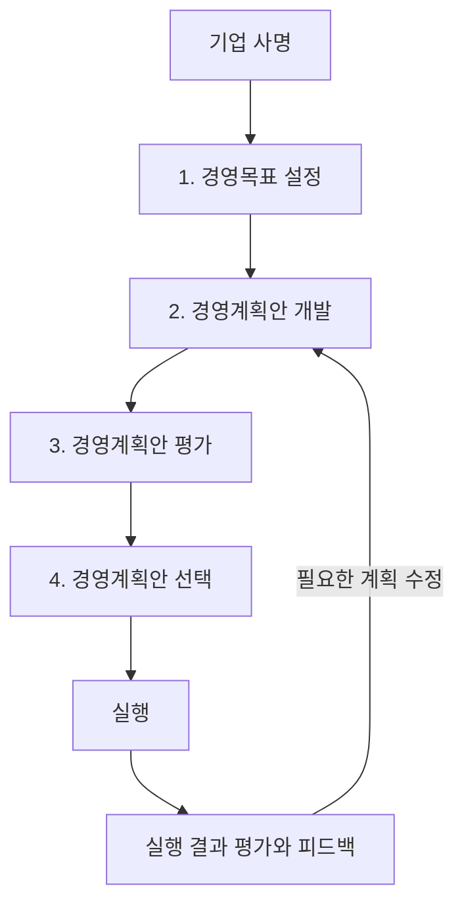

> 조직은 무엇을 달성하려 하며,
> 어떤 방법을 선택하고,
> 환경 변화에 어떻게 대응해야 하는가?

## 1. 전체 내용 먼저 보기
| 학습 주제     | 핵심 내용                            | 기억할 말     |
| --------- | -------------------------------- | --------- |
| 계획활동의 의미  | 목표를 정하고 목표 달성에 가장 좋은 방법을 찾는 활동   | 사전적·미래지향적 |
| 계획의 종류    | 기간에 따라 장기·중기·단기, 성격에 따라 전략·운영·예산 | 분류 기준을 구분 |
| 목표관리(MBO) | 상사와 부하가 목표를 협의하고 성과를 평가          | 참여·통합·평가  |
| 계획수립 4단계  | 목표 설정 → 대안 개발 → 평가 → 선택          | 목·개·평·선   |
| 현대의 계획활동  | 유연한 수정, 장기 자원관리, 최고경영자의 지원       | 방향과 대응 능력 |
| 시나리오 경영   | 여러 미래 상황별로 실행 가능한 대응안을 준비        | 상황별 대응    |

## 2. 계획활동이란?
### 2.1. 경영활동을 보는 두 관점
| 관점    | 나누는 기준        | 구성                 |
| ----- | ------------- | ------------------ |
| 과정 관점 | 경영활동이 진행되는 과정 | 계획 → 조직화 → 지휘 → 통제 |
| 업무 관점 | 업무의 내용과 성격    | 인사·마케팅·생산·재무 등     |

> 인사·마케팅·생산·재무 각각에도 계획·조직화·지휘·통제 과정이 존재한다.
> 예를 들어 인사활동도 채용계획을 세우고, 담당자를 배치하고, 실행을 이끌고, 결과를 평가한다.

### 2.2. 정의와 특징
**계획활동 (Planning)**
- 경영목표를 설정하고,
- 이를 달성하기 위한 가장 좋은 방법을 찾는 **사전적·미래지향적** 경영활동이다.

- 경영활동의 출발점이며 조직화·지휘·통제에 앞선다.
- 문제가 발생하기 전에 미래를 준비하는 성격을 가진다.
- 대기업뿐 아니라 중소기업과 작은 점포에도 필요하다.
- 환경이 변하면 계획을 수정할 수 있어야 한다.

> 계획도 목표를 달성하도록 실행 방법을 유연하게 조정해야 한다.

### 2.3. 계획수립이 중요한 이유
| 이유          | 실제 의미                              |
| ----------- | ---------------------------------- |
| 방향 제시       | 조직이 어디로 가야 하는지, 왜 일하는지 알려준다.       |
| 조정 개선       | 업무의 중복과 충돌을 줄이고 부서 간 활동을 맞춘다.      |
| 통제 개선       | 실제 성과를 계획과 비교하여 차이를 바로잡는 기준을 제공한다. |
| 시간관리        | 필요한 업무와 일정을 미리 배치한다.               |
| 집중성과 신축성 확보 | 핵심 업무에 집중하면서 고객 요구와 변화에 대응한다.      |
| 기회와 위험 파악   | 미래의 기회를 활용하고 위험에 대비한다.             |

**연결해서 기억하기**
- 계획이 있어야 성과를 비교할 기준이 생기므로, 계획과 통제는 밀접하게 연결된다.

## 3. 계획의 종류
### 3.1. 기간에 따른 분류: 장기·중기·단기
| 구분   | 일반적인 기간 | 주된 내용                    | 초점              |
| ---- | ------- | ------------------------ | --------------- |
| **장기계획** | 5년 이상   | 신규사업 진출·기존사업 철수, 사업구조 변화 | 기업의 장기 생존과 성장   |
| **중기계획** | 2~5년    | 생산시설의 확장·축소              | 효과성 증대, 전술적 실행  |
| **단기계획** | 1년 이내   | 기존 시설의 가동률 조정·개선         | 생산능력 활용의 효율성 증대 |

> **기간은 절대 기준이 아니다.**
> 업종, 투자 규모, 사업의 성격과 효과가 나타나는 시간을 함께 고려해야 한다.

#### 업종별 예
| 업종       | 단기   | 중기  | 장기    | 기간이 달라지는 배경         |
| -------- | ---- | --- | ----- | ------------------- |
| 유통회사     | 6개월  | 1년  | 3년    | 고정자산 투자 부담이 비교적 작음  |
| 컴퓨터 제조회사 | 1년   | 3년  | 5년    | 대규모 생산시설 투자 필요      |
| 광산회사     | 2~3년 | 5년  | 7~10년 | 탐사·시공·생산까지 오랜 시간 소요 |

**구분의 요령**
- ‘몇 년인가?’와 함께 ‘사업구조를 바꾸는가, 시설 규모를 바꾸는가, 기존 시설을 더 잘 활용하는가?’를 묻는다.

#### 장기계획의 목적
- 사업구조를 바꾸고 신제품·서비스를 개발하여 기업을 혁신한다.
- 현재 수익과 미래 수익의 균형을 맞춘다.
- 전사적 목표와 전략의 우선순위를 정하고 자원을 배분한다.
- 구성원에게 미래 비전을 제시하여 동기를 부여한다.
- 단기 행동의 지침을 제공하고 기업 전체 목표와 부문 목표를 일치시킨다.

#### 확정계획과 연동계획
| 구분   | 의미                                | 예시                                   |
| ---- | --------------------------------- | ------------------------------------ |
| **확정계획** | 계획의 시작과 종료 시점이 고정됨                | 2020~2024년 계획                        |
| **연동계획** | 일정한 계획기간을 유지하면서 시간 경과에 따라 계획을 갱신함 | 2020~2024년 계획 → 연말에 2021~2025년 계획 수립 |

==장기계획에 연동계획이 필요하다.==
장기 방향을 유지하면서 새 정보를 반영하면 계획의 현실 타당성이 높아진다.

> 2026-10-30

### 3.2. 성격에 따른 분류: 전략·운영·예산
| 구분    | **전략계획**                     | **운영계획**                 | **예산계획**                       |
| ----- | ------------------------ | -------------------- | -------------------------- |
| 핵심 질문 | 어디로 나아갈 것인가?             | 부문별로 어떻게 실행할 것인가?    | 얼마를 배정하고 사용할 것인가?          |
| 범위    | 전사적·종합적·포괄적              | 부문별 세부 업무와 자원배분      | 부문별·항목별 예상금액               |
| 내용    | 사업·제품구조의 혁신과 변혁          | 인력·생산·마케팅·자금·연구개발 등  | 실행에 필요한 자원의 금액화            |
| 성격    | 장기적, 질적·비계량적 판단, 불확실성이 큼 | 전략계획보다 불확실성과 혁신성이 낮음 | 대체로 1년 정도의 단기계획, 계량적 판단 가능 |
| 주도 계층 | 최고경영자                    | 중간경영자, 최고경영자와 협조     | 일선경영자, 중간경영자와 협조           |

**연결 관계**
- 전략계획의 기본방향을 운영계획으로 구체화한다.
- 예산계획으로 필요한 자원을 금액으로 표시한다.

**전술계획**
- 전략계획에 근거한 구체적·중기적 계획으로,
- 중간관리자가 담당하며 내부 환경에 의존하는 성격을 가진다.

> 기간별 분류와 성격별 분류는 기준이 다르다.
> 장기계획과 전략계획은 관련성이 높지만,
> 모든 계획을 기간만으로 전략·운영·예산에 기계적으로 대응시키지는 않는다.

## 4. 목표관리 (MBO)
### 4.1. 의미
**MBO (Management By Objectives)**
- 피터 드러커가 창안한 관리기법이다.
- 상사와 부하가 조직의 공동목표를 협의하여 설정하고, 개인별 역할을 정한 뒤, 목표 달성 성과를 평가한다.

**핵심**
- 조직 목표와 연결된 목표를 함께 정하고,
- 자율적으로 수행하며,
- 합의한 목표를 기준으로 평가하는 것이다.

### 4.2. 세 가지 특징
| 특징            | 의미                     | 축구팀 비유                     |
| ------------- | ---------------------- | -------------------------- |
| 목표설정 참여       | 종업원이 상사와 협의하여 목표를 정함   | 선수의 역할과 능력을 고려해 감독과 목표를 합의 |
| 계층 간 목표 통합    | 기업·부서·개인 목표가 같은 방향을 향함 | 팀의 우승 목표와 선수의 득점·도움 목표를 연결 |
| 목표와 성과의 연계 평가 | 합의한 목표를 기준으로 실제 성과를 평가 | 20골 목표에 22골이면 달성률 110%     |

**주의**
- 참여는 개인이 원하는 목표를 마음대로 정한다는 뜻이 아니다.
- 상사와 협의하고 조직의 공동목표와 연결해야 한다.

#### 경영자 계층별 목표
| 계층    | 설정하는 목표         |
| ----- | --------------- |
| 최고경영자 | 기업 전체의 경영목표     |
| 중간경영자 | 부문의 운영목표        |
| 일선경영자 | 일상 업무와 관련된 직무목표 |

### 4.3. 기대효과
- 목표설정 참여와 자율적 수행을 통한 동기부여 향상
- 조직 목표와 개인 역할의 연결을 통한 기업 성과 향상
- 상하 간 의사소통 개선과 조직 혁신 유도
- 능력개발과 관리의 질 개선
- 성과평가의 기준을 분명히 하여 평가 오류 감소

관련 사례
- 구글의 OKR (Objectives and Key Results)
	- 목표와 이를 확인할 핵심 결과를 설정하는 방식이다.

학습의 중심
- **목표와 결과 지표를 연결하고 구성원의 참여를 이끌어낸다**는 점에 둔다.

## 5. 계획수립의 4단계


### 1단계: 경영목표 설정
**기업의 사명(mission)을 토대로 경영목표(objective)를 설정한다.**

| 개념 | 의미 | 이해용 카페 예시 |
|---|---|---|
| 사명 | 기업이 존재하는 근본적인 목적 | 동네 주민에게 편안한 일상 공간을 제공 |
| 목표 | 사명을 실현하기 위해 달성하려는 결과 | 다음 분기 재방문율을 높임 |
| 계획 | 목표를 달성하기 위한 방법 | 서비스 개선과 단골 프로그램 운영 |

기업 전체 목표를 먼저 설정하고, 이에 연결되는 부문별 목표와 직무목표를 세우는 방식이 적절하다.

```
기업 사명 → 전사 경영목표 → 부문별 운영목표 → 일상 업무의 직무목표
```
- 최고경영자는 기업 전체 목표를 수립한다.
- 중간경영자는 부문별 운영목표를 수립한다.
- 일선경영자는 직무목표를 수립한다.
- 각 부문의 목표는 기업 전체 목표와 연결되어야 한다.

**브랜드 관리 보충 사례**
- 우수한 브랜드는 고객이 원하는 가치의 제공, 변화에 대한 적응, 가치에 맞는 가격과 포지셔닝, 일관된 커뮤니케이션, 브랜드 포트폴리오와 마케팅의 통합관리, 지속적 지원과 모니터링 등 기본에 충실하다.

### 2단계: 경영계획안 개발
목표를 달성할 수 있는 여러 **대안(alternative)**을 만든다.

| 방법 | 방식 | 핵심 주의점 |
|---|---|---|
| 하향식 | 최고경영자의 결정에 의존하여 계획안을 개발 | 의사결정이 위에서 아래로 전달됨 |
| 브레인스토밍 | 참여자가 자발적으로 다양한 아이디어를 제안 | 제안 단계에서 성급하게 비판하지 않음 |
| 벤치마킹 | 우수 기업의 제품·서비스·업무방식을 비교·분석하여 개선안을 개발 | 자사 실정에 맞게 변형·개선 |

#### 브레인스토밍의 3대 규칙
1. **비판금지**: 제안되는 아이디어를 즉시 비판하지 않는다.
2. **자유분방**: 자유롭고 다양한 발상을 허용한다.
3. **질보다 양**: 처음부터 완성도만 따지지 않고 많은 아이디어를 모은다.

종업원부터 최고경영자까지 모든 계층이 참여할 수 있는 상향식 방법이다.
아이디어를 모으는 개발 단계와 대안을 심사하는 평가 단계를 구분하면 이해하기 쉽다.

#### 벤치마킹
벤치마킹
- 우수한 상대와 자사의 성과 차이를 비교하고, 뛰어난 운영방식을 배워 자기혁신을 추구하는 **체계적인 개선활동**이다.

| 절차          | 할 일                  |
| ----------- | -------------------- |
| 1. 범위 결정    | 개선할 목표 범위를 정한다.      |
| 2. 측정범위 결정  | 비교할 측정항목을 정한다.       |
| 3. 비교대상 결정  | 비교·분석할 기업을 정한다.      |
| 4. 벤치마킹 진행  | 제품·서비스·업무방식을 비교한다.   |
| 5. 성과 차이 분석 | 항목별 성과 격차를 분석한다.     |
| 6. 개선계획 수립  | 목표 달성을 위한 개선안을 마련한다. |
| 7. 변화관리     | 변화사항을 비교하고 관리한다.     |

장점
- 우수한 방식을 창조적으로 모방하여 연구개발·시행착오에 드는 시간과 비용을 줄인다.
- 경쟁자가 추구하는 목표와 경쟁력 확보에 필요한 새로운 기준을 파악한다.
- 동종업계뿐 아니라 다른 업종에서도 배울 수 있다.

**사례**
- 스타벅스가 도요타의 린 생산방식을 매장 동선과 음료 제조 과정에 적용하는 사례는 다른 업종의 업무방식도 벤치마킹할 수 있음을 보여준다.

### 3단계: 경영계획안 평가
| 평가 기준   | 핵심 질문                    | 살펴볼 내용                 | 카페 예시                      |
| ------- | ------------------------ | ---------------------- | -------------------------- |
| **현실성** | 실제로 실행할 수 있는가?           | 실현 가능성, 법적 제약 등        | 야외 좌석 설치가 허가되는가?           |
| **충족도** | 목표나 의사결정 상황을 얼마나 만족시키는가? | 목표 달성에 기여하는 정도         | 단골 프로그램이 재방문율 향상에 도움이 되는가? |
| **적합성** | 실행 결과와 영향이 타당한가?         | 소요 비용, 다른 부문에 미치는 영향 등 | 할인 비용과 직원 업무 부담을 감당할 만한가?  |
> 기업의 특성에 따라 평가 기준을 추가하거나 변경할 수 있다.

#### 매몰비용과 기회비용
| 구분       | 의미                           | 의사결정에서의 처리    |
| -------- | ---------------------------- | ------------- |
| **매몰비용** | 이미 지출해 회수할 수 없는 비용           | 향후 대안 선택에서 제외 |
| **기회비용** | 어떤 대안을 선택하여 포기하게 된 다른 대안의 가치 | 대안 평가에 포함     |
과거에 돈을 썼다는 이유만으로 계획을 고집하지 않고,
**앞으로 발생할 비용·가치와 포기하는 대안의 가치**를 비교한다.

### 4단계: 경영계획안 선택
- 주어진 여건에서 가장 유리한 대안을 선택한다.
- 전문가의 견해와 경영자의 경험·직관을 균형 있게 활용한다.
- 부적절한 대안을 하나씩 제거하여 최선의 안을 고를 수 있다.
- **두 안의 결과가 비슷하다면 비용이 적은 안을 채택한다.**
- 선택한 안을 실행한 뒤 결과의 효과를 평가하고 피드백한다.

**평가와 선택의 차이**
- 평가는 대안의 장단점과 타당성을 비교하는 단계이다.
- 선택은 비교 결과에 따라 실행할 안을 결정하는 단계이다.

## 6. 21세기의 계획활동
| 요구사항                  | 이유                            | 실천 방향                   |
| --------------------- | ----------------------------- | ----------------------- |
| 환경 변화에 대응하는 **유연성**   | 외부상황이 빠르고 다양하게 변함             | 계획을 신속하게 수립·수정          |
| 체계적 자원관리를 위한 **장기계획** | 경쟁 위험을 줄이고 미래를 준비해야 함         | 정보·지식을 포함한 자원을 장기적으로 활용 |
| 최고경영자의 직접 **참여와 지원**  | 장기·전략계획에는 최종 의사결정과 자원 지원이 필요함 | 경영진이 참여하고 전 직원과 방향을 공유  |

**장기계획과 유연성은 함께 필요하다.**
장기적으로 갈 방향을 정하되, 환경 변화에 따라 실행 경로와 자원배분을 수정한다.

## 7. 시나리오 경영과 위기관리
### 7.1. 핵심 개념
**패러다임 시프트**(Paradigm Shift)
- 기존의 사고방식이나 기본 틀이 크게 전환되는 것
- 이런 변화는 기업에 기존 계획으로 대응하기 어려운 위기를 만들 수 있다.

**시나리오 경영**
- 경영환경에 영향을 미치는 다양한 변수를 고려하고, 상황별 전략을 준비하여 위험을 줄이는 경영기법
- 출발점은 **미래의 불확실성을 인정하는 것**이다.
- 어떤 상황을 가정할지와 그 상황에서 어떻게 실행할지를 구체화해야 한다.

**시나리오 플래닝**
- 여러 미래 상황과 대응안을 준비하여 시나리오 경영을 뒷받침하는 도구

### 7.2. 상황별 대응 예시
다음은 원자재 수급 사례를 단순화한 것이다.

| 시나리오 | 가정한 상황 | 대응 방향 |
|---|---|---|
| 정상 | 가격과 공급이 안정적 | 기존 조달계획 유지 |
| 주의 | 가격 상승과 공급 불안 조짐 | 대체 공급처와 조달 비중 조정 준비 |
| 위기 | 가격 급등 또는 공급 차질 | 준비한 대체 산지의 조달 비중 확대 |

> 상황을 나열하는 데서 끝나지 않고,
> 대응을 시작할 조건과 실행방안을 마련하여 조직 전체가 유연하게 움직이게 한다.

### 7.3. 연동계획과 시나리오 플래닝의 차이
| 구분  | 연동계획                      | 시나리오 플래닝                  |
| --- | ------------------------- | ------------------------- |
| 핵심  | 시간이 지나면 계획기간을 옮겨 갱신       | 서로 다른 미래 상황별 대응안을 준비      |
| 예시  | 5개년 계획을 매년 새로 수립          | 최선·중립·최악 상황별 전략 마련        |
| 공통점 | 변화에 맞춰 계획의 현실성과 대응 능력을 높임 | 변화에 맞춰 계획의 현실성과 대응 능력을 높임 
