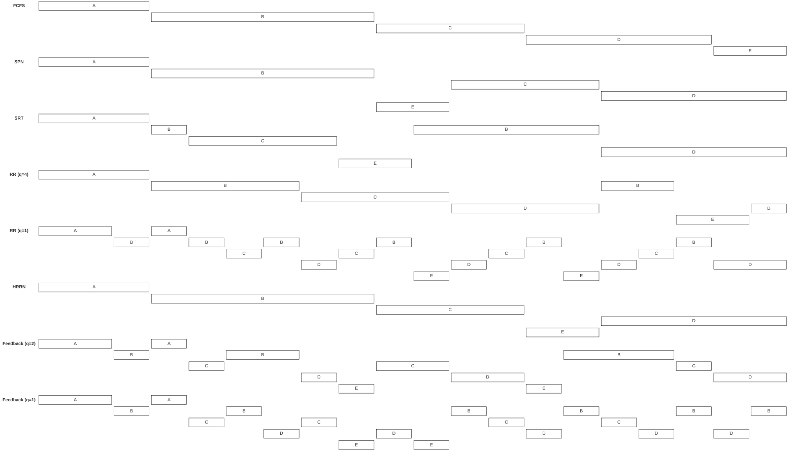

## 1. 처리기 스케줄링의 유형
- **처리기 스케줄링**
	- 시스템의 응답 시간, 처리량, 효율성을 높이기 위해 CPU가 다음에 실행할 프로세스를 선택하는 것
	- 실행 선후 관계에 따라 3가지로 나뉜다.

### 1.1. 장기 스케줄링
> **장기 스케줄링** (Long-term Scheduling; *Job Scheduler*)

- 새 프로세스의 시스템 진입 허용 여부를 결정한다.
- ==멀티프로그래밍의 정도(degree of multiprogramming)를 결정==한다.

- **선택 기준**: FCFS, 우선순위, CPU-burst 길이, I/O-bound 프로세스 우대 등

### 1.2. 중기 스케줄링
> **중기 스케줄링** (Medium-term Scheduling; *Swapper*)

- 스와핑(Swapping) 기능의 일부
- swap-out된 프로세스 중 어느 것을 다시 주 메모리로 swap-in할지 결정한다.

### 1.3. 단기 스케줄링
> **단기 스케줄링** (Short-term Scheduling; *CPU Scheduler*)

- ==디스패처(Dispatcher)==라고도 하며, 가장 자주 실행된다.
- 다음 번에 실행할 프로세스를 세밀한 기준으로 선정한다.

- **실행 시점**: 클럭 인터럽트, 입출력 인터럽트, 시스템 콜, 신호(signal) 발생 시

## 2. 스케줄링 알고리즘
### 2.1. 단기 스케줄링 평가 기준
- **평가 기준**
	- 단기 스케줄러를 평가하는 관점은 크게 두 가지로 나뉜다.
	- 모든 시스템에서 가장 중시해야 할 관점은 **사용자 중심 관점**이다.

|    관점 1    |   관점 2    |               지표                |          설명           |
| :--------: | :-------: | :-----------------------------: | :-------------------: |
| **사용자 중심** | **성능 중심** |   **반환 시간**(Turnaround Time)    |  시스템 진입 후 종료까지의 총 시간  |
|     〃      | **성능 중심** |    **응답 시간**(Response Time)     |    요청 후 첫 응답까지의 시간    |
|     〃      | **성능 중심** |       **완료 기한**(Deadline)       |  기한 내 완료 프로세스 수 최대화   |
|     〃      |  *성능 외적*  |    *예측 가능성*(Predictability)     | 동일 작업은 항상 유사한 시간 내 완료 |
| **시스템 중심** | **성능 중심** |       **처리량**(Throughput)       |   단위 시간당 완료 프로세스 수    |
|     〃      | **성능 중심** |  **처리기 이용률**(CPU Utilization)   |  CPU가 바쁘게 실행된 시간 비율   |
|     〃      |  *성능 외적*  |         *공정성*(Fairness)         |   어떤 프로세스도 기아 상태 방지   |
|     〃      |  *성능 외적*  | *균형 있는 자원*(Balancing Resources) |     시스템 자원 최대한 활용     |

### 2.2. 비교 기준
> 스케줄링 기법을 비교할 때는 다음을 기준으로 한다.

1. **선택 함수** (Selection Function)
	- 다음 실행 프로세스를 준비 큐에서 대기 중인 프로세스 중 하나를 고르는 알고리즘
	- (w: 경과시간, e: 실행시간, s: 총 서비스 시간)

2. **결정 모드** (Decision Mode)
	- 선택 함수가 호출되는 시점이 언제인가?
	
	1. **선점**(Preemptive)
		- 프로세스가 CPU를 잡으면 종료되거나 자발적으로 놓을 때까지 CPU를 빼앗기지 않음
	
	2. **비선점**(Nonpreemptive)
		- 실행 중이더라도 시간 할당량 만료나 더 높은 우선순위 프로세스 등장 시 OS가 강제로 CPU를 빼앗음
		-  (컨텍스트 스위칭 오버헤드 증가하나, 독점 방지에 유리)

### 2.3. 주요 스케줄링 알고리즘
|    구분     |  FCFS  |  SPN   |   SRT    |      RR       |  HRRN   | Feedback |
| :-------: | :----: | :----: | :------: | :-----------: | :-----: | :------: |
| **선택 함수** | max[w] | min[s] | min[s-e] |      상수       | (w+s)/s |  본문 참조   |
| **결정 모드** |  비선점   |  비선점   |    선점    |      선점       |   비선점   |    선점    |
|  **처리량**  | 고려 안함  |   높음   |    높음    | q에 따라 낮을 수 있음 |   높음    |  고려 안함   |
| **기아 상태** |   없음   |   있음   |    있음    |      없음       |   없음    |    있음    |

| 프로세스 | 도착 시간 | 서비스 시간 |
| :--: | :---: | :----: |
|  A   |   0   |   3    |
|  B   |   2   |   6    |
|  C   |   4   |   4    |
|  D   |   6   |   5    |
|  E   |   8   |   2    |

![[Scheduling_Algorithms.png]]

#### (1) FCFS

- **방식**
	- 준비 큐에 먼저 도착한 프로세스를 먼저 실행 (FIFO; First-In-First-Out)

- **특징**
	- **비선점** 방식
	- 긴 프로세스에 유리, I/O 중심 프로세스에 불리
	- 기아 상태 없음

#### (2) SPN (Shortest-Process-Next)

- **방식**
	- 실행 시간이 가장 짧은 프로세스를 먼저 선택

- **특징**
	- **비선점** 방식
	- *FCFS의 단점(편향성)을 보완하여 대기 시간을 줄인다.*
	- 단점: 긴 프로세스가 기아(Starvation) 상태에 빠질 수 있음
	- 총 실행 시간을 미리 알기 어려워 **지수적 평균(Exponential Averaging)** 으로 예측

- *계산 문제 풀이*
	- 강의자료 예제: $\dfrac{(3-0)+(9-2)+(15-4)+(20-6)+(11-8)}{5}$
	- $\text{FCFS}=\dfrac{100+101+102+103+104}{5}=\dfrac{510}{5}$
	- $\text{SPN}=\dfrac{1+2+3+4+104}{5}=\dfrac{114}{5}$
	- ==정규화된 반환 시간==: (머문 시간/실행 시간) $Tr/Ts = 1/(1-ρ)$

- ==SPN의 간트 차트 및 NTT로 출제==

#### (3) SRT (Shortest-Remaining-Time)
- **방식**
	- SPN의 **선점** 버전
	- 남아있는 실행 시간이 가장 짧은 프로세스 선택

- **특징**
	- 새 프로세스의 잔여 시간 < 현재 실행 중인 프로세스의 잔여 시간이면 **즉시 선점**
	- 단점: 매 스케줄링마다 잔여 시간을 평가하는 오버헤드, 긴 프로세스의 기아 가능성

#### (4) RR (Round-Robin)

- **방식**
	- 시간 할당량(Time Quantum, $q$)만큼 실행 후 강제로 선점
	- 클럭 인터럽트를 이용해 시간 측정
	- **$q$가 너무 작으면** → 문맥교환 오버헤드 증가
	- **$q$가 너무 크면** → FCFS와 유사해짐

- **특징**
	- *선점 방식*
	- 처리기 중심 프로세스를 입출력 중심 프로세스보다 우대하는 경향
    - 해결책: **VRR (가상 라운드 로빈)** — I/O 완료 프로세스를 별도 보조 큐에서 우선 처리

#### (5) HRRN (Highest-Response-Ratio-Next)
- **방식**
	- 응답 비율 $R$이 가장 큰 프로세스를 선택
	- ==공식==: $R = (w + s) / s$ ($w$: 대기시간, $s$: 예상 서비스 시간)

- **특징**
	- **비선점** 방식
	- ==짧은 프로세스 우대 + 오래 기다린 긴 프로세스도 $R$값이 커져 기아 상태 방지==

#### (6) Feedback 스케줄링
- **방식**
	- 프로세스의 서비스 시간을 미리 알 필요 없음
	- 실행될 때마다 한 단계 낮은 우선순위 큐로 강등

- **특징**
	- 새 프로세스, 짧은 프로세스일수록 우대 *(선점 방식)*
	- Multilevel Feedback Queue 구조 (*다단계 큐*; RQ0 ~ RQn-1: FCFS, RQn: 라운드 로빈)
	- 변형: 큐마다 시간 할당량을 다르게 설정 ($q = 2^i$)

## 3. 성능 비교 방법
1. **큐잉 분석** (Queuing Analysis)
	- 정규화된 반환 시간: (머문 시간/실행 시간) $Tr/Ts = 1/(1-ρ)$
	- 이 지표가 각 프로세스의 반환시간 영향을 반영하는데 적합하다.
	- 짧은 작업 우대 및 선점 스케줄링이 $Tr/Ts$ 개선에 효과적

2. **시뮬레이션 모델링**
	- 시뮬레이션 결과: **SRT**가 짧은 프로세스에 가장 유리, **FCFS**가 긴 프로세스에 가장 유리
	
	- 대체로 **짧은 작업을 우대하는 선점형 기법**(SRT, RR 등)이 평균 턴어라운드 시간을 개선한다.
	- 하지만 짧은 작업을 우대하면 필연적으로 긴 프로세스의 대기 시간이 증가한다.

- ==차트 해석 문제 나오는데 그대로 읽으면 돼서 쉬움==

## 4. Fair-Share 스케줄링
- **배경**
	- 개별 프로세스가 아닌 ==프로세스 집합(그룹) 단위로 시스템 자원을 공정하게 분배==하려는 스케줄링
	- (한 사용자가 많은 프로세스를 생성한다고 해서 CPU를 독점하지 못하게 함)

- **동작 방식**
	- 각 사용자(그룹)에게 가중치 부여 → 자원 사용 지분을 가중치 비율에 맞게 통제

- **스케줄링 기준**
	- **복합 우선순위** = 프로세스 우선순위 + 최근 CPU 사용 시간 + 그룹의 최근 CPU 소비 시간
	- 설정된 가중치를 유지하도록 CPU를 할당한다.
