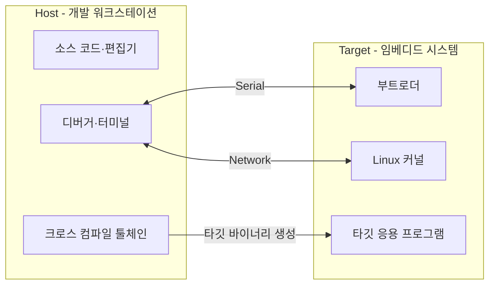

## 요약
**호스트**
- 타깃용 소프트웨어를 개발한다.
	- Crosstool-NG **크로스 컴파일 툴체인**
	- QEMU 하드웨어 에뮬레이션, 유저 모드 에뮬레이션

**타깃**
- 만들어진 프로그램을 실행한다.

## 1. 전체 흐름
학습 후 다음 질문에 답할 수 있으면 된다.
- 임베디드 개발에서 크로스 컴파일이 필요한 이유는 무엇인가?
- 툴체인의 구성 요소는 각각 어떤 일을 하는가?
- ABI와 부동소수점 설정은 왜 맞아야 하는가?
- Crosstool-ng로 툴체인을 만드는 절차는 무엇인가?
- QEMU에서 타깃 프로그램을 실행할 때 sysroot가 왜 필요한가?

**전체 흐름**
```
호스트에서 소스 코드 작성
        ↓
타깃용 크로스 컴파일 툴체인으로 빌드
        ↓
타깃용 실행 파일 생성
        ↓
타깃에서 실행 / QEMU에서 실행 확인
```

**핵심 문장**
- 프로그램을 만드는 컴퓨터와 그 프로그램을 실행할 시스템이 다를 수 있다.

## 2. 호스트와 타깃 이해하기


| 구분   | 호스트 (Host)        | 타깃 (Target)               |
| ---- | ----------------- | ------------------------- |
| 의미   | 개발 작업을 수행하는 시스템   | 개발 중인 임베디드 시스템            |
| 예    | 고성능 PC, 개발 워크스테이션 | 임베디드 보드                   |
| 주 역할 | 소스 작성, 툴체인 실행, 빌드 | 만들어진 프로그램 실행              |
| 자원   | 상대적으로 풍부함         | 메모리·저장 공간·처리 성능이 제한될 수 있음 |

강의에서는 개발 환경으로 **Ubuntu**를 소개한다.
Ubuntu는 Debian에서 파생된 Linux 배포판이다.

호스트와 타깃은 직렬 통신이나 네트워크로 연결할 수 있다.
직렬 통신 프로그램은 다음과 같이 소개된다.
- Windows: HyperTerminal, Tera Term
- Linux: Minicom, Picocom, Gtkterm, PuTTY, screen, tmux, tio

> **학습 보충**
> 위 목록에는 터미널·세션 관리 도구도 포함되어 있다.
> 도구마다 직렬 포트 접속 기능과 용도가 같지는 않으므로, ‘모두 동일한 직렬 통신 프로그램’으로 외우지는 않는다.

## 3. 크로스 컴파일이 필요한 이유
### 3.1. 네이티브 컴파일과 크로스 컴파일
| 구분        | 네이티브 컴파일        | 크로스 컴파일                   |
| --------- | --------------- | ------------------------- |
| 생성 코드     | 개발 시스템에서 실행할 코드 | 다른 실행 환경을 위한 코드           |
| 자료의 명령어 예 | `gcc`           | `arm-linux-gnueabihf-gcc` |

==크로스 컴파일을 사용하는 이유== #3-2/임베디드시스템/출제
1. 타깃의 메모리와 저장 공간이 제한적이다.
2. 타깃에서 빌드하면 개발 시스템보다 느리다.
3. 모든 개발 도구를 타깃에 설치할 필요가 없다.

따라서 빌드는 자원이 풍부한 호스트에서 하고, 결과물은 타깃에서 실행하는 방식을 사용한다.

### 3.2. 툴체인 접두사
**툴체인 접두사**
- 어떤 환경을 대상으로 하는지 드러난다.
- ==아키텍처 - 벤더 - 운영체제 - ABI/C 라이브러리 관련 식별자== #3-2/임베디드시스템/출제

1. **아키텍처**
	- 대상 CPU 구조
	- 예: `arm`, `riscv`, `mips64el`

2. **벤더**
	- **선택적**으로 들어가는 이름
	- 예: `vendor`, 실습의 `training`

3. **운영체제**
	- 대상 OS, 또는 OS를 특정하지 않음
	- 예: `linux`, `none`

4. **ABI/C 라이브러리**
	- 바이너리 인터페이스 및 라이브러리 관련 정보
	- 예: `gnueabihf`, 실습의 `musleabihf`

**학습 보충**
- 이름의 필드 수와 표기는 툴체인에 따라 달라진다.
- 항상 하이픈으로 나뉜 네 항목이 있어야 하는 것은 아니다.
- `arm-linux-gnueabihf`에는 명시적인 벤더 필드가 없다.

## 4. 크로스 컴파일 툴체인의 구성
**크로스 컴파일 툴체인**
- 컴파일러 하나가 아니라, **컴파일·링크·라이브러리 사용·바이너리 분석에 필요한 도구들의 묶음**이다.
1. **Binutils**: 바이너리를 생성하고 다루는 도구 모음(어셈블러, 링커, 분석 도구)
2. **커널 헤더**: 운영체제 커널과 통신하기 위한 규칙
3. **GCC**: C/C++ 등의 소스 코드를 대상 CPU용 기계어로 바꿔주는 컴파일러 모음
4. **C 라이브러리**: C 프로그래밍에 필요한 가장 기본적인 표준 함수 모음

### 4.1. Binutils
> ==Binutils 도구 이름== #3-2/임베디드시스템/출제

| 도구        | 역할                 | 기억할 점               |
| --------- | ------------------ | ------------------- |
| `as`      | 어셈블리 소스에서 이진 코드 생성 | 어셈블러                |
| `ld`      | 오브젝트 파일 등을 연결      | 링커                  |
| ==ar==    | `.a` 아카이브 생성·관리    | 정적 라이브러리            |
| `ranlib`  | 아카이브의 심볼 인덱스 생성    | `ar`와 함께 기억         |
| `objdump` | 오브젝트·실행 파일 정보 분석   | 디스어셈블 등에 활용         |
| `readelf` | ELF 파일 정보 확인       | 실행 파일 구조 분석         |
| `size`    | 바이너리 영역의 크기 확인     | 코드·데이터 크기 분석        |
| `nm`      | 심볼 확인              | 함수·변수 이름 분석         |
| `strings` | 바이너리의 문자열 확인       | 문자열 단서 찾기           |
| `objcopy` | 바이너리 복사·변환·가공      | 형식·섹션 가공            |
| ==strip== | 심볼·디버깅 정보 등을 제거    | 파일 크기 감소, 디버깅 정보 손실 |

### 4.2. 커널 헤더
**커널 헤더**
- 응용 프로그램과 C 라이브러리가 **커널과 상호작용할 때 필요한 정의**를 제공한다.
- 주요 내용: 시스템 콜과 번호, 상수 정의, 자료구조 정의
- ==C 라이브러리를 빌드할 때 필요==하며, 많은 응용 프로그램도 이를 사용한다. #3-2/임베디드시스템/출제

`<linux/...>`, `<asm/...>` 등을 소개한다.

커널 소스에서 헤더를 추출하는 Makefile 타깃:
```sh
make headers_install
```

**학습 보충**
- 헤더는 빌드에 사용하는 인터페이스 정의다.
- 실행 중인 커널 자체와 구분해야 한다.

### 4.3. GCC
**GCC (GNU Compiler Collection)**
- 여러 프로그래밍 언어를 지원하는 컴파일러 모음이다.
- x86, ARM, RISC-V 등 다양한 CPU 구조용 코드를 만들 수 있다.
- 강의에서는 C/C++를 중심으로 툴체인을 구성한다.
- GCC와 GNU Binutils는 GPL 라이선스 소프트웨어로 소개된다.

> 언어 지원 목록은 GCC 버전에 따라 달라질 수 있다.
> 핵심은 ‘다양한 언어와 대상 아키텍처를 지원하는 컴파일러 모음’이라는 점이다.

### 4.4. C 표준 라이브러리
**C 표준 라이브러리**
- 응용 프로그램에 익숙한 C API를 제공한다.
- Linux 환경에서 응용 프로그램과 커널 사이의 인터페이스 역할을 한다.

```
응용 프로그램
      ↓
C 라이브러리
      ↓
커널
```

**학습 보충**
- 위 그림은 역할을 단순화한 것이다.
- 모든 C 라이브러리 함수가 커널을 호출하는 것은 아니다.
- 커널 헤더는 이 관계에서 사용하는 정의이며 실행 계층이 아니다.

| 라이브러리     | 강의의 설명                                                 |
| --------- | ------------------------------------------------------ |
| **glibc**     | 표준적인 솔루션                                               |
| **uClibc-ng** | 임베디드 시스템용 경량 C 라이브러리                                   |
| **musl**      | 빠르고 단순한 C 라이브러리. Buildroot·Yocto 지원, Alpine Linux에서 사용 |
| **klibc**     | C 라이브러리 종류로 소개                                         |
| **newlib**    | C 라이브러리 종류로 소개                                         |

## 5. ABI와 부동소수점 설정
### 5.1. ABI란?
> API가 소스 코드에서 사용하는 함수·인터페이스라면, ABI는 컴파일된 코드 사이의 약속이다.
> CPU 아키텍처가 같아도 ABI가 맞지 않으면 함께 사용할 수 없는 경우가 있다.

**ABI (Application Binary Interface)**
- 바이너리 수준에서 코드가 서로 연결되고 호출되는 규칙이다.
	- **함수 인자**를 어떻게 **전달**하는가?
	- **반환값**을 어떻게 **전달**하는가?
	- **시스템 콜**을 어떻게 **수행**하는가?
	- **구조체**를 어떻게 **배치**하고 **정렬**하는가?

### 5.2. ARM의 EABI와 EABIhf
| 구분         | 학습 포인트                                        |
| ---------- | --------------------------------------------- |
| **EABI**   | **ARM**의 바이너리 인터페이스 규약                        |
| **EABIhf** | 부동소수점 인자를 부동소수점 레지스터로 전달하는 **hard-float** ABI |

**EABIhf 사용에는 FPU가 필요하다.**
- **FPU (Floating-Point Unit)**: 부동소수점 연산 장치

RISC-V ABI 이름으로는 `ilp32`, `ilp32f`, `ilp32d`, `lp64`, `lp64f`, `lp64d`가 소개된다.

### 5.3. 부동소수점 연산 방법
방식 1. 하드웨어 부동소수점 명령 사용 (**Hard Float**)
- FPU를 사용하는 코드 생성

방식 2. FPU 없이 해당 명령을 에뮬레이션 (**커널 트랩 에뮬레이션**)
- 커널이 명령을 에뮬레이션하는 방식이며 매우 느림

방식 3. 소프트웨어 부동소수점 연산 (**Soft Float**)
- 부동소수점 명령 대신 사용자 공간 라이브러리 호출

ARM FPU의 예로 `VFPv3`, `VFPv3-D16`, `VFPv4`, `VFPv4-D16`이 나온다.
RISC-V에서는 `F` 확장을 부동소수점 지원과 연결해 설명한다.

> ‘연산에 어떤 명령을 쓰는가’와 ‘함수 인자를 어떤 레지스터로 전달하는가’는 구분해서 이해한다.
> 실제 설정에서는 대상 CPU의 FPU 지원, 코드 생성 옵션, ABI, 라이브러리의 호환성을 함께 확인해야 한다.
> 강의의 FPU 탑재 여부나 커널 에뮬레이션 설명을 모든 CPU·OS 환경에 일반화하지 않는다.

> 2026-09-15

## 6. 툴체인을 준비하는 방법
| 방법            | 장점                         | 부담 또는 제약            |
| ------------- | -------------------------- | ------------------- |
| 수동 구축         | 구성 요소를 직접 제어               | 의존성과 빌드 순서가 복잡함     |
| 미리 빌드된 툴체인 사용 | 가장 간단하고 편리함                | 요구에 맞는 세밀한 조정에 한계   |
| 구축 유틸리티 사용    | 설정에 따라 구성 요소의 다운로드·빌드를 자동화 | 도구 설정과 빌드 과정의 이해 필요 |

### 6.1. 수동 구축 순서
```
1. Binutils/GCC 의존성 빌드
   GMP, MPFR, ISL 등
        ↓
2. Binutils 빌드
        ↓
3. 첫 단계 GCC 빌드
        ↓
4. Linux 커널 헤더 추출
        ↓
5. 첫 단계 GCC로 C 라이브러리 빌드
        ↓
6. Linux와 C 라이브러리를 지원하는 최종 GCC 빌드
```

**왜 GCC를 단계적으로 만드는가?**

학습 보충
- C 라이브러리를 만들려면 컴파일러가 필요하고, 완성된 컴파일러 환경에는 C 라이브러리가 필요하다.
- 먼저 최소한의 컴파일러를 만들고, 라이브러리를 준비한 뒤 최종 컴파일러를 만드는 방식으로 의존성을 해결한다.

### 6.2. 미리 빌드된 툴체인
배포처
- Ubuntu·Fedora의 패키지
- Bootlin
- ARM

### 6.3. 툴체인 구축 유틸리티
| 도구                               | 강의 자료 기준 특징                                                          |
| -------------------------------- | -------------------------------------------------------------------- |
| **Crosstool-ng**                 | 여러 아키텍처와 glibc·uClibc·musl,<br>hard/soft float 지원                    |
| **Buildroot**                    | Makefile 기반. glibc·uClibc·musl 지원.<br>자료에서 SDK 생성 명령으로 `make sdk` 소개 |
| **PTXdist**                      | Makefile 기반. Pengutronix가 주로 관리<br>자료의 2023.01 기준 glibc·uClibc 지원    |
| **OpenEmbedded / Yocto Project** | 기능이 다양하지만 빌드 시스템이 복잡함<br>glibc·musl 지원으로 소개                          |

## 7. Crosstool-ng 실습 순서
> 아래는 강의 실습 재현을 위한 정리다.
> 다른 운영체제·버전에서는 패키지 이름, 설정 메뉴와 제공 버전이 다를 수 있다.

### 7.1. 필요한 패키지 설치
```sh
sudo apt update

sudo apt install \
	autoconf \
	bison \
	build-essential \
	flex \
	gawk \
	gettext \
	git \
	help2man \
	libncurses5-dev \
	libtool-bin \
	python3 \
	rsync \
	texinfo \
	unzip
```

### 7.2. 소스 내려받기와 버전 선택
```sh
cd ~
git clone https://github.com/crosstool-ng/crosstool-ng
cd crosstool-ng
git checkout crosstool-ng-1.28.0
```

### 7.3. Crosstool-ng 도구 자체 빌드
```sh
# configure 스크립트 생성
./bootstrap

# 소스 디렉토리에서 사용할 수 있도록 구성
./configure --enable-local

# ct-ng 실행 파일 생성
make
```

**구분**
- 여기서 `make`로 만드는 것은 툴체인 구축 도구인 `ct-ng`다.
- Target용 툴체인은 뒤의 `./ct-ng build`에서 만든다.

### 7.4. 설정 확인과 수정
```sh
./ct-ng help

./ct-ng list-samples

./ct-ng menuconfig
```

- 설정 시스템은 Linux 커널과 유사한 **Kconfig 기반**이다.
- 설정 결과는 **`.config`** 파일에 저장된다.
- `./ct-ng nconfig`도 설정 편집에 사용할 수 있다.
- `./ct-ng <sample-name>`으로 샘플을 불러오면 기존 `.config`가 대체된다.

자료에 나온 샘플 명령:
```sh
./ct-ng aarch64-unknown-linux-gnu
```

> 이 명령은 샘플 사용법의 예다.
> 다음 표의 실습은 ARM 및 VFPv3 설정이므로, `aarch64` 샘플을 그대로 같은 설정이라고 생각하면 안 된다.

### 7.5. 강의의 실습 설정값
| 메뉴                    | 설정                                          |
| --------------------- | ------------------------------------------- |
| Path and misc options | 필요하면 실험 기능 허용                               |
| Target options        | Target Architecture: `arm`                  |
| Target options        | Use specific FPU (`ARCH_FPU`): `vfpv3`      |
| Target options        | Floating point: hardware (FPU)              |
| Toolchain options     | Vendor string (`TARGET_VENDOR`): `training` |
| Toolchain options     | Alias (`TARGET_ALIAS`): `arm-linux`         |
| Operating System      | Target OS: `linux`                          |
| Operating System      | 자료의 표현대로 6.6보다 이전이면서 가장 가까운 Linux 버전        |
| C-library             | `musl` (`LIBC_MUSL`), 제안되는 기본 버전 유지         |
| C compiler            | GCC `14.3.0`                                |
| C compiler            | C++ (`CC_LANG_CXX`) 활성화                     |
| Debug facilities      | 모든 옵션 해제                                    |

Alias를 `arm-linux`로 지정하면 짧은 이름인 **`arm-linux-gcc`**로 컴파일러를 사용할 수 있다.

### 7.6. 툴체인 빌드
```sh
# 의존성을 자동으로 내려받고 툴체인 구성 요소를 빌드한다.
./ct-ng build
```
```
[INFO ] Build completed at 20260915.015146
[INFO ] (elapsed: 12:50.53)
```

> 2026-09-17

## 8. 설치 경로와 sysroot
설치 위치는 기본적으로 `$HOME/x-tools/` 아래다.
실습 결과의 경로는 다음과 같다.
```
$HOME/x-tools/arm-training-linux-musleabihf/
├── bin/                                      # 크로스 컴파일 도구
└── arm-training-linux-musleabihf/
    └── sysroot/
        ├── lib/                             # 타깃용 라이브러리
        └── usr/include/                     # C 라이브러리·커널 헤더
```

### 8.1. PATH와 sysroot 구분하기
`PATH`
- 셸이 `arm-linux-gcc` 같은 실행 명령을 찾을 위치
```sh
# PATH 설정
export PATH="$HOME/x-tools/arm-training-linux-musleabihf/bin:$PATH"
```
또는:
```sh
echo 'export PATH="$HOME/x-tools/arm-training-linux-musleabihf/bin:$PATH"' >> ~/.bashrc
```

`sysroot`
- 타깃 환경의 헤더·라이브러리 등이 들어 있는 루트 디렉토리
- `lib/`: 타깃용 C 라이브러리, GCC runtime, C++ 표준 라이브러리
- `usr/include/`: C 라이브러리 헤더, 커널 헤더

**핵심**: Host의 라이브러리와 Target용 라이브러리를 구분해야 한다.

## 9. 툴체인 검증과 QEMU 오류 해결
**QEMU** (Quick EMUlator)
- 하드웨어 에뮬레이션, 유저 모드 에뮬레이션 (==타깃 프로그램 실행==) #3-2/임베디드시스템/출제

### 9.1. 실행 파일 만들기
```sh
cd ~

cat << 'EOF' > hello.c
#include <stdio.h>

int main(void) {
    printf("Hello world!\n");
    return 0;
}
EOF
```

컴파일:
- `arm-linux-gcc`: 실습에서 지정한 컴파일러 alias
- `-o hello`: 출력 파일 이름 지정
```sh
arm-linux-gcc -o hello hello.c
```

파일 확인:
- `file hello`: 생성 파일의 형식과 대상 아키텍처 등 확인
```sh
file hello
```

### 9.2. QEMU로 실행
```sh
sudo apt install qemu-user
```

```sh
qemu-arm hello
```
오류 예:
```
qemu-arm: Could not open '/lib/ld-musl-armhf.so.1': No such file or directory
```

### 9.3. 오류 원인
**학습 보충**
- 이 예제의 실행 파일은 타깃용 동적 로더를 필요로 한다.
- `ld-musl-armhf.so.1`은 ARM hard-float musl 환경의 동적 로더다.
- QEMU가 이를 찾지 못했기 때문에 실행이 실패한다.

컴파일 성공은 실행에 필요한 타깃 라이브러리 환경까지 준비되었다는 뜻은 아니다.

### 9.4. sysroot를 지정해서 해결
먼저 로더 위치를 찾는다.
```sh
find ~/x-tools -name ld-musl-armhf.so.1
```
```
/home/c2kp/x-tools/arm-training-linux-musleabihf/
arm-training-linux-musleabihf/sysroot/lib/ld-musl-armhf.so.1
```

이후 해당 로더가 들어 있는 sysroot를 지정한다.
PDF에서 줄바꿈된 경로를 한 줄로 정리하면 다음과 같다.
```sh
qemu-arm \
	-L "$HOME/x-tools/arm-training-linux-musleabihf/arm-training-linux-musleabihf/sysroot" \
	hello
```

자료의 실행 결과:
```
Hello world!
```

**학습 보충**
- 이 예제에서 `-L`은 타깃 동적 로더·라이브러리를 찾을 경로의 기준을 제공한다.
- 경로에는 로더 파일 자체가 아니라 **sysroot 디렉토리**를 지정한다.
- 실제로 생성된 툴체인 이름이 다르면 경로도 바꿔야 한다.

```
컴파일러 찾기       → PATH 확인
ARM 실행 파일 확인 → file hello
동적 로더 찾기      → find ~/x-tools -name ld-musl-armhf.so.1
실행 환경 지정     → qemu-arm -L <sysroot> hello
```

### cf.
```sh
alias qemu-arm-target='qemu-arm -L ~/x-tools/arm-training-linux-musleabihf/arm-training-linux-musleabihf/sysroot'
```
