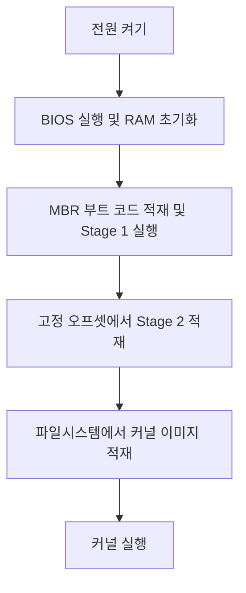
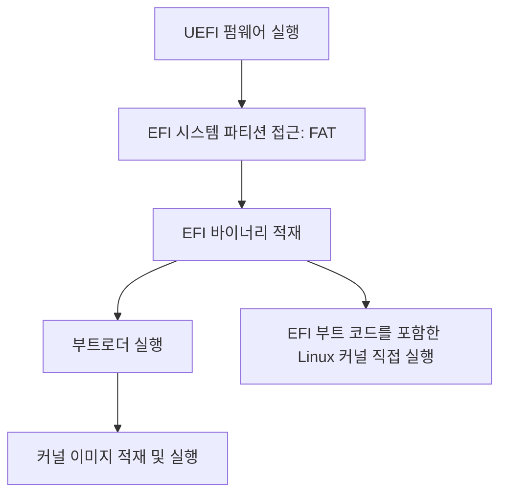
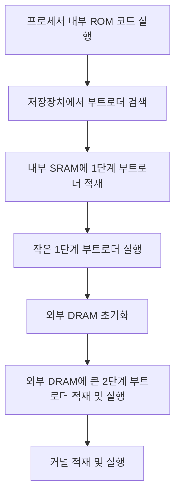

## 1. 부트로더의 역할
**부트로더**
- 프로세서에서 최초로 실행되는 코드
- BIOS·UEFI 펌웨어 또는 프로세서의 ROM 코드가 먼저 동작하고, 이어 부트로더를 적재한다. 따라서 실제 부팅 순서는 플랫폼별 구조와 함께 이해한다.

| 역할        | 설명                                  |
| --------- | ----------------------------------- |
| 하드웨어 초기화  | 실행에 필요한 기본 하드웨어 상태 준비               |
| 커널 적재     | 플래시 저장장치 또는 네트워크에서 운영체제 커널을 메모리로 읽기 |
| 압축 해제     | 압축된 응용 바이너리 해제                      |
| 실행 제어     | 적재한 응용 또는 운영체제 실행                   |
| 운영체제 선택   | 부팅할 운영체제를 선택하는 메뉴 제공                |
| 셸과 명령어 제공 | 데이터 적재, 메모리 검사, 테스트 수행              |

## 2. 플랫폼별 부팅 구조
| 구분         | 기존 x86 BIOS               | UEFI                    | 임베디드                       |
| ---------- | ------------------------- | ----------------------- | -------------------------- |
| 초기 실행 주체   | BIOS                      | UEFI 펌웨어                | 프로세서 ROM 코드                |
| 부트로더 탐색 기준 | 저장장치 첫 섹터의 MBR 부트 코드      | ESP의 EFI 바이너리           | 정해진 저장 위치와 포맷              |
| 주요 제약      | MBR 부트 코드 크기              | EFI 실행 형식과 ESP 구조       | 내부 SRAM 용량, 외부 DRAM 미초기화   |
| 단계 분리 이유   | 작은 Stage 1에서 큰 Stage 2 적재 | MBR식 단계 분리를 요구하지 않음     | SRAM에서 시작해 DRAM으로 실행 공간 확대 |
| 커널로 진행     | Stage 2가 파일시스템에서 커널 적재    | 부트로더 경유 또는 EFI 커널 직접 적재 | 외부 DRAM 초기화 후 2단계 부트로더가 진행 |

### 2.1. 이전 x86 BIOS 부팅
**BIOS** (Basic Input Output System)
- 2005~2006년 이전의 기존 x86 부팅 구조

- 하드웨어 플랫폼에 포함된 펌웨어로, **플래시 메모리**에 저장된다. 일반적인 사용자 저장장치와는 다른 위치에 있다.
- 소스가 공개되지 않아 수정이 어렵다.
- 부팅 과정을 구현하고 호출 가능한 런타임 서비스도 제공한다.
- BIOS가 **RAM 초기화**를 담당한다.

**MBR (Master Boot Record)**
- 저장장치의 첫 번째 섹터이다.
- 파티션 테이블과 최대 446바이트의 부트로더 코드를 포함한다.
- 부트로더 코드는 RAM으로 적재된다.

| 단계      | 특징                                                                                                       |
| ------- | -------------------------------------------------------------------------------------------------------- |
| Stage 1 | MBR에 포함되는 작은 코드                                                                                          |
| Stage 2 | Stage 1이 적재하는 더 큰 코드 파일시스템을 지원하고 커널 이미지를 읽는다. 파일시스템과 별도의 고정 오프셋에 저장하여, Stage 1이 쉽게 찾고 적재할 수 있게 한다. |

**두 단계로 나누는 이유**
- MBR에 들어갈 수 있는 코드 크기가 작으므로, 파일시스템 처리와 커널 적재 기능을 더 큰 Stage 2가 담당한다.

| 저장장치 레이아웃         | 내용                                       |
| ----------------- | ---------------------------------------- |
| Sector 0 (MBR)    | Bootloader stage 1 (446 bytes) + 파티션 테이블 |
| 예약 영역             | Bootloader stage 2 (~ 수백 KB)             |
| Regular partition | Linux 파일시스템 (커널 + 루트 파일시스템)              |
| Regular partition | 기타 데이터                                   |

### 2.2. UEFI 부팅
**UEFI** (Unified Extensible Firmware Interface)
- 2005~2006년부터 시작된 x86용 펌웨어 인터페이스
- 운영체제와 펌웨어 사이의 인터페이스를 정의한다.

- 펌웨어가 부팅과 운영체제용 런타임 서비스를 제공한다.
- 펌웨어 자체는 플래시 메모리에 저장된다.

- **EFI 시스템 파티션(ESP)**에서 EFI 바이너리를 적재한다.
- EFI 바이너리는 보통 부트로더이며, EFI 부트 코드를 포함한 Linux 커널을 직접 적재할 수도 있다.

| ESP 항목 | 강의 내용 |
|---|---|
| 파일시스템 | FAT |
| MBR에서 식별 | 파티션 타입 `0xEF` |
| GPT에서 식별 | 특수한 GUID(Globally Unique Identifier) |
| EFI 파일 경로 예시 | `/efi/boot/bootx32.efi`, `/efi/boot/bootx64.efi` |

### 2.3. 임베디드 플랫폼 부팅
대부분의 임베디드 프로세서에는 프로세서 벤더가 작성한 **ROM 코드**가 내장되어 있다.
- 부팅의 초기 단계를 담당한다.
- 프로세서 내부에 구축되어, 변경하거나 업데이트할 수 없다.
- 동작은 프로세서 데이터시트에 설명된다.
- NAND/NOR 플래시, USB, SD 카드, eMMC 등에서 부트로더를 찾고 적재한다.
- 부트로더의 위치와 포맷은 정해져 있다.
- 외부 RAM이 초기화되지 않은 상태에서도 실행할 수 있다.

부트로더를 먼저 **내부 SRAM**에 적재하지만, SRAM 용량이 제한되므로 부팅을 두 단계로 나눈다.
- 1단계는 제한된 SRAM에서 실행하며 외부 DRAM을 준비한다.
- 2단계는 초기화된 DRAM에서 더 많은 기능을 수행한다.

