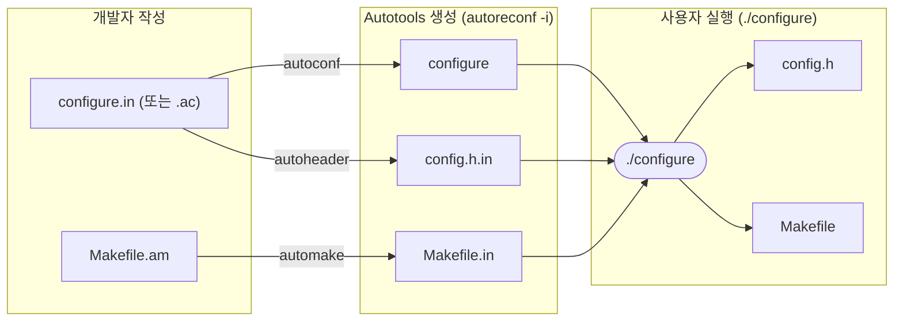
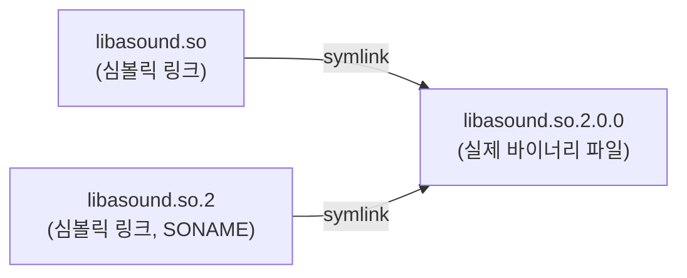

## 1. 빌드 시스템과 작업 공간의 이해
### 1.1. 빌드 시스템의 역할
소스 코드를 실행 가능한 응용 프로그램이나 라이브러리로 변환하는 도구이다.

- **의존성 검사**: 시스템 요구사항 및 필요한 외부 라이브러리가 충족되는지 확인한다.
- **컴파일 및 생성**: 모든 소스 파일을 컴파일하여 실행 파일, 라이브러리, 문서 등을 생성한다.
- **설치**: 빌드된 결과물을 지정된 위치에 복사(설치)한다.
- **종류**
	- 범용 C/C++ 빌드 시스템: `Makefile`, `Autotools`, `CMake`, `Meson`
	- 언어별 전용 빌드 시스템: Python, Perl, Go, Rust, NodeJS 등

### 1.2. 스테이징 공간 vs. 타겟 공간
임베디드 크로스 컴파일 환경에서는 루트 파일시스템의 복사본을 **두 개**로 나누어 관리한다.


| 구분          | 스테이징 공간 (Staging / Build Space)                       | 타겟 공간 (Target Space)                               |
| :---------- | :---------------------------------------------------- | :------------------------------------------------- |
| **목적**      | 다른 라이브러리나 응용 프로그램을 **컴파일(빌드)**하기 위함                   | 실제 임베디드 하드웨어에서 **실행(Runtime)**하기 위함                |
| **포함 파일**   | 패키지의 **모든 파일** (헤더 파일, 정적/공유 라이브러리, 문서, 매뉴얼, 실행 파일 등) | 실행에 **필수적인 파일만** 선별 (실행 파일, 공유 라이브러리, 런타임 설정 파일 등) |
| **디버깅 심볼**  | 유지함 (`strip` 하지 않음)                                   | 제거함 (`strip` 수행하여 용량 최소화)                          |
| **용량 및 위치** | 용량이 큼 / 호스트(개발 PC)에만 존재                               | 용량이 작음 / 타겟 보드에 탑재 (또는 NFS 마운트)                    |

### 1.3. 설치 경로의 두 축: `prefix` vs `DESTDIR`
크로스 컴파일 후 `install` 단계에서 가장 혼동하기 쉬운 두 개념이다.

**`prefix` (실행 위치)**
- 소프트웨어가 **타겟 보드에서 실행될 때** 위치할 경로이다. (예: `--prefix=/usr`)
- 프로그램 내부에서 설정 파일이나 라이브러리를 찾을 때 이 경로를 기준으로 삼는다.

**`DESTDIR` (설치 목적지)**
- 빌드 시스템이 컴파일된 파일을 **개발 호스트 PC의 어느 폴더에 복사할지** 지정한다. (예: `DESTDIR=/tmp/staging`)
- 최종적으로 호스트에 파일이 복사되는 경로는 **`$(DESTDIR)/$(prefix)`**가 된다.
- *예: `DESTDIR=/home/tux/rootfs`, `prefix=/usr` → 실제 복사 위치는 `/home/tux/rootfs/usr/bin` 등*

## 2. 빌드 시스템
| 빌드 시스템        | 설정 기술 파일                           | 구성(Configure) 명령 | 빌드 / 설치 명령                | 주요 특징                                  |
| :------------ | :--------------------------------- | :--------------- | :------------------------ | :------------------------------------- |
| **Makefile**  | `Makefile`                         | 없음               | `make` / `make install`   | 단순함, 환경변수로 컴파일러/플래그 직접 전달              |
| **Autotools** | `configure.ac`, `Makefile.am`      | `./configure`    | `make` / `make install`   | 전통적 표준, `--host`로 크로스 컴파일 지정           |
| **CMake**     | `CMakeLists.txt`                   | `cmake`          | `make` / `make install`   | `-D` 옵션으로 변수 전달 (`CMAKE_C_COMPILER` 등) |
| **Meson**     | `meson.build`, `meson_options.txt` | `meson`          | `ninja` / `ninja install` | 최신/고속, 별도 빌드 폴더 필수, `--cross-file` 사용  |

### 2.1. Makefile (`make`)
가장 기본적인 빌드 도구로, 각 프로젝트마다 고유한 `Makefile`을 가진다.
크로스 컴파일 시 **표준 변수**를 재정의하여 컴파일러와 경로를 지정한다.

**주요 표준 변수**
- `CC` / `CXX` / `LD`: C 컴파일러 / C++ 컴파일러 / 링커 경로 (예: `CC=arm-linux-gcc`)
- `CFLAGS` / `CPPFLAGS`: C 컴파일러 및 전처리기 플래그 (예: 헤더 파일 경로 지정 `-I/path/to/headers`)
- `CXXFLAGS`: C++ 컴파일러 플래그
- `LDFLAGS`: 링커 플래그 (예: 라이브러리 경로 지정 `-L/path/to/libraries`)
- `DESTDIR`: 설치 목적지 디렉토리

프로젝트에 따라 자체 정의된 특수 변수(예: `NO_ENCRYPTION=1`)로 특정 기능이나 의존성을 끄기도 한다.

### 2.2. Autotools (`autoconf`, `automake`, `libtool`)
오래되고 비교적 복잡하지만 수많은 레거시/오픈소스 프로젝트에서 사용되는 표준적인 빌드 시스템이다.
(최근에는 Meson 등으로 대체되는 추세)

**구성 요소**
- **`autoconf`**: 시스템 환경을 검사하는 `configure` 스크립트 생성
- **`automake`**: 빌드 규칙을 담은 `Makefile.in` 생성
- **`libtool`**: 운영체제/시스템과 무관하게 공유 라이브러리를 생성하도록 지원

#### 파일 생성 및 빌드 흐름


1. **준비 (`autoreconf -i` 또는 `autogen.sh`)**
	- 소스 저장소에 `configure` 스크립트와 `Makefile.in`이 없을 때 실행하여 생성한다.

2. **구성 (`./configure`)**
	- 시스템 환경과 의존성을 테스트하고 최종 `Makefile`을 생성한다.
	- `--build`: 패키지가 **빌드(컴파일)될** 호스트 PC 시스템 지정
	- `--host`: 패키지가 **실행될** 타겟 머신 지정 (예: `--host=arm-linux`).
	- `--enable-FEATURE` / `--disable-FEATURE`: 특정 기능 활성화/비활성화 (예: `--disable-alsamixer`)
	- `--with-PACKAGE` / `--without-PACKAGE`: 외부 패키지 연동 활성화/비활성화

> [!tip] 왜 크로스 컴파일에서 `--host`가 필수인가?
> `configure` 스크립트는 시스템을 테스트하기 위해 작은 테스트용 C 프로그램을 컴파일한 뒤 **직접 실행**해 보려고 한다.
> 크로스 컴파일된 ARM용 바이너리는 개발 PC(x86)에서 실행될 수 없으므로 에러가 발생한다.
> `--host` 옵션을 주어야 크로스 컴파일임을 인식하고 실행 테스트를 건너뛴다.

3. **빌드 및 설치**
	- `make` → `make DESTDIR=... install`

### 2.3. CMake
1999년에 시작된 현대적인 빌드 시스템으로 Qt 6, KDE 등 대형 프로젝트에서 널리 쓰인다.

**핵심 동작**
- 의존성과 빌드 대상을 기술한 **`CMakeLists.txt`** 파일을 **`cmake`**가 읽어들여 `Makefile` 또는 `Ninja` 빌드 파일을 생성한다.

**빌드 순서**
1. `cmake` 실행 (옵션 예: `-DCMAKE_INSTALL_PREFIX=/usr`, 크로스 컴파일러 지정 `-DCMAKE_C_COMPILER=arm-linux-gcc`)
2. `make`
3. `make DESTDIR=... install`

### 2.4. Meson & Ninja
Python으로 작성된 가장 최신 빌드 시스템으로, 현재 오픈소스 진영에서 가장 주목받고 있다.

**핵심 동작**
- `meson.build`와 `meson_options.txt`를 처리하여 `make`의 빠른 대안인 `Ninja` 빌드 파일을 생성한다.

**중요 규칙 (Out-of-tree build)**
- **빌드 디렉토리는 반드시 소스 디렉토리와 분리**되어야 한다
- (`mkdir build && cd build` 필수)

**Meson Cross 파일 (`--cross-file`)**
- 크로스 컴파일에 필요한 도구와 타겟 아키텍처 정보를 정의한 텍스트 파일이다.
- (수동 작성 또는 Buildroot/Yocto가 자동 생성)
- 구성 예시:
```ini
[binaries]
c = 'arm-linux-gcc'
strip = 'arm-linux-strip'

[host_machine]
system = 'linux'
cpu_family = 'arm'
cpu = 'cortex-a9'
endian = 'little'
```

**빌드 순서**
1. `mkdir build && cd build`
2. `meson --cross-file ../cross-file.txt --prefix /usr ..`
3. `ninja`
4. `DESTDIR=... ninja install`

## 3. 라이브러리 관리와 타겟 배포 핵심 메커니즘
### 3.1. `pkg-config` (라이브러리 정보 질의 도구)
응용 프로그램을 컴파일할 때 필요한 외부 라이브러리의 헤더 위치와 링크 옵션을 알려주는 도구이다.
Autotools, CMake, Meson 등이 내부적으로 라이브러리를 찾을 때 사용한다.

**데이터베이스 (`.pc` 파일)**
- 각 라이브러리가 설치될 때 `<prefix>/lib/pkgconfig/` 경로에 `*.pc` 파일을 남긴다.
- (기본 탐색 경로: `/usr/lib/pkgconfig`)

**주요 명령어**
```sh
# 인식된 모든 라이브러리 목록 출력
pkg-config --list-all

# 컴파일 플래그(-I...)와 링크 플래그(-l...) 출력
pkg-config --cflags --libs <패키지명>
```

**크로스 컴파일용 핵심 환경 변수**
- 기본 상태의 `pkg-config`는 호스트 PC(`/usr/lib/pkgconfig`)의 라이브러리를 찾으므로, 스테이징 공간을 바라보도록 환경 변수를 설정해야 한다.
```sh
# .pc 파일을 찾을 디렉토리를 스테이징 공간으로 변경한다.
export PKG_CONFIG_LIBDIR=/tmp/staging/usr/lib/pkgconfig

# .pc 파일 내부에 적힌 경로(예: /usr/include) 앞에 스테이징 디렉토리 경로를 자동으로 덧붙여 출력하게 한다.
export PKG_CONFIG_SYSROOT_DIR=/tmp/staging/
```

### 3.2. 공유 라이브러리의 파일 구조와 `SONAME`
리눅스에서 공유 라이브러리를 빌드하면 보통 3개의 파일(실제 파일 1개 + 심볼릭 링크 2개)이 생성된다. (예: `alsa-lib` 빌드 결과물)



1. **`libasound.so.2.0.0` (실제 바이너리 파일)**
	- 메이저.마이너.패치 버전이 모두 붙은 실제 공유 라이브러리 코드이다.

2. **`libasound.so` (`-> libasound.so.2.0.0` 심볼릭 링크)**
	- **컴파일(링크)할 때만 사용**된다.
	- 컴파일러 옵션 `-l<LIBNAME>`(예: `-lasound`)을 주면 링커가 이 이름을 찾는다. (타겟 보드에는 복사할 필요 없음)

3. **`libasound.so.2` (`-> libasound.so.2.0.0` 심볼릭 링크, `SONAME`)**
	- **실행 시간(Runtime)에 필요**하다.
	- 실행 파일 헤더에는 자신이 필요로 하는 라이브러리의 **SONAME(Shared Object Name)**인 `libasound.so.2`가 기록되어 있으며, 프로그램 실행 시 동적 로더(Dynamic Loader)가 이 이름을 찾아 메모리에 로드한다.
	- 따라서 **타겟 공간에는 `libasound.so.2`와 `libasound.so.2.0.0`만 복사**하면 된다. (`cp -a` 옵션으로 심볼릭 링크 속성 유지)

> [!tip] 참고 도구
> `readelf -d <파일명>` (크로스 환경에선 `arm-linux-readelf -d`)을 사용하면, 실행 파일이나 라이브러리가 의존하는 라이브러리(`NEEDED`)와 자신의 `SONAME`을 확인할 수 있다.

### 3.3. 스트립 (`strip`)을 통한 용량 최적화
- 컴파일된 실행 파일과 공유 라이브러리에는 디버깅을 위한 심볼(함수명, 변수명, 줄 번호 등)이 포함되어 있어 크기가 크다.

- 임베디드 타겟 공간으로 파일을 복사한 후, **`strip` 도구(예: `arm-linux-strip`)를 실행하여 불필요한 심볼을 제거**하면 파일 크기를 대폭 줄일 수 있다.

- C 라이브러리나 동적 로더(`ld-*.so.*`) 등을 스트립할 때는 쓰기 권한(`chmod +w`)이 필요할 수 있다.

### 3.4. 패키지 설치 디렉토리 구조 및 부가 용어
스테이징 공간에 패키지를 설치했을 때 생성되는 표준 디렉토리의 역할입니다. 타겟 공간에는 이 중 런타임에 필요한 것만 선별해 복사합니다.

- `/usr/bin`, `/usr/sbin`: 일반 사용자 및 관리자용 실행 파일
- `/usr/lib`: 공유/정적 라이브러리 및 `pkgconfig`
- `/usr/include`: C/C++ 헤더 파일 *(타겟에는 불필요)*
- `/usr/share/man`, `/usr/share/locale`: 매뉴얼 페이지 및 다국어 번역 파일 *(타겟에는 보통 불필요)*
- `/usr/share/<패키지명>`: 패키지 전용 런타임 설정 파일 및 데이터 (예: `/usr/share/alsa/alsa.conf`, `/usr/share/sounds`)
- `/lib/udev`: 하드웨어 장치 관리용 `udev` 규칙 파일

#### 강의에 등장한 배경 용어
**ALSA** (Advanced Linux Sound Architecture)
- 리눅스 커널 및 사용자 공간의 표준 오디오 서브시스템
- (`alsa-lib` 라이브러리와 `alsa-utils` 유틸리티로 구성되며, `alsa-utils`는 `alsa-lib`에 의존함)


**curses / ncurses**
- 터미널 환경에서 텍스트 기반 UI(TUI)를 구성하기 위한 그래픽 프레임워크
- (`alsa-utils` 중 콘솔 볼륨 조절기인 `alsamixer`에서 사용됨)
