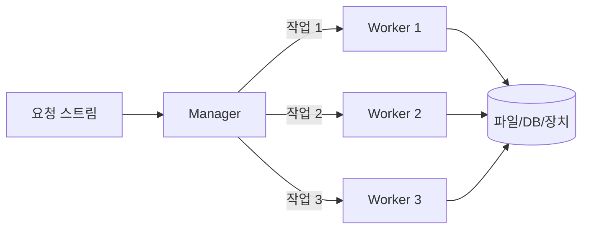
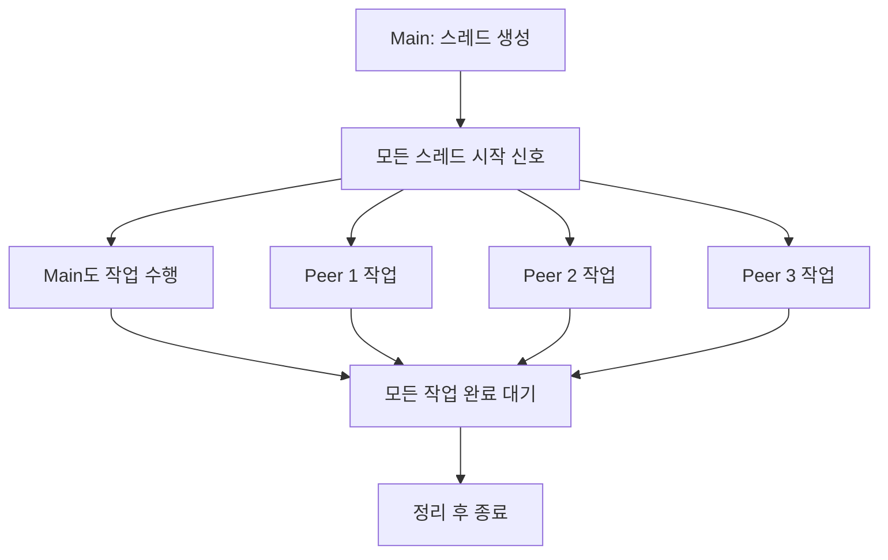

> **학습 목표**
> 스레드를 생성하고 종료하는 흐름을 설명하고,
> 작업에 맞는 멀티스레드 모델을 선택하며,
> 공유 데이터와 성능의 한계를 이해한다.

> **읽는 방법**
> 핵심 개념 → API와 코드 → 설계 모델 → 안전성과 성능 순으로 학습한다.

## 1. 전체 흐름 먼저 보기
```text
하나의 프로그램을 여러 작업으로 분리
    ↓
pthread_create()로 작업을 수행할 스레드 생성
    ↓
각 스레드에 필요한 데이터를 포인터로 전달
    ↓
공유 데이터 접근을 동기화하며 작업 수행
    ↓
스레드 종료 → join 또는 detach로 종료 후 자원 회수 관리
    ↓
병렬화 비율과 오버헤드로 실제 성능 평가
```

스레드를 만드는 것은 쉽지만, 작업을 잘 나누고 데이터를 안전하게 공유하는 것은 어렵다.

## 2. pthread
**pthread (POSIX Thread)**
- 프로그램을 여러 실행 흐름으로 나누기 위한 POSIX 표준 API이다.
- 실제 구현 방식은 운영체제마다 다를 수 있다.

- 프로그램은 처음에 `main()`을 실행하는 하나의 스레드로 시작한다.
- 추가 스레드는 프로그래머가 명시적으로 생성한다.
- 생성된 스레드도 다른 스레드를 생성할 수 있다.
- 강의에서는 Linux Pthread를 커널 레벨 스레드로 설명하고, `clone()` 시스템 콜을 구현 기반으로 소개한다.

### 2.1. 동시성과 병렬성
| 구분               | 의미                                     | 예시                   |
| ---------------- | -------------------------------------- | -------------------- |
| 동시성(Concurrency) | 여러 작업이 진행되며 실행 구간이 겹친다. 번갈아 실행될 수도 있다. | 한 코어가 여러 스레드를 번갈아 실행 |
| 병렬성(Parallelism) | 여러 작업이 실제로 같은 시점에 실행된다.                | 여러 코어에서 각각의 스레드를 실행  |

> **보충**
> 스레드를 여러 개 만들었다고 반드시 동시에 CPU를 사용하는 것은 아니다.
> 코어 수, 스케줄링, 작업 의존성에 따라 달라진다.

### 2.2. 프로세스 생성과 스레드 생성 비용
> 멀티 프로세스(`fork()` + `exec()`)
> 멀티 스레드(`pthread_create()`)

강의의 실험은 `fork()`와 `pthread_create()`를 각각 **50,000회** 수행한 시간을 비교한다.
제시된 환경에서는 스레드 생성 시간이 더 짧다.

**학습 포인트**
- 스레드 생성도 비용이 든다.
- 작은 요청마다 반복해서 생성하면 그 비용이 누적되므로, 뒤에서 배우는 **스레드 풀**이 유용하다.

> 이 표는 특정 환경의 측정 결과다.
> 수치를 모든 시스템의 성능으로 일반화하지 않는다.

### 2.3. 컴파일
```c
#include <pthread.h>
```

강의의 컴파일 명령:
```bash
gcc -o test test.c -lpthread
```

> **보충**
> GCC 환경에서는 컴파일과 링크에 필요한 스레드 관련 설정을 함께 적용하는 `gcc -pthread -o test test.c` 형태도 사용한다.

## 3. pthread API의 세 범주
| 범주     | 목적                     | 대표적인 작업               |
| ------ | ---------------------- | --------------------- |
| **스레드 관리** | 스레드의 생명주기와 속성 관리       | 생성, 종료, 대기, 분리, 속성 설정 |
| **뮤텍스**    | 공유 자원에 대한 상호 배제        | 초기화, 잠금, 잠금 해제, 제거    |
| **조건 변수**  | 어떤 조건이 충족될 때까지 대기하고 알림 | 대기, 신호, 초기화, 제거       |
스레드 관리와 설계 개념을 중심으로 다룬다.

### 3.1. 기본 함수 비교
| 함수                 | 핵심 역할                       | 헷갈리기 쉬운 점           |
| ------------------ | --------------------------- | ------------------- |
| `pthread_create()` | 새 스레드 생성                    | 성공 여부는 함수 반환값으로 확인  |
| `pthread_exit()`   | 호출한 스레드 종료                  | 다른 스레드를 즉시 종료하지 않음  |
| `pthread_join()`   | 특정 스레드 종료를 기다리고 결과 회수       | join 가능한 스레드에 사용    |
| `pthread_detach()` | 종료 시 스레드 관리 자원이 자동 회수되도록 설정 | 즉시 종료시키는 함수가 아님     |
| `pthread_self()`   | 호출한 스레드 ID 획득               | 사용자 지정 작업 번호와는 다름   |
| `pthread_equal()`  | 두 스레드 ID가 같은지 비교            | 같으면 0이 아닌 값, 다르면 0  |
| `pthread_kill()`   | 지정한 스레드에 signal 전달          | 이름과 달리 무조건 종료시키지 않음 |
| `pthread_cancel()` | 다른 스레드에 취소 요청               | 요청 즉시 종료된다고 보장하지 않음 |

> **보충·주의**
> `pthread_kill()`로 전달한 signal의 종류와 처리 방식에 따라 프로세스 전체에 영향을 줄 수 있다.
> `pthread_cancel()`의 실제 취소 시점은 대상 스레드의 취소 설정과 취소 지점 등에 따라 달라진다.

## 4. 스레드 생성: `pthread_create()`
```c
int pthread_create(
    pthread_t *thread,               // 생성한 스레드 ID를 저장할 위치
    const pthread_attr_t *attr,      // 스레드 속성
    void *(*start_routine)(void *),  // 새 스레드가 실행할 함수
    void *arg                        // 실행 함수에 전달할 인자 하나
);
```

실행 함수는 다음 형태여야 한다.
```c
void *worker(void *arg);
```

### 4.1. 반환값과 스레드 ID는 다르다
```c
pthread_t tid;
int ret = pthread_create(&tid, NULL, worker, NULL);
// ret == 0: 생성 성공, 첫 번째 인자가 스레드 ID
// ret != 0: 생성 실패, 오류 번호 반환
```

### 4.2. 생성 순서와 실행 순서는 다르다
```text
main: 스레드 0 생성 → 스레드 1 생성 → 스레드 2 생성

가능한 작업 실행 순서: 2 → 0 → 1
```

생성된 스레드는 `pthread_create()`가 호출자에게 반환되기 전에도 실행을 시작할 수 있다.
강의의 Hello World 출력은 **가능한 출력의 한 예**이며, 항상 번호순으로 출력되지는 않는다.

### 4.3. 스레드에 인자 전달하기
`pthread_create()`는 시작 함수에 **`void *` 인자 하나**를 전달한다.
여러 값을 전달하려면 구조체로 묶는다.
```c
struct Task {
    int id;
    const char *filename;
};

void *worker(void *arg) {
    struct Task *task = arg;
    /* task->id, task->filename 사용 */
    return NULL;
}
```

가장 중요한 규칙: 전달한 데이터의 수명
- **스레드가 데이터를 사용하는 동안, 그 데이터는 유효해야 하며 다른 스레드가 임의로 바꾸지 않아야 한다.**
- 주소를 전달하면 데이터가 자동 복사되는 것은 아니다.

잘못되기 쉬운 예:
```c
for (int i = 0; i < 5; ++i) {
    pthread_create(&threads[i], NULL, worker, &i);
}
```

모든 스레드가 같은 `i`의 주소를 받는다.
메인 스레드가 `i`를 변경하는 동안 작업 스레드가 읽을 수 있고, 반복문이 끝나면 `i`의 수명도 끝난다.

올바른 방향:
```c
int ids[5];
for (int i = 0; i < 5; ++i) {
    ids[i] = i;
    pthread_create(&threads[i], NULL, worker, &ids[i]);
}
/* ids의 수명이 끝나기 전에 모든 작업 스레드를 join한다. */
```

이 조각에서는 오류 처리를 생략했다. 완성된 예제는 다음 절에 있다.

강의의 파일 읽기 예제 흐름
```text
main
  1. 파일명 저장 공간을 malloc()으로 할당
  2. 사용자에게 파일명을 입력받음
  3. 파일명 포인터를 전달하며 스레드 생성

작업 스레드
  1. 전달받은 포인터를 파일명으로 해석
  2. fopen()으로 파일 열기
  3. 파일 내용을 읽어 출력
  4. fclose()로 파일 닫기
```

**의도**: 각 스레드가 별도의 파일명 데이터를 받아 파일 읽기를 수행한다.

**보충·주의**: 강의 코드를 실행 가능한 코드로 옮길 때는 다음을 보완한다.
- `malloc()` 실패와 입력 함수의 반환값을 확인한다.
- 크기 80인 버퍼에 `scanf()`로 입력한다면 `%79s`처럼 길이를 제한한다.
- 파일 읽기 버퍼에도 입력 길이 제한을 두거나 `fgets()`를 사용한다.
- 할당한 파일명 메모리를 누가 `free()`할지 정한다. 생성 실패 시에는 생성한 쪽에서 정리한다.
- 작업 함수는 `return NULL;` 또는 `pthread_exit(NULL);`로 종료한다.
- 생성한 스레드에 join 또는 detach를 적용하여 종료 후 관리 자원을 회수한다.

## 5. 스레드 종료와 자원 회수
### 5.1. 종료 방식 비교
| 동작                            | 결과                                            |
| ----------------------------- | --------------------------------------------- |
| 스레드 시작 함수에서 `return result;`  | 해당 스레드 종료                                     |
| `pthread_exit(result);`       | 호출한 스레드 종료                                    |
| 다른 스레드가 `pthread_cancel()` 호출 | 대상 스레드에 취소 요청                                 |
| `main()`에서 `return`           | 프로세스 종료, 나머지 스레드도 종료                          |
| 어느 스레드에서든 `exit()` 호출         | 프로세스 전체 종료                                    |
| 성공한 `exec()`                  | 기존 프로세스 이미지를 새 프로그램으로 교체; 기존 스레드는 이어서 실행되지 않음 |

> **보충·주의**
> 강의는 `exec`를 프로세스 종료와 함께 나열하지만, 정확히는 **현재 프로그램 이미지를 교체하는 동작**이다.
> `exec()`가 실패하면 교체되지 않는다.

### 5.2. `main()`의 종료 방식이 중요한 이유
```c
int main(void) {
    /* 작업 스레드 생성 */
    pthread_exit(NULL);
}
```

> ==main() 종료 방식== #3-2/UNIX시스템프로그래밍/출제 (O/X)

이 경우 초기 스레드만 종료하므로 다른 스레드는 계속 실행할 수 있다.
마지막 스레드까지 종료하면 프로세스도 종료한다.

반면 작업을 기다리지 않고 `main()`에서 `return 0;`을 실행하면, 프로세스가 종료되어 아직 진행 중인 작업도 끝난다.

### 5.3. `join`과 `detach`
```text
생성된 스레드
  ├─ join 가능 → 다른 스레드가 pthread_join() → 종료 대기 + 결과/관리 자원 회수
  └─ detach 상태 → 종료 시 관리 자원 자동 회수, join 불가
```

- **Join**: 작업 완료를 기다리거나 반환 결과가 필요할 때 사용한다.
- **Detach**: 나중에 join하지 않을 스레드의 종료 후 자원 회수를 관리한다.
- 기본 속성으로 생성한 스레드는 일반적으로 join 가능한 상태이다.
- `pthread_exit()`만으로 join 가능한 스레드의 관리 자원 회수까지 끝나는 것은 아니다.

> **보충**
> 강의는 특히 `main()`에서 `pthread_exit()` 사용을 권장한다.
> 모든 작업의 완료와 결과를 확인해야 하는 프로그램에서는 `pthread_join()`으로 기다린 뒤 `main()`에서 반환하는 흐름도 적절하다.
>
> `pthread_exit()`는 `fclose()`나 `free()`를 대신하지 않는다.
> 스레드에서 연 파일과 동적 할당 메모리의 정리 책임을 명확히 해야 한다.

## 6. 전체 흐름을 보여 주는 학습용 코드
> **보충 예제**
> 강의의 Hello World 예제를 바탕으로 인자 수명, 오류 처리, 종료 대기를 명확하게 구성했다.

```c
#include <pthread.h>
#include <stdio.h>
#include <stdlib.h>
#include <string.h>

#define NUM_THREADS 5

struct Task {
    int id;
};

static void *print_hello(void *arg) {
    const struct Task *task = arg;
    printf("Hello from task %d\n", task->id);
    return NULL;
}

int main(void) {
    pthread_t threads[NUM_THREADS];
    struct Task tasks[NUM_THREADS];
    int created = 0;
    int failed = 0;

    for (int i = 0; i < NUM_THREADS; ++i) {
        tasks[i].id = i;
        int rc = pthread_create(&threads[i], NULL,
                                print_hello, &tasks[i]);
        if (rc != 0) {
            fprintf(stderr, "pthread_create: %s\n", strerror(rc));
            failed = 1;
            break;
        }
        ++created;
    }

    for (int i = 0; i < created; ++i) {
        int rc = pthread_join(threads[i], NULL);
        if (rc != 0) {
            fprintf(stderr, "pthread_join: %s\n", strerror(rc));
            exit(EXIT_FAILURE);
        }
    }

    return failed ? EXIT_FAILURE : EXIT_SUCCESS;
}
```

컴파일과 실행:
```bash
gcc -Wall -Wextra -pthread -o hello hello.c
./hello
```

코드를 이해할 때 확인할 사항:
1. `tasks[i]`는 각 스레드가 독립적으로 받는 인자 공간이다.
2. `tasks`는 모든 join이 끝날 때까지 `main()`의 스택에 남아 있다.
3. `created`를 사용하므로 생성에 성공한 스레드만 join한다.
4. join을 배열 순서로 호출해도 작업 스레드의 실행·출력 순서는 고정되지 않는다.
5. 모든 작업이 종료된 후 `main()`이 반환하므로 작업 도중 프로세스가 끝나지 않는다.

> 강의의 `(void *)t`와 `%ld` 출력은 정수·포인터 변환과 형식 지정자에 주의가 필요하다.
> 이 예제는 구조체 포인터를 전달해 그 문제를 피한다.
> `task->id`는 학습용 작업 번호이며 `pthread_t` 스레드 ID가 아니다.

> 2026-09-29

## 7. 작업을 어떻게 나눌 것인가?
스레드 활용의 전제는 **동시에 수행해도 되는 독립적인 작업을 찾아 나누는 것**이다.

### 7.1. 잠재적 병렬성 (Potential parallelism)
작업들의 실행 순서를 바꾸어도 결과가 같다면, 그 작업들을 병렬 실행할 가능성이 있다.

```text
A: 입력 데이터의 앞부분 계산
B: 입력 데이터의 뒷부분 계산
C: A와 B의 결과 합치기

A와 B는 독립적으로 실행 가능
C는 A와 B가 모두 끝난 뒤 실행
```

강의의 시간 흐름 그림은 독립적인 두 작업을 순서대로 실행하거나 번갈아 실행할 수 있고, 병렬 실행한 뒤 마지막 작업으로 합칠 수도 있음을 보여 준다.

### 7.2. 스레드를 사용하는 이유
| 목적          | 설명                             | 예시             |
| ----------- | ------------------------------ | -------------- |
| **CPU 작업 병렬화**  | 여러 코어가 계산을 나누어 처리              | 독립적인 데이터 구간 계산 |
| **I/O와 계산 겹치기** | 한 작업이 I/O를 기다리는 동안 다른 작업 진행    | 파일 읽기와 계산      |
| **응답성 유지**      | 오래 걸리는 작업과 사용자 작업 분리           | 인쇄 중 문서 편집     |
| **비동기 이벤트 처리**  | 발생 시점이 불확실한 이벤트를 기다리며 다른 작업 진행 | 네트워크 서버        |

> **보충**
> 스레드의 이점은 실행 시간 단축뿐 아니라 응답성에도 있다.
> 한 코어에서도 I/O 대기 시간에 다른 작업을 진행하는 이점을 얻을 수 있다.

## 8. 스레드 설계 모델
| 모델                 | 나누는 기준          | 주요 구조              | 기억할 표현         |
| ------------------ | --------------- | ------------------ | -------------- |
| **Manager/Worker** | 요청 또는 작업 단위     | 관리자 → 작업자          | “일을 배분한다”      |
| Thread pool        | 작업 단위, 작업자는 재사용 | 작업 큐 + 미리 만든 작업자   | “미리 만들어 재사용한다” |
| **Pipeline**       | 처리 단계           | 단계별 스레드 연결         | “단계를 이어 준다”    |
| **Peer**           | 동등한 작업 분담       | 대등한 작업자, 메인도 참여 가능 | “함께 나누어 한다”    |

### 8.1. Manager/Worker: 관리자가 일을 나누어 준다


- Manager가 요청을 받아 작업을 배분한다.
- Worker는 배정된 작업을 수행한다.
- 강의의 첫 예제는 요청 종류 X, Y에 맞는 작업 스레드를 생성한다.
- 공유 자원을 사용할 때는 worker 사이에도 동기화가 필요하다.

#### 스레드 풀 (Thread pool)
Worker를 미리 생성해 두고 여러 작업에 재사용하는 Manager/Worker의 변형이다.

```text
Manager: 요청 수신 → 작업 큐에 삽입 → 대기 중인 Worker에 알림
Worker:  작업 대기 → 큐에서 작업 꺼내기 → 처리 → 다시 작업 대기
```

**장점**: 요청마다 스레드를 생성하는 비용을 줄인다.

**보충**: 작업 큐는 공유 자원이다. 큐 접근을 mutex로 보호하고, 큐가 비었을 때 조건 변수로 기다리는 방식으로 구현할 수 있다. 실제 프로그램에는 작업 종료를 알리는 절차도 필요하다.

#### cf. 동시성 서버/요청 처리 모델
| 모델              | 처리 방식                         |
| --------------- | ----------------------------- |
| Fork-based      | 요청이 들어올 때 자식 프로세스를 생성해 처리     |
| Thread-based    | 요청이 들어올 때 스레드를 생성해 처리         |
| Process Pool    | 여러 프로세스를 미리 만들어 두고 반복해서 작업 처리 |
| ==Thread Pool== | 여러 스레드를 미리 만들어 두고 반복해서 작업 처리  |

### 8.2. Pipeline: 처리 단계를 나눈다


각 스레드는 한 단계를 맡아 이전 단계의 결과를 받고, 처리 후 다음 단계에 넘긴다.

```text
시간 1: Stage 1이 데이터 A 처리
시간 2: Stage 1이 데이터 B 처리 | Stage 2가 데이터 A 처리
시간 3: Stage 1이 데이터 C 처리 | Stage 2가 데이터 B 처리 | Stage 3이 데이터 A 처리
```

**핵심**: 데이터 A 하나는 단계 순서를 따라가지만, 서로 다른 데이터 A·B·C는 여러 단계에서 동시에 처리할 수 있다.

**보충**: 가장 느린 단계가 전체 처리량의 병목이 된다. 단계 사이의 데이터 전달과 버퍼 접근도 동기화해야 한다.

### 8.3. Peer: 대등한 작업자들이 일을 나누어 한다


- 작업자들이 대등하게 각자의 작업을 수행한다.
- 강의의 설명에서는 메인 스레드도 다른 스레드를 만든 뒤 작업에 참여한다.
- 공유 자원을 사용할 때는 필요한 동기화를 수행한다.

> 2026-10-06

## 9. 경쟁 상태와 스레드 안전성
### 9.1. 경쟁 상태
**경쟁 상태 (Race Condition)**
- **여러 실행 흐름의 접근 순서나 타이밍에 따라 프로그램의 결과가 달라지는 문제**이다.

강의는 여러 스레드의 동일 자원 접근을 경고한다. 다만 공유 데이터를 읽기만 하는 경우까지 모두 문제가 되는 것은 아니다. 변경을 포함한 접근을 적절하게 조정하지 않을 때 문제가 발생한다.

#### 예: `counter++`는 한 단계라고 가정할 수 없다
개념적으로 다음처럼 나눌 수 있다.
```text
1. counter의 현재 값을 읽기
2. 읽은 값에 1 더하기
3. 계산 결과를 counter에 저장하기
```

`counter = 0`에서 두 스레드가 각각 한 번 증가시키는 상황:

| 순서 | 스레드 A | 스레드 B | 공유 counter |
|---|---|---|---|
| 1 | 0 읽기 | | 0 |
| 2 | | 0 읽기 | 0 |
| 3 | 1 계산 후 저장 | | 1 |
| 4 | | 1 계산 후 저장 | 1 |

두 번 증가시켰지만 한 번의 갱신이 사라지는 흐름을 보여 준다.

> **보충·주의**
> 이는 갱신 손실을 이해하기 위한 개념적 예시다.
> C에서 일반 변수를 동기화 없이 동시에 읽고 쓰는 데이터 경쟁은 정의되지 않은 동작이므로, 실제 결과가 위 표의 값으로만 제한되는 것은 아니다.

### 9.2. 스레드 안전성
**스레드 안전성 (Thread Safety)**
- 여러 스레드가 동시에 호출하거나 실행해도, 공유 상태를 손상시키지 않고 정해진 동작을 유지하도록 설계되어 있다는 뜻이다.

강의의 라이브러리 예제:
```text
Thread 1 ─┐
Thread 2 ─┼→ 같은 라이브러리 함수 → 같은 전역 메모리 수정
Thread 3 ─┘
```

각 스레드의 지역 변수가 별개여도, 호출한 함수가 내부적으로 공유 전역 데이터를 수정한다면 충돌할 수 있다.

### 9.3. 해결 방향
- 공유되는 변경 가능한 데이터를 줄인다.
- 공유 상태에 접근하는 임계 구역을 mutex 등으로 보호한다.
- 외부 라이브러리의 스레드 안전성 보장과 사용 조건을 확인한다.
- 보장 여부가 불확실한 함수는 관련 호출을 직렬화하는 방법을 검토한다.

> **보충**
> mutex가 효과를 내려면 같은 공유 상태에 접근하는 관련 경로들이 같은 잠금 규칙을 따라야 한다.
> 특정 호출 하나만 잠그고 다른 접근을 그대로 두면 보호가 불완전하다.

> **보충**
> 경쟁 상태는 특정 타이밍에서만 드러날 수 있다.
> 여러 번 실행했을 때 문제가 보이지 않았다는 사실은 스레드 안전성의 증거가 아니다.

## 10. 멀티코어와 멀티스레딩
### 10.1. 암달의 법칙 (Amdahl's Law)
$$S(N) = \dfrac{1}{(1-P) + P/N}$$
- $S$ (Speedup): 전체 시스템의 속도 향상 비율
- $P$ (Parallel Fraction): 병렬화 가능한 작업의 비율 ($0≤P≤1$)
- $1-P$: 병렬화 불가능한/반드시 순차 실행하는 작업의 비율
- $N$: 투입된 프로세서(코어/처리기)의 개수

| 기호 | 의미 |
|---|---|
| `T(1)` | 처리기 하나에서의 실행 시간 |
| `T(N)` | 처리기 N개에서의 실행 시간 |
| `f` | 병렬화할 수 있는 실행 시간 비율 |
| `1 - f` | 순차 실행이 필요한 비율 |
| `N` | 처리기 수 |
| `S(N)` | 단일 처리기 대비 속도 향상 배수 |

**직관**: 병렬 부분은 여러 처리기로 나누지만, 순차 부분은 계속 한 줄로 처리해야 한다.

### 10.2. 계산 예제
전체 시간의 80%를 병렬화할 수 있고 처리기를 4개 사용한다면:
```text
f = 0.8, N = 4
S(4) = 1 / (0.2 + 0.8 / 4)
     = 1 / 0.4
     = 2.5배
```

원래 100초가 걸렸다면 이상적인 실행 시간은 `20초 + 80초 / 4 = 40초`이다.

### 10.3. 처리기를 무한히 늘리면?
$$S_{max} = \lim_{N \to \infty} S(N) = \dfrac{1}{1-P}$$

| 병렬화 가능 비율 f | 순차 비율 | 이상적인 최대 속도 향상 |
|---|---|---|
| 50% | 50% | 2배 |
| 80% | 20% | 5배 |
| 90% | 10% | 10배 |
| 95% | 5% | 20배 |

**순차 구간이 남아 있으면 코어 수만 늘려서는 그 한계를 넘을 수 없다.**

### 10.4. 실제 성능과 오버헤드
실제 성능은 오버헤드의 영향도 받는다.
1. 순차 비율이 높을수록 처리기를 늘려도 속도 향상이 제한된다.
2. 오버헤드가 있으면 처리기를 늘리다가 성능 향상이 둔화되거나 오히려 감소할 수 있다.

보충해서 생각할 수 있는 비용은 스레드 생성·관리, 동기화 대기, 문맥 교환, 메모리 접근 경쟁, 작업량 불균형 등이다.

> **보충**
> 위 Amdahl 공식은 고정된 작업량과 이상적인 병렬 분할을 가정하고 추가 병렬화 비용을 제외한다.
> `N`은 처리기 수이며, 생성한 스레드 수와 자동으로 같아지는 값이 아니다.
