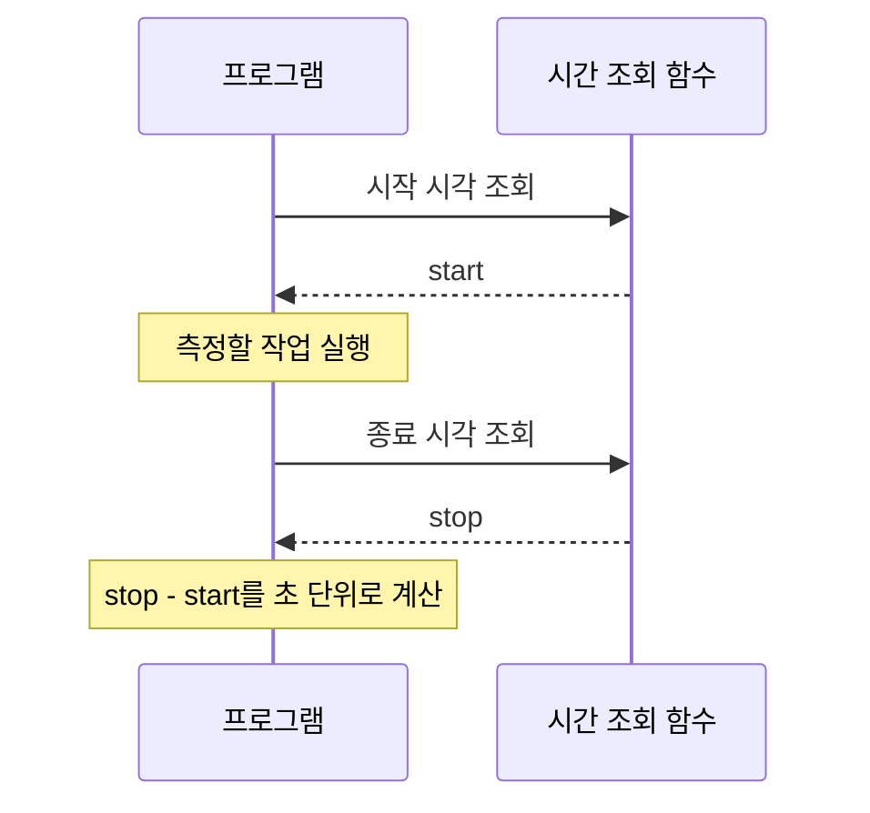
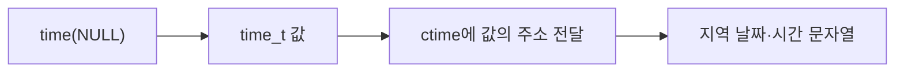
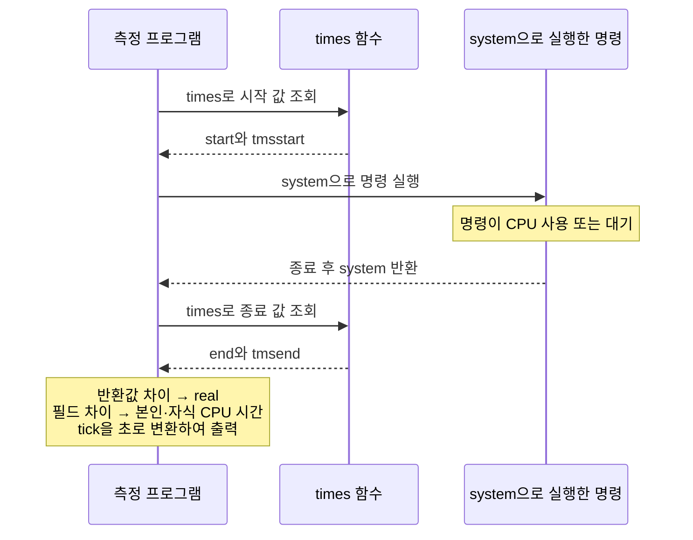
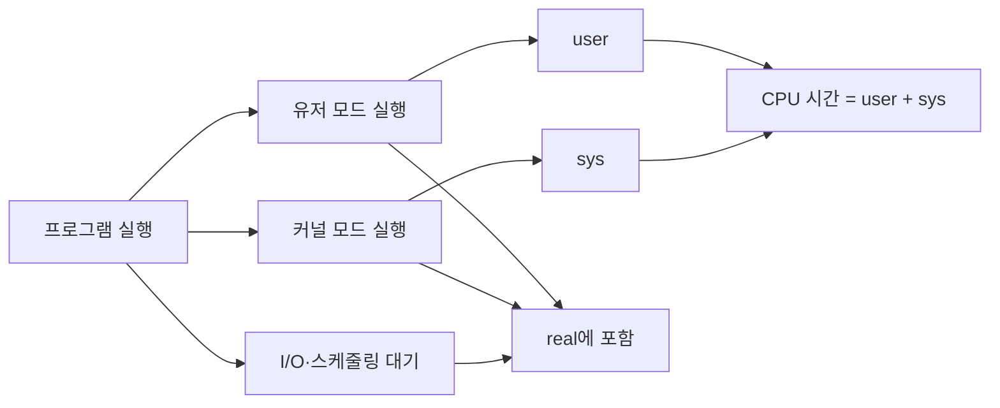

---
aliases:
  - Time Management
type: Lecture
tags:
  - 3-2/UNIX시스템프로그래밍
draft: false
date: 2026-10-05
prev:
  - "[[03-2_pthread 동기화]]"
next:
  - "[[05_파이프 IPC]]"
---
## 요약
| 구분    | 대상                           | 반환/단위                | 용도                                                                 |
| ----- | ---------------------------- | -------------------- | ------------------------------------------------------------------ |
| C 표준  | `time(tt)`                   | 초(`time_t`)          | 현재 시간                                                              |
| 〃     | `difftime(tt end, tt start)` | 초(`double`)          | 두 시간의 차이                                                           |
| 〃     | `ctime(tt)`                  | `char`               | 날짜·시간 문자열로 변환                                                      |
| POSIX | `gettimeofday(tv, tz)`       | 마이크로초<br>(`int/1e6`) | 현재 시간                                                              |
| 〃     | `clock_gettime(id, ts)`      | 나노초<br>(`int/1e9`)   | `CLOCK_REALTIME`: 현재 시간<br>`CLOCK_MONOTONIC`: ==경과 시간==            |
| 〃     | `times(tms)`                 | `ct tick`            | `tms` CPU 사용시간                                                     |
| 명령어   | `time` 명령어                   | 밀리초                  | `real`: 경과 시간<br>`user`: 유저 모드 CPU 사용 시간<br>`sys`: 커널 모드 CPU 사용 시간 |

## 1. 유닉스 시간
**유닉스 시간**(Unix Time) 또는 **POSIX 시간**, **에포크 시간**(Epoch Time)
- 컴퓨터 시스템에서 시각을 표현하는 표준적인 방법
- **기준 시점(Unix Epoch)**
	- **1970-01-01 00:00:00 UTC**(협정 세계시)를 0으로 정한다.
- **표현 방식**
	- 기준 시점으로부터 **경과한 시간을 ‘초(second)’ 단위의 정수**로 나타낸다.
    - 예: 기준 시점으로부터 1분이 지났다면 60, 하루는 86400
    - 예: 1970년 이전의 시각은 음수(-)로 표현

*cf. 2038년 문제 (Year 2038 Problem, Y2K38)*
- 32비트 정수 공간은 2038년에 오버플로우로 1901년이 됨
- 64비트 정수로 처리하도록 전환하면 약 2,920억 년 동안 문제없음

## 2. C 표준
### 2.1. `time()`
==time()== #3-2/UNIX시스템프로그래밍/출제 (O/X)
- 현재 시각을 `time_t` 값으로 반환한다.
- `tloc`이 `NULL`이 아니면 해당 주소에도 값을 저장한다.
- `time(NULL)`은 반환값만 사용하는 방식이다.
- 초 단위 표현이므로 짧은 코드 구간의 측정에는 거칠다.

```c
#include <time.h>
time_t time(time_t *tloc);
```

### 2.2. `difftime()`
- 두 달력 시각의 차이를 **초 단위 `double`**로 반환한다.
```c
#include <time.h>
double difftime(time_t end, time_t start);
```

```text
경과 시간 = difftime(종료 시각, 시작 시각)
```

강의 예제의 핵심 흐름:
```c
time_t tstart = time(NULL);
/* 측정할 작업 */
time_t tend = time(NULL);
printf("elapsed time = %f\n", difftime(tend, tstart));
```



**보충**
- `difftime()`이 `double`을 반환해도 `time()` 입력 자체가 초 단위이므로 더 세밀한 측정값이 생기는 것은 아니다.
- 경과 시간 측정에는 시스템 시각 변경의 영향을 피하는 `CLOCK_MONOTONIC`을 사용한다.

### 2.3. `ctime()`
`time_t` 값의 주소를 받아 사람이 읽을 수 있는 **지역 시간 문자열**로 변환한다.

**(1) 헤더 및 함수 원형**
```c
#include <time.h>

char *ctime(const time_t *clock);
```



**(2) 반환값**
- 반환되는 문자열은 항상 고정된 26바이트 크기(널 종료 문자 `\0` 포함)의 포맷을 가진다.
```
Wed Mar 25 15:30:20 2026\n\0
```

- 결과 문자열에는 끝에 개행 문자 `\n`이 포함되어 있어 `printf`에 개행을 추가하면 빈 줄이 생길 수 있다.
- [Linux man-pages: ctime](https://man7.org/linux/man-pages/man3/ctime.3.html)

**(3) 예제**
```c
time_t now = time(NULL);
printf("%s", ctime(&now)); // Wed Mar 25 15:30:20 2026
```

## 3. POSIX
### 3.1. `gettimeofday()`
Epoch 이후의 현재 시각을 **초 부분과 마이크로초 부분**으로 나누어 얻는다.

*cf.*
- `gettimeofday()`는 시스템 시각 변경의 영향을 받는다.
- POSIX.1-2008에서 구식 인터페이스로 지정되었고 POSIX.1-2024에서 제거되었으므로 새로운 코드에서는 `clock_gettime()`을 사용한다. 표준에서 제거되었다는 것이 기존 운영체제에서 즉시 사용할 수 없다는 뜻은 아니다.
- [Linux man-pages: gettimeofday](https://man7.org/linux/man-pages/man2/gettimeofday.2.html)

**(1) 헤더 및 함수 원형**
```c
#include <sys/time.h>

int gettimeofday(struct timeval *tv, struct timezone *tz);
```

**(2) 매개변수 tv**
```c
struct timeval {
    time_t      tv_sec;   /* 초 */
    suseconds_t tv_usec;  /* 마이크로초 (0 ~ 999,999) */
};
```

**(3) 매개변수 tz**
타임존(시간대) 정보를 받기 위한 구조체였으나, 현재는 사용되지 않는(Obsolete) 매개변수이다.
대부분의 운영체제에서 구현되지 않거나 무시되므로, 관례적으로 항상 `NULL`을 전달한다.

**(4) 예제**
```c
gettimeofday(&start, NULL);
// 측정할 작업 (예: 150,000 마이크로초 = 0.15초 대기)
gettimeofday(&end, NULL);

// 경과 시간 계산 (초 + 마이크로초)
long seconds = end.tv_sec - start.tv_sec;
long micros = end.tv_usec - start.tv_usec;

printf(
	"경과 시간: %ld초 %ld마이크로초 (약 %.4f초)\n",
	seconds, micros, seconds + (micros / 1000000.0)
);
```

### 3.2. `clock_gettime()`
- POSIX 표준에서 제공하는 고해상도(High-Resolution) 시간 측정 함수
	- *나노초 단위로 표현할 수 있다는 것과 실제 시계의 해상도가 1ns라는 것은 다르다.*
- 선택한 시계의 값을 **초와 나노초**로 얻는다.
- [Linux man-pages: clock_gettime](https://man7.org/linux/man-pages/man2/clock_gettime.2.html)

**(1) 헤더 및 함수 원형**
```c
#include <time.h>

int clock_gettime(clockid_t clock_id, struct timespec *tp);
```

**(2) 매개변수 clock_id**
측정하고자 하는 시간의 기준(클럭)을 지정한다.
- `CLOCK_REALTIME`
	- Epoch를 기준으로 하는 현재 달력 시각
	- 용도: 현재 시각 측정 등
- `CLOCK_MONOTONIC` - ==출제==
	- 임의의 기준점부터 흐르는 단조 시각
	- 용도: 코드 실행의 경과 시간 측정 등
	- *절대값을 날짜로 해석하는 대신 두 값의 차이를 사용하며, 시스템 달력 시각을 직접 변경해도 그 변경에 따른 점프를 받지 않는다.*

**(3) 매개변수 tp**
```c
struct timespec {
	time_t tv_sec;  /* 초 */
	long   tv_nsec; /* 나노초 (0 ~ 999,999,999) */
};
```

**(4) 예제**
> ==elapsed 한 줄 계산식 출제== #3-2/UNIX시스템프로그래밍/출제
```c
#include <stdio.h>
#include <time.h>

int main() {
	struct timespec start, end;
	
	if (clock_gettime(CLOCK_MONOTONIC, &start) == -1) {  // 성공 0, 실패 1
		perror("clock_gettime start error");  return 1;
	}
	
	/* 시간을 측정할 작업 */
	
	if (clock_gettime(CLOCK_MONOTONIC, &end) == -1) {  // 성공 0, 실패 1
		perror("clock_gettime end error");  return 1;
	}
	
	long   sec     = end.tv_sec  - start.tv_sec;
	long   nsec    = end.tv_nsec - start.tv_nsec;
	double elapsed = seconds + (nanoseconds / 1e9);
	
	printf("%ld초 %ld나노초 (%.6f초)\n", sec, nsec, elapsed);
	return 0;
}
```

### 3.3. `times()`
현재 프로세스와 이미 종료 및 회수된 자식 프로세스가 사용한 CPU 시간을, 매개변수로 전달된 tms 구조체에 저장한다.

**(1) 헤더 및 함수 원형**
```c
#include <sys/times.h>

clock_t times(struct tms *buffer);
```

**(2) 매개변수 buffer**
```c
struct tms {
	clock_t tms_utime;   // 현재 프로세스의 유저모드 CPU 사용시간
	clock_t tms_stime;   // 현재 프로세스의 커널모드 CPU 사용시간
	clock_t tms_cutime;  // 종료 및 회수된 자식들의 유저모드 CPU 사용시간 합
	clock_t tms_cstime;  // 종료 및 회수된 자식들의 커널모드 CPU 사용시간 합
};
```

- 자식 시간은 종료한 자식을 `wait()` 계열로 회수했을 때 반영된다.
- 자식이 회수한 후손의 시간도 누계에 포함될 수 있다.
- [Linux man-pages: times](https://man7.org/linux/man-pages/man2/times.2.html)

**(3) 반환값**
- 성공 시: 과거 임의의 기준점 이후 흐른 시간의 clock tick 수
- *실패 시*: `(clock_t) -1`을 반환하고 errno를 설정한다.

**(4) tick을 초로 변환**
```c
#include <unistd.h>
long clktck = sysconf(_SC_CLK_TCK);
```

```text
초 단위 시간 = tick 수 차이 / 초당 tick 수
```

반환값의 차이로 `real`을, 구조체 필드의 차이로 CPU 시간을 계산한다.
```c
double real = (end - start) / (double)clktck;
double user = (tmsend.tms_utime - tmsstart.tms_utime)
    / (double)clktck;
double sys = (tmsend.tms_stime - tmsstart.tms_stime)
    / (double)clktck;
double child_user = (tmsend.tms_cutime - tmsstart.tms_cutime)
    / (double)clktck;
double child_sys = (tmsend.tms_cstime - tmsstart.tms_cstime)
    / (double)clktck;
```

**보충**
- `times()`의 tick 변환에는 `sysconf(_SC_CLK_TCK)`를 사용한다.
- `clock()`에 사용하는 `CLOCKS_PER_SEC`와 혼동하지 않는다.
- [Linux man-pages: times](https://man7.org/linux/man-pages/man2/times.2.html)

**(5) 예제 실행 구조**
`main()`은 명령행 인자를 순회하며 `do_cmd()`를 호출한다.
`do_cmd()`는 `system(cmd)` 앞뒤에서 시간을 조회하고, `pr_times()`는 차이를 초로 변환해 출력한다.



**(6) 출력 해석**

| 측정 항목        | `clockgettime.out` | `thread.out` |
| ------------ | -----------------: | -----------: |
| `real`       |              3.15초 |        1.43초 |
| `user`       |              0.00초 |        0.00초 |
| `sys`        |              0.00초 |        0.00초 |
| `child user` |              3.14초 |        0.55초 |
| `child sys`  |              0.00초 |        1.69초 |

- 측정 프로그램은 주로 명령 실행과 대기를 하므로 자신의 CPU 시간은 출력 정밀도에서 `0.00`으로 나타난다.
- 실제 명령의 CPU 사용은 자식 프로세스 항목에 나타난다.
- `clockgettime.out`은 `real ≈ child user`로, 주로 유저 모드 계산을 수행한 결과와 부합한다.
- `thread.out`은 자식 CPU 시간 합이 `0.55 + 1.69 = 2.24초`로 `real = 1.43초`보다 크다. 강의의 병렬 처리 설명과 연결해서 해석할 수 있다. 이 출력만으로 스레드 수를 결정할 수는 없다.

## 4. time 명령어
특정 프로그램을 실행하면서 소요 시간을 측정한다.
```sh
time 프로그램명

time ls -l

real 0m0.005s
user 0m0.005s
sys  0m0.000s
```

출력되는 세 값의 의미는 다음과 같다.

| 출력 항목  | 의미                  | 포함되는 시간               |
| ------ | ------------------- | --------------------- |
| `real` | 시작부터 종료까지의 경과 시간    | 실행, I/O 대기, 스케줄링 대기 등 |
| `user` | 유저 모드에서 소비한 CPU 시간 | 프로그램의 계산·명령 실행        |
| `sys`  | 커널 모드에서 소비한 CPU 시간  | 프로그램을 위해 수행한 시스템 작업   |

`real`과 `user + sys`의 관계
- 대기가 많으면 CPU가 일하지 않는 동안에도 시간이 흐르므로 `real > user + sys`가 될 수 있다.
- CPU를 계속 사용하는 단일 실행 흐름에서는 두 값이 비슷할 수 있다.
- 여러 CPU에서 동시에 실행하면 CPU 시간이 합산되므로 `real < user + sys`가 될 수 있다.



**핵심**
- CPU 시간은 여러 CPU의 작업량을 누적한 값이므로 실제 경과 시간보다 클 수 있다.
