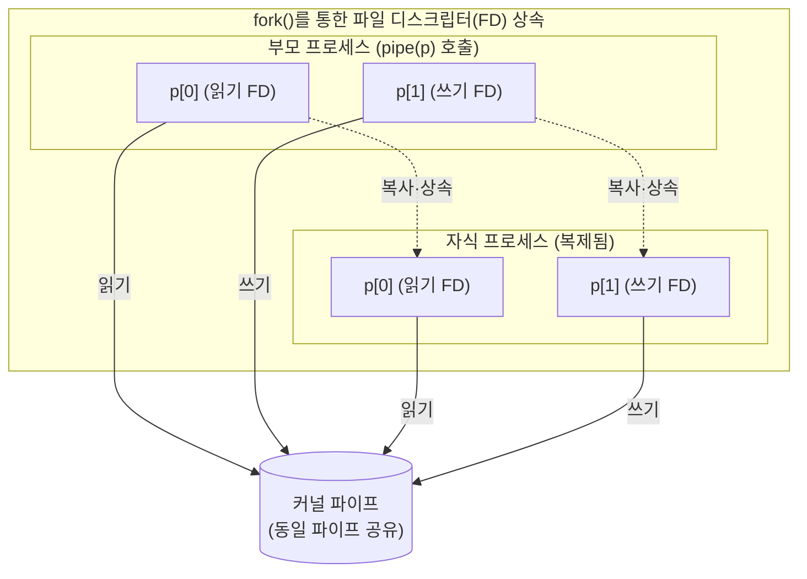
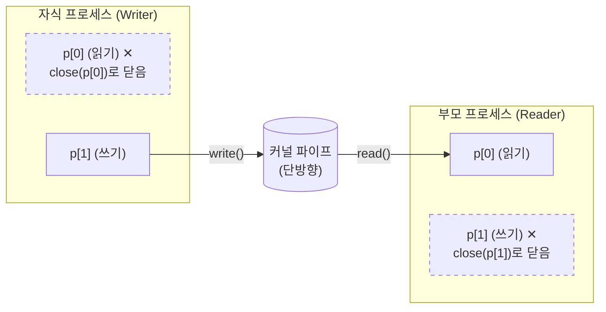
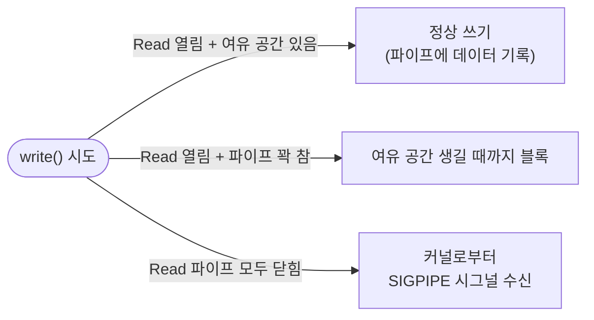
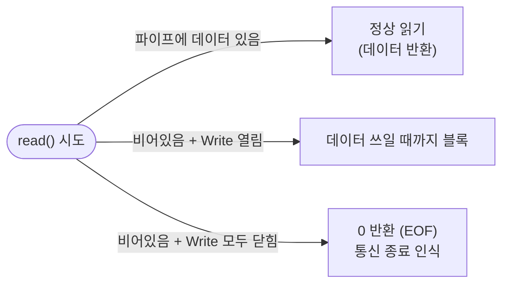

## 요약
**파이프**
- 커널 파이프 버퍼를 통해 프로세스 간 통신한다.
- 단방향 바이트 스트림이다.
- 메시지 경계가 없어, 합쳐지거나 나뉘어 읽힐 수 있다.

**익명 파이프**
- FD의 상속 관계가 있는 프로세스 간 통신
1. `pipe(fd[])`로 익명 파이프 생성 (`fork()` 전에 호출해야 같은 커널 파이프 버퍼를 가리킨다.)
2. `fork()`로 파일 디스크립터 상속
3. (exec()할 경우) `dup2()`
4. 각 프로세스가 쓰지 않는 끝 `close()`
	- EOF 판정 조건을 위해 닫아둔다.
	- 부모는 쓰기 끝, 자식은 읽기 끝을 닫는다.
5. (exec()할 경우) `exec()`
6. `write()`/`read()`로 데이터 전달
7. ==모든 쓰기 끝이 닫히고, 남은 데이터까지 읽으면==, 읽기는 EOF, 쓰기는 `SIGPIPE`

**논블로킹 모드 파이프**
- `fcntl(,,O_NONBLOCK);`
- 실패 시 errno `EAGAIN`

**동기식 I/O 멀티플렉싱**
- `select(nfds, rfds, wrfds, efds, timeout);`
- `nfds`는 최대 번호+1
- 반환되는 집합은 다음 호출에 재사용하면 안 된다.
- select()는 EOF도 읽기 준비된 것으로 본다.

**네임드 파이프** (FIFO)
- 파일 경로 형식의 이름를 알고 있는 프로세스 간 통신
1. `mkfifo(path, mode);`
2. `open(path, flags);`
	- `O_WRONLY | O_NONBLOCK`: 논블로킹 쓰기
	- `O_RDONLY | O_NONBLOCK`: 논블로킹 읽기

## 0. 배경: 컴퓨터 시스템의 전형적인 수행 시간
파이프는 디스크(임시 파일)가 아닌 **커널 메모리**를 통해 데이터를 주고받으므로 훨씬 빠른 통신이 가능하다.

| 항목       | 실제 수행 시간                   | 사람의 시간으로 환산 (비유) |
| :------- | :------------------------- | :--------------- |
| 프로세서 사이클 | 0.5 ns (2GHz)              | 1초               |
| 캐시 접근    | 1 ns (1GHz)                | 2초               |
| 메모리 접근   | 15 ns                      | 30초              |
| 문맥 교환    | 5,000 ns (5 $\mu\text{s}$) | 167분 (약 2.8시간)   |
| 디스크 접근   | 7,000,000 ns (7 ms)        | **162일**         |
| 타임 퀀텀    | 100,000,000 ns (100 ms)    | 6.3년             |

## 1. 명령어 수준에서의 파이프 `|`
**파이프** (pipe)
- 한 프로세스를 다른 관련된 프로세스에 연결시켜 주는 **단방향 통신 채널**이다.

**특징**
- 파이프를 지나가는 자료의 흐름은 운영체제에 의해 **자동적으로, 그리고 보이지 않게** 처리된다.
- 예: `$ pr doc | lp`
	- 파이프가 없다면 임시 파일(`tmpfile`)을 생성해 출력을 저장하고, 다시 입력으로 읽은 뒤 삭제(`rm`)해야 하지만, 파이프(`|`)는 이를 메모리 상에서 곧바로 연결한다.

## 2. 익명 파이프를 이용한 프로그래밍
### 2.1. 파이프 생성 시스템 콜 `pipe()`
```c
#include <unistd.h>
int pipe(int fd[2]);
```

**역할**
- 커널 내부에 파이프를 생성하고, 두 개의 파일 디스크립터를 배열에 담아 반환한다.

**파라미터**
- **`fd[0]`**: 파이프의 데이터를 읽는 FD
- **`fd[1]`**: 파이프에 데이터를 쓰는 FD

**반환값**
- 성공 시 `0`
- 실패 시 `-1`

### 2.2. 부모-자식 프로세스 간 통신 원리
1. **파이프 생성 및 상속**
	- 부모 프로세스가 `pipe(p)`를 호출한 뒤, `fork()`를 수행하면,
	- 자식 프로세스는 부모의 파일 디스크립터(`p[0]`, `p[1]`)를 그대로 복사하여 상속받는다.



2. **사용하지 않는 파일 디스크립터 닫기 (`close()`)**
	- 파이프는 **단방향**이므로, 데이터의 흐름을 명확히 하고 파일 디스크립터를 절약하기 위해 각 프로세스에서 쓰지 않는 쪽을 닫아준다.
	- **자식 → 부모 전송 시**
		- **자식(Writer)**: 읽기 기술자를 닫고(`close(p[0])`), `p[1]`에 `write()` 수행
		- **부모(Reader)**: 쓰기 기술자를 닫고(`close(p[1])`), `p[0]`에서 `read()` 수행



### 2.3. 파이프의 크기와 블로킹 특성
**파이프의 크기**
- 크기가 **유한**하다.
- (POSIX 기준 최소 512바이트이며, 대부분의 시스템은 그보다 훨씬 큼)
```c
fpathconf(fd, _PC_PIPE_BUF);  /* 파이프의 최대 쓰기 크기 확인 */
```





**프로세스 지연 (블로킹 동작)**
- **Write 블로킹**
	- 파이프가 꽉 차서 용량을 초과할 가능성이 있는 `write`가 시도되면,
	- 다른 프로세스가 데이터를 읽어가서 **충분한 공간이 마련될 때까지 `write` 수행이 블록** 된다.
- **Read 블로킹**
	- 파이프가 비어있으면, 누군가 데이터를 쓸 때까지 **`read` 수행이 블록** 된다.

### 2.4. 파이프 닫기 (종료 처리)
**Write 파이프를 모두 닫았을 때**
- 파이프에 대한 `read()`는 파일의 끝(EOF)에 도달한 것과 마찬가지로 **`0`을 반환**한다.
- (읽는 프로세스가 통신 종료를 인식하는 기준이 됨)

**Read 파이프를 모두 닫았을 때**
- 읽을 프로세스가 없는 파이프에 `write()`를 시도하는 모든 프로세스는 커널로부터 **`SIGPIPE` 시그널**을 받게 된다.

> 2026-10-27

## 3. 논블로킹 모드 파이프
파이프가 비어있거나 꽉 차 있을 때,
프로세스가 멈추지(block) 않고 즉시 복귀하여 다른 일을 처리하도록 만드는 기법이다.

### 방법 1. `fcntl(,,O_NONBLOCK)`
`fcntl()` 시스템 콜과 `O_NONBLOCK` 플래그를 사용하여 구현하는 일반적인 방법이다.
```c
#include <fcntl.h>
fcntl(filedes, F_SETFL, O_NONBLOCK);
```

**동작 특징**
- `O_NONBLOCK`이 설정된 상태에서 파이프가 비어있을 때 `read()`를 호출하면,
- 대기하지 않고 즉시 **`-1`을 반환**하며 전역 변수 `errno`에 `EAGAIN`이 설정된다.

**읽기(`read`) 반환값에 따른 분기 처리**
- `> 0`: 정상적으로 읽은 바이트 수 (메시지 수신)
- `== 0`: 쓰기 쪽 파이프가 닫힘 (EOF, 통신 종료)
- `== -1` (`errno == EAGAIN`): 현재 파이프가 비어있음 (다른 작업 수행 가능)

### 방법 2. `fstat()`
단 하나의 프로세스만이 파이프로부터 자료를 읽는 경우에 한해 사용 가능하다.

## 4. 동기식 I/O 멀티플렉싱 시스템 콜 `select()`
> 다수의 파이프를 취급

### 4.1. 개념 및 목적
- 하나의 프로세스(예: 서버)가 여러 자식 프로세스와 연결된 **여러 개의 파이프를 동시에 감시**해야 할 때 사용한다.
- 파이프뿐만 아니라 일반 파일, 터미널(표준 입력 등), FIFO, 소켓 등에도 동일하게 사용할 수 있는 **다중 입출력(I/O Multiplexing)** 해결책이다.

### 4.2. `select()` 시스템 콜
```c
#include <sys/time.h>
int select(
	int nfds,  /* 감시할 FD의 범위 */
	fd_set *readfds,   /* 읽기 준비 상태를 감시할 FD 집합 */
	fd_set *writefds,  /* 쓰기 준비 상태를 감시할 FD 집합 */
	fd_set *errorfds,  /* 예외 상태를 감시할 FD 집합 */
	struct timeval *timeout  /* 최대 대기 시간 */
);

struct timeval {
	long tv_sec;   /* 초 */
	long tv_usec;  /* 마이크로초 */
};
```

**매개변수**
- `nfds`: 검사할 파일 디스크립터의 개수 (감시 대상 중 **가장 큰 파일 디스크립터 번호 + 1**)
- `readfds` / `writefds` / `errorfds`: 각각 읽기, 쓰기, 오류 이벤트를 감시할 파일 디스크립터 비트마스크(`fd_set`)의 포인터
- `timeout`: 대기 시간을 지정하는 `struct timeval` 포인터 (`tv_sec`: 초, `tv_usec`: 마이크로초)
	- **`NULL`일 때**: 이벤트가 발생할 때까지 **무한정 대기(blocking)**
	- **`0`을 포함한 구조체일 때**: 기다리지 않고 상태만 확인 후 **즉시 반환(polling)**
	- **`0`이 아닌 값을 포함한 구조체일 때**: **지정된 시간 동안만 대기** 후 이벤트가 없으면 타임아웃 반환

> [!caution] 주의
> `select()` 호출이 끝나면 인자로 넘긴 `fd_set` 변수의 비트가 이벤트가 발생한 것만 남도록 **변경**된다.
> 따라서 반복문에서 `select()`를 계속 호출할 때는 원본 마스크(`master`)를 따로 보관해 두고 매번 복사(`set = master`)하여 사용해야 한다.

### 4.3. 비트 조작 매크로 (`fd_set` 제어)
`fd_set`
- 파일 디스크립터 번호를 비트로 표현한 마스크이다.
- 아래 4가지 매크로로 조작한다.
```c
/* fdset이 가리키는 비트마스크를 모두 0으로 초기화 */
void FD_ZERO(         fd_set *fdset)

/* 마스크 내의 fd번째 비트를 1로 설정 (감시 대상 추가) */
void FD_SET(  int fd, fd_set *fdset)

/* 마스크 내의 fd번째 비트를 0으로 설정 (감시 대상 제거) */
void FD_CLR(  int fd, fd_set *fdset)

/* 마스크 내의 fd번째 비트가 1인지 확인 (select 반환 후 이벤트 발생 여부 확인용) */
int  FD_ISSET(int fd, fd_set *fdset)
```

## 5. 파이프와 `exec()` 시스템 콜
셸(Shell)에서 `$ ls | wc`와 같은 파이프라인 명령어를 처리하는 내부 원리이다.

### 5.1. 핵심 원리
1. 셸(또는 부모 프로세스)에서 개방되어 있는 파일 디스크립터는 **`exec()` 시스템 콜을 수행한 이후에도 여전히 개방된 상태를 유지**한다.
2. `exec()`로 새 프로그램을 실행하기 전에 **`dup2()` 시스템 콜**을 사용하여 표준 출력(`1`)과 표준 입력(`0`)을 파이프에 연결한다.

### 5.2. 연결 과정
> `com1 | com2` 구현 시

- **쓰는 프로세스 (`com1`, 예: `ls`)**
	1. `dup2(p[1], 1);` → 표준 출력(`1`)이 쓰기 파이프(`p[1]`)를 가리키도록 복제
	2. `close(p[0]); close(p[1]);` → 불필요해진 원본 파이프 기술자 닫기 (절약)
	3. `execvp(com1[0], com1);` → 프로그램 실행 (화면에 출력하는 모든 내용이 파이프로 들어감)

- **읽는 프로세스 (`com2`, 예: `wc`)**
	1. `dup2(p[0], 0);` → 표준 입력(`0`)이 읽기 파이프(`p[0]`)를 가리키도록 복제
	2. `close(p[0]); close(p[1]);` → 불필요해진 원본 파이프 기술자 닫기
	3. `execvp(com2[0], com2);` → 프로그램 실행 (키보드 대신 파이프로부터 입력을 받음)

## 6. 네임드 파이프 (FIFO)
### 6.1. 익명 파이프 vs. 네임드 파이프 비교
| 구분           | 익명 파이프 (`pipe()`)                  | 네임드 파이프 (FIFO, `mkfifo()`)                                    |
| :----------- | :--------------------------------- | :------------------------------------------------------------ |
| **통신 대상**    | **부모와 자식** 등 혈연관계가 있는 프로세스만 연결 가능  | 혈연관계가 없는 **임의의 두 프로세스** 연결 가능                                 |
| **수명 (지속성)** | 일시적 (프로세스 종료 시 소멸, 영구히 존재 불가)      | **영구적** (파일 시스템 내에 존재)                                        |
| **식별 방법**    | 프로세스 내부의 파일 디스크립터 배열(`p[0]`, `p[1]`) | **UNIX 파일 이름(경로)** 을 부여받음 (권한 맨 앞이 `p`로 표시됨, 예: `prw-rw-r--`) |

### 6.2. 명령어 수준에서의 FIFO 사용
**생성 명령어**
```sh
/etc/mknod channel p
# 또는
mkfifo channel
```

**사용 예시**
```sh
$ cat < channel &        # 백그라운드에서 FIFO로부터 읽기 대기
$ ls -l > channel; wait  # FIFO로 출력 전송
```

### 6.3. FIFO를 이용한 프로그래밍
**FIFO 생성 함수**
```c
#include <sys/types.h>
#include <sys/stat.h>

int mkfifo(const char *pathname, mode_t mode);
```
- 이미 같은 이름의 FIFO 파일이 존재하면 `-1`을 반환하며, 이때 `errno`는 `EEXIST`가 된다.

#### FIFO 개방(`open()`) 시의 동작 특성
생성된 FIFO는 일반 파일처럼 `open()`, `read()`, `write()`, `close()`를 사용해 다룬다.

**Blocking Open (기본값)**
- **다른 프로세스가 읽기(`O_RDONLY`)를 위해 해당 FIFO를 `open`할 때까지 봉쇄(block)** 된다. (반대의 경우도 마찬가지)
```c
open("/tmp/fifo", O_WRONLY);
```

**Non-blocking Open**
- 상대 프로세스가 아직 열지 않았더라도 기다리지 않고 즉시 반환한다.
```c
open("/tmp/fifo", O_WRONLY | O_NONBLOCK);  /* O_NONBLOCK 플래그 추가 */
```

**지속적인 수신 대기**
- 메시지를 계속 받아야 하는 수신자(Receiver) 프로세스가 `open(fifo, O_RDWR)`(읽기/쓰기 겸용)으로 FIFO를 열면,
- 송신자가 연결을 끊더라도 쓰기 기술자가 항상 하나 열린 상태로 유지되므로,
- `read()`가 `0`(EOF)을 반환하며 종료되지 않고 다음 메시지를 계속 기다릴 수 있다.
```c
open(fifo, O_RDWR);
```
