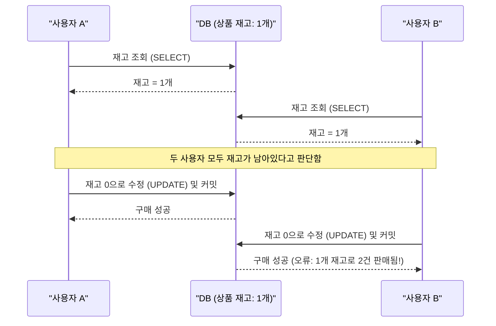
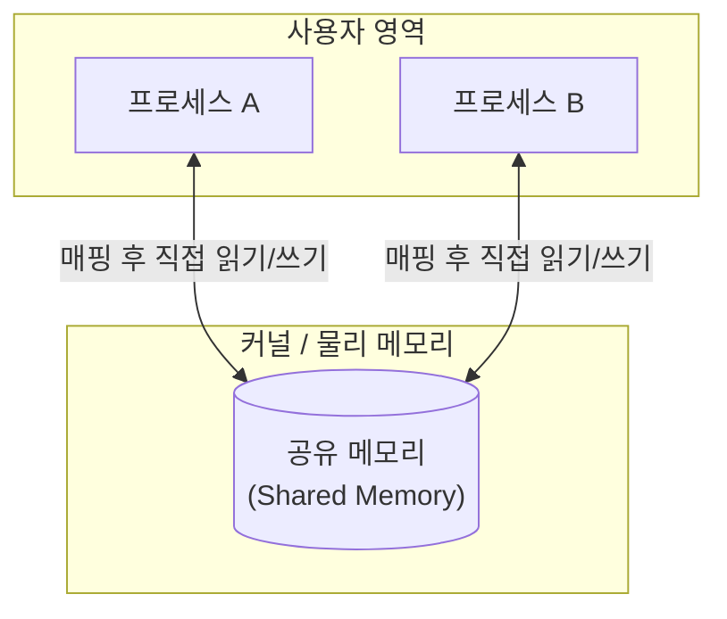
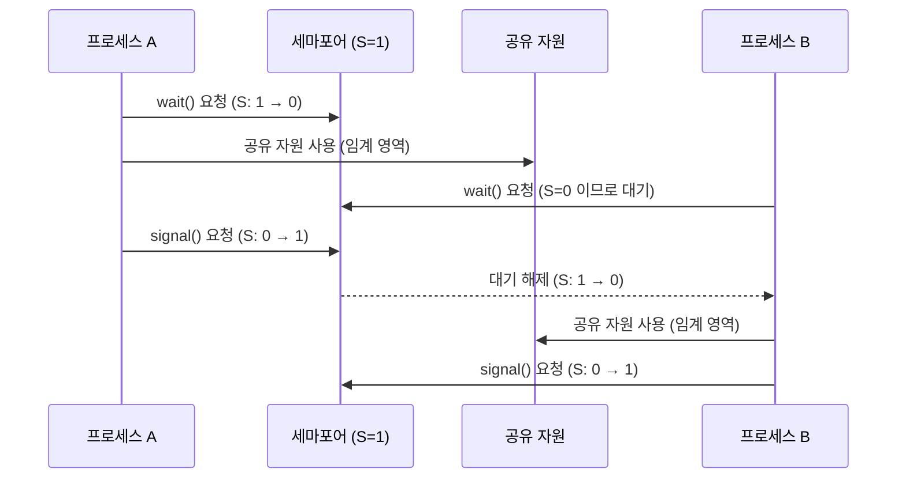

## 요약
레코드 로킹
- `fcntl()`

시스템 V IPC
- **메시지 큐**: 패킷/메시지 단위의 데이터 교환 (우선순위 부여 가능)
- **공유 메모리**: 대용량 데이터의 **초고속 공유**
- **세마포어**: 프로세스 간 **동기화** 및 임계 영역 보호

| 구분         | 헤더 파일         | 생성/접근<br>(`get`) | 핵심 연산                              | 제어/삭제<br>(`ctl`)       | 셸 삭제 옵션            |
| :--------- | :------------ | :--------------- | :--------------------------------- | :--------------------- | :----------------- |
| **메시지 큐**  | `<sys/msg.h>` | `msgget()`       | `msgsnd()` (송신)<br>`msgrcv()` (수신) | `msgctl()`             | `ipcrm -q <msgid>` |
| **공유 메모리** | `<sys/shm.h>` | `shmget()`       | `shmat()` (부착)<br>`shmdt()` (분리)   | `shmctl()`             | `ipcrm -m <shmid>` |
| **세마포어**   | `<sys/sem.h>` | `semget()`       | `semop()`<br>(`p`, `v` 연산)         | `semctl()`<br>(초기화 포함) | `ipcrm -s <semid>` |

## 1. 레코드 로킹
레코드 로킹의 필요성


**레코드 로킹** (Record Locking)
- 여러 프로세스가 동일한 파일을 동시에 읽고 쓸 때 데이터가 손상되는 것을 막기 위해, **현재 사용 중인 파일의 특정 구역(일부)을 잠그는 기법**이다.
- 커널에 의해 **원자적 연산**으로 보장된다.

### 1.1. 로크의 종류
| 구분                    | 상수명       | 설명                   | 동시 접근 가능 여부                       |
| :-------------------- | :-------- | :------------------- | :-------------------------------- |
| **읽기 로크**<br>(공유 로크)  | `F_RDLCK` | 데이터를 읽기 위해 설정하는 로크   | 다른 프로세스의 **읽기 로크은 허용**, 쓰기 로크은 불허 |
| **쓰기 로크**<br>(배타적 로크) | `F_WRLCK` | 데이터를 수정하기 위해 설정하는 로크 | 다른 프로세스의 **읽기·쓰기 로크 모두 불허**       |
| **로크 해제**             | `F_UNLCK` | 설정된 잠금을 해제           | -                                 |

### 1.2 `fcntl` 함수와 `flock` 구조체
레코드 로킹은 `<fcntl.h>`의 `fcntl()` 시스템 콜을 사용한다.

```c
#include <fcntl.h>

int fcntl(
	int fd,
	int cmd,
	struct flock *ldata
);

struct flock {
	short l_type;    /* 로크의 유형 (F_RDLCK, F_WRLCK, F_UNLCK) */
	short l_whence;  /* 오프셋 기준 위치 (SEEK_SET, SEEK_CUR, SEEK_END) */
	off_t l_start;   /* 기준점에서 떨어진 바이트 수 */
	off_t l_len;     /* 잠글 세그먼트의 바이트 길이 */
	pid_t l_pid;     /* F_GETLK 조회 결과: 충돌 로크 소유 PID */
};
```

**`cmd` (명령어 인자)**
- `F_GETLK`: `ldata`가 가리키는 구역의 로크 상태 정보를 조회 (잠금을 보유한 프로세스의 PID 확인 가능)
- `F_SETLK`: 로크을 설정하거나 해제(`F_UNLCK`)하고 **즉시 리턴** (다른 프로세스에 의해 잠겨 있으면 기다리지 않고 `-1` 반환, `errno`에 `EACCES` 또는 `EAGAIN` 설정)
- `F_SETLKW`: 로크을 설정하되, 다른 프로세스에 의해 이미 봉쇄(Block)되어 있으면 **로크이 풀릴 때까지 대기(Sleep)**

**`struct flock` (로크 설정 정보 구조체)**
- `short l_type`: 로크의 유형 (`F_RDLCK`, `F_WRLCK`, `F_UNLCK`)
- `short l_whence`: 오프셋 기준 위치 (`SEEK_SET`: 파일 시작, `SEEK_CUR`: 현재 파일 포인터, `SEEK_END`: 파일 끝)
- `off_t l_start`: 기준 위치(`l_whence`)로부터의 상대적 시작 위치 (Offset)
- `off_t l_len`: 잠글 세그먼트의 바이트 길이 (Length)
- `pid_t l_pid`: `F_GETLK` 호출 시 현재 로크을 걸고 있는 프로세스의 PID가 저장됨

### 1.3 레코드 로킹의 주요 특징
- **자동 해제**: 프로세스가 종료(`exit`)되면 해당 프로세스가 걸어둔 모든 레코드 로크은 자동으로 해제됩니다.
- **교착 상태 (Deadlock)**: 두 프로세스가 각각 파일의 서로 다른 영역을 잠근 상태에서, 상대방이 잠근 영역에 대해 `F_SETLKW`(대기 모드)로 잠금을 요청하면 서로 무한정 기다리는 **교착 상태**가 발생할 수 있습니다.

## 2. 시스템 V IPC 기본 개념
**시스템 V IPC**
- 유닉스 시스템 V 버전에서 도입한 3가지 IPC 메커니즘이다.

| 구분         | 주요 목적                          | 헤더 파일         | 생성/접근 (`get`) | 핵심 연산                              | 제어/삭제 (`ctl`)       | 셸 삭제 옵션            |
| :--------- | :----------------------------- | :------------ | :------------ | :--------------------------------- | :------------------ | :----------------- |
| **세마포어**   | 프로세스 간 **동기화** 및 임계 영역 보호      | `<sys/sem.h>` | `semget()`    | `semop()` (`p`, `v` 연산)            | `semctl()` (초기화 포함) | `ipcrm -s <semid>` |
| **메시지 큐**  | 패킷/메시지 단위의 데이터 교환 (우선순위 부여 가능) | `<sys/msg.h>` | `msgget()`    | `msgsnd()` (송신)<br>`msgrcv()` (수신) | `msgctl()`          | `ipcrm -q <msgid>` |
| **공유 메모리** | 대용량 데이터의 **초고속 공유**            | `<sys/shm.h>` | `shmget()`    | `shmat()` (부착)<br>`shmdt()` (분리)   | `shmctl()`          | `ipcrm -m <shmid>` |

### 2.1. 공통 메커니즘
#### (1) IPC 설비 키 (Facility Key, `key_t`)
파일 시스템의 파일 이름처럼 커널 내의 **IPC 객체를 식별하기 위해 사용하는 숫자**이다.
```c
#include <sys/ipc.h>

/* 존재하는 파일 경로명 path와 숫자 id를 조합해 고유한 키값을 생성한다. */
key_t ftok(const char *path, int id);
```

#### (2) IPC `get` 연산 (`msgget`, `semget`, `shmget`)
새로운 IPC 객체를 생성하거나 기존 객체에 접근한다. (파일의 `open` / `creat`와 유사)

호출 결과로 **IPC 설비 식별자**(Identifier)를 반환하며, 이는 파일 디스크립터(`fd`)와 유사하지만 시스템 전체에서 고유한 값이다.

**주요 생성 플래그 (`permflags`)**
- `IPC_CREAT`: 해당 키의 IPC 객체가 없으면 새로 생성하고, 이미 있으면 기존 객체를 반환한다. (덮어쓰지 않음)
- `IPC_EXCL`: `IPC_CREAT`와 함께 사용 시, 이미 객체가 존재하면 실패(`-1` 반환) 처리하여 **오직 새로 생성되는 경우에만 성공**하도록 보장한다.

#### (3) IPC 제어 연산 (`msgctl`, `semctl`, `shmctl`)
모든 제어 연산은 공통적인 3가지 표준 명령(`command`)을 지원한다.
- `IPC_STAT`: IPC 객체의 상태 정보를 구조체에 읽어옴
- `IPC_SET`: IPC 객체의 소유권, 접근 권한 및 제어 변수 값을 변경
- `IPC_RMID`: 시스템에서 해당 IPC 객체를 **삭제**

#### (4) 상태 자료구조와 권한 구조체 (`struct ipc_perm`)
각 IPC 객체가 생성될 때마다 상태 자료구조가 하나씩 만들어지며,
공통적으로 접근 허가 구조체인 `ipc_perm`을 포함한다.

구성 요소
- 생성자 ID(`cuid`), 생성자 그룹 ID(`cgid`), 유효 사용자 ID(`uid`), 유효 그룹 ID(`gid`), 접근 권한(`umode`)

### 2.2. IPC 관리 셸 명령어
`ipcs`
- 현재 시스템에서 실행 중인 IPC 설비(메시지 큐, 공유 메모리, 세마포어)의 상태 목록을 출력한다.

`ipcrm`
- 시스템으로부터 특정 IPC 설비를 강제로 제거한다.
```sh
ipcrm -q <msgid>  # 메시지 큐 제거
ipcrm -s <semid>  # 세마포어 제거
ipcrm -m <shmid>  # 공유 메모리 제거
```

## 3. 메시지 큐
**메시지 큐** (Message Queue)
- 프로세스 간에 **메시지**(문자나 바이트의 열)를
- 커널이 관리하는 **메시지 큐**라는 통로를 통해 주고받는 방식이다.


### 3.1. 메시지 구조체 템플릿
메시지를 송수신할 때는 반드시 첫 번째 멤버로 메시지 타입(`long mtype`)을 갖는 구조체를 정의해 사용해야 한다.
```c
struct mymsg {
	long mtype;             /* 메시지 타입 (양의 정수, 우선순위 등으로 활용) */
	char mtext[SOMEVALUE];  /* 실제 전송할 메시지 데이터 */
};
```

### 3.2. 주요 함수
#### (1) 생성 및 접근
```c
int mqid = msgget(key_t key, int flags);
/* 메시지 큐를 생성/개방한다. */
/* 메시지 큐 식별자 mqid를 반환한다. */
```

#### (2) 메시지 송신
```c
int msgsnd(int mqid, const void *message, size_t size, int flags);
/* mqid가 가리키는 큐에 size 크기의 메시지를 추가한다. */
```

#### (3) 메시지 수신
```c
ssize_t msgrcv(int mqid, void *message, size_t size, long msg_type, int flags);
/* 큐에서 조건에 맞는 메시지를 읽어오며, 읽은 메시지는 큐에서 제거된다. */
```

**`msg_type`에 따른 수신 동작 (핵심)**
- **`0`**
	- 타입에 관계없이 큐의 **첫 번째 메시지** 수신
	- 활용 용도: 일반적인 선입선출(FIFO) 큐
- **`> 0` (양수)**
	- `mtype`이 `msg_type`과 **정확히 일치하는** 첫 번째 메시지 수신
	- 활용 용도: 특정 종류의 메시지만 골라 받기
- **`< 0` (음수)**
	- `mtype`이 `msg_type`(절댓값) 이하인 것 중 **가장 작은 `mtype`을 가진** 메시지 수신
	- 활용 용도: **우선순위 큐(Priority Queue)** 구현

**주요 `flags`**
- `IPC_NOWAIT`: 조건에 맞는 메시지가 없을 때 대기하지 않고 즉시 에러(`-1`) 리턴 (Non-blocking)
- `MSG_NOERROR`: 수신한 메시지가 버퍼 크기(`size`)보다 클 때 에러를 내지 않고 크기에 맞춰 뒷부분을 **절단**(Truncate)하여 수신

#### (4) 메시지 큐 제어
```c
int msgctl(int mqid, int command, struct msqid_ds *status);
```

명령
- `IPC_STAT`
- `IPC_SET`
- `IPC_RMID`: 큐를 삭제한다.

`msqid_ds` 구조체를 통해 조회·변경한다.
- 큐에 쌓인 메시지 개수(`msg_qnum`)
- 최대 바이트 수(`msg_qbytes`)
- 마지막 송/수신 프로세스 PID(`msg_lspid`, `msg_lrpid`)
- 마지막 송/수신/변경 시각(`msg_stime`, `msg_rtime`, `msg_ctime`)

## 4. 공유 메모리
**공유 메모리** (Shared Memory)
- 두 개 이상의 프로세스가 **물리적 메모리의 일부 영역을 자신의 논리 주소 공간에 연결하여 함께 사용하는 기법**이다.



### 4.1. 특징
**최고의 효율성**
- 커널 영역으로 데이터를 복사하고 다시 읽어오는 과정(시스템 콜 오버헤드) 없이 메모리에 직접 읽고 쓰므로, **3가지 IPC 기법 중 속도가 가장 빠르고 효율적**이다.

**동기화 필요성**
- 공유 메모리 자체에는 접근 순서 제어 기능이 없으므로, 여러 프로세스가 동시에 읽고 쓸 때 데이터가 꼬이지 않도로크 **세마포어 등을 함께 사용하여 동기화**해야 한다.

### 4.2. 동작 흐름
**사용 순서**
- `shmget`(공유 메모리 생성)
- → `shmat`(프로세스 주소 공간에 부착)
- → 포인터로 읽기/쓰기
- → `shmdt`(주소 공간에서 분리)
- → `shmctl`(공유 메모리 제거)

### 4.3. 주요 함수
#### (1) 생성
```c
int shmget(key_t key, size_t size, int flags);
```
- `size` 바이트 크기의 공유 메모리 세그먼트를 생성하고 식별자(`shmid`)를 반환한다.

#### (2) 부착 (Attach)
```c
void *shmat(int shmid, const void *addr, int flags);
```
- 생성된 공유 메모리 영역을 호출 프로세스의 **논리적 주소 공간에 연결**하고, 그 시작 주소를 반환한다.
- `addr`
	- `NULL`(`0`)인 경우: 커널이 프로세스 내 사용 가능한 첫 번째 적절한 주소를 찾아 자동으로 부착한다. (일반적인 사용법)
	- `NULL`이 아닌 경우: 지정된 주소(또는 `SHM_RND` 설정 시 가장 가까운 페이지 경계 주소)에 부착한다.
- `flags`
	- `SHM_RDONLY`(읽기 전용으로 부착)
	- `SHM_RND`(주소를 페이지 경계에 맞춤)

#### (3) 분리 (Detach)
```c
int shmdt(const void *addr);
```
- 프로세스의 논리 주소 공간에서 공유 메모리 세그먼트 연결을 끊는다.
- (메모리 자체가 삭제되는 것은 아님)

#### (4) 제어 및 삭제
```c
int shmctl(int shmid, int command, struct shmid_ds *status);
```
- 공유 메모리의 상태를 조회(`IPC_STAT`)·변경(`IPC_SET`)하거나
- 시스템에서 완전히 제거(`IPC_RMID`)한다.

## 5. 세마포어
**세마포어** (Semaphore)
- 여러 프로세스가 공유 자원에 동시에 접근하는 것을 막고,
- **임계 영역(Critical Section)을 보호(동기화)**하기 위해 사용하는
- **정수형 변수(`sem`)**이다.



### 5.1. 세마포어의 기본 원리 (`p`와 `v` 연산)
> [!tip] System V (1983) vs. POSIX (1988)
> semop()의 `p()` 연산 (proberen) → `sem_wait()`
> semop()의 `v()` 연산 (verhogen) → `sem_post()`

`p()` (임계 영역 진입 시)
- `sem != 0`이면: `sem` 값을 1 감소(`sem--`)시키고 즉시 임계 영역으로 진입한다.
- `sem == 0`이면: `sem`이 0보다 커질 때까지 **대기(Wait)**한 뒤, 깨어나면 1 감소시키고 진입한다.

`v()` (임계 영역 빠져나올 때)
- `sem` 값을 1 증가(`sem++`)시킨다.
- 만약 대기 큐(Wait queue)에 기다리는 프로세스가 있다면 첫 번째 대기 프로세스를 깨워 재시작시킨다.

```
p(sem);                  // 1. 잠금 획득 (자원 점유)
/* Critical Section */   // 2. 임계 영역 작업 수행
v(sem);                  // 3. 잠금 해제 (자원 반납)
```

### 5.2. System V 세마포어 함수
System V IPC의 세마포어는 단일 변수가 아니라 **세마포어 집합(배열)** 단위로 다루어진다.

#### (1) 세마포어 집합 생성
```c
int semget(key_t key, int nsems, int flags);
```
- `nsems` 개수의 세마포어를 가진 집합을 생성하고 식별자(`semid`)를 반환한다.
- 집합 내 각 세마포어는 인덱스(`0` ~ `nsems - 1`)로 구분하며 각 값을 `semval`이라 부른다.

#### (2) 세마포어 제어 및 초기화
```c
int semctl(int semid, int sem_num, int command, union semun ctl_arg);

/* 환경에 따라 프로그램에서 정의해야 하는 공용체 */
union semun {
	int val;                /* SETVAL */
	struct semid_ds *buf;   /* IPC_STAT, IPC_SET */
	unsigned short *array;  /* GETALL, SETALL */
};
```
- `union semun` 공용체를 인자로 사용하여 세마포어를 초기화하거나 상태를 제어한다.

**주요 `command` 분류**
- **표준 IPC 기능**
	- `IPC_STAT`, `IPC_SET`, `IPC_RMID`(세마포어 집합 삭제)
- **단일 세마포어 연산** (`sem_num` 인덱스 지정)
	- `GETVAL` / `SETVAL`: 특정 세마포어의 값(`semval`)을 조회하거나 `ctl_arg.val`로 설정(초기화)
	- `GETPID`: 가장 최근에 해당 세마포어에 접근한 프로세스의 PID(`sempid`) 반환
	- `GETNCNT`: 세마포어 값이 현재보다 커지기를 기다리는 프로세스 수(`semncnt`) 반환
	- `GETZCNT`: 세마포어 값이 `0`이 되기를 기다리는 프로세스 수(`semzcnt`) 반환
- **전체 세마포어 연산**
	- `GETALL` / `SETALL`: 집합 내 모든 세마포어 값을 `ctl_arg.array` 배열에 읽어오거나 일괄 설정

#### (3) 세마포어 연산 수행 (`p`, `v` 실행)
```c
int semop(int semid, struct sembuf *ops, size_t num_ops);

struct sembuf {
	unsigned short sem_num;  /* 연산을 수행할 세마포어의 집합 내 인덱스 */
	short          sem_op;   /* 수행할 연산을 결정하는 정수 */
	short          sem_flg;  /* IPC_NOWAIT, SEM_UNDO 등 */
};
```
- `sembuf` 구조체 배열을 전달하여 실제 세마포어 증감 연산을 수행한다.

`sem_op`
- **음수 (`< 0`)**: **`p()` 연산** (값 감소, 부족하면 대기)
- **양수 (`> 0`)**: **`v()` 연산** (값 증가, 대기 프로세스 깨움)
- **`0`**: 세마포어 값(`semval`)이 `0`이 될 때까지 대기

`sem_flg`
- `IPC_NOWAIT`: 대기하지 않고 즉시 리턴
- `SEM_UNDO`: 프로세스가 세마포어를 풀어주지 못하고 비정상 종료하더라도, 커널이 해당 프로세스가 수행했던 세마포어 연산을 **자동으로 원상 복구(Undo)**하여 데드락을 방지한다.
