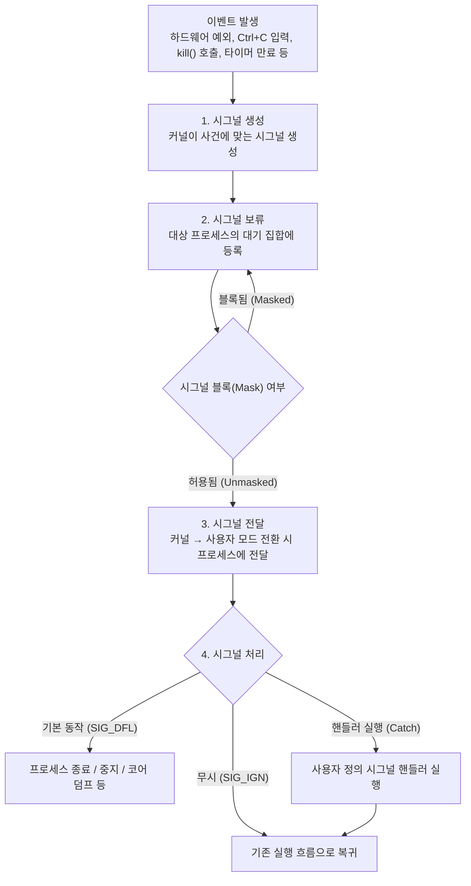
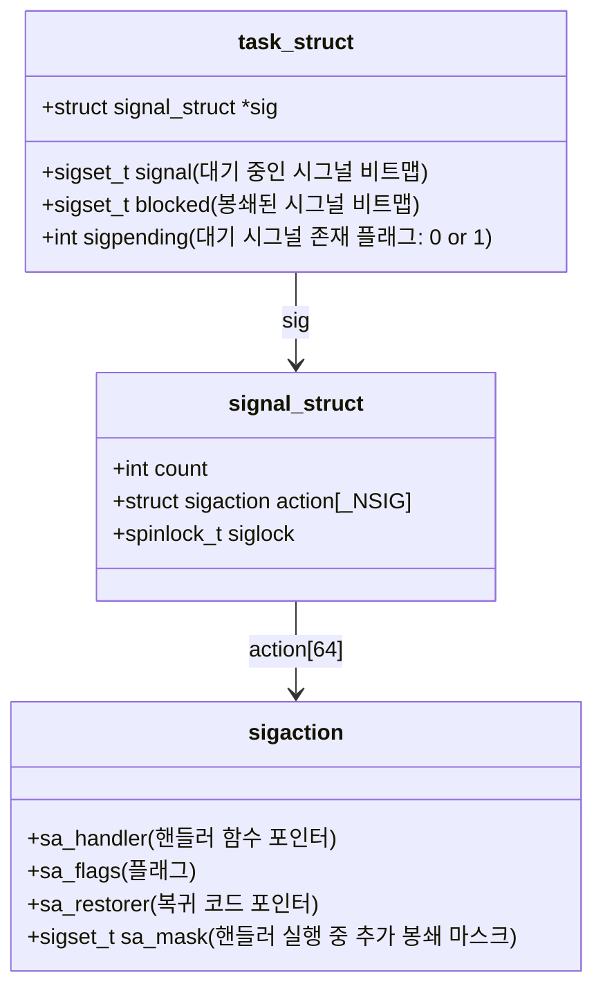

## 요약
IPC
- 파이프
	- 익명 파이프
	- 네임드 파이프 (FIFO)
- 시스템 V IPC
	- 메시지 큐
	- 공유 메모리 및 세마포어
- 시그널 (비동기 소프트웨어 인터럽트)
	- **시그널의 라이프 사이클**
		1. **생성**: 이벤트 발생으로 시그널 생성
		2. **보류**: 시그널 마스크로 블록 → `sigprocmask()`
		3. **전달**: 프로세스에 수신
		4. **처리**: 기본 동작, 무시, 핸들러 실행 → `sigaction()`

시그널 보내기 함수
- `kill()`: 다른 프로세스
- `raise()`: 자기 자신
- `alarm()`: 타이머

## 1. 협력 프로세스
### 1.1. 독립 프로세스 vs. 협력 프로세스
**독립 프로세스**
- 다른 프로세스의 실행에 영향을 주지도, 받지도 않는 프로세스이다.
- UNIX/Linux의 프로세스는 기본적으로 독립적이다.
- (예: `fork()`를 통해 생성된 자식 프로세스는 부모와 별도의 독립된 메모리 공간을 가진다.)

**협력 프로세스**
- 다른 프로세스의 실행에 영향을 주거나 영향을 받을 수 있는 프로세스이다.
- **협력의 장점**: *정보 공유, 연산 속도 향상, 모듈화, 편의성*
- **주의점**: 공유 자원(예: 생산자-소비자 문제의 버퍼 카운터)에 동시에 접근할 때 **동기화 문제(Race Condition)**가 발생할 수 있다.

### 1.2. IPC 및 동기화 인터페이스
**동일 시스템 내**
- 동기화
- 파이프
	- 익명 파이프
	- 네임드 파이프 (FIFO)
- 시스템 V IPC
	- 메시지 큐
	- 공유 메모리 및 세마포어
- 시그널
- STREAM

**서로 다른 시스템 간**
- 소켓
- RPC (Remote Procedure Call)
- RMI, DCOM, CORBA 등

## 2. 시그널 개요
### 2.1. 시그널의 정의 및 특징
**시그널**
- 비동기적인 사건이나 예외적인 상황의 발생을 프로세스에게 알리는 소프트웨어 인터럽트 메커니즘이다.

**전송 주체**
- **커널 → 프로세스**: 하드웨어 예외, 타이머 만료, 터미널 입력 등 발생 시 커널이 전송
- **프로세스 → 프로세스**: `kill()` 시스템 콜을 통해 다른 프로세스에게 전송

**헤더**
- `<signal.h>`에 정의되어 있다.

**개수**
- Linux 기준 최대 64개(일반 시그널 31개 + 실시간 시그널)의 시그널을 지원한다.

### 2.2. 시그널에 의한 종료 유형
**정상 종료 (Normal Termination)**
- 대부분의 시그널은 수신 시 프로세스를 일반 종료시킨다.

**비정상 종료 (Abnormal Termination)**
- 오류 원인을 디버깅할 수 있도록 메모리 상태를 저장한 **코어 덤프(Core dump)** 파일을 생성하며 종료시킨다.
- 대상 시그널: `SIGABRT`(`abort()` 호출), `SIGBUS`, `SIGSEGV`, `SIGQUIT`, `SIGILL`, `SIGTRAP`, `SIGSYS`, `SIGXCPU`, `SIGXFSZ`, `SIGFPE`

**자식 프로세스의 상태 확인 (`<sys/wait.h>`)**
- 부모 프로세스는 `wait(&status)` 호출 후 매크로를 통해 자식의 종료 원인을 구별할 수 있다.
- `WIFEXITED(status)`: 정상적으로 `exit` 했는지 검사 (`WEXITSTATUS`로 종료 코드 확인)
- `WIFSIGNALED(status)`: 시그널에 의해 종료되었는지 검사 (`WTERMSIG`로 시그널 번호 확인)
- `WIFSTOPPED(status)`: 시그널에 의해 일시 중단되었는지 검사 (`WSTOPSIG`로 시그널 번호 확인)

## 3. 리눅스의 주요 시그널 종류
> [!important] `SIGKILL`과 `SIGSTOP`
> 무시하거나 포착할 수 없다.

### 3.1. 프로세스 종료 관련
| 시그널                      | 발생 원인 및 특징                                                                                                                                                |   기본 행동   |
| :----------------------- | :-------------------------------------------------------------------------------------------------------------------------------------------------------- | :-------: |
| **`SIGHUP`**             | • 제어 터미널의 연결이 끊어졌을 때 제어 프로세스에게 전송<br>• 세션 리더가 종료될 때 전경(Foreground) 프로세스 그룹에 전송<br>• *활용*: 터미널이 없는 **데몬(Daemon) 프로세스에게 설정 파일을 다시 읽도록(reload) 지시**할 때 흔히 사용 |    종료     |
| **`SIGINT`**             | 터미널에서 인터럽트 키(`Ctrl-C` 또는 `DEL`) 입력 시 발생                                                                                                                   |    종료     |
| **`SIGQUIT`**            | 터미널에서 종료 키(`Ctrl-\`) 입력 시 발생                                                                                                                              | 종료 (Core) |
| **`SIGABRT`** (`SIGIOT`) | `abort()` 함수 호출에 의한 비정상 종료 또는 하드웨어 결함                                                                                                                     | 종료 (Core) |
| **`SIGKILL`**            | **무조건적인 강제 종료 시그널**                                                                                                                                       |    종료     |
| **`SIGTERM`**            | `kill` 명령어가 기본적으로 보내는 표준 종료 요청 시그널                                                                                                                        |    종료     |

### 3.2. 하드웨어/물리적 예외 상황 관련
| 시그널             | 발생 원인                                      |   기본 행동   |
| :-------------- | :----------------------------------------- | :-------: |
| **`SIGILL`**    | 잘못된 기계어 명령어(Illegal instruction) 수행        |    종료     |
| **`SIGTRAP`**   | 디버거 브레이크포인트 도달 (`ptrace` 시스템 콜)            | 종료 (Core) |
| **`SIGBUS`**    | 버스 에러 (메모리 정렬 오류 등 하드웨어 버스 결함)             |    종료     |
| **`SIGFPE`**    | 산술 연산 오류 (0으로 나누기, 부동소수점 예외 등)             |    종료     |
| **`SIGSEGV`**   | 유효하지 않은 메모리 주소 참조 (Segmentation Violation) | 종료 (Core) |
| **`SIGSTKFLT`** | 수치 보조 프로세서(Co-processor) 스택 오버플로우          |    종료     |

### 3.3. 일시 중단 및 재개 관련
| 시그널                      | 발생 원인 및 특징                                 |      기본 행동      |
| :----------------------- | :----------------------------------------- | :-------------: |
| **`SIGCHLD`** (`SIGCLD`) | 자식 프로세스가 종료되거나 중단되었을 때 부모 프로세스에게 전송        | **무시 (Ignore)** |
| **`SIGCONT`**            | 중지(Stopped) 상태인 프로세스의 실행을 재개시킴             | **재개 (Resume)** |
| **`SIGSTOP`**            | **프로세스를 강제로 일시 중단**                        |    **일시 중단**    |
| **`SIGTSTP`**            | 터미널에서 일시 중단 키(`Ctrl-Z`) 입력 시 발생 (포착/무시 가능) |    **일시 중단**    |
| **`SIGTTIN`**            | 백그라운드 프로세스가 제어 터미널에서 읽기를 시도할 때 발생          |    **일시 중단**    |
| **`SIGTTOU`**            | 백그라운드 프로세스가 제어 터미널에 쓰기를 시도할 때 발생           |    **일시 중단**    |

### 3.4. 기타 시그널 (사용자 정의, 자원, 알람, 입출력)
**프로그래머 정의**
- `SIGUSR1`, `SIGUSR2` (사용자 프로그램에서 목적에 맞게 정의하여 사용 / 기본: 종료)

**파이프 및 자원 제한**
- `SIGPIPE`: 읽는 프로세스(Reader)가 없는 파이프에 쓰기를 시도할 때 (기본: 종료)
- `SIGXCPU`: CPU 시간 제한 초과 (기본: 종료)
- `SIGXFSZ`: 파일 크기 제한 초과 (기본: 종료)

**알람(타이머) 관리**
- `SIGALRM`: `alarm()` 함수 또는 실제 시간 타이머(`ITIMER_REAL`) 만료 (기본: 종료)
- `SIGVTALRM`: 프로세스가 실제 실행된 시간만 측정하는 가상 타이머(`ITIMER_VIRTUAL`) 만료 (기본: 종료)
- `SIGPROF`: 프로파일링 타이머(`ITIMER_PROF`) 만료 (기본: 종료)

**입출력 및 전원**
- `SIGWINCH`: 터미널 윈도우 크기 변경 (기본: **무시**)
- `SIGURG`: 소켓에 긴급(Out-of-band) 데이터 도착 (기본: **무시**)
- `SIGIO` (`SIGPOLL`): 비동기 입출력 이벤트 발생 가능 알림 (기본: 종료)
- `SIGPWR` (`SIGINFO`): 전원 공급 이상 발생 (기본: 종료)

## 4. 시그널의 라이프 사이클
> 시그널의 라이프 사이클: **생성 → 보류 → 전달 → 처리**



### 4.1. 시그널 생성
시그널 생성 원인 5가지
1. **터미널 특수키 입력**: `Ctrl-C`(`SIGINT`), `Ctrl-\`(`SIGQUIT`), `Ctrl-Z`(`SIGTSTP`) 등
2. **하드웨어 오류**: 0으로 나누기(`SIGFPE`), 잘못된 메모리 참조(`SIGSEGV`) 등
3. **`kill()` 시스템 콜**: 특정 프로세스나 그룹에 시그널 전달 (대상 프로세스에 대한 권한 필요)
4. **`kill` 명령어 실행**: 셸 명령어로 내부적으로 `kill()` 함수를 호출
5. **소프트웨어적 조건**: 알람 타이머 종료(`SIGALRM`), 끊어진 파이프 쓰기(`SIGPIPE`), 네트워크 긴급 데이터(`SIGURG`) 등

### 4.2. 시그널 보류
**보류 (Pending)**
- 시그널이 발생했으나 블록 등의 이유로 **아직 프로세스에 전달되지 못한 상태**이다.
- *중첩 불가*: 일반 UNIX 시그널은 대기열(Queue)에 쌓이지 않으므로, 한 순간에 한 프로세스에 대해 보류(Pending)된 시그널은 **각 시그널 종류별로 최대 1개**만 유지된다.

**블록 (Block)**
- 특정 시그널이 프로세스에 전달되지 못하도록 막는 것이다.
- 블록된 시그널이 발생하면 블록이 해제되거나 무시(`SIG_IGN`)로 변경될 때까지 **보류(Pending) 상태**로 남아 있다.

**시그널 마스크 (Signal Mask)**
- 현재 프로세스에 대해 **블록(봉쇄)될 시그널들의 집합**이다.

### 4.3. 시그널 전달
**전달 (Delivery)**
- 생성된 시그널이 프로세스에 수신되어 지정된 방법대로 처리되는 것이다.

### 4.4. 시그널 처리
시그널을 받은 프로세스의 3가지 처리 행동

1. **기본 동작 수행 (`SIG_DFL`)**
	- 별도의 처리를 지정하지 않은 경우 시그널 고유의 기본 동작(대부분 종료)을 수행한다.

2. **시그널 무시 (`SIG_IGN`)**
	- 시그널을 무시한다.
	- 단, **`SIGKILL`과 `SIGSTOP`은 절대 무시할 수 없다.**
	- 하드웨어 오류(`SIGSEGV`, `SIGFPE` 등)로 발생한 시그널을 무시하면 무한 루프나 예측 불가능한 동작이 발생할 수 있어 주의해야 한다.

3. **시그널 포착 (Catch / 사용자 정의 핸들러 실행)**
	- 시그널 수신 시 미리 등록해 둔 **사용자 수준 함수(Signal Handler)**를 실행한다.
	- 단, **`SIGKILL`과 `SIGSTOP`은 포착할 수 없다.**
	- **활용 예 - 우아한 퇴장(Graceful Exit)**: `SIGINT` 등을 포착하여 작업 중이던 임시 파일을 삭제(`unlink`)하고 안전하게 종료하도록 구현할 수 있다.

> 2026-11-16

## 5. 시그널 제어 시스템 콜 및 함수
### 5.1. 시그널 관련 주요 시스템 콜 요약
| 시스템 콜 | 설명 |
| :--- | :--- |
| `kill()` | 특정 프로세스(또는 프로세스 그룹)에 시그널을 보냄 |
| `sigaction()` / `signal()` | 특정 시그널 수신 시 취할 행동(핸들러 등)을 변경/지정함 |
| `sigprocmask()` | 블록(봉쇄)할 시그널의 집합(시그널 마스크)을 변경함 |
| `sigpending()` | 현재 블록되어 지연(Pending) 중인 시그널이 있는지 확인함 |
| `sigsuspend()` / `pause()` | 시그널이 도착할 때까지 프로세스 실행을 일시 대기함 |
| `rt_sig*()` | 실시간(Real-time) 시그널 처리를 위한 시스템 콜들 |

### 5.2. 시그널 집합 (`sigset_t`) 조작 함수
복수의 시그널을 그룹으로 묶어 지정할 때(시그널 마스크 설정 등) `sigset_t` 자료형을 사용한다.

**초기화**
- `int sigemptyset(sigset_t *set)`: 집합을 빈 상태(모든 비트 0)로 초기화
- `int sigfillset(sigset_t *set)`: 모든 시그널을 포함하도록(모든 비트 1) 초기화

**원소 추가/삭제**
- `int sigaddset(sigset_t *set, int signo)`: 집합에 특정 시그널(`signo`) 추가
- `int sigdelset(sigset_t *set, int signo)`: 집합에서 특정 시그널(`signo`) 제거

```c
#include <signal.h>

/* 초기화 */
int sigemptyset(sigset_t *set);  /* 빈 집합으로 초기화 */
int sigfillset(sigset_t *set);   /* 모든 시그널을 포함하도록 초기화 */

/* 시그널 추가/삭제 */
int sigaddset(sigset_t *set, int signo);  /* 집합에 특정 시그널 추가 */
int sigdelset(sigset_t *set, int signo);  /* 집합에서 특정 시그널 제거 */
```

#### 시그널 블로킹: `sigprocmask()`
프로세스가 중단되면 안 되는 **중요한 작업(Critical Section / Delicate Operations)**을 수행할 때 시그널을 일시적으로 봉쇄하기 위해 사용한다.

```c
int sigprocmask(
	int how,
	const sigset_t *set,
	sigset_t *oset
);
```

**`how` 인자에 따른 동작**
- `SIG_SETMASK`: 프로세스의 시그널 마스크를 `set`으로 **교체**
- `SIG_BLOCK`: 기존 시그널 마스크에 `set`에 포함된 시그널들을 **추가(블록 설정)**
- `SIG_UNBLOCK`: 기존 시그널 마스크에서 `set`에 포함된 시그널들의 **블록을 해제**

#### 예제
```c
sigset_t new_set, old_set, pending_set;
sigemptyset(&new_set);
sigaddset(&new_set, SIGINT);

sigprocmask(SIG_BLOCK, &new_set, &old_set);
/* 중요한 작업 */
sigprocmask(SIG_SETMASK, &old_set, NULL);
```

### 5.3. 시그널 행동의 지정: `sigaction()`
기존 `signal()` 함수보다 정교하고 안전하게 시그널 처리를 설정할 수 있는 표준 시스템 콜이다.

```c
int sigaction(
	int signo,
	const struct sigaction *act,
	struct sigaction *oact
);

struct sigaction {
	void (*sa_handler)(int);  /* 기본 시그널 핸들러 지정 */
	void (*sa_sigaction)(int, siginfo_t *, void *);  /* SA_SIGINFO 플래그 확장 시그널 핸들러 */
	sigset_t sa_mask;  /* 블록할 시그널 집합 */
	int sa_flags;  /* 시그널 처리 방식을 수정하는 비트 플래그 */
	void (*sa_restorer)(void); /* 내부적으로 사용 */
};
```

**매개변수**
- `signo`: 처리할 대상 시그널 번호
- `act`: 새로 설정할 시그널 행동 구조체 포인터
- `oact`: 이전의 시그널 행동 설정을 백업받을 구조체 포인터 (나중에 이전 행동을 복원할 때 사용, 필요 없으면 `NULL`)

**`struct sigaction` 주요 멤버**
- `void (*sa_handler)(int)`: 핸들러 함수 포인터, 또는 `SIG_DFL`, `SIG_IGN` 지정
- `sigset_t sa_mask`: **해당 시그널 핸들러가 실행되는 동안 추가로 블록(봉쇄)할 시그널 집합**
- `int sa_flags`: 시그널 처리 방식을 제어하는 플래그
	- `SA_NOCLDSTOP`: 자식이 일시 중단되었을 때는 `SIGCHLD`를 보내지 않음
	- `SA_NODEFER` (`SA_NOMASK`): 핸들러 실행 중 자기 자신의 시그널을 자동 블록하지 않음
	- `SA_RESETHAND` (`SA_ONESHOT`): 핸들러가 한 번 실행된 후 기본 동작(`SIG_DFL`)으로 초기화함
	- `SA_RESTART`: 시그널에 의해 중단된 시스템 콜을 자동으로 재시작함
	- `SA_SIGINFO`: 추가 정보를 받는 확장 핸들러(`sa_sigaction`)를 사용함

#### 예제
```c
struct sigaction sa;

/* 다음 중 하나 */
sa.sa_handler = SIG_DFL;        /* 1. 기본 동작 */
sa.sa_handler = SIG_IGN;        /* 2. 무시 */
sa.sa_handler = handle_sigint;  /* 3. 실행할 핸들러 함수 지정 */

sigemptyset(&sa.sa_mask);       /* 핸들러 실행 중 추가로 막을 시그널 없음 */
sa.sa_flags = 0;                /* 필요 시 SA_RESTART 등 플래그 지정 */
sigaction(SIGINT, &sa, NULL);
```

### 5.4. 시그널과 시스템 콜의 충돌
**인터럽트 되는 시스템 콜 (`EINTR`)**
- 대부분의 시스템 콜은 완료될 때까지 시그널의 영향을 받지 않으나, **느린 장치(터미널, 네트워크 등)에 대한 `read`, `write`, `open` 호출** 중 시그널이 도착해 핸들러가 실행되면 시스템 콜이 중단된다.
- 이때 시스템 콜은 `-1`을 반환하고 전역 변수 `errno`에 **`EINTR`**을 저장한다.

### 5.5. 비지역적 점프
**비지역적 점프 (`sigsetjmp` / `siglongjmp`)**
- 시그널 핸들러 실행 후 원래 중단된 위치로 돌아가는 대신, 프로그램 내의 **미리 저장해 둔 특정 위치(예: 메인 메뉴 루프)로 곧바로 복귀(Non-local goto)**할 때 사용한다.
```c
int sigsetjmp(sigjmp_buf env, int savemask);
```
- 현재 스택 환경(위치)과 시그널 마스크를 `env`에 저장한다.
- 직접 호출될 때는 `0`을 반환하고, `siglongjmp`를 통해 돌아왔을 때는 `0`이 아닌 값(`val`)을 반환한다.
```c
void siglongjmp(sigjmp_buf env, int val);
```
- 저장된 `env` 위치로 제어를 되돌리고 시그널 마스크를 복원한다.
- 절대 원래 위치로 리턴하지 않는다.

### 5.6. 시그널 보내기 함수
#### (1) `kill()`
```c
/* 다른 프로세스에게 시그널을 전송한다. */
int kill(pid_t pid, int sig);
```
- `pid > 0`: 프로세스 ID가 `pid`인 프로세스에 전송
- `pid == 0`: 호출 프로세스와 **같은 프로세스 그룹**에 속한 모든 프로세스에 전송
- `pid == -1` (일반 사용자): 호출 프로세스의 유효 사용자 ID(`euid`)와 같은 실제 사용자 ID(`real uid`)를 가진 모든 프로세스에 전송
- `pid == -1` (`root` 사용자): 특수 시스템 프로세스를 제외한 모든 프로세스에 전송
- `pid < -1`: 프로세스 그룹 ID(`pgid`)가 `|pid|`(절댓값)와 같은 모든 프로세스에 전송

#### (2) `raise()`
```c
/* 호출한 프로세스 자신에게 시그널을 보낸다. */
int raise(int sig);
```

#### (3) `alarm()`
```c
/* secs초 후에 호출 프로세스 자신에게 SIGALRM 시그널을 보낸다. */
unsigned int alarm(unsigned int secs);
```
- `alarm(0)`을 호출하면 설정된 알람이 취소된다.

### 5.7. 시그널 대기 함수
```c
/* 임의의 시그널이 도착하여 핸들러가 처리될 때까지 프로세스의 수행을 일시 중단(Sleep) */
int pause(void);
```

## 6. 커널 내부의 시그널 구현
### 6.1. 시그널 처리를 위한 커널의 4가지 기능
1. **시그널 보내기 (`kill`)**: 대상 태스크의 시그널 대기 비트 설정
2. **시그널 발견**: **커널 모드(수준) 수행에서 사용자 모드(수준) 수행으로 복귀(전이)할 때** 대기 중인 시그널 검사
3. **사용자 수준 시그널 핸들러 등록 (`signal` / `sigaction`)**
4. **사용자 수준 시그널 핸들러 호출**: 사용자 스택 프레임 조작

### 6.2. 태스크 제어 블록(`task_struct`)의 시그널 자료구조


**`signal` (`sigset_t`)**
- 현재 태스크에 도착해 있으나 아직 처리되지 않은(Pending) 시그널들의 64비트 마스크이다.

**`blocked` (`sigset_t`)**
- 현재 태스크에서 봉쇄(Block) 설정된 시그널들의 64비트 마스크이다.

**`sigpending`**
- 처리해야 할 시그널이 도착해 있는지 여부를 빠르게 확인하기 위한 플래그이다.

**`sig` (`struct signal_struct *`)**
- 각 시그널 번호별로 등록된 `sigaction` 배열(`action[_NSIG]`)을 관리한다.

### 6.3. 커널의 단계별 시그널 동작 메커니즘
1. **시그널 핸들러 등록 (`sys_signal` → `do_sigaction`)**
	- 사용자가 등록한 핸들러 주소와 마스크를 현재 태스크의 `task_struct -> sig -> action[sig]` 내부의 `sa_handler`, `sa_flags`, `sa_mask`에 기록합니다.

2. **시그널 보내기 (`sys_kill` → `kill_proc_info` → `send_sig_info`)**
	- 대상 태스크(`t`)를 찾아 `sigaddset(&t->signal, sig)`를 통해 대상 태스크의 `signal` 비트맵에 해당 시그널 비트를 켜고, **`t->sigpending = 1`**로 설정합니다.

3. **시그널 발견 (`entry.S` → `do_signal`)**
	- 시스템 콜이나 하드웨어 인터럽트 처리를 마치고 **커널 모드에서 사용자 모드로 돌아가기 직전**, 커널은 현재 태스크의 `current->sigpending`이 `1`인지 확인합니다.
	- `1`이면 `do_signal()`을 호출하고, `dequeue_signal()`을 통해 `blocked` 되지 않은 대기 시그널을 하나 꺼냅니다.

4. **시그널 처리 및 사용자 핸들러 실행 (`handle_signal`)**
	- 만약 `SIG_IGN`이나 `SIG_DFL`이면 커널 안에서 바로 무시하거나 종료 처리합니다.
	- **사용자 정의 핸들러(`sa_handler`)가 등록된 경우**: 핸들러 함수는 **사용자 공간(User Mode)**에 있는 코드이므로 커널이 직접 실행하지 않고, **사용자 스택(User Stack)에 시그널 핸들러용 스택 프레임을 강제로 추가(`setup_frame`)**합니다.
	- **스택 프레임 조작을 통한 실행 흐름**:
		1. 커널에서 사용자 모드로 복귀할 때, 원래 실행하던 코드가 아니라 **시그널 핸들러(`sighandler`)의 주소로 점프**하도록 프로그램 카운터(복귀 주소)를 조작합니다.
		2. 사용자 모드에서 **시그널 핸들러가 실행**됩니다.
		3. 핸들러가 종료(return)되면, 스택에 미리 심어둔 **`return address to kernel`(`sa_restorer`)**을 통해 다시 커널로 진입하여 시그널 마스크와 이전 스택 상태를 복원합니다.
		4. 이후 원래 인터럽트되었던 사용자 프로그램 위치로 완전히 복귀하여 실행을 이어갑니다.
