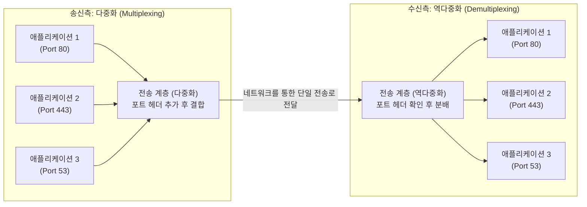
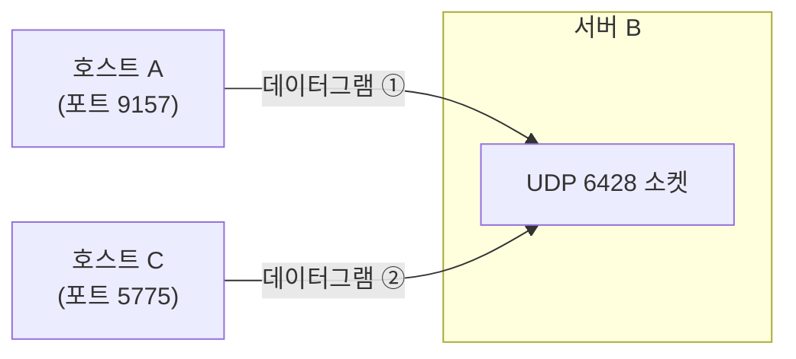
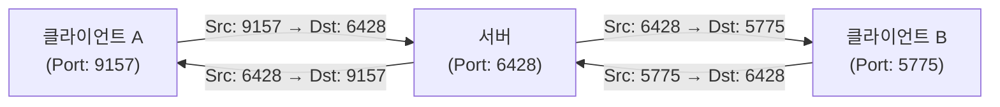
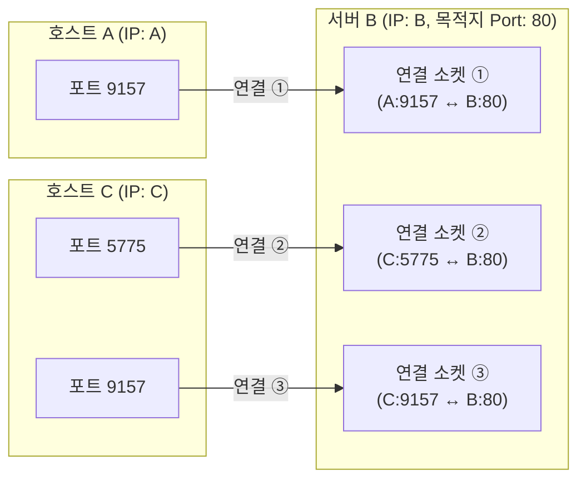

---
aliases:
  - 03_전송 계층
type: Lecture
tags:
  - 3-2/컴퓨터네트워크
draft: false
date: 2026-10-05
prev:
  - "[[02-4_P2P, 스트리밍, CDN]]"
next:
  - "[[03-2_UDP]]"
---
## 요약
1. 송신 측 **다중화**
	- 여러 소켓의 데이터에 헤더를 추가하여 결합한다.
2. 네트워크를 통한 단일 전송로로 전달한다.
3. 수신 측 **역다중화**
	- 받은 세그먼트/데이터그램의 헤더 정보를 이용해 적절한 소켓에 전달한다.
	- **UDP 역다중화**: 목적지의 포트
	- **TCP 역다중화**: 출발지/목적지의 IP/포트 (4-튜플)

## 1. 전송 계층
> 프로세스 사이의 통신을 제공한다.

**전송 계층 (Transport Layer)**
- 서로 다른 호스트에서 실행되는 **애플리케이션 프로세스 사이의 논리적 통신**을 제공한다.
1. **호스트**: 네트워크에 연결된 컴퓨터 등 종단 장치.
2. **프로세스**: 호스트에서 실행 중인 프로그램.
3. **논리적 통신**: 실제 데이터는 여러 계층과 네트워크 장비를 거치지만, 응용 프로그램 관점에서는 상대 프로세스와 통신하는 것으로 볼 수 있다는 뜻.

전송 프로토콜
- **종단 시스템**, 즉 송신·수신 호스트에서 실행된다.
- 인터넷의 대표적인 전송 프로토콜은 **TCP와 UDP**다.

### 1.1. 네트워크 계층과의 차이
| 구분                | 네트워크 계층      | 전송 계층                     |
| ----------------- | ------------ | ------------------------- |
| 통신의 대상            | 호스트 ↔ 호스트    | 프로세스 ↔ 프로세스               |
| 대표 프로토콜           | IP           | TCP, UDP                  |
| 이번 자료에서 주목할 식별 정보 | IP 주소        | 포트 번호와, 프로토콜에 따라 IP 주소    |
| 핵심 역할             | 목적지 호스트까지 전달 | 호스트에 도착한 데이터를 적절한 소켓으로 전달 |
> IP 주소로 호스트를 찾고, 전송 계층에서 소켓을 구별한다.

전송 계층은 네트워크 계층의 서비스를 이용한다.
프로토콜에 따라 부족한 기능을 보완하기도 한다.
예를 들어 TCP는 IP 위에서 신뢰적이고 순서가 보장되는 전달을 제공한다.

## 2. 송신과 수신의 기본 동작
### 2.1. 송신 측
1. 응용 계층으로부터 메시지를 받는다.
2. 필요한 전송 계층 헤더 값을 정한다.
3. 헤더와 데이터를 포함하는 전송 계층 데이터 단위를 만든다.
4. 이를 네트워크 계층인 IP에 전달한다.

전송 계층 데이터 단위
- TCP에서는 **세그먼트**(segment),
- UDP에서는 **데이터그램**이라고 부르는 것이 일반적이다.

### 2.2. 수신 측
1. IP 계층으로부터 전송 계층 데이터를 받는다.
2. 헤더 값을 확인한다.
3. 응용 계층에 전달할 데이터를 추출한다.
4. **적절한 소켓을 통해** 응용 프로세스에 전달한다.

### 2.3. 캡슐화 관계
| 계층      | 데이터 구성                |
| ------- | --------------------- |
| 응용 계층   | 애플리케이션 메시지            |
| 전송 계층   | 전송 계층 헤더 + 애플리케이션 데이터 |
| 네트워크 계층 | IP 헤더 + 전송 계층 데이터     |

강의의 그림에서 `Hₜ`는 전송 계층 헤더, `Hₙ`은 네트워크 계층 헤더다.
수신 측에서는 계층을 올라가며 헤더를 해석하고 상위 계층에 데이터를 전달한다.

> IP 주소는 IP 헤더에, 송신지·목적지 포트 번호는 TCP/UDP 헤더에 들어 있다.
> 역다중화 설명에서 이 정보들을 함께 이용한다고 해서 전부 전송 계층 헤더에 들어 있는 것은 아니다.

## 3. TCP와 UDP의 서비스 비교
| 항목       | TCP    | UDP                 |
| -------- | ------ | ------------------- |
| 통신 방식    | 연결 지향형 | 비연결형                |
| 신뢰적 전달   | 제공     | 보장하지 않음             |
| 순서대로 전달  | 제공     | 보장하지 않음             |
| 흐름 제어    | 제공     | TCP와 같은 기능을 제공하지 않음 |
| 혼잡 제어    | 제공     | TCP와 같은 기능을 제공하지 않음 |
| 연결 설정    | 필요     | TCP와 같은 연결 설정 과정 없음 |
| 지연 시간 보장 | 없음     | 없음                  |
| 대역폭 보장   | 없음     | 없음                  |

**UDP가 비신뢰적이라는 것은 데이터가 항상 손실된다는 뜻이 아니다.**
- 전달 성공이나 순서를 UDP 자체가 보장하지 않으며, IP의 최선형 전달 서비스에 의존한다는 뜻이다.

**TCP가 신뢰적이라는 것도 정해진 시간 안에 도착한다는 뜻은 아니다.**
- 신뢰적 전달과 지연·대역폭 보장은 서로 다른 서비스다.
- 두 제어 기능을 구별하면 다음과 같다.
	- **흐름 제어**: 수신자가 감당할 수 있는 속도를 고려한다.
	- **혼잡 제어**: 네트워크의 혼잡 상태를 고려한다.

## 4. 다중화와 역다중화
> 송신 측은 여러 소켓에서 모아 보내고,
> 수신 측은 헤더를 보고 알맞은 소켓으로 나눈다.



### 4.1. 송신 측 다중화
> 여러 소켓의 데이터를 하위 계층으로 보낸다.

**다중화 (Multiplexing, MUX)**
- 여러 입력이 하나의 설비를 함께 이용하게 하는 개념이다.
- 전송 계층에서는 송신 측이 다음 작업을 한다.
	1. 여러 응용 소켓으로부터 데이터를 받는다.
	2. 수신 측이 구별할 수 있도록 전송 계층 헤더를 붙인다.
	3. 네트워크 계층으로 전달한다.

여러 응용 프로그램의 데이터가 같은 호스트의 네트워크 계층을 통해 나갈 수 있다.
여러 메시지를 반드시 하나의 거대한 세그먼트로 합친다는 뜻은 아니다.

### 4.2. 수신 측 역다중화
**역다중화 (Demultiplexing, DeMUX)**
- 수신한 데이터를 구별해 각 출력으로 분리하는 과정이다.
- 전송 계층에서는 수신한 데이터의 **헤더 정보**를 이용해 **적절한 소켓**에 전달한다.

#### 역다중화에는 어떤 정보가 필요한가?
수신 호스트는 다음 정보를 확인할 수 있다.

| 정보가 있는 곳 | 포함된 주요 식별 정보 |
|---|---|
| IP 헤더 | 송신지 IP 주소, 목적지 IP 주소 |
| TCP/UDP 헤더 | 송신지 포트 번호, 목적지 포트 번호 |

어떤 조합으로 소켓을 선택하는지는 **UDP인지 TCP인지**에 따라 다르다.

### cf. 소켓과 포트
이해를 돕기 위한 보충 설명이다.
- **소켓(socket)**: 응용 프로그램이 전송 계층을 통해 데이터를 주고받는 통신 창구.
- **포트 번호(port number)**: 전송 계층에서 통신 창구를 구별하는 데 사용하는 번호.

소켓과 포트 번호는 같은 개념이 아니다.
특히 TCP에서는 서버의 같은 포트 번호를 사용하는 여러 연결 소켓이 존재할 수 있다.

## 5. UDP/TCP 역다중화 비교
| 비교 기준                       | UDP: 기본 모델                   | TCP: 연결 소켓            |
| --------------------------- | ---------------------------- | --------------------- |
| 수신 소켓 구별 기준                 | 수신 호스트의 목적지 포트               | 송신지·목적지 IP와 포트의 4개 요소 |
| 목적지가 같고 송신자가 다른 경우          | 같은 소켓으로 전달                   | 서로 다른 연결 소켓으로 전달      |
| 서버의 같은 포트로 여러 클라이언트가 보내는 경우 | 하나의 소켓이 여러 송신자의 데이터를 받을 수 있음 | 여러 연결 소켓을 구별할 수 있음    |

**비교 예시**:
```
A:9157 → B:80
C:9157 → B:80
```

- **UDP**: 기본 모델에서는 B의 같은 UDP 소켓으로 전달된다.
- **TCP**: 송신지 IP가 다르므로 B의 서로 다른 TCP 연결 소켓으로 전달된다.

## 6. UDP 역다중화
> ==목적지 포트== 중심

### 6.1. 기본 원리
기본 모델에서, UDP는 **수신 호스트의 목적지 포트 번호**를 확인하여 소켓에 전달한다.

예를 들어 다음 코드는 로컬 포트 `12534`에 UDP 소켓을 만든다.
```java
DatagramSocket mySocket1 = new DatagramSocket(12534);
```

이 호스트의 해당 포트로 도착한 UDP 데이터는 그 소켓으로 전달된다.

송신할 때는 상대를 지정하기 위해 **목적지 IP 주소와 목적지 포트 번호**가 필요하다.

### 6.2. 송신자가 달라도 같은 소켓으로 전달될 수 있다
같은 목적지 IP 주소와 목적지 포트 번호로 도착했다면, **송신지 IP 주소나 송신지 포트 번호가 달라도** 같은 UDP 소켓으로 전달된다.



> **“UDP는 포트 번호만으로 역다중화”**는 수신 호스트가 정해진 상황에서 목적지 포트로 소켓을 선택한다는 설명이다.
> 네트워크를 통해 목적지 호스트까지 찾아갈 때는 목적지 IP 주소도 필요하다.

### 6.3. 예제


- 응답 방향에서는 송신지와 목적지의 역할이 바뀐다.
- 따라서 이 예제에서는 요청과 응답의 포트 번호가 서로 뒤바뀐다.

## 7. TCP 역다중화
> ==4개 요소==로 연결을 구별한다.

### 7.1. 기본 원리
TCP의 연결 소켓은 다음 **4개 요소**(4-tuple)로 구별한다.
```
(송신지 IP 주소, 송신지 포트 번호, 목적지 IP 주소, 목적지 포트 번호)
```

수신 호스트는 이 조합을 이용해 적절한 TCP 연결 소켓으로 데이터를 전달한다.

### 7.2. 서버 포트가 같아도 연결을 구별할 수 있다.


**목적지 포트가 같다는 이유만으로 같은 TCP 연결이 되는 것은 아니다.**

> 연결 요청을 기다리는 서버의 **리스닝 소켓**과 연결 수립 후 데이터를 주고받는 **연결 소켓**을 구별하면 이해하기 쉽다.
> 4개 요소 설명은 연결된 TCP 소켓을 구별하는 기준에 초점을 둔다.
