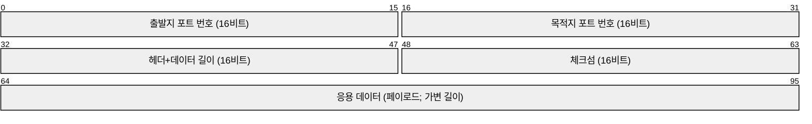
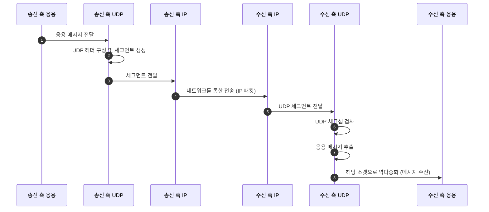
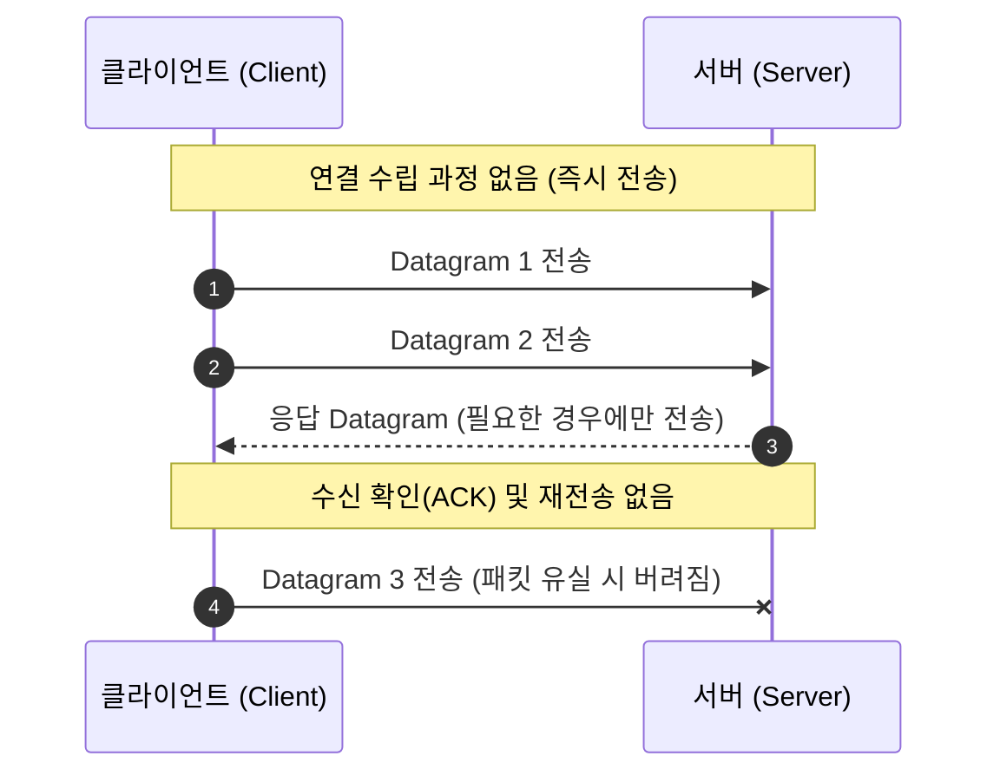

---
aliases:
  - 03_전송 계층
type: Lecture
tags:
  - 3-2/컴퓨터네트워크
draft: false
date: 2026-10-12
prev:
  - "[[03-1_전송 계층 서비스, 다중화]]"
next:
  - "[[03-3_오류 제어]]"
---
## 요약
> UDP는 연결 설정 없이 메시지를 보내는 간단한 트랜스포트 계층 프로토콜이다.
> 전달·순서를 보장하지 않으며, 체크섬으로 전송 중 비트 오류를 탐지한다.

### UDP 헤더


### 체크섬
16비트 덧셈 → 캐리 순환 → 1의 보수

## 1. UDP
> 연결 없이 보내는 프로토콜

**UDP (User Datagram Protocol)**
- 트랜스포트 계층에서 동작하는 기본적인 프로토콜이다.

| 특징           | 의미                                    | 학습 포인트                   |
| ------------ | ------------------------------------- | ------------------------ |
| **비연결형**         | 송수신자 사이에 연결 설정을 위한 핸드셰이크가 없다.         | 데이터를 보내기 전에 연결을 맺지 않는다.  |
| **최선의 노력형 서비스**  | 세그먼트가 손실되거나 전송 순서와 다르게 도착할 수 있다.      | 전달 및 순서 보장을 기대할 수 없다.    |
| **독립적인 세그먼트 처리** | 각 UDP 세그먼트를 독립적으로 처리한다.               | 연결 상태를 관리할 필요가 없다.       |
| **작은 헤더**        | 최소한의 헤더 필드만 사용한다.                     | 헤더는 8바이트이다.              |
| **혼잡 제어 없음**     | UDP 자체에 네트워크 혼잡에 맞춰 송신량을 조절하는 기능이 없다. | 송신율을 다루는 책임은 상위 기능에 남는다. |
| **체크섬 제공**       | 전송 중 데이터가 바뀌었는지 검사한다.                 | 오류 탐지와 신뢰성 보장은 다르다.      |

**용어 정리**
- **핸드셰이크**: 데이터 전송 전에 통신 상대와 연결을 설정하는 메시지 교환
- **RTT(Round-Trip Time)**: 메시지가 상대에게 갔다가 응답이 돌아오는 데 걸리는 왕복 시간
- **페이로드(payload)**: 헤더를 제외한 실제 응용 데이터
- **역다중화(demultiplexing)**: 수신한 메시지를 알맞은 소켓과 응용 프로그램에 전달하는 과정

> 비연결형이라는 말은 송수신자가 없다는 뜻이 아니다.
> 송수신자는 존재하지만 UDP가 사전 연결 설정과 연결 상태 관리를 하지 않는다는 뜻이다.

## 2. UDP를 사용하는 이유와 용도
### 2.1. 왜 필요한가?
1. **연결 설정에 드는 지연을 줄인다.** 연결을 설정하기 위한 왕복 메시지 교환 없이 전송할 수 있다.
2. **연결 상태 관리 부담이 작다.** UDP 자체는 송수신자 간 연결 상태를 유지하지 않는다.
3. **헤더가 작다.** 데이터마다 붙는 제어 정보의 양이 적다.
4. **응용에서 필요한 기능을 선택해 추가할 수 있다.** 신뢰성이나 오류 복구가 필요하면 UDP 위에 별도로 구현한다.

“가장 빠르게 전송될 수 있음”, “혼잡 상황에서도 동작 가능”은 **UDP 자체에 연결 설정과 혼잡 제어가 없다는 특성**과 연결해서 이해하자.
혼잡한 네트워크에서도 전달이나 일정한 지연이 보장된다는 뜻은 아니다.

### 2.2. 대표적인 사용 예
| 사용 예                   | 학습 포인트                   |
| ---------------------- | ------------------------ |
| **멀티미디어 스트리밍**         | 손실과 송신율 요구를 고려하는 응용의 예   |
| **DNS**                | UDP를 사용하는 응용 프로토콜의 예     |
| **SNMP**(간이 망 관리 프로토콜) | UDP 송수신 동작을 설명할 때 사용한 예  |
| **HTTP/3**             | UDP 위에 추가 기능을 구현해 통신하는 예 |

> UDP를 사용하는 응용이 신뢰성 있는 통신을 제공하더라도, UDP 자체에 전달 보장이 생기는 것은 아니다.
> 필요한 신뢰 기능과 오류 처리·복구 기능을 상위에서 추가해야 한다.

## 3. UDP의 송수신 과정
계층 사이의 전달 흐름을 연결해서 보면 다음과 같다.

*그림은 수신 측에서 오류가 검출되지 않은 경우의 기본 흐름이다.*

### 송신자
1. 응용 계층으로부터 메시지를 받는다.
2. UDP 헤더의 필드 값을 결정한다.
3. 헤더와 메시지를 합쳐 UDP 세그먼트를 만든다.
4. 세그먼트를 IP 계층으로 넘긴다.

### 수신자
1. IP 계층으로부터 UDP 세그먼트를 받는다.
2. 체크섬을 검사한다.
3. 세그먼트에서 응용 메시지를 추출한다.
4. 해당 소켓을 통해 응용 계층으로 메시지를 전달한다.

> **구분**: UDP는 응용과 IP 사이에서 메시지 전달을 담당한다. 실제 네트워크를 거치는 전달은 IP와 그 아래 계층으로 이어진다.

### cf. UDP 시퀀스 다이어그램


## 4. UDP 세그먼트
**UDP 세그먼트**
- 64비트(8바이트)의 UDP 헤더와
- 가변 길이의 응용 데이터(페이로드)로 구성된다.


### 4.1. UDP 헤더
16비트 ==필드==가 네 개 들어 있다. #3-1/네트워크프로그래밍/출제

1. **출발지 포트 번호** (source port)
	- 송신 측 포트 번호
2. **목적지 포트 번호** (destination port)
	- 수신 측 포트 번호
	- 수신 메시지를 알맞은 소켓으로 전달할 때 사용한다
3. **길이** (length)
	- **헤더를 포함한 UDP 세그먼트 전체 길이**로, `8바이트 + 응용 데이터의 바이트 수`이다.
	- 단위는 바이트이다.
4. **체크섬** (checksum)
	- 전송 중 비트 오류를 탐지하기 위한 값

## 5. 체크섬의 목적과 계산 원리
### 5.1. 체크섬의 목적
**체크섬**
- 수신된 세그먼트에 전송 중 **비트 오류**가 발생했는지 탐지한다.
- **16비트 단위 덧셈, 캐리 되돌림, 1의 보수**를 사용한다.

### 5.2. 세 가지 계산 규칙
| 규칙                 | 설명                                                       |
| ------------------ | -------------------------------------------------------- |
| 16비트 단위            | 계산 대상을 16비트 정수들의 배열로 보고 더한다.                             |
| 캐리 되돌림(wraparound) | 16비트를 넘는 캐리가 생기면 그 값을 하위 16비트 합에 다시 더한다.                 |
| 1의 보수              | 각 비트를 반전한다. `0 → 1`, `1 → 0`이며, 2의 보수처럼 마지막에 1을 더하지 않는다. |

### 5.3. 송신자와 수신자의 계산 차이
| 구분     | 송신자                         | 수신자                 |
| ------ | --------------------------- | ------------------- |
| 체크섬 필드 | 처음에는 `0x0000`으로 놓고 계산       | 전송받은 체크섬 값까지 포함     |
| 계산     | 16비트 단위 합산 → 캐리 되돌림 → 1의 보수 | 16비트 단위 합산 → 캐리 되돌림 |
| 결과의 용도 | 체크섬 필드에 저장                  | 최종 합이 `0xFFFF`인지 검사 |

**판정**
- 최종 합이 `0xFFFF`이면: 오류가 **검출되지 않았다**.
- 최종 합이 `0xFFFF`가 아니면: 오류가 **검출되었다**.

### 5.4. 체크섬 계산 예제
> 송신은 **더하기 → 캐리 되돌림 → 비트 반전**
> 수신은 **체크섬까지 더하기 → 캐리 되돌림 → 전부 1인지 확인**

계산할 두 16비트 값은 다음과 같다. `0x`는 16진수 표기이다.
```text
Data A = 1110 0110 0110 0110 = 0xE666
Data B = 1101 0101 0101 0101 = 0xD555
```

#### (1) 송신 측
**① 체크섬 필드를 0으로 두고 더한다.**
```text
  0xE666
+ 0xD555
+ 0x0000
---------
 0x1BBBB
```

**② 넘친 캐리를 다시 더한다.**
```text
하위 16비트 = 0xBBBB
넘친 캐리   = 0x0001
최종 합     = 0xBBBB + 0x0001 = 0xBBBC
```

**③ 1의 보수를 구한다.**
```text
합:     1011 1011 1011 1100 = 0xBBBC
반전:   0100 0100 0100 0011 = 0x4443

전송할 체크섬 = 0x4443
```

#### (2) 수신 측
**① 받은 데이터와 받은 체크섬을 모두 더한다.**
```text
0xE666 + 0xD555 + 0x4443 = 0x1FFFE
```

**② 넘친 캐리를 다시 더한다.**
```text
0xFFFE + 0x0001 = 0xFFFF
```

**③ 판정한다.**
최종 합이 `0xFFFF`, 즉 모든 비트가 1이므로 **오류가 검출되지 않았다**.

## 6. 체크섬의 탐지 한계
**체크섬이 맞아도 데이터에 오류가 있을 수 있다.**
서로 다른 비트 변화가 합에서 상쇄되면 체크섬이 달라지지 않기 때문이다.

두 값의 마지막 비트가 반대 방향으로 바뀌는 경우를 보자.

| 구분 | Data A | Data B | 두 값의 합 |
|---|---|---|---|
| 원래 값 | `0xE666` | `0xD555` | `0x1BBBB` |
| 오류 발생 후 | `0xE667` | `0xD554` | `0x1BBBB` |

- A는 마지막 비트가 `0 → 1`로 바뀌어 값이 1 증가한다.
- B는 마지막 비트가 `1 → 0`으로 바뀌어 값이 1 감소한다.
- 합이 같으므로 체크섬도 같고, 이 오류는 탐지되지 않는다.

여러 비트가 바뀌는 모든 오류를 놓친다는 뜻은 아니다.
**그중 합이 유지되는 오류 패턴을 놓칠 수 있다**는 뜻이다.

### 6.1. 반드시 구분할 세 가지
| 개념        | 의미                               | UDP 체크섬의 역할             |
| --------- | -------------------------------- | ----------------------- |
| 오류 탐지     | 데이터가 바뀌었는지 알아낸다.                 | 수행하지만 모든 오류를 탐지하지는 못한다. |
| 오류 복구     | 잘못된 데이터를 바로잡거나 다시 받는다.           | 체크섬 자체가 수행하지 않는다.       |
| 신뢰성 있는 전달 | 손실·순서 문제 등을 처리해 필요한 전달 조건을 충족한다. | UDP 자체는 보장하지 않는다.       |
