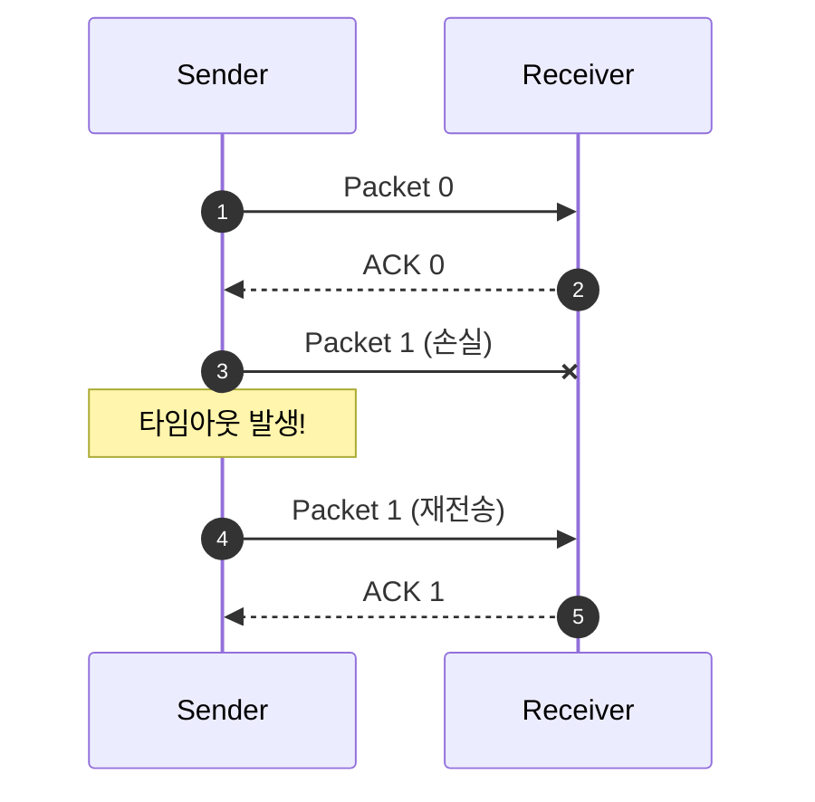
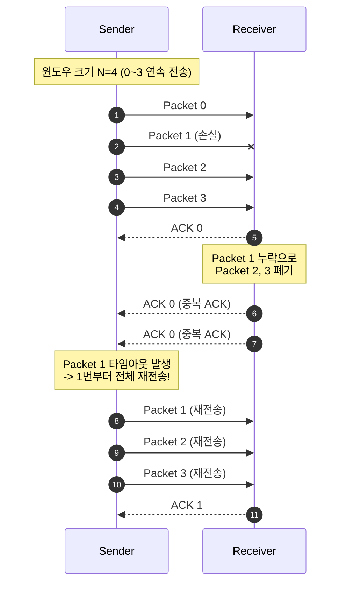
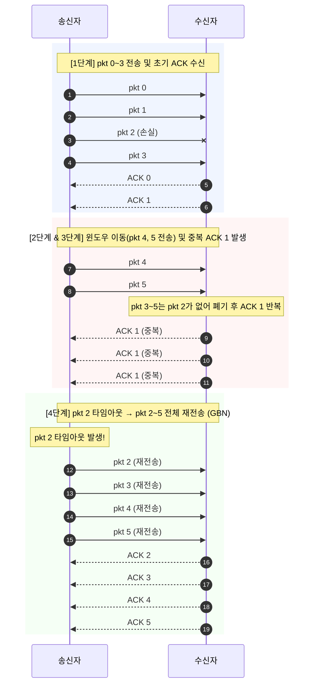
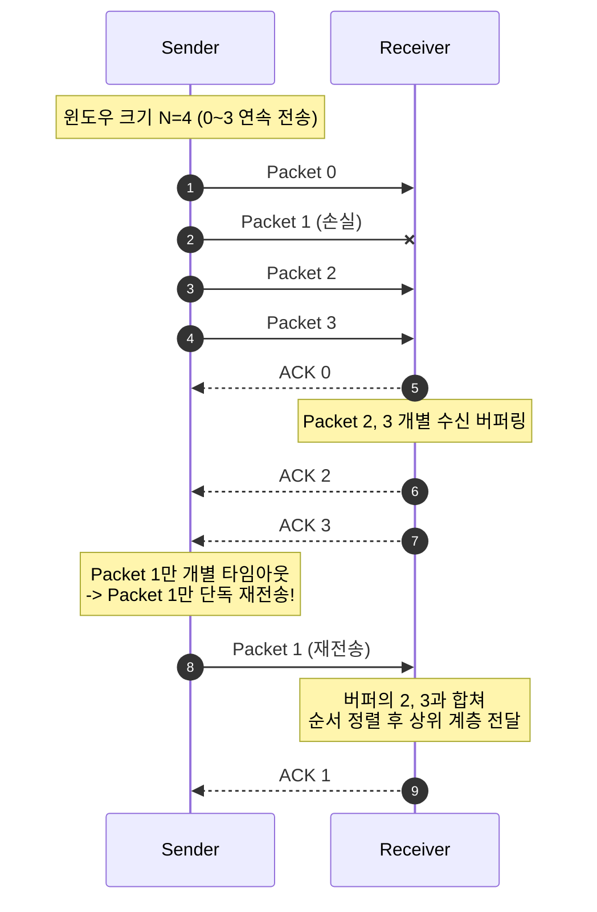
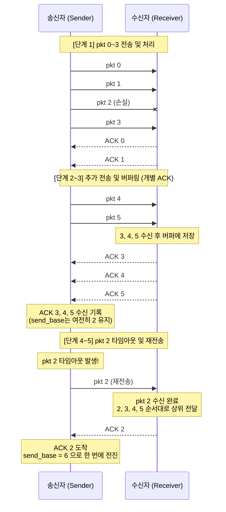

---
aliases:
  - 03_전송 계층
type: Lecture
tags:
  - 3-2/컴퓨터네트워크
draft: false
date: 2026-10-15
prev:
  - "[[03-2_UDP]]"
next:
  - "[[03-4_흐름 제어]]"
---
## 요약
**RDT** (신뢰적 데이터 전송)
- RDT 1.0
- RDT 2.0 (체크섬, ACK/NAK 피드백)
- RDT 2.1 (시퀀스 번호)
- RDT 2.2 (ACK+시퀀스 번호)
	- 기대한 ACK와 다른 중복 ACK가 오면 현재 패킷 재전송
- RDT 3.0 (타이머)
	- 기대와 다른 ACK는 무시하고 타임아웃으로 재전송

**ARQ** (자동 재송 요청)
- **S&W**
- **파이프라이닝**
	- ACK를 기다리는 동안에도 데이터를 보낸다.
	- (시퀀스 번호 비트 길이가 $k$)
	- **GBN**
		- 누적 ACK
		- 최대 송신 윈도우 크기: $2^k-1$
	- **SR**
		- 개별 ACK
		- 최대 송수신 윈도우 크기: $2^{k-1}$
		- 시퀀스 번호 공간: $2^k$

## 1. 먼저 알아둘 배경
### 도입
1. 데이터 오류 방지 - **오류 제어** (Error Control)
2. 송수신자 간의 속도 조절 - **흐름 제어** (Flow Control)
3. 네트워크의 데이터 폭주 방지 - **혼잡 제어** (Congestion Control)

| 구분       | 오류 제어                                                         | 흐름 제어                                 | 혼잡 제어                                       |
| :------- | :------------------------------------------------------------ | :------------------------------------ | :------------------------------------------ |
| 주요 목적 | 데이터의 유실, 변형, 순서 뒤바뀜 방지                                  | 송신측과 수신측의 데이터 처리 속도 차이 해결       | 송신측과 네트워크 전송 능력의 차이(병목 현상) 해결         |
| 제어 대상 | 데이터 세그먼트 자체의 무결성                                           | 종단 간 (End-to-End) (수신자의 버퍼 크기)  | 전체 네트워크 (라우터 및 서브넷의 혼잡도)              |
| 감지 방식 | Checksum, ACK 누락, 타임아웃                                  | 수신자가 보내는 **수신 윈도우(RWND)** 크기 확인 | 타임아웃, 중복 ACK를 통한 **패킷 손실 추정**         |
| 핵심 기법 | **ARQ** (Stop-and-Wait, Go-Back-N, Selective Repeat) | 슬라이딩 윈도우 (Sliding Window)          | 느린 시작(Slow Start), 혼잡 회피, 빠른 재전송 및 회복 |

### 1.1. 통신의 방향
| 방식                    | 의미                         | 예시        |
| --------------------- | -------------------------- | --------- |
| **단방향** (simplex)     | 한 방향으로만 전송                 | TV·라디오 방송 |
| **반이중** (half-duplex) | 양방향 전송이 가능하지만 동시에 전송할 수 없음 | 무전기       |
| **전이중** (full-duplex) | 양방향으로 동시에 전송 가능            | 전화        |

> RDT 모델은 **데이터는 송신자 → 수신자로만 보내되, ACK 같은 제어 정보는 반대 방향으로 보낼 수 있다**고 가정한다.
> 데이터 전송 방향과 제어 메시지의 방향을 구분하자.

### 1.2. 신뢰적 전송이 필요한 이유
> 송신자는 패킷을 보냈다는 사실만으로 수신자가 받았는지 알 수 없다.
> 수신자도 자신이 보낸 ACK를 송신자가 받았는지 알 수 없다.

응용 프로그램은 데이터를 올바르게 전달받기를 원하지만, 실제 하위 채널에서는 다음 문제가 발생할 수 있다.
- **비트 오류**: 패킷의 내용이 바뀐다.
- **손실**: 데이터 패킷이나 ACK가 도착하지 않는다.
- **지연·순서 변경**: 예상보다 늦게 오거나 전송한 순서와 다르게 도착한다.
- **중복**: 재전송한 패킷과 원래 패킷이 모두 도착할 수 있다.

==RDT (Reliable Data Transfer; 신뢰성 있는 데이터 전송)==
- RDT는 이런 채널 위에서 신뢰적인 전송 서비스를 구현한다.
- 다만 각 RDT 버전이 가정하는 채널의 문제는 서로 다르다.

### 1.3. 핵심 도구와 역할
| 도구     | 해결하는 문제                 | 기억할 점                             |
| ------ | ----------------------- | --------------------------------- |
| 체크섬    | 패킷의 비트 오류 검출            | 오류를 검출하는 수단이며, 내용을 직접 복구하는 수단은 아님 |
| ACK    | 정상 수신 사실 통보             | 무엇을 확인하는지는 프로토콜마다 다름              |
| NAK    | 비정상 수신 사실 통보            | 모든 신뢰적 프로토콜에서 필요한 것은 아님           |
| 재전송    | 손상·손실된 데이터 복구           | 중복 수신을 만들 수 있으므로 순서 번호와 함께 사용     |
| 순서 번호  | 패킷 식별, 중복 구별, 순서 관리     | RDT 2.1부터는 0과 1을 번갈아 사용           |
| 타이머    | 응답이 오지 않는 상황에서 재전송 시작   | 타임아웃은 손실의 확정 증거가 아님               |
| 버퍼     | 재전송할 패킷이나 순서가 어긋난 패킷 저장 | 송신 버퍼와 수신 버퍼의 목적이 다름              |
| 윈도우    | 전송·수신을 허용하는 순서 번호 범위 관리 | 크기와 시작 위치를 구분해야 함                 |
| 파이프라이닝 | ACK 대기로 낭비되는 시간 감소      | ACK를 기다리지 않고 여러 패킷을 연속 전송         |

*cf. 피기백(Piggyback, 피기배킹)*
- 수신자가 송신자에게 응답(ACK)을 보낼 때 독립된 별도의 패킷을 만들지 않고, 자신이 보낼 데이터 패킷의 헤더에 슬쩍 얹어서 함께 전송하는 기법

### 1.4. ARQ: 오류를 검출한 뒤 재전송으로 복구
==ARQ (Automatic Repeat reQuest; 자동 재송 요청)==
- 오류 검출과 확인 응답, 재전송을 이용하는 에러 제어 방식이다.

1. 송신자가 오류 검출 정보를 포함한 패킷을 보낸다.
2. 수신자가 패킷을 검사하고 ACK 또는 필요한 경우 NAK를 보낸다.
3. 송신자는 응답 내용이나 타임아웃에 따라 재전송한다.

대표적으로
- Stop-and-Wait
- Go-Back-N
- Selective Repeat가 있다.

NAK 없이 ACK와 타이머만으로 동작하는 방식도 가능하다.

## 2. RDT 인터페이스와 FSM 읽기
### 2.1. 네 가지 인터페이스
| 인터페이스                | 호출 상황               | 역할                  |
| -------------------- | ------------------- | ------------------- |
| `RDT_send(data)`     | 상위 응용이 데이터를 보내려 할 때 | 신뢰적 전송 프로토콜에 데이터 전달 |
| `udt_send(packet)`   | RDT가 실제 패킷을 전송할 때   | 비신뢰적 하위 채널에 패킷 전달   |
| `RDT_rcv(packet)`    | 하위 채널에서 패킷이 도착할 때   | 도착한 데이터·제어 패킷 처리    |
| `deliver_data(data)` | 정상 데이터를 상위 계층에 넘길 때 | 응용에 데이터 전달          |

`udt`는 unreliable data transfer의 의미다.
여기서 `udt_send()`를 UDP 전용 함수로 해석하지 않는다.

### 2.2. FSM
> 현재 상태에서 사건이 발생하면 어떻게 행동하는가?

FSM(Finite-State Machine, 유한 상태 기계)은 다음 세 요소로 읽는다.
1. **상태**
	- 현재 무엇을 기다리는가?
	- 예: ACK 0 대기
2. **이벤트·조건**
	- 무엇이 발생했는가?
	- 예: 정상 ACK 0 도착
3. **행동과 전이**
	- 무엇을 하고 어느 상태로 이동하는가?
	- 예: 타이머 중지 후 데이터 1 전송 요청 대기

강의의 FSM에서 전이 표기는 보통 `이벤트 / 행동`이며, `Λ`는 별도 행동이 없음을 뜻한다.

> 같은 ACK가 도착해도 현재 기다리는 순서 번호에 따라 처리 방식이 달라진다.
> FSM은 메시지 종류뿐 아니라 **현재 상태**도 함께 보아야 한다.

## 3. RDT 1.0~3.0
| 버전      | 고려하는 문제                | 새로 추가되는 핵심 기능              | 남아 있는 문제              |
| ------- | ---------------------- | -------------------------- | --------------------- |
| RDT 1.0 | 오류·손실이 없는 완벽한 채널       | 단순 송수신                     | 실제 채널의 오류를 처리하지 못함    |
| RDT 2.0 | 데이터 비트 오류              | 체크섬, ACK/NAK, 재전송          | ACK/NAK가 손상되면 판단 불가   |
| RDT 2.1 | ACK/NAK 비트 오류까지 고려     | 순서 번호 0·1, 중복 제거, 응답 오류 검사 | 손실이 발생하면 계속 기다릴 수 있음  |
| RDT 2.2 | RDT 2.1의 기능을 ACK만으로 구현 | 번호가 있는 ACK로 NAK 대체         | 손실은 여전히 해결하지 못함       |
| RDT 3.0 | 데이터·ACK의 오류와 손실        | 타이머와 타임아웃 재전송              | Stop-and-Wait의 낮은 활용도 |

### RDT 1.0
배경
- 비트 오류와 패킷 손실이 발생하지 않는다.

- 송신자: 데이터를 패킷으로 만들어 전송한다.
- 수신자: 패킷에서 데이터를 추출해 상위 계층에 전달한다.
- 오류나 손실을 복구할 필요가 없으므로 ACK·재전송·타이머가 필요하지 않다.

### RDT 2.0 (ACK/NAK)
배경
- 비트 오류가 발생할 수 있다.
핵심 메커니즘
- 송신자는 패킷 하나를 보낸 뒤 피드백을 기다린다. (S&W)
1. **체크섬**: 비트 오류 확인
2. **ACK/NAK 피드백**
3. 다음 데이터 전송/같은 패킷 재전송

**치명적인 한계**
- ACK/NAK 자체가 손상되면 송신자는 데이터가 정상 수신되었는지 알 수 없다.
- 무작정 재전송하면 수신자가 같은 데이터를 두 번 전달할 수 있다.

### RDT 2.1 (시퀀스 번호)
배경
- ACK/NAK에도 비트 오류가 발생할 수 있다. (판단 불가/중복 문제 발생)
핵심 메커니즘
- **시퀀스 번호** 0 또는 1

**해결**: 데이터 패킷에 순서 번호 `0`, `1`을 번갈아 붙인다.

- 송신자는 ACK/NAK가 손상되거나 NAK가 오면 현재 패킷을 재전송한다.
- 수신자는 **자신이 기대하는 순서 번호**의 정상 패킷만 상위 계층에 전달한다.
- 이미 받은 번호의 패킷이 다시 오면 중복이므로 데이터는 버리고 ACK를 다시 보낸다.

예를 들어 수신자가 `pkt 0`을 정상 처리했지만 ACK가 손상되었다고 하자.
1. 송신자는 결과를 확신할 수 없어 `pkt 0`을 다시 보낸다.
2. 수신자는 이제 `pkt 1`을 기다리고 있으므로 재도착한 `pkt 0`을 중복으로 판단한다.
3. 데이터를 다시 전달하지 않고 ACK만 다시 보낸다.

**왜 1비트면 충분한가?**
- 이 단계의 정지대기 모델에서는 한 번에 하나의 패킷만 확인을 기다린다.
- 따라서 직전 패킷의 재전송과 다음 새 패킷을 구분하면 된다.
- 여러 패킷이 동시에 전송 중인 파이프라이닝에서는 더 넓은 번호 공간이 필요하다.

### RDT 2.2 (ACK+시퀀스 번호)
배경
- 프로토콜 단순화를 위해 NAK를 제거한다.
핵심 메커니즘
- **ACK+시퀀스 번호** (예: ACK 0, ACK 1)

**해결**: 수신자는 오류 패킷을 받으면, 마지막으로 정상 수신한 패킷의 ACK를 다시 보낸다.

예를 들어 `pkt 0`을 정상 수신한 뒤 `pkt 1`이 손상되면 다음과 같이 동작한다.

| 순서 | 동작 |
|---|---|
| 1 | 수신자는 `pkt 1`의 오류를 검출한다. |
| 2 | NAK 대신 마지막 정상 패킷에 대한 `ACK 0`을 다시 보낸다. |
| 3 | `ACK 1`을 기다리던 송신자는 `ACK 0`을 받고 현재 `pkt 1`을 재전송한다. |

이때 ACK에는 **어느 순서 번호를 확인하는지** 표시되어야 한다.

> **주의**: RDT 2.2에서 기대한 번호와 다른 중복 ACK를 받으면 **현재 패킷을 재전송**한다. 다음 새 패킷을 보내는 것이 아니다.

### RDT 3.0 (타이머)
배경
- 패킷 손실이 발생할 수 있다. (무한 대기 문제 발생)
핵심 메커니즘
- **타임아웃**: 타이머 만료까지 응답이 없으면 재전송

**문제**: 데이터나 ACK가 손실되면, 오류 응답조차 도착하지 않는다. RDT 2.x에서는 무한정 기다릴 수 있다.

**해결**: 일정 시간 동안 ACK가 없으면 재전송하도록 타이머를 추가한다.

| 현재 상황 | 송신자 행동 |
|---|---|
| 새 패킷 전송 | 패킷을 저장·전송하고 타이머 시작 |
| 기대한 번호의 정상 ACK 수신 | 타이머 중지, 다음 번호로 진행 |
| 타임아웃 | 같은 패킷 재전송, 타이머 재시작 |
| ACK 손상 또는 기대와 다른 번호의 ACK 수신 | 강의의 RDT 3.0 FSM에서는 무시하고 계속 대기 |

수신자는 RDT 2.2와 같은 원리로 정상 패킷을 확인하고 중복을 제거한다.

**타임아웃 ≠ 손실 확정**
- 패킷이나 ACK가 단지 늦게 도착하는 상황에서도 타임아웃이 발생할 수 있다.
- 재전송이 만든 중복은 순서 번호로 처리한다.

#### RDT 3.0의 대표 상황 네 가지
| 상황             | 일어나는 일                  | 해결 과정                             |
| -------------- | ----------------------- | --------------------------------- |
| 정상 전송          | 데이터와 ACK가 모두 정상 도착      | ACK를 받고 다음 패킷 전송                  |
| 데이터 손실         | 수신자는 해당 데이터를 받지 못함      | 송신자 타임아웃 → 데이터 재전송                |
| ACK 손실         | 수신자는 데이터를 처리했지만 송신자는 모름 | 타임아웃 → 재전송 → 수신자는 중복 제거 후 ACK 재전송 |
| 이른 타임아웃·ACK 지연 | 원래 전송이 진행 중인데 재전송도 발생   | 중복 데이터 제거, 현재 상태에 맞지 않는 ACK 무시    |

**ACK 손실을 이해하는 핵심 구분**
- 수신자에게는 이미 전달이 완료되었을 수 있다.
- 송신자에게는 아직 전달 완료가 확인되지 않았다.
- 따라서 패킷을 다시 받을 때 ACK는 다시 보내되, **응용에는 같은 데이터를 다시 넘기지 않아야 한다.**

## ARQ 방식
| 항목              | S&W            | GBN                         | SR                    |
| --------------- | -------------- | --------------------------- | --------------------- |
| 확인 없이 보낼 수 있는 양 | 1개             | 송신 윈도우 N 범위                 | 송신 윈도우 N 범위           |
| ACK 의미          | 현재 패킷 확인       | n번까지 누적 확인                  | n번 개별 확인              |
| 타이머             | 현재 패킷용         | 가장 오래된 미확인 패킷용              | 각 미확인 패킷용             |
| 타임아웃 시 재전송      | 현재 패킷          | 가장 오래된 미확인 패킷부터 전송된 미확인 패킷들 | 타임아웃된 해당 패킷           |
| 순서 밖 패킷 처리      | 중복 구별·제거가 중심   | 기본 예에서는 폐기                  | 수신 윈도우 안이면 버퍼링        |
| 수신 버퍼 필요성       | 순서 밖 패킷 보관 불필요 | 기본 예에서는 순서 밖 보관 불필요         | 순서 밖 패킷 보관 필요         |
| 주요 장점           | 단순함            | 파이프라이닝과 누적 ACK              | 불필요한 재전송 감소           |
| 주요 한계           | 긴 RTT에서 낮은 활용도 | 손실 뒤의 패킷까지 재전송              | 버퍼·개별 상태 관리, 번호 공간 제약 |

- **GBN**: 앞이 비면 뒤를 버리고, 타임아웃 때 미확인 구간을 다시 보낸다.
- **SR**: 앞이 비어도 뒤를 보관하고, 빠진 패킷만 다시 받는다.

## 4. S&W
**S&W** (Stop-and-Wait; 정지-대기)

### 4.1. 왜 느린가?
송신 시간보다 기다리는 시간이 훨씬 길 수 있다.

| 기호 | 의미 | 단위 예시 |
|---|---|---|
| `L` | 패킷 길이 | bit |
| `R` | 링크 전송률 | bit/s |
| `L/R` | 패킷 전체 비트를 링크에 내보내는 전송 지연 | s |
| `RTT` | 강의 계산에서 사용하는 왕복 전파 지연 | s |
| `U_sender` | 전체 시간 중 송신자가 실제 데이터 전송에 쓰는 비율 | 0~1 |

ACK 전송 시간과 처리 시간은 무시하는 단순 모델에서:
$$
U_{\text{sender}} = \frac{L/R}{RTT + L/R}
$$

첫 데이터 비트의 송신 시작부터 ACK 도착까지 한 주기가 `RTT + L/R`이고, 그중 실제 송신 시간은 `L/R`이다.

### 4.2. 예제
- 링크 전송률: `R = 1 Gbps = 10^9 bit/s`
- 편도 전파 지연: `15 ms`
- 왕복 전파 지연: `RTT = 30 ms`
- 패킷 길이: `L = 8,000 bit`

$$
\frac{L}{R} = \frac{8000}{10^9}\text{ s}
= 8\,\mu\text{s} = 0.008\text{ ms}
$$

$$
U_{\text{sender}} = \frac{0.008}{30 + 0.008}
\approx 0.000267 = 0.0267\%
$$

즉, 송신자는 한 주기 약 `30.008 ms` 중 `0.008 ms`만 데이터를 보내고 나머지는 기다린다.

이 모델의 유효 데이터 전송률은 약 `1 Gbps × 0.000267 ≈ 267 kbps`다.
링크 자체가 빨라도 프로토콜이 대부분의 시간을 대기에 쓰면 실제 활용도는 낮다.

## 5. 파이프라이닝
기다리는 동안에도 다음 패킷을 보낸다.

> Stop-and-Wait ARQ의 비효율성을 극복하기 위해, ACK을 기다리지 않고 여러 패킷을 연속으로 보내는 **파이프라이닝** 기술이 도입되며 ARQ 방식도 두 갈래로 확장된다.
> 1. **Go-Back-N (GBN) ARQ**
> 2. **Selective Repeat (SR) ARQ**

파이프라이닝은 **앞선 패킷의 ACK를 받기 전에 여러 패킷을 연속 전송**하는 방식이다.

추가로 필요한 것은 다음과 같다.
- 여러 패킷을 구분할 수 있는 더 넓은 순서 번호 공간.
- 미확인 패킷을 보관하는 송신 버퍼.
- 전송 가능한 범위를 제한하는 윈도우.
- 방식에 따라 순서가 어긋난 패킷을 저장하는 수신 버퍼.

### 5.1. 활용도 개선
같은 조건에서 패킷 3개를 연속 전송하면:
$$
U_{\text{sender}} = \frac{3L/R}{RTT + L/R}
= \frac{0.024}{30.008}
\approx 0.000800 = 0.0800\%
$$

정지대기보다 약 3배 좋아진다.
다만 이 예에서는 RTT가 길어서 3개만으로도 활용도는 여전히 낮다.

손실이 없고 ACK·처리 비용을 무시하는 같은 모델에서, 윈도우 크기가 N일 때:
$$
U_{\text{sender}} \approx
\min\left(1, \frac{N L/R}{RTT + L/R}\right)
$$

링크를 계속 사용하려면 대략 다음 조건이 필요하다.
$$
N \ge \left\lceil\frac{RTT + L/R}{L/R}\right\rceil
$$

예에서는 `(30 + 0.008) / 0.008 = 3751`이므로, 이 이상화된 모델에서 완전한 활용도를 얻으려면 윈도우에 약 3,751개 패킷이 필요하다.

### 5.2. 슬라이딩 윈도우의 의미
윈도우는 고정된 묶음을 전부 보내고 전부 확인받은 뒤 다음 묶음으로 이동하는 것만을 뜻하지 않는다.
**ACK가 도착해 앞쪽 패킷이 확인되면 전송 가능 범위가 앞으로 이동**한다.

- `send_base`: 송신 윈도우의 시작, 즉 가장 앞의 미확인 패킷 번호
- `nextseqnum`: 다음에 새로 전송할 패킷 번호
- `N`: 윈도우 크기
- 번호 순환을 생략하면 송신 윈도우는 `[send_base, send_base + N - 1]`

대표적인 파이프라이닝 프로토콜이 **GBN**과 **SR**이다.
둘의 핵심 차이는 오류 뒤에 도착한 패킷을 어떻게 처리하고 무엇을 재전송하느냐다.

## 6. GBN
**GBN** (Go-Back-N; 고백엔)
- 누적 ACK
- 타임아웃이 발생하면 가장 오래된 미확인 패킷부터 이미 보낸 미확인 패킷들을 재전송한다.

### 6.1. 핵심 규칙
송신자:
- ACK를 받지 못한 패킷을 포함해 최대 N개의 패킷을 전송할 수 있다.
- `ACK n`은 **n번까지 모든 패킷을 순서대로 정상 수신했다**는 누적 확인이다.
- 새로운 누적 ACK를 받으면 윈도우 시작 위치를 앞으로 이동한다.
- 가장 오래된 미확인 패킷에 대한 타이머를 관리한다.
- 타임아웃이면 가장 오래된 미확인 패킷부터 마지막으로 전송한 패킷까지 재전송한다. 아직 보내지 않은 패킷까지 재전송하는 것은 아니다.

수신자:
- 이 강의의 상세 예에서는 **다음에 기대하는 번호의 패킷만 받아서 전달**한다.
- 순서가 어긋난 패킷은 버린다.
- 지금까지 연속해서 정상 수신한 마지막 번호의 ACK를 다시 보낸다.

순서 밖 패킷의 버퍼링을 구현 선택 사항으로도 언급한다.
아래 비교는 강의의 상세 동작 예처럼 버리는 기본 GBN 모델을 기준으로 한다.

### 6.2. 예시

**누적 ACK의 장점**: `ACK 4`가 정상 도착하면 4번까지 수신되었음을 알 수 있으므로, 그보다 낮은 번호의 ACK가 일부 손실되어도 전송을 진행할 수 있다.

**단점**: 실제로 손실된 것이 하나뿐이어도 이후의 패킷들을 다시 보내야 할 수 있다.

## 7. SR
**SR** (Selective Repeat; 선택적 재전송)
- 각 패킷을 개별 확인한다. (개별 ACK)
- 확인받지 못한 패킷만 선택적으로 재전송한다.

### 7.1. 핵심 규칙
송신자:
- 송신 윈도우 안에서 패킷을 전송한다.
- `ACK n`을 받으면 n번 패킷만 확인된 것으로 표시한다.
- 각 미확인 패킷을 위한 논리적 타이머를 관리한다.
- n번 타임아웃이면 **n번만** 재전송한다.
- 윈도우의 시작 패킷이 확인되면 이미 ACK된 연속 구간을 건너뛰어 다음 미확인 위치로 시작점을 이동한다.

수신자:
- 현재 수신 윈도우 안의 정상 패킷에 개별 ACK를 보낸다.
- 순서가 어긋난 패킷은 버퍼에 저장한다.
- 앞에서 빠졌던 패킷이 도착하면 버퍼의 연속된 패킷들과 함께 상위 계층에 순서대로 전달한다.
- 직전 수신 윈도우에 해당하는 이미 처리한 패킷이 다시 오면 ACK를 다시 보내 송신자의 재전송을 끝낼 수 있게 한다.

> **수신과 응용 전달은 다르다.**
> SR은 pkt 3을 받아 ACK 3을 보낼 수 있어도, pkt 2가 빠져 있다면 pkt 3을 응용에 전달하지 않고 보관한다.

### 7.2. 예시

**왜 ACK 3을 받아도 바로 윈도우가 이동하지 않는가?**
- SR의 윈도우는 N개의 연속 번호 범위다.
- 앞쪽의 미확인 패킷 2가 남아 있으므로, 뒤쪽 패킷이 확인되어도 시작점은 2에 머무른다.

### 7.3. 한계
> 순서 번호를 너무 빨리 재사용하면 안 된다.

반례:
- 순서 번호 공간: `0, 1, 2, 3`, 총 4개
- 송신·수신 윈도우 크기: `N=3`
- 수신자가 0·1·2를 처리하면 다음 수신 윈도우는 `[3, 0, 1]`이 된다.
- ACK들이 모두 손실되면 송신자는 예전 `pkt 0`을 재전송할 수 있다.
- 수신자는 0이 현재 윈도우 안에 있으므로, **예전 패킷을 새 패킷으로 잘못 받아들일 수 있다.**

수신자는 송신자의 ACK 수신 상황을 직접 볼 수 없어서,
같은 번호를 가진 새 패킷과 오래된 재전송 패킷을 구별하기 어렵다.

이를 방지하려면, 강의의 같은 크기 송신·수신 윈도우 모델에서:
$$
N \le \frac{M}{2}
$$

- `M`: 순서 번호 공간의 크기
- 순서 번호가 k비트라면 `M = 2^k`

따라서: $N \le 2^{k-1}$

| 순서 번호 비트 수 k | 번호 공간 M | SR 최대 윈도우 크기 N |
|---|---|---|
| 2 | 4 | 2 |
| 3 | 8 | 4 |
| 4 | 16 | 8 |

> SR은 이전 전송의 번호 범위와 새 수신 번호 범위가 겹쳐 생기는 혼동을 막도록, 번호 공간을 윈도우 크기의 최소 두 배로 확보한다.
