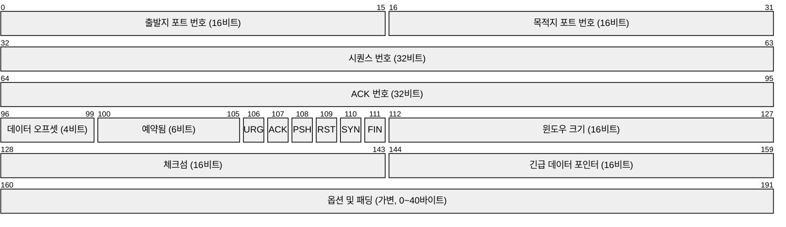
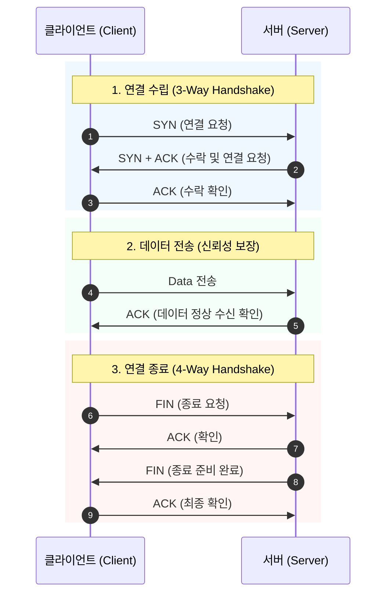
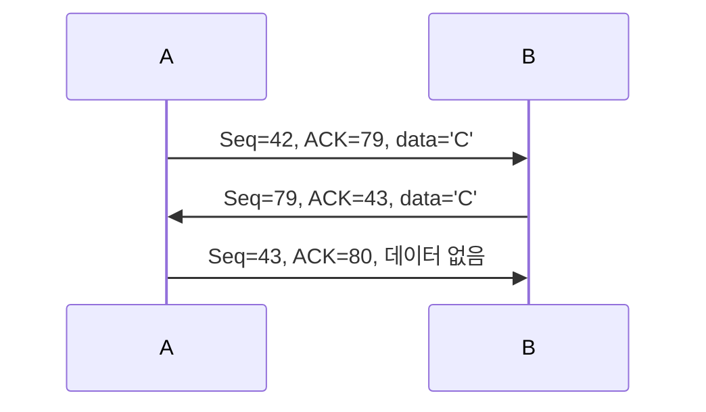
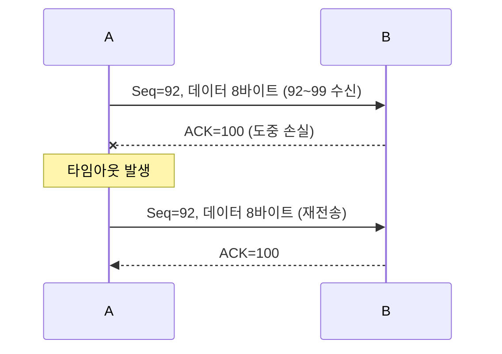
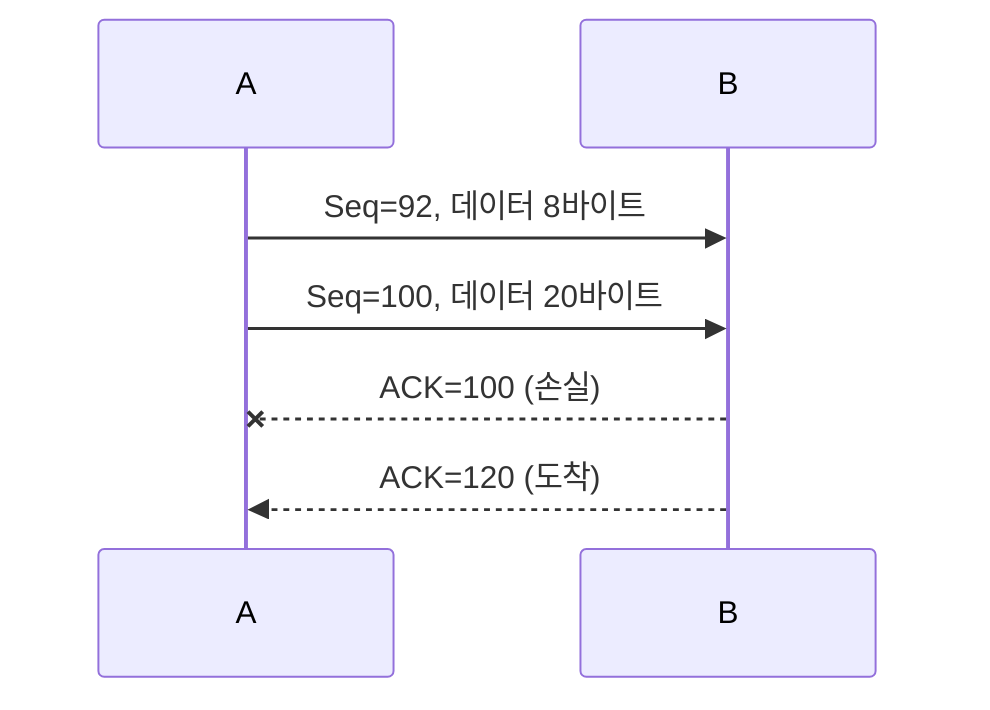
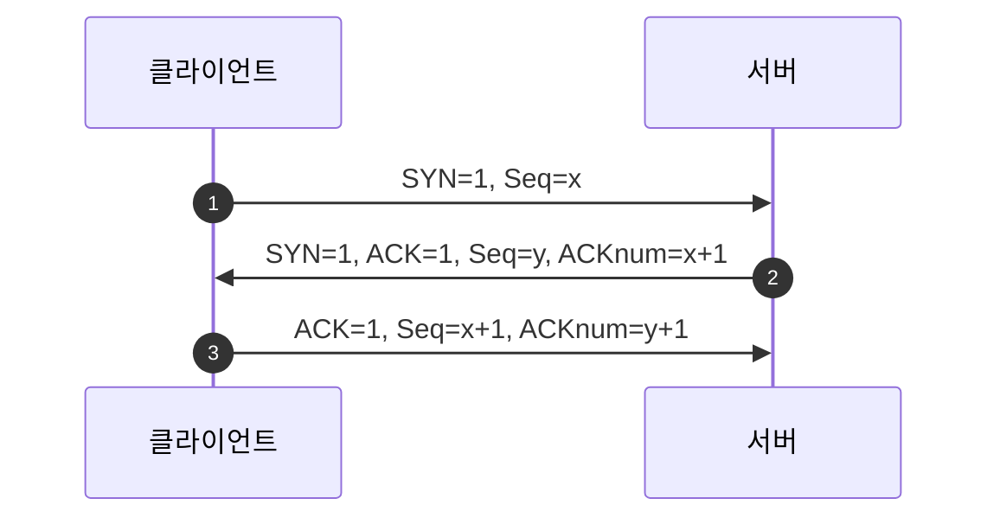
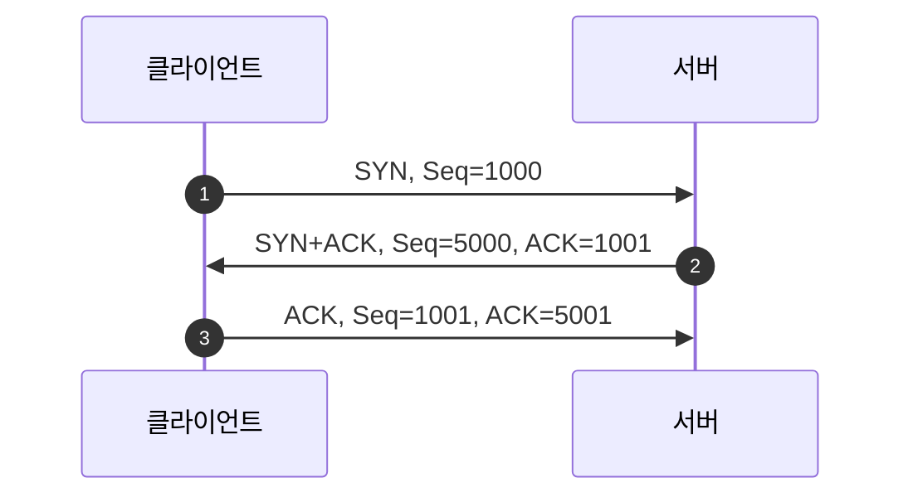
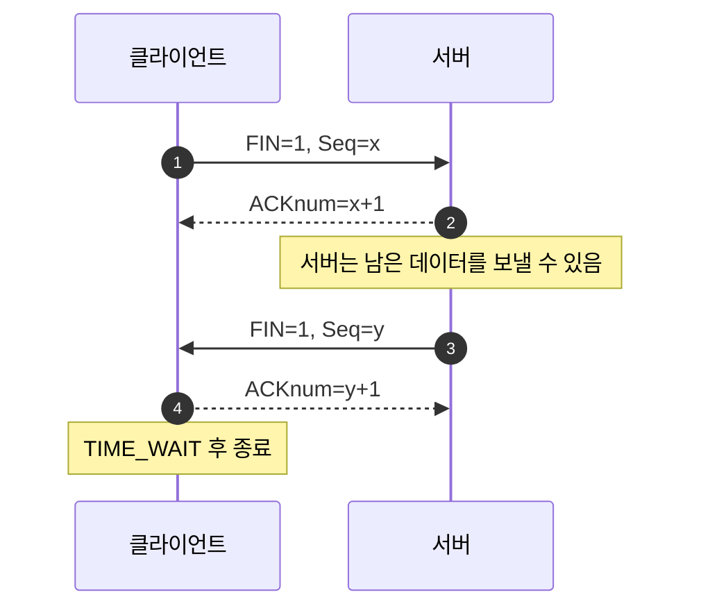

---
aliases:
  - 03_전송 계층
type: Lecture
tags:
  - 3-2/컴퓨터네트워크
draft: false
date: 2026-10-22
prev:
  - "[[03-3_오류 제어]]"
next:
  - "[[03-5_혼잡 제어]]"
---
## 요약
### TCP 헤더


```sh
netstat -an | grep 22000
```

## 1. TCP를 이해하는 큰 흐름
TCP는 두 응용 프로그램 사이에서 **바이트들을 빠짐없이, 순서대로 전달하기 위한 연결 지향형 트랜스포트 프로토콜**이다.

TCP를 공부할 때는 다음 네 가지 질문을 연결해서 생각하면 된다.

| 질문 | TCP의 대응 | 핵심 용어 |
|---|---|---|
| 어떤 데이터를 보냈고, 어디까지 도착했는가? | 바이트마다 번호를 붙이고 수신 상태를 알린다. | Seq, ACK |
| 데이터나 ACK가 유실되면 어떻게 하는가? | 타임아웃 또는 중복 ACK를 보고 재전송한다. | RTT, 타이머, 빠른 재전송 |
| 수신자가 데이터를 감당하지 못하면? | 수신 버퍼의 여유 공간에 맞춰 전송량을 제한한다. | 흐름 제어, rwnd |
| 언제 통신을 시작하고 끝내는가? | 제어 세그먼트를 교환해 연결을 설정하고 종료한다. | SYN, ACK, FIN |

**핵심 연결**
- Seq로 데이터를 식별하고,
- ACK로 도착을 확인하며,
- 타이머로 손실에 대응하고,
- rwnd로 수신자를 보호한다.

*TCP 시퀀스 다이어그램*


## 2. TCP의 기본 성질
| 성질           | 의미                                       |
| ------------ | ---------------------------------------- |
| 일대일 통신       | 하나의 TCP 연결은 두 종단 사이의 통신이다.               |
| 연결 지향        | 데이터 교환 전에 핸드셰이크로 연결 상태와 초기 파라미터를 준비한다.   |
| 신뢰적·순서 보장 전송 | 손실에 재전송으로 대응하고, 응용에는 순서대로 바이트를 전달한다.     |
| 바이트 스트림      | 데이터는 연속된 바이트의 흐름이며, 응용 메시지 경계를 보존하지 않는다. |
| 전이중 통신       | 한 연결에서 양쪽이 동시에 데이터를 보낼 수 있다.             |
| 누적 ACK       | 연속해서 받은 바이트들을 하나의 ACK 번호로 확인한다.          |
| 파이프라이닝       | ACK를 기다리는 동안에도 허용된 범위 안에서 여러 세그먼트를 전송한다. |
| 흐름 제어        | 수신 버퍼의 여유 공간을 넘지 않도록 전송량을 제한한다.          |

### 2.1. 바이트 스트림에 메시지 경계가 없다는 뜻
응용이 `ABC`와 `DEF`를 따로 전송했어도, 수신 응용이 반드시 두 번에 나누어 읽는 것은 아니다.
`ABCDEF`를 한 번에 읽거나, `AB`와 `CDEF`로 나누어 읽을 수도 있다.

따라서 **응용 메시지의 구분은 응용 계층에서 처리해야 한다.**
TCP의 세그먼트 경계와 응용 메시지 경계는 일치할 필요가 없다.

### 2.2. 전이중 통신에서 기억할 점
A→B와 B→A에는 **각각 독립적인 순서 번호 공간**이 있다.
A가 보내는 세그먼트의 Seq는 A→B 데이터를, ACK는 반대 방향인 B→A 데이터의 수신 상태를 나타낸다.

## 3. MSS와 MTU
*cf. 프레임*
- 이더넷, IP, TCP, HTTP

### 3.1 MSS: TCP 데이터 부분의 최대 크기
**MSS (Maximum Segment Size)**
- TCP 세그먼트 하나에 담을 수 있는 **데이터(payload)의 최대 바이트 수**다.

- IP 헤더와 TCP 헤더는 MSS에 포함하지 않는다.
- 연결 설정 때 TCP 옵션으로 자신의 수신 MSS를 상대방에게 알릴 수 있다.
- 양쪽이 광고하는 MSS 값이 반드시 같을 필요는 없다.

### 3.2. MTU: 링크가 운반할 수 있는 패킷 크기의 한도
**MTU (Maximum Transfer Unit)**
- IP 패킷의 크기를 생각할 때 MTU에는 IP 헤더, TCP 헤더, TCP 데이터가 포함된다.
- Ethernet의 흔한 예는 1,500바이트다.

```
IP 패킷
┌───────────┬────────────┬───────────────────┐
│ IP 헤더   │ TCP 헤더   │ TCP 데이터        │
└───────────┴────────────┴───────────────────┘
                         ← MSS의 대상 →
←──────────────── MTU와 비교하는 크기 ───────→
```

IPv4 헤더 20바이트, TCP 헤더 20바이트이고 옵션이 없다고 가정하면:
```
MSS = 1500 - 20 - 20 = 1460바이트
```

> **강의 표현 보충**
> MTU는 TCP 자체의 고유 값이 아니며, 항상 1,500바이트인 것도 아니다.
> 강의의 1,460바이트는 위 조건에서 나오는 대표적인 MSS 예다.
> 536바이트와 1,460바이트를 모든 TCP 연결의 고정 기본값으로 외우지 말고, **MSS는 데이터 크기이고 MTU 및 헤더 크기에 영향을 받는다**는 관계를 이해하자.

## 4. TCP 세그먼트
TCP 세그먼트는 **헤더 + 응용 데이터**로 구성된다.

### 4.1. TCP 헤더
1. 출발지 포트 번호 (source port)
2. 목적지 포트 번호 (destination port)
3. ==시퀀스 번호== (sequence number): 첫 번째 데이터 바이트의 번호
4. ==ACK 번호== (acknowledgment number): 다음에 기대하는 바이트의 번호
5. 데이터 오프셋: 헤더의 길이 (20-60바이트; 어디서부터 데이터가 시작되는지)
6. 예약됨 (reserved)
7. 제어 비트 플래그
	- **ACK**: ACK 번호 필드가 유효함을 나타낸다.
	- **SYN**: 연결 설정에 사용한다.
	- **FIN**: 해당 방향으로 더 보낼 데이터가 없음을 알린다.
	- **RST**: 연결을 리셋할 때 사용한다.
	- **CWR / ECE**: 혼잡 통지와 관련된다.
8. ==윈도우 크기==: 수신자가 받아들일 수 있는 여유 공간
9. 체크섬 (checksum): 전송 중 오류 검출
10. 긴급 데이터 포인터 (urgent data pointer)
11. 옵션 및 패딩: 추가 파라미터로, MSS 같은 정보를 전달한다.


#### 시퀀스 번호
`Seq=100`, 데이터 길이 20바이트인 세그먼트가 전송하는 바이트 범위는 다음과 같다.
```
100, 101, 102, ..., 119
```

따라서 다음 데이터의 시작 번호는 `120`이다.
```
마지막 데이터 바이트 번호 = Seq + 데이터 길이 - 1
다음 데이터 시작 번호    = Seq + 데이터 길이
```

#### ACK 번호
`ACK=120`의 의미는 다음과 같다.

> 119번까지의 바이트를 빠짐없이 연속해서 받았으니,
> 다음에는 120번 바이트가 필요하다.

ACK가 120이라고 해서 120번 바이트까지 받았다는 뜻은 아니다.

**누적 ACK**
- 중간의 빈 구간을 건너뛰지 않는다.

수신자가 이미 99번까지 받았다고 하자.

| 도착한 데이터 | 수신 상태 | ACK |
|---|---|---|
| 100~119 | 빈 구간 없이 119까지 수신 | 120 |
| 140~159 | 120~139가 비어 있음 | 120 |
| 160~179 | 여전히 120~139가 비어 있음 | 120 |
| 120~139 | 뒤의 데이터도 보관했다면 179까지 연결됨 | 180 |

수신자가 뒤에 도착한 데이터를 버퍼링하는지는 구현에 따라 달라질 수 있다.
**비순차 데이터의 보관 여부와 관계없이, 누적 ACK는 연속 수신한 범위까지만 확인한다.**

### 4.2. Telnet 예제


1. A는 자신의 42번 바이트로 문자 `C`를 보낸다.
2. B는 그 문자를 받았으므로 `ACK=43`을 보낸다. 동시에 자신의 79번 바이트로 `C`를 되돌려 보낸다.
3. A는 B의 79번 바이트를 받았으므로 `ACK=80`을 보낸다.

여기서 B의 두 번째 세그먼트는 **데이터 전송과 ACK 전달을 동시에 수행**한다.

> **번호 소비 규칙**
> 데이터는 길이만큼 순서 번호를 소비한다.
> 데이터가 없는 순수 ACK는 소비하지 않는다.
> 연결 제어의 **SYN과 FIN은 각각 1을 소비**한다.

## 5. RTT와 재전송 타임아웃
### 5.1. 타임아웃을 적절하게 잡아야 하는 이유
**RTT (Round-Trip Time)**
- 세그먼트를 전송하고 그 ACK가 돌아올 때까지 걸리는 시간이다.

| 타임아웃 설정 | 결과 |
|---|---|
| 너무 짧음 | 아직 도착 중인 ACK를 기다리지 못해 불필요하게 재전송한다. |
| 너무 김 | 실제 손실이 발생해도 복구가 늦어진다. |

RTT는 고정값이 아니므로 최근 측정값을 반영해 타임아웃을 조절해야 한다.

### 5.2. SampleRTT와 EstimatedRTT
**SampleRTT**
- 실제로 한 번 측정한 왕복 시간
- 재전송한 세그먼트는 어느 전송에 대한 ACK인지 모호하므로 RTT 표본 계산에서 제외한다.

**EstimatedRTT**
- 최근 표본을 가중 평균해 얻은 추정 RTT
- $\text{EstimatedRTT} ← (1-α) × \text{EstimatedRTT} + α × \text{SampleRTT}$
- 이는 **지수 가중 이동 평균**(EWMA)이다.
- 새 표본을 반영하면서도 일시적인 변동에 지나치게 흔들리지 않게 한다.
- 오래된 표본의 영향은 반복 갱신 과정에서 점점 작아진다.

계산 예:
```
기존 EstimatedRTT = 100ms
새 SampleRTT     = 140ms
α                = 0.125

새 EstimatedRTT = 0.875 × 100 + 0.125 × 140
                = 105ms
```

### 5.3. DevRTT와 TimeoutInterval
평균 RTT가 같아도 변동이 큰 연결에는 더 큰 안전 여유가 필요하다.

$\text{DevRTT} ← (1-β) × \text{DevRTT} + β × |\text{SampleRTT}-\text{EstimatedRTT}|$
```
TimeoutInterval = EstimatedRTT + 4 × DevRTT
```

예를 들어, 계산에 사용할 추정값이 다음과 같다면:
```
EstimatedRTT = 105ms
DevRTT       = 15ms

TimeoutInterval = 105 + 4 × 15 = 165ms
```

**기억할 관계**: 평균 RTT가 커지거나 RTT 변동폭이 커지면, 타임아웃도 커진다.

## 6. TCP의 신뢰적 데이터 전송
### 6.1. 송신자의 세 가지 핵심 이벤트
가장 오래된 미확인 데이터에 대한 타이머를 중심으로 송신자의 동작을 설명한다.

| 이벤트 | 송신자 동작 |
|---|---|
| 응용에서 데이터 도착 | Seq를 붙여 세그먼트를 만들고 전송한다. 타이머가 꺼져 있다면 시작한다. |
| 타임아웃 발생 | 가장 오래된 미확인 세그먼트를 재전송하고 타이머를 다시 시작한다. |
| 새 데이터를 확인하는 ACK 도착 | 확인 범위를 갱신한다. 미확인 데이터가 남으면 타이머를 다시 시작하고, 없으면 끈다. |

`SendBase`
- **아직 ACK로 확인되지 않은 가장 오래된 바이트의 번호**다.
- 예: `SendBase=92`일 때 `ACK=120`을 받으면, 119번까지 확인되므로 `SendBase`는 120으로 전진한다.

### 6.2. 수신자는 언제 ACK를 보내는가?
| 수신 상황                                  | ACK 동작                                           |
| -------------------------------------- | ------------------------------------------------ |
| 예상한 순서의 세그먼트가 도착했고, 이전 데이터의 ACK는 이미 보냄 | 잠시 지연해 다음 세그먼트를 기다린다. 그동안 다음 세그먼트가 없으면 ACK를 보낸다. |
| 순서대로 다음 세그먼트가 도착했고, 앞선 ACK를 아직 보내지 않음  | 두 세그먼트의 수신을 확인하는 누적 ACK를 즉시 보낸다.                 |
| 예상보다 큰 Seq가 도착해 빈 구간이 발견됨              | 다음에 필요한 번호를 담은 중복 ACK를 즉시 보낸다.                   |
| 빈 구간의 시작을 채우는 세그먼트가 도착함                | 갱신된 ACK를 즉시 보낸다.                                 |
### 6.3. 재전송 시나리오 세 가지
#### A. 데이터는 도착했지만 ACK가 손실됨


송신자는 ACK를 못 받았다는 사실만으로 데이터 손실과 ACK 손실을 구분할 수 없다.
수신자는 중복 데이터를 응용에 다시 전달하지 않고 ACK를 보낸다.

#### B. 타임아웃이 너무 빨리 발생함
원래 데이터와 ACK가 정상적으로 이동 중이어도 타이머가 먼저 만료되면 불필요한 재전송이 발생한다.
수신자는 이미 받은 연속 데이터 범위를 반영한 누적 ACK를 보낸다.

#### C. 뒤의 누적 ACK가 앞의 ACK 손실을 보완함


`ACK=120`은 119번까지 모두 받았다는 뜻이므로, `ACK=100`을 따로 다시 받을 필요가 없다.
타임아웃 전에 ACK=120이 도착했다면 이 ACK 손실 때문에 재전송할 필요도 없다.

### 6.4 빠른 재전송: 타임아웃 전에 손실을 추정
수신자가 100번부터 기다리고 있는데 뒤의 데이터가 계속 도착하면 `ACK=100`을 반복해서 보낸다.

**송신자는 동일 ACK 번호에 대한 중복 ACK를 3개 받으면, 해당 번호에서 시작하는 미확인 세그먼트를 타임아웃 전에 재전송한다.**

```
ACK=100  ← 처음 받은 ACK
ACK=100  ← 중복 ACK 1
ACK=100  ← 중복 ACK 2
ACK=100  ← 중복 ACK 3 → Seq=100 세그먼트 빠른 재전송
```

> **시험 주의**
> 최초 ACK를 포함해 총 3개가 아니라, **최초 ACK 이후 중복 ACK 3개**가 기준이다.
> 중복 ACK는 중간 데이터 손실을 추정하는 단서이며, 손실을 절대적으로 증명하는 것은 아니다.

## 7. 흐름 제어: 수신 버퍼를 보호하기
| 구분          | 흐름 제어                 | 혼잡 제어             |
| ----------- | --------------------- | ----------------- |
| 보호 대상       | 수신 호스트의 버퍼            | 네트워크 내부의 처리 용량    |
| 문제 상황       | 응용이 데이터를 충분히 빨리 읽지 못함 | 네트워크에 트래픽이 몰림     |
| 이 자료의 중심 내용 | 수신자가 광고하는 rwnd        | 구체적인 알고리즘은 다루지 않음 |

### 7.1. 왜 필요한가?
```
네트워크 → TCP 수신 버퍼 → 수신 응용
             들어옴          읽어 감
```

데이터가 들어오는 속도가 응용이 읽어 가는 속도보다 빠르면 수신 버퍼가 찬다.
이를 방지하기 위해 수신자는 자신이 더 받을 수 있는 양을 송신자에게 알린다.

### 7.2. rwnd는 수신 버퍼의 여유 공간
- **RcvBuffer**: 수신 버퍼 전체 크기
- **buffered data**: 도착했지만 응용이 아직 읽지 않은 데이터
- **rwnd(receive window)**: 새 데이터를 받을 수 있는 여유 공간

단순화하면:
```
rwnd = RcvBuffer - 아직 응용이 읽지 않은 데이터의 양
```

수신자는 TCP 헤더의 **Receive window 필드**로 rwnd를 광고한다.

### 7.3. 제한 대상은 미확인 데이터의 총량
송신자는 rwnd를 보고 **보냈지만 아직 ACK로 확인되지 않은 데이터의 양**을 제한한다.
```
미확인 데이터의 양 ≤ rwnd
```

버퍼 예제:
```
RcvBuffer                  = 4000바이트
응용이 아직 읽지 않은 데이터 = 2500바이트
rwnd                       = 1500바이트

현재 미확인 데이터           = 1000바이트
추가 전송 가능량             = 최대 500바이트
```

이 예제는 **흐름 제어만 고려**한 것이다.
실제 전송량은 혼잡 제어에 의해서도 제한된다.

> **강의 표현 보충**
> rwnd는 세그먼트 하나의 크기만 제한하는 값이 아니다.
> 여러 세그먼트를 합친 미확인 데이터의 양에 적용된다.
> 또한 강의의 수신 버퍼 4KB는 설명용 예이며, 모든 운영체제의 고정 크기가 아니다.

## 8. 연결 설정
> 왜 3-way handshake인가?

### 8.1. 연결 전에 준비할 것
연결 설정 과정에서는 다음을 확인하거나 준비한다.

- 양쪽에 연결 의사가 있는가?
- 서로의 메시지가 도달하는가?
- 각 방향의 초기 순서 번호는 무엇인가?
- MSS 등 연결에 필요한 파라미터는 무엇인가?

### 8.2. 2-way 방식이 겪는 문제
네트워크에는 지연, 손실, 재전송, 순서 뒤바뀜이 있다.
이전 연결의 복제된 요청이 아주 늦게 도착할 수 있다.

서버가 요청을 받자마자 연결을 확정하는 2-way 방식을 가정하면:
1. 클라이언트가 연결 요청을 재전송한다.
2. 정상 연결은 이미 끝난다.
3. 네트워크에 남아 있던 오래된 연결 요청이 서버에 도착한다.
4. 서버가 이를 새 요청으로 오해하고 연결을 만든다.

결과는 **클라이언트가 없는 half-open connection**이다.
과거 데이터까지 뒤늦게 도착하면 중복 데이터를 새 데이터처럼 받아들이는 문제도 생길 수 있다.

**핵심**: 서버는 자신의 응답을 현재 클라이언트가 실제로 받았는지 마지막 확인을 받아야 한다.

### 8.3. TCP의 3단계 교환
클라이언트의 초기 순서 번호를 `x`, 서버의 초기 순서 번호를 `y`라고 하자.



| 단계        | 전달하는 의미                              |
| --------- | ------------------------------------ |
| ① SYN     | 클라이언트가 연결을 요청하고 자신의 초기 순서 번호 x를 알린다. |
| ② SYN+ACK | 서버가 x를 확인하고, 자신의 초기 순서 번호 y를 알린다.    |
| ③ ACK     | 클라이언트가 서버의 y를 받았음을 확인한다.             |

SYN은 순서 번호 1개를 소비하므로 ACK 번호가 각각 `x+1`, `y+1`이다.
세 번째 ACK에는 클라이언트 데이터가 함께 실릴 수도 있다.

### 8.4. 연결 설정 상태 변화
```
클라이언트: CLOSED → SYN_SENT → ESTABLISHED
서버:       LISTEN → SYN_RCVD → ESTABLISHED
```

- 클라이언트는 SYN+ACK를 받고 ACK를 보내며 연결이 성립한다.
- 서버는 마지막 ACK를 받고 연결이 성립한다.
- 강의 그림의 `ESTAB`는 `ESTABLISHED`의 축약이다.

### 8.5. 숫자로 확인하기
`x=1000`, `y=5000`이라면, 데이터 없는 기본 교환은 다음과 같다.


## 9. 연결 종료
> 두 방향을 각각 닫는다.

### 9.1. FIN
**FIN** (Finish; 종료)
- “이 방향으로 더 보낼 데이터가 없다”는 뜻이다.

- TCP는 전이중이므로 한쪽이 FIN을 보내도 반대 방향의 데이터 전송은 계속될 수 있다.
- 클라이언트와 서버 중 어느 쪽이든 먼저 종료를 시작할 수 있다.

### 9.2. 기본 종료 절차
가정: 클라이언트가 먼저 종료한다.
아래의 `x`, `y`는 **종료 시점의 다음 순서 번호**이며, 앞 절의 초기 순서 번호와는 별개다.


- FIN도 순서 번호 1개를 소비한다.
- FIN에 대한 ACK는 상대의 FIN을 대신하지 않는다.
- 종료에는 보통 네 번의 교환이 등장하지만, ACK와 FIN을 합칠 수 있어 **항상 정확히 네 세그먼트인 것은 아니다.**
- 양쪽이 동시에 FIN을 보내는 경우도 처리할 수 있다.

### 9.3. 종료 상태 변화
일반적인 순차 종료 예:
```
먼저 종료하는 쪽:
ESTABLISHED → FIN_WAIT_1 → FIN_WAIT_2 → TIME_WAIT → CLOSED

나중에 종료하는 쪽:
ESTABLISHED → CLOSE_WAIT → LAST_ACK → CLOSED
```

| 상태 | 의미 |
|---|---|
| FIN_WAIT_1 | 내 FIN에 대한 ACK 등을 기다린다. |
| FIN_WAIT_2 | 내 FIN은 확인되었고, 상대의 FIN을 기다린다. |
| CLOSE_WAIT | 상대 FIN을 받았고, 내 응용의 종료를 기다린다. |
| LAST_ACK | 내 FIN을 보냈고, 마지막 ACK를 기다린다. |
| TIME_WAIT | 마지막 ACK를 보낸 뒤 일정 시간 기다린다. |

### 9.4. TIME_WAIT와 2 × MSL
마지막 ACK를 보내는 쪽이 **2 × MSL(Maximum Segment Lifetime)** 동안 기다린다.
표준 상태명은 `TIME_WAIT`이며, 강의 그림에는 `TIMED_WAIT`로 표기되어 있다.

이 대기의 의미를 이해하기 위한 보충 설명:
- 마지막 ACK가 유실되어 상대가 FIN을 재전송하면 다시 ACK할 수 있게 한다.
- 이전 연결에서 지연된 세그먼트가 사라질 시간을 확보한다.

## 임시
| 혼동                                 | 정확한 이해                                 |
| ---------------------------------- | -------------------------------------- |
| Seq는 몇 번째 세그먼트인지 나타낸다.             | 해당 세그먼트의 첫 데이터 바이트 번호다.                |
| ACK=120이면 120번까지 받았다.              | 119번까지 연속 수신했고 120번을 기다린다.             |
| 뒤의 데이터가 도착하면 ACK도 무조건 커진다.         | 중간에 빈 구간이 있으면 누적 ACK는 그 구간의 시작에 머문다.   |
| ACK 하나가 손실되면 반드시 재전송한다.            | 더 큰 누적 ACK가 제때 오면 재전송이 필요 없을 수 있다.     |
| 빠른 재전송은 동일 ACK를 총 3번 받으면 한다.       | 처음 ACK 이후 중복 ACK 3개가 기준이다.             |
| rwnd는 세그먼트 하나의 최대 크기다.             | 수신 여유 공간을 알려 미확인 데이터의 총량을 제한한다.        |
| MSS에 IP/TCP 헤더도 포함된다.              | MSS는 TCP 데이터만의 최대 크기다.                 |
| SYN/FIN은 데이터가 없으니 순서 번호를 소비하지 않는다. | 각각 1을 소비한다.                            |
| FIN을 받으면 양방향 통신이 즉시 모두 끝난다.        | FIN을 보낸 방향부터 종료되며, 반대 방향은 계속 전송할 수 있다. |
| 연결 종료는 언제나 네 세그먼트다.                | FIN과 ACK를 합칠 수 있다.                     |

문제
1. `Seq=300`인 세그먼트가 데이터 50바이트를 담고 있다. 마지막 바이트 번호와 다음 데이터의 Seq는?
2. `ACK=850`은 어떤 의미인가?
3. 수신자가 199번까지 받았다. 200~249가 손실되고 250~299가 도착했다면 ACK는?
4. 처음 `ACK=200`을 받은 뒤 같은 ACK를 세 번 더 받았다. 송신자는 무엇을 재전송하는가?
5. 기존 EstimatedRTT가 80ms이고 새 SampleRTT가 120ms다. α=0.125일 때 새 EstimatedRTT는?
6. EstimatedRTT=100ms, DevRTT=20ms일 때 강의 공식에 따른 타임아웃은?
7. 수신 버퍼 8,000바이트 중 5,000바이트가 사용 중이다. rwnd는? 미확인 데이터가 2,000바이트라면 흐름 제어상 추가로 보낼 수 있는 양은?
8. 초기 순서 번호가 클라이언트 100, 서버 900이다. SYN+ACK의 ACK 번호와 마지막 ACK의 ACK 번호는?
9. 데이터 없는 `FIN, Seq=700`에 대한 ACK 번호는?
10. 2-way 방식에서 오래된 연결 요청이 지연 도착하면 어떤 문제가 생길 수 있는가?
11. 첫 번째 데이터에 대한 ACK는 손실되었지만 더 뒤의 누적 ACK가 타임아웃 전에 도착했다. 앞 데이터를 반드시 재전송해야 하는가?
12. 수신 응용이 느려 버퍼가 차는 문제는 흐름 제어와 혼잡 제어 중 어느 것의 대상인가?

정답
1. **349, 350.** 300부터 50바이트이므로 300~349를 전송한다.
2. **849번까지 연속 수신했고, 다음으로 850번 바이트를 기대한다.**
3. **ACK=200.** 200부터 빈 구간이 있으므로 누적 ACK가 전진하지 못한다.
4. **Seq=200에서 시작하는 미확인 세그먼트.** 중복 ACK 3개를 받았으므로 빠른 재전송한다.
5. **85ms.** `0.875 × 80 + 0.125 × 120 = 85`.
6. **180ms.** `100 + 4 × 20 = 180`.
7. **rwnd=3,000바이트, 추가 전송 가능량=1,000바이트.** 다른 전송 제한은 고려하지 않은 값이다.
8. **101, 901.** 각 SYN이 순서 번호를 1씩 소비한다.
9. **701.** FIN이 순서 번호를 1 소비한다.
10. **클라이언트가 없는 연결을 서버가 만들거나, 오래된 데이터를 새 연결의 데이터처럼 수신할 수 있다.**
11. **아니다.** 더 뒤의 누적 ACK가 앞 데이터까지 확인한다면 별도 재전송이 필요 없다.
12. **흐름 제어.** 수신자가 처리할 수 있는 범위에 맞추는 문제다.

체크리스트
- [ ] TCP가 바이트 스트림이며 메시지 경계를 보존하지 않는다는 뜻을 설명할 수 있다.
- [ ] MSS와 MTU를 구분하고, 조건이 주어지면 MSS를 계산할 수 있다.
- [ ] Seq와 데이터 길이로 다음 Seq 및 ACK를 계산할 수 있다.
- [ ] 전이중 연결의 두 순서 번호 공간을 구분할 수 있다.
- [ ] 누적 ACK가 ACK 손실을 보완하는 과정을 설명할 수 있다.
- [ ] EstimatedRTT, DevRTT, TimeoutInterval의 역할과 공식을 알고 있다.
- [ ] 타임아웃 재전송과 빠른 재전송의 발생 조건을 구분할 수 있다.
- [ ] rwnd가 미확인 데이터의 총량을 제한한다는 점을 이해한다.
- [ ] 2-way 방식의 문제와 3-way handshake의 세 메시지를 설명할 수 있다.
- [ ] SYN과 FIN은 각각 1을, 순수 ACK는 0을 소비한다는 규칙을 적용할 수 있다.
- [ ] 연결 설정·종료의 대표 상태 변화를 따라갈 수 있다.
- [ ] FIN의 방향성과 TIME_WAIT의 의미를 설명할 수 있다.
