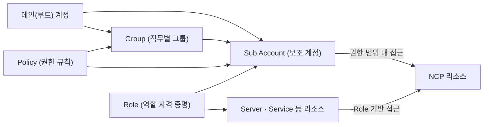

> [!tip] 계정 및 권한 관리
> - [[11_계정 및 권한 관리 (AWS IAM)]]
> - [[03-1_계정 및 권한 관리 (NCP Sub Account)]]

> [!summary] 핵심 요약
> - **Sub Account**는 메인(루트) 계정 하위에 보조 계정을 생성해 **제로 트러스트**와 **최소 권한 원칙**에 따라 직무별 권한과 보안 책임을 분리하는 NCP의 계정·권한 관리(IAM) 서비스이다.
> - **RBAC(Policy · Role)**로 사용자와 리소스의 접근 권한을 체계적으로 제어하고, **MFA · 비밀번호 만료 · 접근 IP 대역 제한**과 접근 유형(콘솔 / API) 분리로 보안성을 높인다.

## 1. 핵심 보안 원칙
- **제로 트러스트 (Zero Trust)**
	- 내부·외부를 막론하고 모든 접근을 기본적으로 신뢰하지 않고 지속적으로 검증하는 보안 모델이다.
	- **5대 관점**: 접근 활동 모니터링, 비정상 행위 탐지, 감사 및 추적성 확보, 권한 검증, 이상 징후 시 위협 대응 연동
- **최소 권한 원칙 (Least Privilege)**
	- 업무 수행에 **반드시 필요한 최소한의 권한만 부여**하여 계정 탈취나 오남용으로 인한 피해를 최소화한다.

## 2. Sub Account와 RBAC

| 개념 | 역할 및 특징 |
| :--- | :--- |
| **Sub Account** | 메인(루트) 계정 하위에 생성하는 보조 계정으로, 직무별 권한과 보안 책임을 분리 |
| **Group** | 동일한 직무·역할을 수행하는 여러 Sub Account를 묶어 권한(Policy)을 일괄 관리하는 단위 |
| **RBAC** (Role-Based Access Control) | 역할(Role) 기반으로 리소스 접근 권한을 체계적으로 제어하는 접근 통제 모델 |
| **Policy vs Role** | **Policy**는 서브 계정·그룹에 부여하는 권한 규칙인 반면, **Role**은 계정뿐 아니라 **Server·Service 등 리소스 자체**에도 권한을 부여할 수 있는 자격 증명 |

## 3. 접근 유형 및 보안 강화 수단
### 3.1. 접근 유형
| 접근 유형 | 인증 수단 | 주요 용도 |
| :--- | :--- | :--- |
| **콘솔 접근** | 전용 로그인 URL + ID · 비밀번호 | 운영자·개발자가 웹 콘솔에 로그인해 리소스를 관리 |
| **API Gateway 접근** | Access Key ID · Secret Key | CLI · SDK · 외부 보안 도구 연동 (예: [[03-3_클라우드 보안\|Cloud Security Watcher(CSW)]] 연동 시 NCP Sub Account API Key 사용) |

### 3.2. 보안 강화 수단
- **MFA (2단계 인증)**: 비밀번호 외에 추가 인증(OTP 등)을 요구해 계정 탈취 피해를 차단한다.
- **비밀번호 만료 정책**: 주기적인 비밀번호 변경을 강제해 장기 노출 위험을 줄인다.
- **접근 허용 IP 대역 제한**: 지정된 사내·관리자 IP 대역에서만 콘솔 및 API에 접근할 수 있도록 제한한다.

## 4. AWS IAM과의 대응 비교
| 구분 | [[11_계정 및 권한 관리 (AWS IAM)\|AWS IAM]] | NCP Sub Account |
| :--- | :--- | :--- |
| **보조 계정** | IAM User | Sub Account |
| **사용자 그룹** | IAM Group | Group |
| **권한 규칙** | Policy | Policy |
| **역할 (리소스 권한 포함)** | IAM Role | Role |
| **프로그래밍 접근 키** | Access Key ID / Secret Access Key | API Key (Access Key / Secret Key) |
