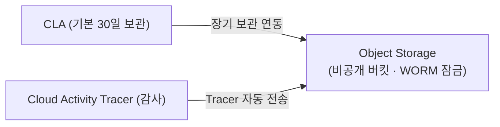

> [!tip] 객체 스토리지
> 데이터를 객체 단위로 저장한다.
> - [[08_객체 스토리지 (AWS S3)]] (Simple Storage Service)
> - [[03-2_객체 스토리지 (NCP Object Storage)]]

> [!summary] 핵심 요약
> - **Object Storage**는 데이터를 **버킷(Bucket)**과 **객체(Object)** 단위로 저장·관리하는 확장형 객체 스토리지로, **Amazon S3 호환 API**를 지원한다.
> - 보안·감사 영역에서는 [[03-3_클라우드 보안|CLA · CAT]] 로그의 장기 보관소로 활용되며, **WORM(Write Once, Read Many)** 잠금 기능과 비공개 설정을 통해 로그 위변조를 방지하고 규제를 준수한다.

## 1. 개념과 기본 구조
**Object Storage**는 이미지·영상·백업·로그 같은 비정형 데이터를 파일 시스템 계층이 아닌 독립적인 **객체(Object)** 단위로 저장하고, HTTP/HTTPS 기반 API로 접근하는 클라우드 스토리지 서비스이다.

| 구성 요소 | 역할 및 특징 |
| :--- | :--- |
| **Bucket (버킷)** | 객체를 담는 최상위 논리적 저장 컨테이너 |
| **Object (객체)** | 실제 데이터 + 메타데이터 + 고유 식별 키(Key)로 구성된 저장 단위 |
| **S3 API 호환** | AWS S3와 호환되는 REST API를 제공해 기존 S3 SDK·CLI 도구를 그대로 연동 가능 |
| **접근 제어 (권한 관리)** | 버킷·객체 단위로 공개 여부를 설정하며, 보안·로그 저장 버킷은 **비공개 설정** 유지가 원칙 |

## 2. 로그 장기 보관과 WORM 잠금
보안 감사 환경에서 Object Storage는 단순 파일 저장소를 넘어 **위변조가 불가능한 로그 장기 보관소** 역할을 수행한다.

| 항목 | 핵심 내용 |
| :--- | :--- |
| **WORM (Write Once, Read Many)** | 데이터를 한 번 기록한 뒤 지정 기간 동안 **수정·삭제를 금지**하는 잠금 기능으로, 위변조를 방지하고 법적·보안 규제를 준수 |
| **비공개 설정 유지** | 감사 로그나 민감 데이터가 외부에 노출되지 않도록 버킷의 퍼블릭 접근을 차단 |
| **[[03-3_클라우드 보안\|CLA]] 연동** | Cloud Log Analytics의 기본 보관 기간(30일) 이후에도 로그를 장기 보존하기 위한 저장소 |
| **[[03-3_클라우드 보안\|CAT]] 연동** | Cloud Activity Tracer의 Tracer 기능으로 콘솔·API 활동 기록을 Object Storage에 자동 적재 |

## 3. NCP 스토리지 유형 비교
| 비교 항목 | [[01-3_블록 스토리지 (NCP Block Storage)\|Block Storage]] | [[01-4_공유 파일 시스템 (NCP NAS)\|NAS]] | Object Storage |
| :--- | :--- | :--- | :--- |
| **저장 단위** | 블록(Block) 단위 가상 디스크 | 파일(File) 단위 계층 구조 | 객체(Object: 데이터 + 메타데이터 + 키) |
| **접근 방식** | 서버 직접 연결 + OS 마운트 | 네트워크 파일 시스템 (NFS / CIFS) | HTTP/HTTPS · S3 호환 API |
| **동시 공유** | 단일 서버 전용 | 여러 서버가 동시에 Read/Write 공유 | 다수 클라이언트·서비스에서 API로 동시 접근 |
| **AWS 대응** | [[04_블록 스토리지 (AWS EBS)\|EBS]] | EFS | [[08_객체 스토리지 (AWS S3)\|S3]] |
| **주요 용도** | OS 디스크, DB 등 저지연 저장 | 웹 서버 간 정적 파일·공유 디렉터리 | 로그 장기 보관(WORM), 백업, 정적 미디어 저장 |
