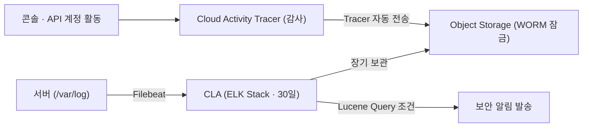

> [!tip] 클라우드 보안 · 로그 · 관제 · 취약점 점검
> - NCP **CLA** · **CAT** / **IDS** · **IPS** · **Anti-DDoS** / **SSC** · **CSW**
> - 관련 노트: [[03-1_계정 및 권한 관리 (NCP Sub Account)|Sub Account]] / [[03-2_객체 스토리지 (NCP Object Storage)|Object Storage]]

> [!summary] 핵심 요약
> - 클라우드 보안은 [[03-1_계정 및 권한 관리 (NCP Sub Account)|계정·권한 제어(Sub Account/RBAC)]]를 바탕으로 **로그·감사 추적(CLA/CAT + [[03-2_객체 스토리지 (NCP Object Storage)|Object Storage WORM]])**, **네트워크 위협 대응(IDS/IPS/Anti-DDoS)**, **취약점·형상 점검(SSC/CSW)** 계층으로 구성된다.

## 1. 로그 관리와 감사 추적
### 1.1. 로그(Log)와 Cloud Log Analytics (CLA)
- **로그(Log)**: 시스템·애플리케이션·네트워크에서 발생하는 이벤트와 상태 정보를 시간순으로 기록한 데이터로, **문제 진단 · 보안 관리 · 운영 분석**의 근거가 된다.
- **Cloud Log Analytics (CLA)**: 대용량 로그를 실시간으로 수집·저장·검색·시각화하는 통합 로그 관리 서비스이다.
	- **수집 구조**: 오픈소스 에이전트 **Filebeat**로 서버 로그를 추출하여 **ELK Stack (Elasticsearch · Logstash · Kibana)** 기반으로 수집·분석한다.
	- **주요 Linux 시스템 로그**:
		- `/var/log/secure`: SSH 접속, `sudo` 사용, 로그인 실패 등 **인증 및 보안 로그**
		- `/var/log/messages`: 부팅, 하드웨어 오류, 서비스 데몬 등 **시스템 전반 로그**
	- **알람(Alarm)**: **Lucene Query**(예: `Failed password for root from`) 조건에 일치하는 로그가 감지되면 통보 대상 그룹에 알림을 발송한다.
	- **보관 정책**: 기본 **30일** 저장되며, 장기 보관이 필요하면 [[03-2_객체 스토리지 (NCP Object Storage)|Object Storage]]와 연동한다.

### 1.2. Cloud Activity Tracer (CAT)와 로그 장기 보관
| 서비스 | 핵심 개념 및 역할 |
| :--- | :--- |
| **Cloud Activity Tracer (CAT)** | 콘솔 및 API를 통해 수행된 **모든 계정의 활동 기록**(누가·언제·무엇을 했는지)을 추적하는 감사(Audit) 서비스. Tracer 기능으로 [[03-2_객체 스토리지 (NCP Object Storage)\|Object Storage]]에 자동 적재 가능 |
| **[[03-2_객체 스토리지 (NCP Object Storage)\|Object Storage · WORM]]** | 로그의 장기 보관소 역할. **WORM** 잠금으로 수정·삭제를 금지해 위변조를 방지하고 규제를 준수 |

## 2. 보안 관제 및 네트워크 위협 대응
- **보안 관제 (Security Monitoring)**: 클라우드 내 보안 위협을 실시간으로 감지하고 로그 분석을 통해 이상 행동을 탐지·알림하는 서비스이다.

| 보안 서비스 | 핵심 동작 | 주요 목적 |
| :--- | :--- | :--- |
| **IDS** (Intrusion Detection System) | 트래픽을 감시해 공격 시도나 비정상 행위를 **탐지 및 경고** | 사고 조기 발견 및 사후 분석 자료 확보 |
| **IPS** (Intrusion Prevention System) | IDS 기능에 더해 공격 트래픽을 실시간으로 **적극 차단** | 공격이 시스템에 도달하기 전 예방 |
| **Anti-DDoS** | 정상 요청과 대규모 공격 트래픽을 구분해 **DDoS 공격 탐지·차단** | 서비스 마비 예방 및 **가용성 보장** |

## 3. 취약점 점검 및 클라우드 형상 관리
### 3.1. System Security Checker (SSC)
서버의 **OS 및 WAS(Web Application Server) 보안 설정 취약점**을 자동 진단하고 개선 방안과 리포트(PDF/Excel)를 제공하는 서비스이다.

| 점검 대상 | 기준 및 항목 수 |
| :--- | :--- |
| **Windows OS** | 37개 항목 |
| **Linux OS** | CSAP 기준 36개 항목 (CSAP · KISA · Finance 등 기준 선택) |
| **WAS (Nginx / Apache)** | KISA 기준 각 7개 항목 |
| **WAS (Tomcat)** | KISA 기준 13개 항목 |

### 3.2. Cloud Security Watcher (CSW)
- **CSPM (Cloud Security Posture Management)** 도구로, **멀티 클라우드(NCP · AWS · Azure) 및 Kubernetes** 환경의 보안 설정 상태를 통합 감시한다.
- 각 클라우드의 API 자격 증명([[03-1_계정 및 권한 관리 (NCP Sub Account)|NCP Sub Account]] API Key, AWS IAM Policy/Key, Azure Entra ID 앱 등록 등)을 연동하여 **보안 프레임워크 준수 현황**과 **자산 설정 변경**을 지속적으로 모니터링한다.

## 4. 보안 서비스 역할 한눈에 보기
| 영역 | 서비스 | 핵심 역할 |
| :--- | :--- | :--- |
| **계정 · 권한** | [[03-1_계정 및 권한 관리 (NCP Sub Account)\|Sub Account]] | 보조 계정 분리, RBAC(Policy/Role), MFA, IP 제한 |
| **로그 분석** | Cloud Log Analytics (CLA) | 서버·앱 로그 통합 수집(ELK), Lucene Query 알람 |
| **감사 추적** | Cloud Activity Tracer (CAT) | 콘솔·API 활동 기록 추적 및 감사 |
| **위변조 방지** | [[03-2_객체 스토리지 (NCP Object Storage)\|Object Storage (WORM)]] | 수정·삭제 불가 잠금을 통한 로그 장기 보관 |
| **네트워크 방어** | IDS · IPS · Anti-DDoS | 침입 탐지(IDS), 실시간 차단(IPS), DDoS 방어 |
| **취약점 진단** | System Security Checker (SSC) | 서버 OS·WAS 보안 설정 취약점 점검 |
| **형상 관리** | Cloud Security Watcher (CSW) | 멀티 클라우드·K8s 보안 준수 현황 통합 관리(CSPM) |
