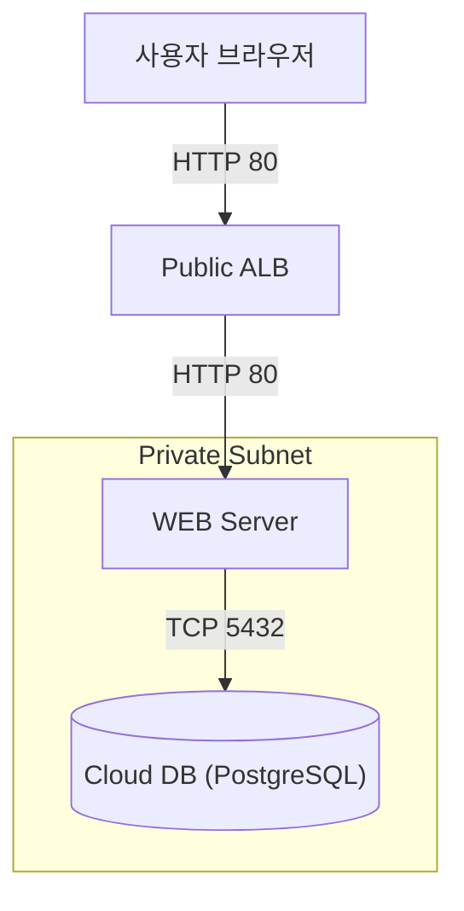
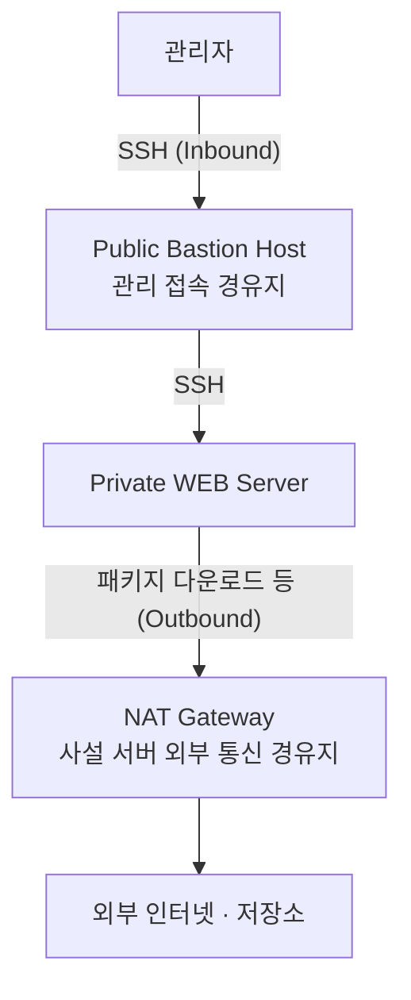

> [!tip] 데이터베이스
> [[07_RDB (AWS RDS)]] (Relational Database Service)
> [[13_NoSQL DB (AWS DynamoDB)]]
> [[04_DB (NCP Cloud DB)]]

> [!summary] 핵심 요약
> - **PaaS DB(Cloud DB)**는 설치·백업·멀티 존 고가용성(Failover)·읽기 부하 분산(Read Replica)을 클라우드가 관리해 주는 데이터베이스 서비스이다.
> - 웹-DB 아키텍처에서는 **WEB 서버와 DB를 모두 Private Subnet에 배치**하고, 외부 요청은 **Public ALB**, 관리자 접속은 **Bastion**, 사설 서버의 외부 다운로드는 **NAT Gateway**로 경로를 분리한다.

## 1. 주요 PaaS DBMS 비교
### 1.1. Cloud DB 스펙 비교표
| DBMS | 유형 | 기본 스토리지 | 추가 단위 | 최대 용량 | 읽기 분산 (Replica) | 백업 보관 | 기본 포트 |
| :--- | :--- | :---: | :---: | :---: | :---: | :---: | :---: |
| **MySQL** | 오픈소스 RDBMS | 10 GB | 10 GB | 6,000 GB | 최대 10개 | 30일 | `3306` |
| **MSSQL** | 상용 RDBMS | 100 GB | 10 GB | 2,000 GB | 최대 5개 | 30일 | - |
| **PostgreSQL** | ORDBMS | 10 GB | 10 GB | 6,000 GB | 최대 5개 | 30일 | `5432` |
| **MongoDB** | 문서 지향 NoSQL | 50 GB | 10 GB | 2,000 GB | - | - | - |
| **Redis** | 인메모리 저장소 | - | - | - | 최대 10개 | 7일 | `6379` |

### 1.2. DBMS별 핵심 특징
#### (1) MySQL
- 대표적인 **오픈소스 관계형 DBMS(RDBMS)**이다.
- **고가용성 & 확장**: Active/Standby 마스터를 서로 다른 Zone에 배치하는 **멀티 존(Multi-Zone)** 구성과 장애 시 자동 전환(**Failover**), 마스터 1대당 **최대 10개의 읽기 슬레이브(Replica)** 및 자동 백업을 지원한다.

#### (2) Microsoft SQL Server (MSSQL)
- **상용 관계형 DBMS**이다.
- 주 DB 장애 시 **미러(Mirror) DB**로 자동 Failover하며, 멀티 존 구성과 **최대 5개의 읽기 전용 슬레이브**를 지원한다.

#### (3) PostgreSQL
- 객체지향 개념을 결합한 **객체-관계형 DBMS(ORDBMS)**이다.
- Primary 장애 시 Secondary로 자동 Failover하며, Primary당 **최대 5대의 Read Replica**를 지원한다.
- **트랜잭션의 ACID 4대 특성**을 엄격히 보장한다.

| 특성 | 의미 |
| :--- | :--- |
| **원자성 (Atomicity)** | 트랜잭션 내 모든 작업은 전부 반영되거나 전부 취소되어야 함 (All or Nothing) |
| **일관성 (Consistency)** | 트랜잭션 실행 전후에 데이터베이스의 무결성과 정합성이 항상 유지됨 |
| **고립성 (Isolation)** | 동시에 실행되는 여러 트랜잭션이 서로 간섭하지 않고 독립적으로 실행됨 |
| **지속성 (Durability)** | 성공적으로 완료(Commit)된 트랜잭션의 결과는 장애가 발생해도 영구 보존됨 |

#### (4) MongoDB
- JSON 유사 문서 형태로 데이터를 저장하는 **문서 지향(Document-Oriented) NoSQL**이다.
- **샤드 클러스터 (Shard Cluster)**: 데이터를 여러 서버에 수평 분산 저장하여 대용량 데이터를 처리한다.
- **레플리카 세트 (Replica Set)**: 동일한 데이터 세트를 복제·유지하는 `mongod` 프로세스 그룹으로 가용성을 확보한다.
- 공식 GUI 관리 도구로 **Compass**를 제공한다.

#### (5) Redis
- 데이터를 메모리에 저장해 초고속으로 처리하는 **인메모리(In-Memory) 데이터 저장소**이다.
- **오토 샤딩 (Auto Sharding)**으로 데이터를 여러 노드에 자동 분산하며, 마스터 노드 장애 시 슬레이브 노드가 마스터로 자동 전환(**Failover**)된다.

## 2. 클라우드 WEB–DB 네트워크 아키텍처
보안성을 높이기 위해 **WEB 서버와 DB 서버 모두 공인 IP가 없는 Private Subnet에 배치**하고, 통신 목적에 따라 세 가지 경로를 명확히 분리한다.

### 2.1. 사용자 요청 경로 (서비스 트래픽)
외부 사용자는 **Public ALB**를 통해서만 Private Subnet의 웹 서버에 접근하며, 웹 서버가 내부망을 통해 DB에 쿼리한다.

### 2.2. 운영 경로: Bastion vs NAT Gateway
사설망 서버의 **인바운드 관리 접속**과 **아웃바운드 외부 통신**은 서로 다른 구성 요소를 사용한다.

| 구분 | Bastion Host | NAT Gateway |
| :--- | :--- | :--- |
| **통신 방향** | 외부 → Private 서버 (**Inbound**) | Private 서버 → 외부 인터넷 (**Outbound**) |
| **주요 목적** | 관리자의 안전한 SSH 원격 접속 경유 | Private 서버의 OS 업데이트·외부 패키지 다운로드 |
| **필수 네트워크 설정** | Public Subnet 배치, SSH ACG 허용 | NAT 전용 Subnet 배치 + **Private Route Table에 `0.0.0.0/0 → NAT Gateway` 경로 추가** |

## 3. 관리형 DB 보안 및 권한 개념
- **네트워크 격리 및 ACG**: DB를 Private Subnet에 두고, DB의 ACG 인바운드에서 해당 DB 포트(예: PostgreSQL `5432`)의 접근 소스를 **VPC 내부 대역(`10.x.0.0/16`)**으로 제한한다.
- **관리형 DB의 권한 모델**: PaaS DB(RDS / Cloud DB)는 클라우드 제공자가 인프라와 엔진을 관리하므로 사용자에게 최상위 **슈퍼유저(`root`) 권한을 직접 부여하지 않는다**. 따라서 PostgreSQL 등에서는 **사용자 전용 스키마**를 생성하고 `search_path`를 설정하여 애플리케이션 테이블을 관리한다.
