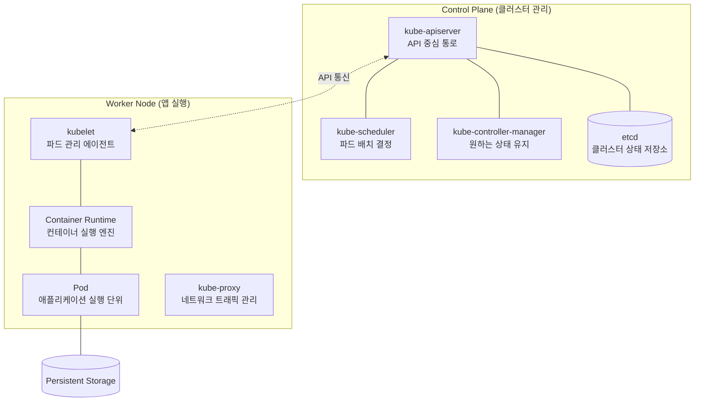

> [!summary] 핵심 요약
> - **Kubernetes(K8s)**는 여러 노드에 분산된 대규모 컨테이너의 배포·확장·장애 복구·네트워킹을 자동화하는 컨테이너 오케스트레이션 플랫폼이다.
> - K8s는 **Control Plane(관리)**과 **Worker Node(실행)**로 나뉘며, 네이버 클라우드에서는 관리형 서비스인 **NKS(Ncloud Kubernetes Service)**를 제공한다.
> - Private Subnet 환경에서는 `ncp-iam-authenticator`와 `kubectl`로 클러스터를 제어하고, CSI 기반 **PV/PVC**와 **Cluster Autoscaler**로 영구 스토리지와 자동 확장을 운영한다.

## 1. Kubernetes (K8s) 개념과 아키텍처
### 1.1. 필요성과 주요 기능
단일 Docker 엔진만으로는 여러 노드에 분산된 대규모 컨테이너의 장애 복구·확장·배포를 관리하기 어렵다. **Kubernetes**는 이를 자동화하는 **컨테이너 오케스트레이션** 플랫폼이다.

| 분류 | 핵심 내용 |
| :--- | :--- |
| **6대 주요 기능** | • **서비스 디스커버리 & 로드 밸런싱**: 컨테이너 간 통신과 트래픽 분산 • **자동 롤아웃 / 롤백**: 무중단 업데이트 및 문제 시 이전 버전 복구 • **자가 치유 (Self-healing)**: 비정상 컨테이너 자동 재시작·교체 • **자동 빈 패킹 (Bin-packing)**: 노드 자원에 맞춰 컨테이너 최적 배치 • **스토리지 오케스트레이션**: 로컬·클라우드 스토리지 자동 마운트 • **시크릿 및 구성 관리**: 민감 정보(Secret)와 설정(ConfigMap) 분리 관리 |
| **5대 핵심 원칙** | 선언적 구성, 분산된 기능 단위(Object), 중앙 제어, 동적 그룹화, API 기반 상호작용 |

### 1.2. 아키텍처 구성 요소
**Control Plane은 클러스터 전체를 관리하는 영역**, **Worker Node는 실제 애플리케이션(Pod)을 실행하는 영역**이다.

| 영역 | 구성 요소 | 핵심 역할 |
| :--- | :--- | :--- |
| **Control Plane** | `kube-apiserver` | 클러스터의 모든 요청이 거치는 API 중심 통로 |
| **Control Plane** | `kube-scheduler` | 새로 생성된 Pod를 어느 Worker Node에 배치할지 결정 |
| **Control Plane** | `kube-controller-manager` | 클러스터가 선언된 목표 상태(Desired State)를 유지하도록 제어 |
| **Control Plane** | `etcd` | 클러스터의 모든 설정과 상태 데이터를 저장하는 키-값 저장소 |
| **Worker Node** | `Pod` | Kubernetes에서 배포·실행하는 애플리케이션의 최소 단위 인스턴스 |
| **Worker Node** | `kubelet` | 각 노드에서 API 서버와 통신하며 Pod의 실행 상태를 관리하는 에이전트 |
| **Worker Node** | `kube-proxy` | 노드 내 네트워크 규칙과 서비스 트래픽 전달 관리 |
| **Worker Node** | `Container Runtime` | 실제로 컨테이너를 실행하는 엔진 |
| **Storage** | `Persistent Storage` | 컨테이너 재시작·교체와 무관하게 데이터를 영구 보존하는 저장소 |

## 2. Kubernetes 운영 핵심 개념 및 NKS
### 2.1. NKS (Ncloud Kubernetes Service) 특징
- **자동 확장성**: 파드와 워커 노드 수량의 자동 확장(**Cluster Autoscaler**) 지원
- **클라우드 인프라 연동**: 고성능 워커 노드, Block Storage/NAS CSI, Load Balancer 자동 연동
- **운영 · 백업 · 보안**: Kubernetes Dashboard·Grafana 기본 제공, **Velero** 플러그인 백업 지원, [[03-3_클라우드 보안|Cloud Activity Tracer(CAT)]]와 연계한 제로 트러스트 감사 지원

### 2.2. 클러스터 접근과 주요 `kubectl` 명령어
Private Subnet의 워커 노드를 보호하기 위해 관리 서버(Bastion)에서 **IAM 인증 도구(`ncp-iam-authenticator`)**와 **`kubeconfig`** 설정을 통해 `kubectl`로 클러스터를 제어한다.

| 구분 | `kubectl` 명령어 | 역할 |
| :--- | :--- | :--- |
| **조회** | `get` | Pods, Services, Nodes, Deployments 등 리소스 목록 조회 |
| **상세 · 디버깅** | `describe` | 리소스의 상세 상태와 이벤트 이력 확인 |
| **로그 · 접속** | `logs` / `exec` | 컨테이너 로그 조회 / 실행 중인 컨테이너 내부 명령 실행 |
| **생성 · 삭제** | `apply` / `create` / `delete` | YAML 선언 파일 적용 / 리소스 생성 / 삭제 |

### 2.3. 영구 스토리지 (PV · PVC · StorageClass)
컨테이너는 기본적으로 휘발성이므로, 영구 데이터가 필요할 때 **CSI(Container Storage Interface)** 기반 StorageClass로 PVC(Persistent Volume Claim)를 생성해 Pod에 마운트한다.

| 스토리지 유형 | 접근 모드 (Access Mode) | 특징 |
| :--- | :--- | :--- |
| **Block Storage CSI** (`nks-block-storage`) | **`ReadWriteOnce` (RWO)** | 단일 노드에서만 읽기·쓰기 마운트 가능 |
| **NAS CSI** (`nks-nas-csi`) | **`ReadWriteMany` (RWX)** | 여러 노드의 서로 다른 Pod 간 동시 읽기·쓰기 공유 가능 |

### 2.4. 확장과 애플리케이션 노출 개념
- **Cluster Autoscaler**: Deployment의 레플리카 증가 등으로 Pod의 자원 요청량이 현재 노드 용량을 초과하면, 노드풀의 최소·최대 범위 내에서 **워커 노드 수를 자동으로 확장·축소**한다.
- **핵심 배포 오브젝트**: **Deployment**(Pod 복제·배포 관리), **ConfigMap**(애플리케이션 설정 분리 주입), **LoadBalancer Service**(클라우드 로드 밸런서를 연동해 클러스터 외부로 서비스 노출)
