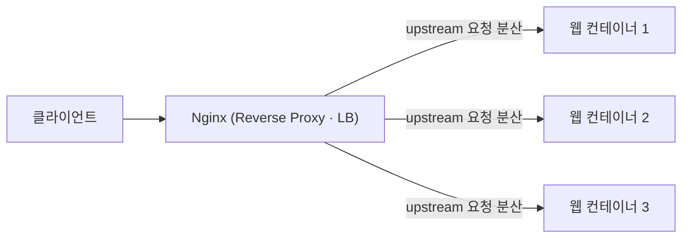
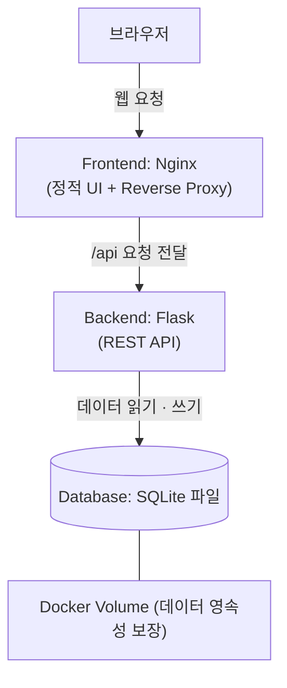

> [!summary] 핵심 요약
> - **Docker**는 애플리케이션과 의존성을 **이미지(Image)**로 패키징하고, 이를 격리된 **컨테이너(Container)**로 실행하는 플랫폼이다.
> - **`Dockerfile`**로 커스텀 이미지를 정의하고, **Registry**로 이미지를 배포·공유하며, **`Docker Compose`**로 다중 컨테이너 스택을, **`Docker Swarm`**으로 다중 호스트 클러스터를 관리한다.

## 1. Docker 기본 개념과 핵심 명령어
- **이미지 (Image)**: 애플리케이션 실행에 필요한 바이너리·라이브러리·설정을 담은 읽기 전용(Stateless) 템플릿
- **컨테이너 (Container)**: 이미지를 기반으로 생성되어 독립된 환경에서 실행되는 프로세스 인스턴스
- **포트 포워딩 (`-p 호스트포트:컨테이너포트`)**: 호스트 머신의 포트로 들어온 요청을 격리된 컨테이너 내부 포트로 연결

### 1.1. 이미지 관리 명령어
| 명령어 | 역할 |
| :--- | :--- |
| `docker pull <이미지명>` | 레지스트리에서 이미지 다운로드 |
| `docker images` | 로컬에 저장된 이미지 목록 확인 |
| `docker rmi <이미지명>` | 로컬 이미지 삭제 |
| `docker build -t <이름:태그> .` | 현재 경로의 `Dockerfile`로 새 이미지 빌드 |

### 1.2. 컨테이너 관리 명령어
| 명령어 | 역할 |
| :--- | :--- |
| `docker run -d --name <이름> -p <호스트:컨테이너> <이미지>` | 컨테이너 생성 및 백그라운드(`-d`) 실행 |
| `docker ps` / `docker ps -a` | 실행 중인 컨테이너 / 정지 포함 전체 컨테이너 목록 확인 |
| `docker stop` / `start` / `restart` | 컨테이너 중지 / 시작 / 재시작 |
| `docker rm` | 정지된 컨테이너 삭제 |
| `docker logs <컨테이너>` | 컨테이너 표준 출력 로그 확인 |
| `docker exec -it <컨테이너> /bin/bash` | 실행 중인 컨테이너 내부 셸에 대화형 접속 |
| `docker cp` | 호스트와 컨테이너 간 파일 복사 |

## 2. Dockerfile과 컨테이너 커스터마이징
### 2.1. `Dockerfile` 핵심 지시어
| 지시어 | 역할 |
| :--- | :--- |
| `FROM` | 새 이미지의 기반이 되는 베이스 이미지 지정 |
| `COPY` | 호스트의 파일·설정·코드를 이미지 내부 경로로 복사 |
| `EXPOSE` | 컨테이너가 외부와 통신할 포트를 메타데이터로 명시 |
| `CMD` | 컨테이너가 시작될 때 기본으로 실행할 명령어 지정 |

### 2.2. 환경 변수와 자동 초기화 개념
- **환경 변수 주입**: DB 루트 비밀번호(`MYSQL_ROOT_PASSWORD`) 등 민감하거나 실행 환경마다 달라지는 설정은 이미지에 하드코딩하지 않고 실행 시 환경 변수로 전달한다.
- **초기화 엔트리포인트**: MySQL 공식 이미지 등은 `/docker-entrypoint-initdb.d/` 디렉터리에 `.sql` 스크립트를 넣어 두면 컨테이너 최초 기동 시 DB와 사용자를 자동 생성한다. 또한 외부 접속을 허용하려면 설정 파일(`mysqld.cnf`)의 `bind-address`를 조정한다.

## 3. 이미지 배포(Registry)와 백업
| 방식 | 개념 및 핵심 명령어 | 특징 |
| :--- | :--- | :--- |
| **Public Registry (Docker Hub)** | `docker login` → `docker tag` → `docker push` | 인터넷을 통해 공개 이미지를 저장·공유 (계정명 태그 필수) |
| **Private Registry** | 사설 `registry` 컨테이너 운영 (기본 5000 포트) | 내부 보안용 이미지 저장소. HTTP 사용 시 `daemon.json`에 `insecure-registries` 등록 필요 |
| **오프라인 백업 · 복원** | `docker save` (tar 추출) / `docker load` (tar 복원) | 네트워크가 없는 환경으로 이미지를 파일 형태로 이동·백업 |

> [!note] GUI 관리 도구: Portainer
> **Portainer**는 호스트의 Docker 소켓(`/var/run/docker.sock`)을 볼륨으로 마운트하여, 웹 브라우저에서 컨테이너·이미지·네트워크·볼륨을 시각적으로 관리하는 도구이다.

## 4. Docker Compose와 멀티 컨테이너 아키텍처
### 4.1. Docker Compose
- 여러 컨테이너의 이미지, 포트, 네트워크, 볼륨, 의존 관계를 단일 선언 파일(**`docker-compose.yml`**)에 정의하고, `docker-compose up -d --build` 한 번으로 전체 스택을 빌드·실행·관리하는 도구이다.

### 4.2. Nginx 로드 밸런싱과 리버스 프록시
Nginx 설정(`nginx.conf`)의 `upstream` 블록을 사용하면 여러 웹 컨테이너로 요청을 분산하는 **로드 밸런서** 역할을 수행할 수 있다.

### 4.3. 3-Tier 아키텍처와 볼륨 영속성
컨테이너가 삭제되어도 데이터를 보존하려면 **Docker Volume**을 마운트해 파일 시스템의 영속성을 보장해야 한다.

- **Frontend (Nginx)**: 정적 웹 페이지 제공 및 `/api` 경로 요청을 백엔드로 전달하는 **리버스 프록시(Reverse Proxy)**
- **Backend (Flask)**: `GET`/`POST` 요청을 처리해 DB에 데이터를 조회·저장하는 API 계층
- **Database + Volume**: 파일 기반 DB(SQLite)를 볼륨에 연결해 컨테이너 재시작·재생성 후에도 데이터 유지

## 5. Docker Swarm (컨테이너 오케스트레이션)
여러 대의 Docker 호스트를 하나의 클러스터로 묶어 컨테이너를 분산 배포·관리하는 Docker 내장 오케스트레이션 도구이다.

- **클러스터 구조**: 클러스터 상태와 스케줄링을 담당하는 **Manager Node**와 실제 컨테이너(Task)를 실행하는 **Worker Node**로 구성된다.
- **Routing Mesh**: 클러스터 내 어느 노드의 IP로 접근하더라도 자동으로 해당 서비스가 실행 중인 컨테이너로 트래픽을 로드 밸런싱해 연결해 준다.

| 명령어 | 역할 |
| :--- | :--- |
| `docker swarm init` | Manager Node에서 Swarm 클러스터 초기화 |
| `docker swarm join` | Worker Node를 클러스터에 합류 |
| `docker node ls` | 클러스터에 속한 노드 목록 및 상태 확인 |
| `docker service create --replicas N ...` | 지정한 복제본 수(`N`)만큼 분산 서비스 생성 |
| `docker service scale <서비스>=N` | 운영 중인 서비스의 컨테이너 복제본 수 동적 조절 (Scale Out/In) |
