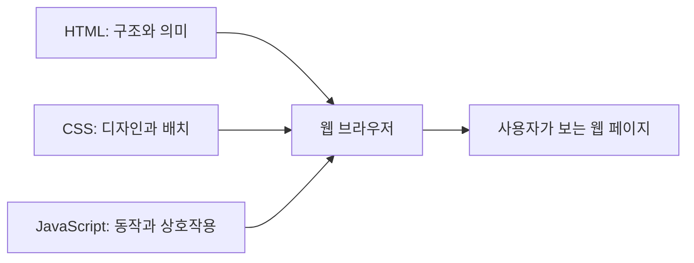
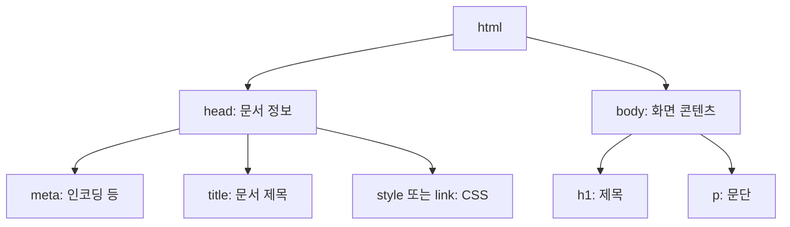
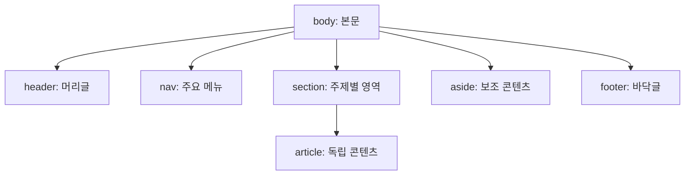
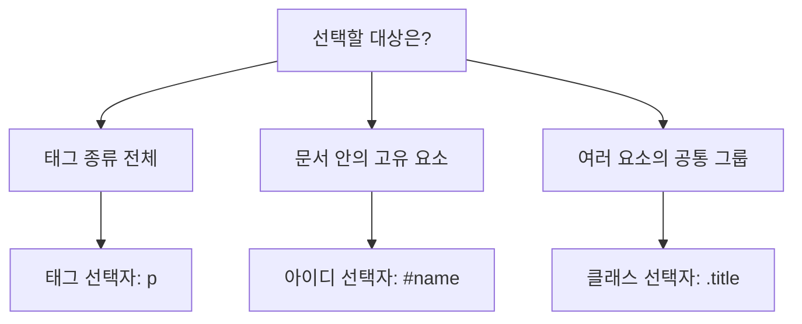
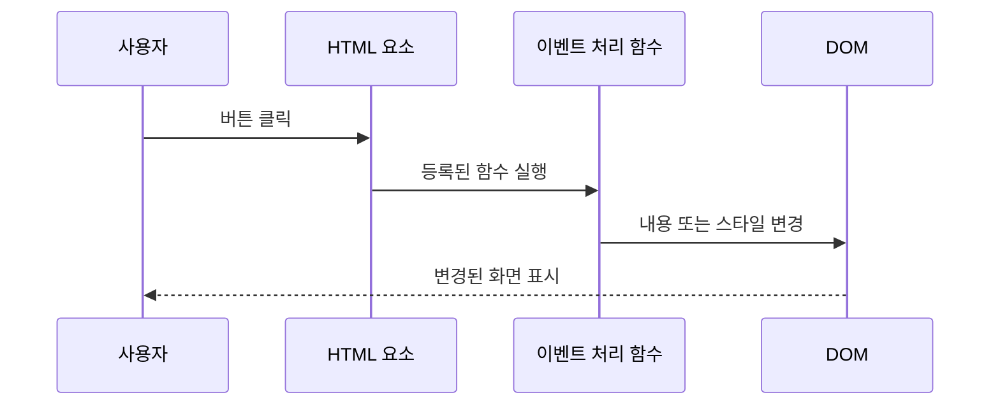

> **Web**
> 전산학기초: [[10_Networks]]
> 프론트엔드프로그래밍: [[01_웹 기술 기초]]
> 웹서비스프로그래밍: [[03_웹 프로그래밍의 기초]]

## 요약
- HTML / CSS / JavaScript: 구조와 의미 / 디자인 / 동작

### 1. HTML
| 비교                                     | 구별 기준                              |
| -------------------------------------- | ---------------------------------- |
| `head` / `body`                        | 문서 정보 / 본문 콘텐츠                     |
| `title` / `h1`                         | 탭 등에 표시되는 문서 제목 / 본문 제목            |
| 태그 보디 / `body` 요소                      | 개별 요소의 콘텐츠 / 문서의 본문 영역             |
| 시맨틱 태그 / `div`                         | 영역의 의미 명시 / 일반 그룹화                 |
| `p` / `br`                             | 문단 / 문단 내부 줄바꿈                     |
| `ul` / `ol` / `li`                     | 순서 없는 목록 / 순서 있는 목록 / 개별 항목        |
| `div` / `span`                         | 기본적으로 블록 영역 / 인라인 영역               |
``

### 2. CSS
| 비교                                     | 구별 기준                              |
| -------------------------------------- | ---------------------------------- |
| `id` / `class`                         | 문서 안의 고유 값 / 여러 요소에서 재사용 가능        |
| `#name` / `.name`                      | 아이디 선택자 / 클래스 선택자                  |
| `div h1` / `p.title`                   | 후손 선택 / 태그와 클래스 조건을 동시에 만족         |

1. 문서 안에서 여러 요소에 같은 스타일을 반복 적용하려면 `id`와 `class` 중 무엇이 적절한가?
	- **`class`**. 하나의 문서에서 `id`는 고유해야 한다.
2. `div h1`은 `div` 바로 아래의 `h1`만 선택하는가?
	- 아니다. **모든 깊이의 후손 `h1`**을 선택한다. 바로 아래 자식만 선택하는 것은 `div > h1`이다. (자식 선택자 설명은 보충)
3. CSS가 아래에 작성되어 있으면 같은 속성의 값을 항상 덮어쓰는가?
	- 아니다. 명시도 등 우선순위 조건도 함께 판단해야 한다.

### 3. JS
| 메서드                               | 선택 기준     | 반환 형태                |
| --------------------------------- | --------- | -------------------- |
| `getElementById('name')`          | `id`      | 요소 하나 또는 `null`      |
| `getElementsByTagName('p')`       | 태그 이름     | 요소 컬렉션               |
| `getElementsByClassName('title')` | 클래스 이름    | 요소 컬렉션               |
| `getElementsByName('username')`   | `name` 속성 | 노드 목록                |
| `querySelector('.title')`         | **CSS 선택자**   | 첫 번째 일치 요소 또는 `null` |
| `querySelectorAll('.title')`      | **CSS 선택자**   | 모든 일치 요소의 노드 목록      |

| 비교                                     | 구별 기준                              |
| -------------------------------------- | ---------------------------------- |
| `getAttribute` / `setAttribute`        | 속성 읽기 / 속성 지정                      |
| `innerHTML` / `textContent`            | HTML 해석을 포함한 내용 / 텍스트 내용           |
| `background-color` / `backgroundColor` | CSS 속성 표기 / JavaScript style 객체 표기 |

- `Math.floor(Math.random() * 255)`의 결과 범위는 0~254의 정수

- DOM 요소에 접근하는 스크립트의 실행 시점을 고려해야 한다. 선택하려는 요소가 아직 파싱되지 않았다면 DOM에서 찾을 수 없기 때문이다.

## 1. 웹 페이지를 구성하는 세 기술
**HTML은 구조와 의미, CSS는 디자인, JavaScript는 동작을 담당한다.**

| 기술 | 역할 | 예시 |
|---|---|---|
| HTML | 콘텐츠의 구조와 의미 정의 | 제목, 문단, 이미지, 목록, 버튼 |
| CSS | 콘텐츠의 표현과 배치 정의 | 글자색, 배경색, 크기, 여백, 반응형 디자인 |
| JavaScript | 이벤트 처리와 동적 변경 | 클릭 처리, 내용 변경, 메뉴 표시, 서버 통신 |



서버는 저장된 HTML 파일을 보내거나, 서버 프로그램으로 HTML을 생성해 전달할 수 있다.
브라우저는 문서 구조를 해석해 화면을 만든다.

*cf.*
- 웹에서 주고받는 데이터가 모두 HTML인 것은 아니다. CSS, JavaScript, 이미지, JSON 등도 전달된다.
- 설명은 HTML 문서를 받아 화면을 구성하는 기본 흐름에 초점을 둔다.

## 2. HTML의 개념과 기본 용어
### 2.1. HTML
**하이퍼텍스트**
- 링크로 다른 정보에 연결된 텍스트
- 사용자가 관련 문서 사이를 이동할 수 있다.
- *초기 WWW는 링크(정보의 연결)에 중점을 두고 설계되었다.*

**마크업**
- 콘텐츠에 태그를 붙여 의미와 구조를 부여하는 방식.

**HTML** (HyperText Markup Language)
- 웹 문서의 구조와 의미를 표현하는 마크업 언어다.
- 예: `<h1>안녕하세요?</h1>`은 해당 텍스트가 최상위 제목임을 나타낸다.

> 브라우저는 서버로부터 받은 HTML 문서의 구조를 해석해 화면을 그린다.
> HTML은 파일 형태로 서버에 존재하거나, 서버 프로그램(JSP·서블릿)이 생성해서 전달된다.
> 어느 쪽이든 결과적으로 브라우저가 받는 데이터의 구조는 HTML 이다.

### 2.2. XML
| 구분    | 특징                              |
| ----- | ------------------------------- |
| HTML  | 표준으로 정해진 태그를 사용하여 웹 문서를 구성      |
| XML   | 목적에 맞게 태그와 문서 규격을 정의하여 데이터를 구조화 |
| XHTML | HTML을 XML 문법에 맞게 표현한 형식         |

**XML** (eXtensible Markup Language)
- 정보의 의미를 태그로 구분하여 각 항목을 별도로 처리할 수 있게 한다.
```xml
<person>
  <name>홍길동</name>
  <tel>010-1234-1234</tel>
  <addr>서울시 마포구</addr>
</person>
```

### 2.3. 태그·속성·태그 보디
기본 형태는 다음과 같다.
```html
<태그이름(시작태그) 속성="속성값">태그보디/콘텐츠</태그이름(종료태그)>

<!-- 시작 태그와 종료 태그로 구성된 태그 -->
<a href="https://www.example.com" target="_blank">사이트 방문하기</a>

<!-- 시작 태그로만 구성된 태그 -->
<!-- src: 이미지 경로, alt: 이미지 대체 텍스트 -->

```

**태그** (Tag)
- 일반 HTML 문법에서 태그 이름은 대소문자를 구분하지 않으며, 소문자로 일관되게 쓰면 읽기 쉽다.
- `<br>`(줄바꿈), `<hr>`(수평선), `` 등은 종료 태그가 없는 빈 요소다.
- 속성은 요소별로 사용할 수 있는 것이 정해져 있으며, `id`, `class`처럼 여러 요소에서 사용하는 공통 속성도 있다.
- 시각적인 디자인은 주로 CSS로 정의한다.

**속성** (Attribute)
- 태그에 **추가 정보**를 제공한다.
- 태그마다 쓸 수 있는 속성이 정해져 있다.
- 디자인 관련 속성은 태그에 거의 쓰지 않고 **CSS로 처리**한다.

**태그 보디** (Tag Body)
- 시작 태그와 종료 태그 사이의 내용(텍스트 또는 다른 태그)
- 부모-자식 관계가 정해진 태그(예: `<ul>`–`<li>`)는 규칙을 따라야 한다.
```html
<h2>Hello World</h2> <!-- 태그 보디가 텍스트 -->

<ul> <!-- 태그 보디가 다른 태그 -->
	<li>아메리카노</li>
	<li>카페라떼</li>
	<li>차
		<ul> <!-- 목록 안에 목록 중첩 -->
			<li>녹차</li>
			<li>홍차</li>
		</ul>
	</li>
</ul>
```

## 3. HTML 문서 구조와 기본 태그
### 3.1. 문서의 기본 구조
```html
<!DOCTYPE html>
<html lang="ko">
<head>
  <meta charset="UTF-8">
  <title>웹 프로그래밍 기초</title>
</head>
<body>
  <h1>안녕하세요.</h1>
  <p>예제 화면입니다.</p>
</body>
</html>
```

| 구성 | 역할 |
|---|---|
| `<!DOCTYPE html>` | HTML 문서 유형 선언 |
| `<html>` | 문서의 루트 요소 |
| `<head>` | 메타데이터, 제목, CSS 연결 등 문서 정보 |
| `<meta charset="UTF-8">` | 문자 인코딩 지정 |
| `<title>` | 브라우저 탭 등에 표시되는 문서 제목 |
| `<body>` | 화면에 표시할 본문 콘텐츠 |



`script`는 `head`와 `body` 모두에 둘 수 있으며, DOM 접근 시 실행 시점을 고려해야 한다.

### 3.2. 제목 태그와 SEO
**제목 태그** `<h1>`~`<h6>`
- 제목의 계층을 나타낸다.
- 기본 표시에서는 숫자가 작을수록 글자가 크지만, **글자 크기보다 문서의 상·하위 제목 관계가 핵심**이다.

**SEO** (Search Engine Optimization; 검색 엔진 최적화)
- 검색 엔진이 문서를 잘 찾고 이해할 수 있도록 최적화하는 작업이다.
- 검색에 잘 노출되려면 올바른 HTML 문법, 구체적인 페이지 제목, 메타 태그 활용이 필요하다.

### 3.3. 문단·줄바꿈·공백
| 표현           | 용도               |
| ------------ | ---------------- |
| `<p>...</p>` | 하나의 문단           |
| `<br>`       | 문단 내부의 줄바꿈       |
| `&nbsp;`     | 줄바꿈되지 않는 공백 문자   |
| CSS 여백       | 요소 사이의 간격과 배치 조정 |
| `<div>`      | 일반 영역 구분         |

일반적인 HTML 표시에서는 연속된 공백과 소스의 줄바꿈이 하나의 공백처럼 처리된다.
```html
<p>첫 번째 문단</p>
<p>두 번째 문단<br>같은 문단 안에서 줄바꿈</p>
<p>단어&nbsp;&nbsp;사이의 공백</p>
```
> *cf.*
> 공백·줄바꿈 처리는 CSS의 `white-space` 설정이나 `<pre>` 등에 따라 달라진다.
> 레이아웃용 간격은 CSS로 지정하는 편이 적절하다.

### 3.4. 목록 태그
| 태그     | 의미                 | 활용                  |
| ------ | ------------------ | ------------------- |
| `<ul>` | 순서 없는 목록 (● 마커)    | 메뉴나 콘텐츠 목록          |
| `<ol>` | 순서 있는 목록 (1. 2. …) | 순서 자체에 의미가 있는 절차·순위 |
| `<li>` | 목록의 개별 항목(아이템)     | -                   |

```html
<ol>
  <li>HTML 작성</li>
  <li>CSS 적용</li>
  <li>JavaScript 연결</li>
</ol>
```

### 3.5. 블록과 인라인
요소의 기본 배치 방식에 따른 구분이다.

| 구분  | 기본 배치                       | 대표 예                     |
| --- | --------------------------- | ------------------------ |
| 블록  | 새 줄에서 시작하고, 보통 가용 너비를 차지한다. | `div`, `p`, `h1`, `form` |
| 인라인 | 문장 흐름 안에서 다른 요소와 나란히 배치된다.  | `span`, `a`, `img`       |
- `<form>`: 사용자 입력을 서버에 제출하는 양식 영역
- `<span>`: 텍스트 일부 등 작은 영역을 묶어 스타일이나 동작을 적용한다.
- `<a href="...">`: 다른 문서나 위치로 이동하는 링크

```html
<div>첫 번째 블록</div>
<div>두 번째 블록</div>
<p><span>같은 줄의 텍스트</span> <a href="next.html">다음 페이지</a></p>
```

> *cf.*
> 블록·인라인 배치는 CSS `display`로 바꿀 수 있다.
> ``는 기본적으로 인라인 흐름에 놓이면서 크기를 지정할 수 있는 대체 요소다.

### 3.6. 시맨틱 태그
**시맨틱 태그** (Semantic Tag)
- 콘텐츠 영역의 **의미와 역할**을 드러낸다.
- 코드의 가독성을 높인다.
- HTML5에서 도입된 주요 구조 태그는 다음과 같다.

| 태그 | 의미 | 사용 예 |
|---|---|---|
| `<header>` | 문서 또는 섹션의 머리글 | 로고, 제목 |
| `<nav>` | 주요 탐색 링크 모음 | 사이트 메뉴 |
| `<section>` | 주제를 기준으로 묶인 영역 | 관련 콘텐츠 그룹 |
| `<article>` | 독립적으로 배포·재사용 가능한 콘텐츠 | 뉴스 기사, 블로그 글 |
| `<aside>` | 주요 내용과 관련된 보조 콘텐츠 | 관련 링크, 사이드바 |
| `<footer>` | 문서 또는 섹션의 바닥글 | 저작권, 연락처 |
| `<div>` | 특별한 의미 없는 일반 영역 | 스타일링, 그룹화 |

- 구성 예시
```
┌──────────── header ────────────┐
├───────────── nav ──────────────┤
│ section           │            │
├───────────────────┤   aside    │
│ article           │            │
├──────────── footer ────────────┤
```


*non-semantic 태그*
- 영역만 구분할 뿐 내용의 의미를 알 수 없어, 스타일링·그룹화 용도로만 쓰고 `class`/`id` 로 구분한다.
  예: `<div class="header">`, `<div id="footer">`

## 4. CSS의 개념과 적용 방법
### 4.1. CSS의 역할과 장점
CSS
- HTML 콘텐츠의 레이아웃과 디자인을 정의한다.

- 콘텐츠와 디자인을 분리하여 각각 수정하기 쉽다.
- 같은 HTML 구조에 다른 테마를 적용할 수 있다.
- PC·스마트폰 등 화면 크기에 맞는 반응형 디자인(Responsive Design)을 구현할 수 있다.

### 4.2. CSS 구문
```css
/* 선택자 { 속성: 값; } */
h1 {
  color: red;
  font-size: 15px;
}
```

- **선택자(selector)**: 스타일을 적용할 HTML 요소를 선택
- **선언부**: `{ ... }`로 묶은 스타일 정의
	- **선언**: `속성: 값;` 형태. 여러 선언을 작성할 수 있다.

### 4.3. 적용 방법 세 가지
| 방식        | 작성 위치                      | 적용 범위와 특징                       |
| --------- | -------------------------- | ------------------------------- |
| 내장 스타일 시트 | HTML의 `<style>` 내부         | 해당 문서에 적용                       |
| 외장 스타일 시트 | 별도 `.css` 파일을 `<link>`로 연결 | 여러 문서에서 재사용하기 편리                |
| 인라인 스타일   | 요소의 `style` 속성             | 해당 요소에 직접 적용,<br>반복 사용 시 관리 어려움 |

```html
<!-- 내장 -->
<style>
  h1 { color: red; }
</style>

<!-- 외장 -->
<!-- rel: 리소스의 관계·용도, href: 파일 경로 -->
<link rel="stylesheet" href="css/main.css">

<!-- 인라인 -->
<h1 style="color: red;">제목</h1>
```

### 4.4. 중첩(Cascading) 적용과 상속
서로 다른 속성은 함께 적용될 수 있다.
같은 속성이 충돌하면 우선순위를 판단한다.

```html
<head>
	<style>
		body { color: blue; }
		h1 { color: red; }
		div h1 { background-color: green; }
	</style>
</head>
<body>
	blue text
	<h1>red text</h1>
	<div>
		<h1>red text on a green background</h1>
	</div>
	blue text
</body>
```

> *cf.*
> **CSS는 단순히 “아래에 쓰면 항상 이긴다”거나 “내장이 외장보다 항상 우선한다”는 규칙이 아니다.**
> 같은 출처·중요도·레이어 등의 조건에서는 선택자의 명시도를 비교하고, 명시도까지 같으면 뒤의 선언을 적용한다.
> 기본 선택자 명시도는 `#id` > `.class` > `태그` 순서다. 상속은 충돌하는 선언의 우선순위 결정과 구별한다.

### 4.5. 파일 분리
HTML·CSS·JavaScript를 별도 파일로 관리하면 유지보수에 유리하다.

```text
ch03/
├── test.html
├── css/
│   └── main.css
└── js/
    └── changeBg.js
```

```html
<link rel="stylesheet" href="css/main.css">
<script src="js/changeBg.js" defer></script>
```

일반 외부 스크립트의 `defer`는 HTML 파싱이 끝난 뒤 실행하도록 한다. 자료처럼 스크립트를 `body` 끝에 두면 앞서 작성된 본문 요소에 접근할 수 있다.

### 4.6. CSS 셀렉터
**CSS 셀렉터**(Selector; 선택자)
- HTML 문서의 특정 요소를 선택해 스타일을 적용하는 규칙
```css
선택자 {
	스타일 속성: 값;
}
```

| 종류       | CSS 문법       | HTML 예시                     | 선택 대상               |
| -------- | ------------ | --------------------------- | ------------------- |
| **태그**       | `p`          | `<p>본문</p>`                 | 모든 `p` 요소           |
| **아이디**      | `#name`      | `<p id="name">이름</p>`       | 해당 ID의 요소           |
| **클래스**      | `.title`     | `<h2 class="title">제목</h2>` | 해당 클래스를 가진 요소       |
| 그룹       | `h1, h2, h3` | 여러 종류의 제목                   | 나열한 선택자 각각에 해당하는 요소 |
| 후손       | `div h1`     | `div` 내부의 `h1`              | `div`의 후손인 `h1`     |
| 태그 + 클래스 | `p.title`    | `<p class="title">본문</p>`   | `title` 클래스가 있는 `p` |



**태그 셀렉터**
- 공통 스타일을 적용할 때 사용한다.
- 여러 태그는 콤마로 나열한다.
```css
p { text-align: center; color: red; }
h1, h2, h3, h4 { color: blue; }
```

**아이디 셀렉터**
- `id`는 문서 안에서 유일해야 한다.
- CSS에서는 앞에 `#`을 붙인다.
```html
<head>
	<style>
		#id_name { color: blue; }
	</style>
</head>
<body>
	<div id="id_name">특정 영역</div>
</body>
```

**클래스 셀렉터**
- 여러 요소를 같은 그룹으로 묶어 스타일을 재사용한다.
- CSS에서는 앞에 `.`을 붙인다.
```html
<head>
	<style>
		.title  { color: blue; }
		p.title { color: red; }
	</style>
</head>
<body>
	<div class="title">blue text</div>
	<h2 class="title">blue text</h2>
	<p class="title">red text</p>
</body>
```
마지막 `p`에는 두 규칙이 모두 일치하지만, `p.title`의 명시도가 더 높아서 빨간 글자가 된다.

### 4.7. 박스 모델
```
┌─ margin ─────────────────────┐
│ ┌─ border ─────────────────┐ │
│ │ ┌─ padding ────────────┐ │ │
│ │ │       content        │ │ │
│ │ └──────────────────────┘ │ │
│ └──────────────────────────┘ │
└──────────────────────────────┘
```

| `padding`/`margin` 값 개수 | 적용 순서                     |
| ----------------------- | ------------------------- |
| 1개 `15px`               | 네 방향 모두                   |
| 2개 `15px 20px`          | 위아래 / 좌우                  |
| 3개 `a b c`              | 위 / 좌우 / 아래               |
| 4개 `a b c d`            | 위 → 오른쪽 → 아래 → 왼쪽 (시계 방향) |

- `margin: auto` + `width: 50%` → 폭 50% 박스가 **가로 중앙**에 온다.

### 4.8. 부트스트랩
**부트스트랩 (Bootstrap)**
- 미리 정의된 스타일과 컴포넌트를 제공하는 오픈소스 라이브러리다.
- 자료에서는 **CSS 클래스를 조합해 디자인을 적용하는 방식**을 소개한다.

사용 방법:
1. 소스를 내려받아 프로젝트에 포함한다.
2. CSS 파일을 링크로 연결한다.
3. 필요한 요소에 제공되는 클래스를 지정한다.


```html
<!-- 버튼 예제 -->
<button type="button" class="btn btn-primary">Primary</button>

<!-- 여러 클래스 조합 -->
<div class="bg-primary w-75 mt-5 shadow">콘텐츠</div>
```
- `btn` 클래스: 기본 버튼 스타일
- `btn-primary` 클래스: 기본 테마에서 파란 배경·흰 글자의 주요 버튼
	- (그 외 `secondary` `success` `danger` `warning` `info` `light` `dark` `link`)

| 주요 유틸리티 클래스                | 의미                           |
| -------------------------- | ---------------------------- |
| `bg-primary`, `bg-warning` | 배경색 (파랑, 노랑)                 |
| `w-75`                     | 너비를 부모의 75%                  |
| `mt-5`, `p-5`              | 위쪽 마진 5, 패딩 5 (크기 **0~5**)   |
| `mx-auto`                  | 좌우 마진 자동 → 가로 중앙 정렬          |
| `ms-auto`                  | 왼쪽(start) 마진 자동 → 오른쪽 끝으로 밀기 |
| `shadow`                   | 박스 테두리에 그림자 효과               |
| `container`                | 콘텐츠를 감싸는 기본 레이아웃 박스          |

> [!tip] 간격 클래스 읽는 법 `{속성}{방향}-{크기}`
> - 속성: `m` margin, `p` padding
> - 방향: `t` top, `b` bottom, `s` start(왼쪽), `e` end(오른쪽), `x` 좌우, `y` 상하, 생략 시 네 방향
> - 크기: `0`~`5`, `auto`

## 5. JavaScript의 개념과 기본 문법
### 5.1. 역할과 특징
**JavaScript**
- 객체 기반 스크립트 언어로, **객체지향·함수형 프로그래밍**을 표현할 수 있다.
	- 변수에 타입을 명시하지 않는 **동적 타입 언어**다.
- **인터프리터 언어**이나 현대적 엔진에서는 JIT 컴파일러를 함께 사용한다.

용도
- 웹 브라우저는 JavaScript 실행 엔진을 내장하고 있다.
	- 정적인 HTML에 동작과 상호작용을 더하는 언어다.
	- HTML 요소의 내용·속성·스타일을 바꿀 수 있다.
	- 이벤트, 비동기 처리, HTTP 요청·응답을 다룰 수 있다.
- 웹 서버에서는 Node.js같은 실행 환경을 사용한다.
- 뷰·앵귤러·리액트 같은 프런트엔드 프레임워크나, 데스크톱 앱 개발에도 사용된다.

| 구분      | 주요 구성요소                       |
| ------- | ----------------------------- |
| 프로그램 구성 | 변수, 함수, 객체, 클래스               |
| 실행 제어   | 조건문, 반복문                      |
| 자료 구조   | 배열, 리스트, 맵(Map) 등의 자료 구조      |
| 웹 기능    | 비동기 처리, HTTP 요청·응답 처리, DOM 접근 |

활용 예
- 자동 스크롤, 콘텐츠 전환
- 날씨 정보 요청, 채팅
- 숨겨진 메뉴 표시, 탭 화면

### 5.1. 변수·문자열·함수
**변수** 선언에는 `var`, `let`, `const`를 사용한다.
- 선언 없이 대입하면 항상 정상적인 전역변수 선언이 되는 것은 아니다. 엄격 모드와 모듈에서는 오류가 발생하므로 선언 키워드를 사용한다.
```javascript
let name = '홍길동';
const message = "안녕하세요";
name = '이순신';
```

| 선언 | 기본 특징 — 보충 |
|---|---|
| `var` | 함수 스코프, 재선언·재할당 가능 |
| `let` | 블록 스코프, 재할당 가능 |
| `const` | 블록 스코프, 같은 변수에 재할당 불가 |
`const`로 선언한 객체도 내부 속성은 변경할 수 있다.

**문자열**에는 작은따옴표 `' '`와 큰따옴표 `" "`를 모두 사용할 수 있다.

*함수형 언어를 지원해 함수를 변수, 함수 인자, 객체 멤버로 사용할 수 있다.*

**함수**는 값처럼 다른 함수의 인자로 전달할 수 있다.
```javascript
function cal(func, num) { return func(num); } // 함수를 인자로 받는다.
function increase(num)  { return num + 1; }
function decrease(num)  { return num - 1; }

alert(cal(increase, 1));  // 2
alert(cal(decrease, 1));  // 0
```
`cal`은 전달받은 함수를 실행한다.
`increase`를 넘기면 1을 더하고, `decrease`를 넘기면 1을 뺀다.

### 5.2. JSON
 JSON(JavaScript Object Notation)
 - JavaScript 객체 리터럴 문법을 바탕으로 한 **텍스트 기반 데이터 교환 형식**
 - JavaScript 객체 자체와는 다르다.
 - JSON에서는 속성 이름과 문자열에 큰따옴표를 사용한다.
 
```json
{
  "name": "홍길동",
  "age": 20
}
```

```javascript
// 보충: JSON 텍스트와 JavaScript 객체 사이의 변환
const person = JSON.parse('{"name":"홍길동","age":20}');
const jsonText = JSON.stringify(person);
```

## 6. 이벤트와 DOM
### 6.1. 이벤트의 개념과 처리
**이벤트**: HTML 문서에서 발생하는 특정 상황이다.
- 사용자 동작: 버튼 클릭, 마우스 이동, 키보드 입력.
- 문서·창 상태 변화: 문서 로드, 창 크기 변경.
- 이벤트 처리 함수가 실행되어 내용이나 스타일을 변경할 수 있다.



```html
<!-- 등록 방식 1. HTML 이벤트 속성 -->
<button type="button" onclick="login()">로그인</button>
```

```javascript
// 등록 방식 2. DOM 요소의 이벤트 처리 속성
button.onclick = login;

// 등록 방식 3. 이벤트 리스너에 콜백 함수 등록
button.addEventListener('click', login);
```

### 6.2. DOM의 개념과 구조
**DOM** (Document Object Model, 문서 객체 모델)
- HTML 문서를 프로그램에서 다룰 수 있도록 객체와 트리 구조로 표현한 것이다.
- JavaScript는 DOM을 통해 HTML 요소에 접근한다.

```html
<html>
	<head>
		<title>Hello Web</title>
	</head>
	<body>
		<h2>Hello World</h2>
	</body>
</html>
```

```
document
└─ html 요소 노드
	├─ head 요소 노드
	│	└─ title 요소 노드
	│		└─ "Hello Web" 텍스트 노드
	└─ body 요소 노드
		└─ h2 요소 노드
			└─ "Hello World" 텍스트 노드
```

*cf.*
- 속성(예: `id`, `class`, `src`)은 요소에 연결되어 있으며, DOM 트리에서 일반적인 자식 노드처럼 배치되지는 않는다.

#### (1) 요소 선택
| 메서드                               | 선택 기준     | 반환 형태                |
| --------------------------------- | --------- | -------------------- |
| `getElementById('name')`          | `id`      | 요소 하나 또는 `null`      |
| `getElementsByTagName('p')`       | 태그 이름     | 요소 컬렉션               |
| `getElementsByClassName('title')` | 클래스 이름    | 요소 컬렉션               |
| `getElementsByName('username')`   | `name` 속성 | 노드 목록                |
| `querySelector('.title')`         | CSS 선택자   | 첫 번째 일치 요소 또는 `null` |
| `querySelectorAll('.title')`      | CSS 선택자   | 모든 일치 요소의 노드 목록      |

```javascript
const nameElement = document.getElementById('name');
const firstTitle = document.querySelector('.title');
const allTitles = document.querySelectorAll('.title');
```

**선택자 문자열과 이름 인자를 구분한다.**
```javascript
document.getElementById('name');  // # 없이 ID 값
document.querySelector('#name');  // CSS 선택자이므로 # 사용
```

#### (2) 내용 변경
```html
<!-- 이름 변경 예제 -->
<p id="name">홍길동</p>
<script>
  document.getElementById('name').innerHTML = '이순신';
</script>
```
화면의 `홍길동`이 `이순신`으로 바뀐다.

> **보충**: `innerHTML`은 내용을 HTML로 해석한다. 단순 텍스트만 변경하려면 `textContent`를 사용할 수 있다.

```javascript
document.getElementById('name').textContent = '이순신';
```

#### (3) 속성 읽기와 변경
```javascript
element.getAttribute('속성이름');
element.setAttribute('속성이름', '새 값');
```

```javascript
const img = document.querySelector('img');

// 읽기 메서드에는 속성 이름 하나를 전달한다.
const oldSrc = img.getAttribute('src');

// 값은 setAttribute에서 지정한다.
img.setAttribute('src', 'images/newPic.jpg');
img.setAttribute('alt', '프로필 사진');
```

#### (4) 동적 디자인 변경
```javascript
const box = document.getElementById('box1');

// 방법 1. style 속성을 문자열로 설정
box.setAttribute('style', 'background-color: yellow;');

// 방법 2. style 객체의 개별 속성 변경
box.style.backgroundColor = 'yellow';

// 방법 3. 클래스 변경
box.className = 'bgyellow';
```

```css
.bgyellow { background-color: yellow; }
```

| 방식 | 특징 |
|---|---|
| `setAttribute('style', ...)` | `style` 속성 전체를 문자열로 설정 |
| `style.backgroundColor` | 개별 스타일을 객체 속성으로 변경 |
| `className` | 클래스 문자열 전체를 변경, CSS 규칙 재사용 |

CSS의 `background-color`는 JavaScript `style` 객체에서 `backgroundColor`로 쓴다.

> **보충**: 기존 클래스를 유지하면서 하나만 추가·제거하려면 `classList.add()`, `remove()`, `toggle()`을 사용할 수 있다. `className` 대입은 기존 클래스 전체를 바꾼다.

## 7. HTML·CSS·JavaScript 코드 분리
HTML에서 JS·CSS 코드를 분리해 두면 유지보수가 쉽다.

```
jspbook/src/main/webapp/ch03/
├── css/main.css
├── js/changeBg.js
└── test.html
```

```html
<!-- test.html -->
<!DOCTYPE html>
<html lang="ko">
<head>
	<meta charset="UTF-8">
	<title>배경색 변경 예제</title>
	<link rel="stylesheet" href="css/main.css">
	<script src="js/changeBg.js" defer></script>
</head>
<body>
	<p>새로 고침해 보세요.</p>
	HelloJSP1
	<h1>HiWorld</h1>
	<div>
		<h1>HelloWorld</h1>
	</div>
	HelloJSP2
	
</body>
</html>
```

> `<script>` 는 `<head>`·`<body>` 어디에나 둘 수 있지만, DOM 접근은 HTML 문서가 모두 로딩된 다음에만 가능하다.

`defer`를 붙이는 이유
- `changeBg.js` 는 `document.body` 에 접근한다.
- `<head>` 에서 바로 실행하면 아직 `<body>` 가 로딩되지 않아 오류가 난다.

```css
/* css/main.css */
body { color: blue; }
h1 { color: red; }
div h1 { background-color: green; }
```

```javascript
// js/changeBg.js
function random(number) {
	// 1. Math.random(): 0 이상 1 미만의 난수 반환
	// 2. Math.floor(): 값 이하의 정수 반환
	return Math.floor(Math.random() * number);
}

function bgChange() {
	// 3. random(256): 0~255의 정수 반환
	const rndCol = 'rgb('+ random(256) + ','
						+ random(256) + ','
						+ random(256) + ')';
	document.body.style.backgroundColor = rndCol;
}

bgChange();
```
