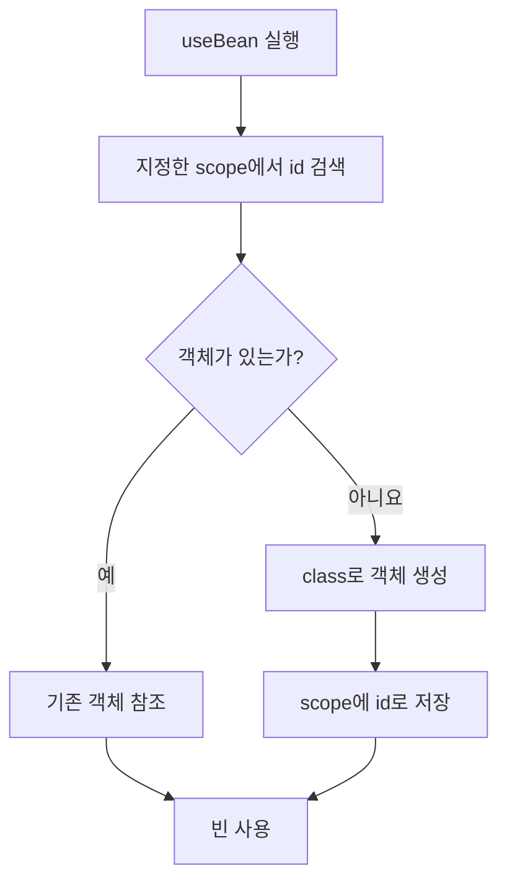
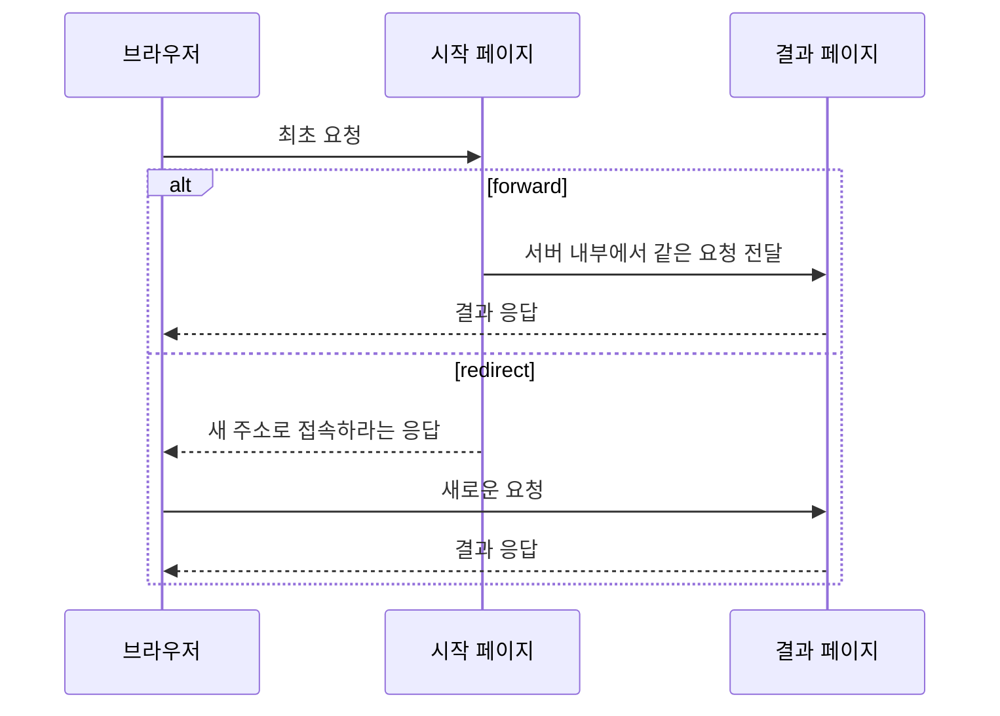
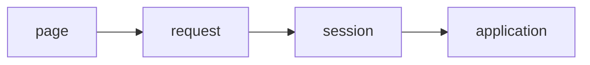
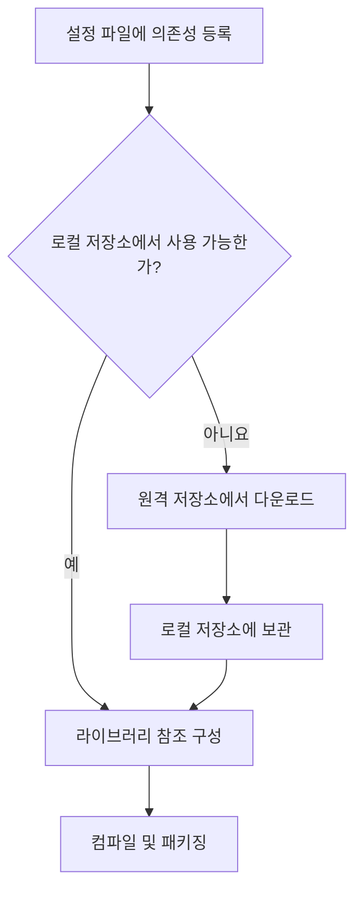

## 요약
### 1. 액션 태그와 자바 빈
- JavaBean: 캡슐화된 Java 클래스
- `jsp:useBean`: 객체를 scope에서 검색하고, 필요하면 생성
	- 기본 scope: `page`
	- `property="*"`: 이름이 같은 요청 파라미터를 Bean 프로퍼티에 설정
- `jsp:setProperty`: 요청 파라미터를 setter에 연결
- `jsp:getProperty`: getter로 읽어 출력
- `jsp:include`: 다른 JSP의 실행 결과를 현재 출력에 포함한다.
- `jsp:forward`: 객체를 유지하며 다른 JSP로 같은 요청 처리를 전달 (URL 유지)

### 2. 커스텀 태그와 EL
- 커스텀 태그: 개발자가 만든 기능을 태그로 재사용

태그 파일 경로 지정 `tagdir`
`prefix="m"`인 `printData` 태그의 사용법 `<m:printData />`

- EL: `${객체.프로퍼티}` 객체의 값을 조회한다.
- JSP 표현식 `<%= ... %>`
- 빈 프로퍼티: `${m.name}` → 내부 이용 메서드 `getName()`
	- scope 탐색 순서: page → request → session → application
- 요청 파라미터: `${param.name}` (폼의 `name` 입력값)
	- `?uname=kim`을 EL로 읽는 식
- 요청 속성: `${requestScope.name}`

### 3. JSTL
- **JSTL**
	- 태그와 EL을 함께 사용하여 **화면의 조건·반복을 표현**한다.
	- 라이브러리와 `taglib` 선언이 필요하다.

- `c:set`: 영역의 값 또는 객체 프로퍼티 설정

- `c:out`: 기본적으로 이스케이프
	- `escapeXml="true"` 기본값: HTML 태그를 문자 그대로
- EL 직접 출력: HTML 태그 처리 (이스케이프 X)

- `c:if`: 단일 조건 (else 없음)
- `c:choose`: 여러 조건 중 하나 선택

- `c:forEach`: 컬렉션 등의 원소 반복
	- 속성 `begin="0" end="5"`는 항목이 충분하면 6회 반복
	- 상태 `index`/`count`: index는 0부터, count는 1부터 시작
- `c:forTokens`: 구분자로 나눈 문자열 반복
	- 마지막 항목 뒤의 쉼표를 생략하는 조건 **`${!i.last}`**

### 4. 빌드 도구와 저장소
- 빌드 도구: 빌드와 의존성을 관리
	- Maven 설정 파일 `pom.xml` (라이브러리 선언 관리)
	- Gradle 설정

- 라이브러리가 필요로 하는 다른 라이브러리: 전이 의존성
- 레포지토리: 라이브러리를 보관

- 웹 앱 패키징 형식 war

## 도입
JSP에서 자바 코드를 직접 작성하는 스크립트릿(`<% ... %>`)이 많아지면 HTML과 처리 코드가 섞여 읽기 어려워진다.
**객체를 다루는 액션 태그 → 값을 표현하는 EL → 조건과 반복을 담당하는 JSTL → 라이브러리를 관리하는 Maven** 순서로 이를 다룬다.

## 1. 액션 태그와 자바 빈
### 1.1. 표준 액션 태그
객체 생성과 공유, 페이지 이동과 전달 등에 사용하는 JSP 태그이다.
`jsp` 접두어를 사용하며 별도의 `taglib` 지시어가 필요하지 않는다.

| 태그 | 역할 |
|---|---|
| `<jsp:useBean>` | 자바 빈 객체를 찾거나 생성 |
| `<jsp:setProperty>` | 빈의 프로퍼티에 값 설정 |
| `<jsp:getProperty>` | 빈의 프로퍼티 값 출력 |
| `<jsp:include>` | 다른 페이지의 실행 결과 포함 |
| `<jsp:forward>` | 같은 요청을 다른 페이지로 전달 |
| `<jsp:param>` | include·forward 대상에 파라미터 전달 |

### 1.2. 자바 빈
자바 빈의 구조
- 클래스는 `public`, 필드는 `private`으로 선언한다.
- 객체를 생성할 수 있도록 매개변수가 없는 기본 생성자를 제공한다.
- 프로퍼티는 `public` getter와 setter로 접근한다.
- 이름이 `name`이면 `getName()`, `setName(...)` 형태로 작성한다.
- `boolean` 프로퍼티의 getter는 `isActive()` 같은 형태를 사용할 수 있다.
- 자료의 직렬화 가능한 빈 예제는 `Serializable`을 구현한다.

```java
import java.io.Serializable;

public class UserBean implements Serializable {
	private String name;
	private int age;
	
	public UserBean() {}
	
	public String getName() { return name; }
	public void setName(String name) { this.name = name; }
	
	public int getAge() { return age; }
	public void setAge(int age) { this.age = age; }
}
```

필드를 직접 공개하지 않고 메서드를 통해 접근하는 구조는 **캡슐화**에 해당한다. setter 안에서 값 검사 등을 추가할 수도 있다.

### 1.3. `jsp:useBean`
```jsp
<jsp:useBean id="m" class="com.my.Member" scope="request" />
```

#### 동작
- 지정한 `scope`에서 `id`가 같은 객체를 먼저 찾는다.
- 객체가 있으면 참조하고, 없으면 지정한 클래스로 생성해 해당 영역에 저장한다.



> 위 흐름은 `class`를 지정해 생성할 수 있는 경우이다.
> `type`만 있는 예제는 기존 객체를 참조하는 용도이다.

#### 속성
| 속성         | 의미                                           |
| ---------- | -------------------------------------------- |
| `id`       | 영역에 저장되는 이름이자 현재 JSP에서 객체를 참조하는 이름           |
| `scope`    | 객체를 저장하거나 검색하는 영역. 생략 시 `page`               |
| `class`    | 생성할 구체 클래스의 전체 이름. 패키지명 포함                   |
| `type`     | 참조 변수의 타입. 클래스·상위 클래스·인터페이스 등                |
| `beanName` | 자료에서 `type`과 함께 `class`를 대체하는 방식으로 소개하는 빈 이름 |
`class`에는 직접 생성할 수 없는 인터페이스나 추상 클래스를 지정할 수 없다.
`type`을 별도로 쓰는 경우 실제 객체와 타입 관계가 맞아야 한다.

#### scope
| 영역            | 유지 범위                                | 사용 예              |
| ------------- | ------------------------------------ | ----------------- |
| `page`        | 현재 JSP 페이지                           | 현재 화면에서만 쓰는 값     |
| `request`     | 하나의 요청 처리 동안. forward·include 대상과 공유 | 처리 결과를 다른 JSP로 전달 |
| `session`     | 같은 클라이언트의 세션이 유지되는 동안                | 로그인 정보, 장바구니      |
| `application` | 웹 애플리케이션 생명 주기 동안                    | 애플리케이션 전체의 공유 정보  |
`session`은 유효시간 만료나 `invalidate()` 호출 등으로 종료된다.
`application`은 사용자별 영역이 아니다.

### 1.4. `jsp:setProperty`
폼 입력을 빈에 저장한다.
```html
<form action="join.jsp" method="post">
    <input name="id">
    <input name="name">
    <input name="email">
    <button type="submit">가입</button>
</form>
```

```jsp
<jsp:useBean id="m" class="com.my.Member" />
<jsp:setProperty name="m" property="*" />

<%
    MemberDAO dao = new MemberDAO();
    dao.insertDB(m);
%>
```
- `name="m"`: 앞에서 참조한 빈을 지정한다.
- `property="*"`: **요청 파라미터와 이름이 같은 프로퍼티**를 setter를 통해 설정한다.
- 폼 입력의 `name="name"`은 빈의 `name` 프로퍼티와 대응한다.
- 별도로 `scope`를 쓰지 않았으므로 빈은 `page` 영역에 저장된다.

예를 들어 문자열 프로퍼티라면 다음과 같은 수동 처리와 대응한다.
```java
m.setName(request.getParameter("name"));
m.setEmail(request.getParameter("email"));
```

자료의 회원 가입 예제는 이 객체를 `MemberDAO`의 `insertDB(m)`에 전달한다.
즉, **폼 입력 → 빈에 값 설정 → DAO에 저장 요청**하는 구조이다.
숫자 프로퍼티는 문자열을 그대로 넘기는 수동 코드와 구분해야 한다.

### 1.5. `jsp:getProperty`
특정 프로퍼티만 설정하거나 출력할 수도 있다.
```jsp
<jsp:setProperty name="m" property="name" value="홍길동" />

<jsp:getProperty name="m" property="name" />
```

### 1.6. `jsp:include`
> include 지시어와 액션의 차이

| 구분    | include 지시어                        | `jsp:include`액션                     |
| ----- | ---------------------------------- | ----------------------------------- |
| 문법    | `<%@ include file="header.jsp" %>` | `<jsp:include page="header.jsp" />` |
| 포함 대상 | 대상 파일의 소스                          | 대상 페이지의 실행 결과                       |
| 처리 방식 | **소스를 합쳐** 하나의 서블릿으로 변환·컴파일        | 요청 처리 중 대상을 실행하고 **결과 포함**          |

```jsp
<%-- main.jsp --%>
<jsp:include page="header.jsp">
    <jsp:param name="title" value="My Homepage" />
</jsp:include>
```

```jsp
<%-- header.jsp --%>
<h2><%= request.getParameter("title") %></h2>
```

`main.jsp`의 출력 안에 `header.jsp`가 처리한 결과가 들어간다.
`jsp:param`으로 전달한 값은 요청 파라미터로 읽는다.

### 1.7. `jsp:forward`
> forward와 redirect의 차이

| 구분            | `jsp:forward`          | redirect           |
| ------------- | ---------------------- | ------------------ |
| 이동을 수행하는 주체   | 서버                     | 브라우저               |
| 새로운 요청        | 기존 요청을 서버 내부에서 전달      | 브라우저가 새 요청 전송      |
| 주소창 URL       | 기존 URL 유지              | 새 URL로 변경          |
| 기존 request 속성 | 유지                     | 새 요청에 자동으로 이어지지 않음 |
| 사용 목적         | 요청 데이터와 처리 결과를 유지하며 전달 | 새 주소로 다시 접속하도록 안내  |



forward 예제:
```jsp
<jsp:forward page="result.jsp">
    <jsp:param name="title" value="My Homepage" />
</jsp:forward>
```

```jsp
<%-- result.jsp --%>
<h2><%= request.getParameter("title") %></h2>
```

redirect 예제:
```java
response.sendRedirect("result.jsp");
```

`request.setAttribute(...)`에 저장한 객체를 이동 후에도 사용해야 한다면 forward가 적합한다.

### 1.8. `jsp:param`
<jsp:include>나 <jsp:forward>의 하위 태그로 사용된다.
이동할 페이지에 파라미터를 추가로 전달할 때 사용한다.

## 실습 7-1: 계산기
### 1. 역할 분리
| 파일                                   | 역할                  |
| ------------------------------------ | ------------------- |
| `src/main/webapp/ch07/calcForm.html` | 두 숫자와 연산자 입력        |
| `src/main/java/ch07/Calculator.java` | 입력 데이터 보관 및 계산      |
| `src/main/webapp/ch07/calc.jsp`      | 빈 생성, 입력값 연결, 결과 출력 |

### 2. 입력 화면
```html
<!DOCTYPE html>
<html>
<head>
    <meta charset="UTF-8">
    <title>계산기-useBean</title>
</head>
<body>
    <h2>계산기-useBean</h2>
    <form method="post" action="calc.jsp">
        <input type="text" name="n1" size="10">
        <select name="op">
            <option>+</option>
            <option>-</option>
            <option>*</option>
            <option>/</option>
        </select>
        <input type="text" name="n2" size="10">
        <input type="submit" value="실행">
    </form>
</body>
</html>
```

`action`은 데이터를 받을 페이지, `method="post"`는 전송 방식, 각 입력의 `name`은 요청 파라미터 이름이다.

### 3. Calculator 빈
```java
package ch07;

public class Calculator {
    private int n1;
    private int n2;
    private String op;
    
    public int getN1() { return n1; }
    public void setN1(int n1) { this.n1 = n1; }
    
    public int getN2() { return n2; }
    public void setN2(int n2) { this.n2 = n2; }
    
    public String getOp() { return op; }
    public void setOp(String op) { this.op = op; }
    
    public long calc() {
        int result = 0;
        switch (op) {
            case "+": result = n1 + n2; break;
            case "-": result = n1 - n2; break;
            case "*": result = n1 * n2; break;
            case "/": result = n1 / n2; break;
        }
        return result;
    }
}
```

### 4. JSP에서 처리
```jsp
<%@ page language="java" contentType="text/html; charset=UTF-8"
    pageEncoding="UTF-8" %>
<jsp:useBean id="calc" class="ch07.Calculator" />
<jsp:setProperty name="calc" property="*" />
<!DOCTYPE html>
<html>
<head>
    <meta charset="UTF-8">
    <title>계산기-useBean</title>
</head>
<body>
    <h2>계산 결과-useBean</h2>
    <hr>
    결과: <%= calc.calc() %>
</body>
</html>
```

## 2. 커스텀 태그와 EL
### 2.1. 커스텀 태그
개발자가 정의한 기능을 태그 형태로 호출하는 방식이다.
반복되는 코드의 재사용과 스크립트릿 감소가 목적이다.
브라우저에서 실행되는 HTML 태그가 아니라 **서버에서 처리되는 JSP 태그**이다.

```jsp
<%@ taglib tagdir="/WEB-INF/tags" prefix="m" %>

<m:printData pid="87459989" />
```
- `tagdir`: 태그 파일이 있는 위치이다.
- `prefix`: 태그를 구분할 접두어이다.
- `printData`: `printData.tag`라는 태그 파일명과 대응한다.
- `pid`: 태그에 전달할 속성이다.

공통적으로 필요한 기능을 표준 태그 라이브러리로 제공하는 것이 JSTL이다.

### 2.2. EL의 역할
**EL (Expression Language)**
- `${...}` 구문으로 값을 표현한다.
- 영역에 저장된 객체의 프로퍼티, 배열·리스트·맵의 원소를 읽고 간단한 연산을 수행할 수 있다.

```jsp
이름: ${m.name}
```
`m`이 빈 객체라면 `name` 필드에 직접 접근하는 것이 아니라 `getName()`으로 값을 읽는다.

| 표현 방식 | 예시 |
|---|---|
| JSP 표현식 | `<%= m.getName() %>` |
| 액션 태그 | `<jsp:getProperty name="m" property="name" />` |
| EL | `${m.name}` |
| 영역을 지정한 EL | `${sessionScope.m.name}` |

EL 읽기에는 getter가 중요하다.
setter는 프로퍼티에 값을 저장할 때 사용한다.

### 2.3. EL의 영역 검색 순서
영역을 생략한 `${m.name}`은 다음 순서로 `m`이라는 속성을 찾고 처음 발견한 값을 사용한다.


영역을 고정하려면 명시적으로 지정한다.
```jsp
${pageScope.m.name}
${requestScope.m.name}
${sessionScope.m.name}
${applicationScope.m.name}
```

### 2.4. 요청 파라미터와 속성의 구분
| 구분      | 생성·전달 방식                        | 읽기                                                |
| ------- | ------------------------------- | ------------------------------------------------- |
| 요청 파라미터 | 폼, 쿼리 문자열, `jsp:param`          | `request.getParameter("uname")`, `${param.uname}` |
| 요청 속성   | `request.setAttribute("m", 객체)` | `request.getAttribute("m")`, `${requestScope.m}`  |
`?uname=홍길동`으로 전달된 값을 `${requestScope.uname}`으로 읽는 것은 맞지 않는다.
이 경우 `${param.uname}`을 사용한다.

### 2.5. 연산 및 컬렉션 접근
```jsp
${10 + 20}                         <%-- 30 --%>
${10 * 20}                         <%-- 200 --%>
${true && false}                   <%-- false --%>
${10 >= 20}                        <%-- false --%>
${user.name == '홍길동' ? '조교' : '학생'}
${myList[0]}                       <%-- 첫 번째 원소 --%>
${myMap['name']}                   <%-- name 키의 값 --%>
```

핵심 업무 로직 전체를 EL로 작성하기보다, 화면에 표시할 값을 선택하거나 간단히 계산하는 수준으로 사용한다.

값이 없거나 `null`이면 화면에 빈 값으로 나타나는 경우가 많지만, **EL에서 모든 오류가 사라지는 것은 아니다.**
없는 프로퍼티 접근, getter 내부 오류, 잘못된 메서드 호출 등은 예외가 발생할 수 있다.

## 3. JSTL
**JSTL** (JSP Standard Tag Library)
- **조건문·반복문·출력** 등의 기능을 태그로 제공하는 표준 라이브러리이다.
- 사용하려면 실제 라이브러리 구현과 `taglib` 선언이 필요한다.

### 3.1. 준비
자료에서 수동 설치하는 파일:
- `jakarta.servlet.jsp.jstl-api-3.0.0.jar`: API
- `jakarta.servlet.jsp.jstl-3.0.1.jar`: 구현체

두 파일을 웹 애플리케이션의 `WEB-INF/lib`에 둔다.
자료의 프로젝트 구조에서는 `src/main/webapp/WEB-INF/lib`에 해당한다.

자료에 제시된 선언:
```jsp
<%@ taglib prefix="c" uri="http://java.sun.com/jsp/jstl/core" %>
```
`c`는 core 라이브러리에 관례적으로 사용하는 접두어이다.
이 노트의 예제는 자료와 비교하기 쉽도록 위 선언을 유지한다.

cf. Jakarta Tags 3.0 공식 문서의 core 선언:
```jsp
<%@ taglib prefix="c" uri="jakarta.tags.core" %>
```

### 3.2. core 태그 분류
| 기능     | 태그                                   | 용도                |
| ------ | ------------------------------------ | ----------------- |
| 변수 관리  | `set`, `remove`                      | 속성 저장·삭제          |
| 조건 처리  | `if`, `choose`, `when`, `otherwise`  | 조건에 따른 출력         |
| 반복     | `forEach`, `forTokens`               | 컬렉션 순회, 문자열 토큰 순회 |
| URL 처리 | `import`, `redirect`, `url`, `param` | URL 및 관련 파라미터 처리  |
| 기타     | `out`, `catch`                       | 출력, 예외 처리         |
실습은 `set`, `out`, `if`, `choose`, `forEach`, `forTokens` 중심이다.

### 3.3. `c:set`: 값 저장
```jsp
<c:set var="product1" value="<h2>애플 아이폰</h2>" />
<c:set var="product2" value="삼성 갤럭시 노트" />
<c:set var="intArray" value="${[1,2,3,4,5]}" />
```
- `var`는 저장할 속성 이름이다.
- `scope` 생략 시 `page` 영역에 저장한다.
- 해당 영역의 `setAttribute(...)`와 같은 용도로 사용한다.
- EL로 객체나 값을 전달할 수 있다.
- 이름은 `intArray`이지만 `${[1,2,3,4,5]}`는 자료에서 설명하듯 **List**이다.
- `target`을 사용하는 방식으로 기존 객체의 프로퍼티를 설정할 수도 있다.

### 3.4. `c:out`: 출력과 이스케이프
```jsp
<c:out value="${product1}" default="Not registered" escapeXml="true" />
```

| 속성 | 의미 |
|---|---|
| `value` | 출력할 값 |
| `default` | 값이 `null`일 때 대신 출력할 값 |
| `escapeXml` | `<`, `>`, `&` 등의 문자를 이스케이프할지 지정 |

`product1`이 `<h2>애플 아이폰</h2>`일 때:

| 출력 방식 | 브라우저에서 보이는 결과 |
|---|---|
| `<c:out value="${product1}" />` | `<h2>애플 아이폰</h2>`라는 문자 |
| `<c:out value="${product1}" escapeXml="false" />` | HTML 제목으로 처리된 애플 아이폰 |
| `${product1}` | HTML 제목으로 처리된 애플 아이폰 |

### 3.5. `c:if`: 단일 조건
```jsp
<c:if test="${msg == 'user1'}" var="result" scope="page">
    test result: ${result}
</c:if>
```
- `test`가 참일 때만 본문을 실행한다.
- `var`에는 본문 출력값이 아니라 **조건 평가 결과인 true/false**가 저장된다.
- `scope`는 그 평가 결과를 저장할 영역이다.
- `else`는 없다.

```jsp
<c:if test="${!empty product2}">
    <p>${product2} 이미 추가됨!!</p>
</c:if>
```
`empty`는 `null`, 빈 문자열, 비어 있는 컬렉션 등의 여부를 확인할 때 사용한다. `!empty`는 그 반대이다.

### 3.6. `c:choose`, `c:when`, `c:otherwise`: 조건 분기
```jsp
<c:choose>
    <c:when test="${checkout}">
        <p>주문 제품: ${product2}</p>
    </c:when>
    <c:otherwise>
        <p>체크아웃 상태가 아님!!</p>
    </c:otherwise>
</c:choose>
```

`choose`가 분기 전체를 감싸고, 참인 첫 `when`의 본문을 실행한다.
해당하는 조건이 없으면 `otherwise`가 실행된다.
자료에서는 `switch/case/default`에 비유하지만, 각 `when`이 조건식을 평가한다는 점에서는 `if/else if/else`처럼 이해할 수 있다.

### 3.7. `c:forEach`: 반복
```jsp
<c:forEach var="m" items="${members}"
           begin="0" end="5" varStatus="status">
    index: ${status.index} / count: ${status.count}<br>
    name: ${m.name}<br>
    email: ${m.email}<hr>
</c:forEach>
```

| 속성 | 의미 |
|---|---|
| `items` | 반복할 배열·리스트 등의 대상 |
| `var` | 현재 원소를 참조하는 변수 |
| `varStatus` | 반복 상태를 참조할 변수 |
| `begin` | 시작 인덱스 |
| `end` | 종료 인덱스. 해당 인덱스 포함 |
| `step` | 증가 간격. 기본값 1 |

`begin="0" end="5"`이면 원소가 충분할 때 **최대 6개**를 처리한다.

| 상태 프로퍼티 | 의미 |
|---|---|
| `index` | 현재 인덱스. 위 예제에서는 0부터 시작 |
| `count` | 현재 반복 횟수. 1부터 시작 |
| `first` | 첫 번째 반복이면 true |
| `last` | 마지막 반복이면 true |
| `current` | 현재 원소 |

`begin`이 2라면 첫 반복의 `index`는 2, `count`는 1이다.
인덱스와 반복 횟수를 구분해야 한다.

### 3.8. `c:forTokens`: 문자열 분리와 반복
```jsp
<c:forTokens var="city"
             items="Seoul|Tokyo|NewYork|Toronto"
             delims="|" varStatus="i">
    <c:if test="${i.first}">도시 목록: </c:if>
    ${city}<c:if test="${!i.last}">, </c:if>
</c:forTokens>
```

결과:
```text
도시 목록: Seoul, Tokyo, NewYork, Toronto
```

`delims`에 지정한 구분자로 문자열을 나눈다.
`first`로 머리말을 한 번만 출력하고, `!last`로 마지막 항목 뒤의 쉼표를 생략한다.

## 실습 7-2: JSTL
아래 코드는 자료의 `jstlExam.jsp` 실습을 하나로 재구성한 학습용 예제이다.

```jsp
<%@ page
	language="java"
	contentType="text/html; charset=UTF-8"
	pageEncoding="UTF-8" %>

<%@ taglib
	uri="http://java.sun.com/jsp/jstl/core"
	prefix="c" %>

<!DOCTYPE html>
<html>
<head>
    <meta charset="UTF-8">
    <title>JSTL 종합 예제</title>
</head>

<body>
	<c:set var="product1" value="<h2>애플 아이폰</h2>" />
	<c:set var="product2" value="삼성 갤럭시 노트" />
	<c:set var="intArray" value="${[1,2,3,4,5]}" />
	
	<%-- <h2> 자체가 문자로 표시 --%>
	<p>product1(jstl):
	    <c:out value="${product1}" default="Not registered" />
	</p>
	
	<%-- <h2>가 HTML 태그로 처리 --%>
	<div>product1(el): ${product1}</div>
	
	<%-- intArray[2]의 값은 3 --%>
	<p>intArray[2]: ${intArray[2]}</p>
	
	<%-- 0 : 1부터 4 : 5까지 --%>
	<ul>
	    <c:forEach var="num" varStatus="i" items="${intArray}">
	        <li>${i.index} : ${num}</li>
	    </c:forEach>
	</ul>
	
	<%-- 주문 제품 표시 --%>
	<c:set var="checkout" value="${true}" />
	<c:if test="${checkout}">
	    <p>주문 제품: ${product2}</p>
	</c:if>
	
	<c:if test="${!checkout}">
	    <p>체크아웃 상태가 아님!!</p>
	</c:if>
	
	<%-- 이미 추가됨 표시 --%>
	<c:if test="${!empty product2}">
	    <p><b>${product2} 이미 추가됨!!</b></p>
	</c:if>
	
	<%-- 주문 제품 표시 --%>
	<c:choose>
	    <c:when test="${checkout}">
	        <p>주문 제품: ${product2}</p>
	    </c:when>
	    <c:otherwise>
	        <p>체크아웃 상태가 아님!!</p>
	    </c:otherwise>
	</c:choose>
	
	<%-- 도시 목록: Seoul, Tokyo, NewYork, Toronto --%>
	<c:forTokens
		var="city" items="Seoul|Tokyo|NewYork|Toronto" delims="|" varStatus="i">
	    <c:if test="${i.first}">도시 목록: </c:if>
	    ${city}<c:if test="${!i.last}">, </c:if>
	</c:forTokens>
</body>
</html>
```

## 4. 빌드 도구와 저장소
### 4.1. 빌드 도구가 필요한 이유
프로젝트 규모와 외부 라이브러리 수가 증가하면 소스 컴파일뿐 아니라 의존성 버전, 테스트, 패키징, 빌드 재현성을 함께 관리해야 한다.
빌드 도구는 이 과정을 설정 파일로 관리한다.

자료는 자바 빌드 도구로 Ant, Maven, Gradle을 소개한다.

### 4.2. Maven과 Gradle
| 항목         | Maven                      | Gradle                   |
| ---------- | -------------------------- | ------------------------ |
| 설정         | `pom.xml`                  | Groovy DSL 또는 Kotlin DSL |
| 표현 방식      | XML 기반                     | 프로그램 구조를 활용한 DSL         |
| 자료의 특징 설명  | 프로젝트가 커지면 XML 설정이 길어질 수 있음 | 유연하고 간결한 설정 가능           |
| 다중 프로젝트 설명 | 상속을 통한 설정 공유               | 설정 주입 등의 방식 활용           |
| 자료의 사용 환경  | Spring 프로젝트 등              | Android 및 Spring 프로젝트 등  |
Eclipse가 Maven에, IntelliJ가 Gradle에 친화적이다.

### 4.3. 의존성과 repository
- **의존성**: 프로젝트가 사용하는 외부 라이브러리이다.
- **전이 의존성**: 그 라이브러리가 다시 필요로 하는 다른 라이브러리이다.

- **원격 저장소**: 라이브러리를 내려받는 저장소이다.
- **로컬 저장소**: 내려받은 라이브러리를 보관하고 재사용하는 위치이다.
- **사내 저장소**: 회사의 자체 라이브러리나 필요한 라이브러리를 관리하는 저장소이다.



필요한 핵심 라이브러리를 등록하면 관련 의존성도 함께 해결할 수 있다.
라이브러리를 매번 수동으로 찾아 복사하는 부담을 줄여 준다.

## 5. Eclipse에서 Maven 적용
### 5.1. Dynamic Web Project 변환
1. 기존 프로젝트를 우클릭한다.
2. **Configure → Convert to Maven Project**를 선택한다.
3. 프로젝트 정보를 입력하고 **Finish**를 누른다.
4. 생성된 `pom.xml`과 프로젝트 구조를 확인한다.
5. 이후 라이브러리 변경 작업 전에 자료의 안내에 따라 Tomcat을 종료한다.

| 정보 | 의미 | 자료의 예 |
|---|---|---|
| Group Id | 조직·프로젝트 그룹 식별자 | `jwbook` |
| Artifact Id | 프로젝트 산출물 식별자 | `jwbook` |
| Version | 산출물 버전 | `0.0.1-SNAPSHOT` |
| Packaging | 패키징 형식 | 웹 프로젝트는 `war` |

자료에서는 Group Id에 패키지 이름 규칙을 적용하고 Artifact Id는 소문자로 작성하도록 안내한다.
`jar`는 일반 애플리케이션·라이브러리, `war`는 웹 애플리케이션 산출물로 설명한다.

### 5.2. 수동 JAR 관리를 Maven으로 전환
1. `WEB-INF/lib`에 수동 복사했던 **JSTL 관련 JAR 두 개**를 제거한다.
2. `pom.xml`의 `dependencies` 안에 아래 의존성을 등록한다.
3. 다른 의존성이 이미 있으면 기존 `dependencies` 내부에 항목을 추가한다.

```xml
<dependencies>
    <dependency>
        <groupId>jakarta.servlet.jsp.jstl</groupId>
        <artifactId>jakarta.servlet.jsp.jstl-api</artifactId>
        <version>3.0.0</version>
    </dependency>

    <dependency>
        <groupId>org.glassfish.web</groupId>
        <artifactId>jakarta.servlet.jsp.jstl</artifactId>
        <version>3.0.1</version>
    </dependency>
</dependencies>
```

위 내용은 **기존 `pom.xml`의 `<project>` 내부에 넣을 조각**이며, 완전한 POM 파일은 아니다.
버전은 원자료의 실습 값이다.

### 5.3. 반영 및 확인
1. `pom.xml`을 저장한다.
2. `pom.xml` 우클릭 → **Maven → Update Project...**를 선택한다.
3. 확인 창에서 **OK**를 누른다.
4. **Maven Dependencies**에 라이브러리가 보이는지 확인한다.
5. Tomcat에서 `jstlExam.jsp`를 실행한다.
6. 수동 JAR 없이도 JSTL 예제가 정상 동작하는지 확인한다.

핵심은 라이브러리 관리 기준을 **직접 복사한 JAR 파일에서 `pom.xml`의 의존성 선언으로 옮기는 것**이다.
