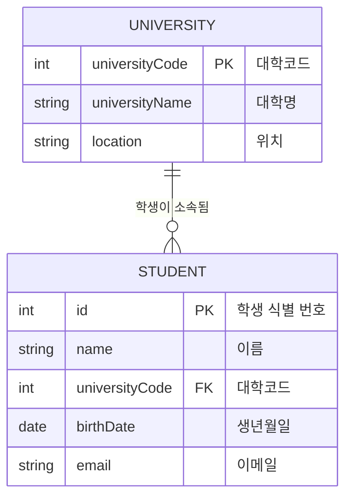
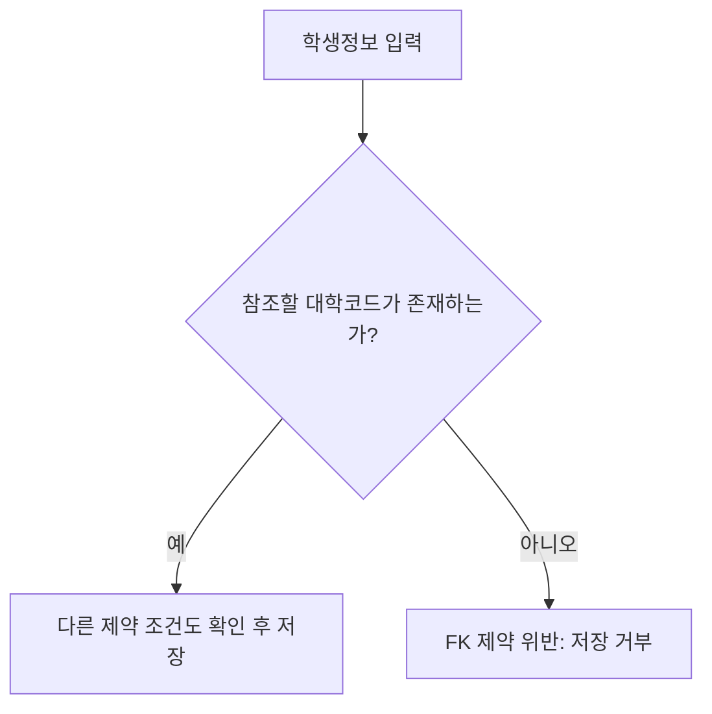
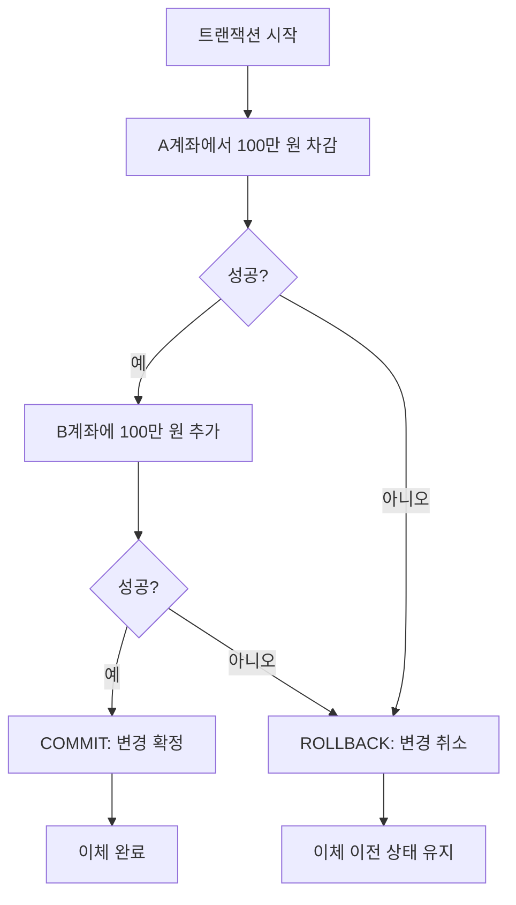
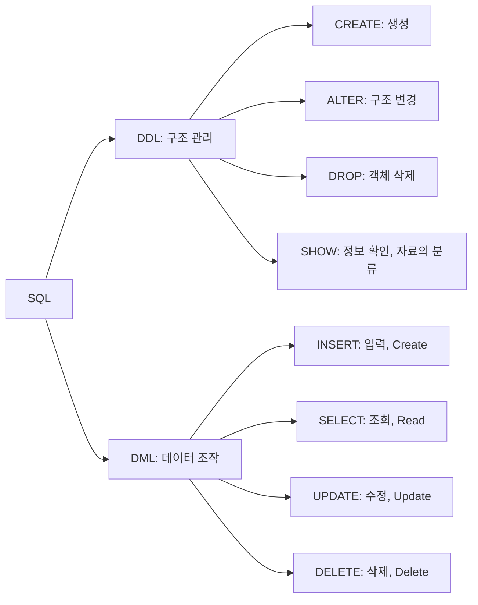
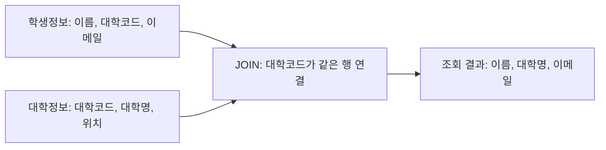

## 요약
### DB
- DB: 체계적으로 관리하는 **데이터 집합**
- DBMS: **데이터베이스를 관리하는 소프트웨어**
- NoSQL: 다양한 데이터 모델
- RDB: 테이블과 관계

### RDB
- 테이블: 칼럼과 로우
	- 자료형: 저장할 값의 유형

- 제약 조건: 데이터 무결성 유지
	- `PRIMARY KEY`: 레코드 식별
	- `FOREIGN KEY`: 다른 테이블 참조

- 시퀀스
	- 순차적인 값 자동 생성
	- H2의 `AUTO_INCREMENT`

- 트랜잭션: 여러 작업을 하나의 논리적 단위로 처리
	1. `COMMIT`: 확정
	2. `ROLLBACK`: 취소

- SQL: 구조 관리와 데이터 조작
	- DDL: 구조 정의/관리
		- `CREATE`, `ALTER`, `DROP`
	- DML: 데이터 조작 (CRUD)
		- `INSERT`, `UPDATE`, `DELETE`
	- DML/DQL
		- `SELECT *`
		- `DISTINCT`: 조회 결과의 중복 제거
		- `FROM`
		- `WHERE`: 개별 행 조건
		- `GROUP BY ... HAVING`: 결과 조건
		- `ORDER BY ... ASC/DESC`
	- 함수
	- JOIN: 여러 테이블의 정보를 조합하여 조회

## 1. 데이터베이스와 DBMS
### 1.1. 데이터베이스
데이터베이스(Database)
- 여러 사람이 공유하여 사용할 목적으로 **체계적으로 통합·관리하는 데이터의 집합**이다.
- 방대한 정보를 분류하고 정리하여 쉽게 검색할 수 있게 한다. 넓은 의미에서는 디지털 정보만을 뜻하지 않는다.

- 웹 서비스는 데이터를 저장·조회·관리하기 위해 DB를 사용한다.
- 자료에서는 스마트폰의 주소록·메모 저장에 SQLite를 사용하는 사례를 든다.
- 프로그램은 네트워크를 통해 외부 서버의 DB와 연동할 수 있다.

### 1.2. DBMS
DBMS(Database Management System)
- **데이터베이스를 운영하고 관리하는 소프트웨어 시스템**이다.

| 구분 | 의미 | 예 |
|---|---|---|
| DB | 관리 대상인 데이터의 집합 | 학생·대학 정보 |
| DBMS | DB를 관리하는 소프트웨어 | Oracle, MySQL, IBM DB2, MS SQL |
일상적으로는 DBMS까지 포함하여 “데이터베이스”라고 부르기도 한다.

DBMS의 주요 기능
- 데이터 파일 관리, 인덱싱, 캐싱, 네트워크 서버 기능, 사용자·권한 관리, 백업·복원, 클러스터링

### 1.3. 데이터베이스의 특징
| 특징          | 학습 포인트                           |
| ----------- | -------------------------------- |
| 중복 최소화      | 같은 데이터를 불필요하게 반복 저장하지 않도록 관리     |
| 공유          | 여러 사용자·프로그램이 데이터를 함께 이용          |
| 일관성         | 데이터가 서로 모순되지 않도록 유지              |
| 무결성         | 정해진 조건에 맞는 유효한 데이터 유지            |
| 보안성         | 사용자와 접근 권한 관리                    |
| 최신성         | 변경한 데이터를 반영하여 최신 상태 유지           |
| 표준화         | 데이터 형식과 관리 규칙 통일                 |
| 논리적·물리적 독립성 | 데이터 구조·저장 방식과 이용 프로그램 사이의 의존성 완화 |
| 접근 편의·공간 절약 | 검색과 이용을 쉽게 하고 중복 저장을 줄임          |

## 2. RDB와 NoSQL
| 항목     | 관계형 DB                       | NoSQL                                 |
| ------ | ---------------------------- | ------------------------------------- |
| 데이터 모델 | 칼럼·로우로 구성된 테이블               | 문서, 그래프, 키-값 등                        |
| 구조     | 정해진 구조의 데이터에 적합              | 유연하거나 서로 다른 구조에 적합                    |
| 관계 표현  | 테이블 간 관계로 연결                 | 모델에 따라 참조·포함 등으로 표현                   |
| 장점     | 일관성, 정규화를 통한 갱신 비용 감소, 관계 표현 | 대용량·분산 처리, 클라우드 환경, 유연한 모델링, 빠른 읽기·쓰기 |
| 한계     | 구조 변경 부담, 관계 처리 비용           | 복잡한 관계를 표현할 때 중복 가능                   |

### 2.1. RDBMS
관계형 데이터베이스(RDBMS)
- 데이터를 **테이블의 칼럼과 로우**로 관리하고, 테이블 사이의 관계를 설정한다.
- 데이터 관리에는 **SQL(Structured Query Language)**을 사용한다.

- 예: Oracle, IBM DB2, MS SQL, MySQL.
- 구조가 일정하고 데이터 간 관계가 중요한 경우에 적합하다.
- 정규화를 통해 중복을 줄이고 데이터 변경을 관리할 수 있다.

### 2.2. NoSQL
NoSQL (Not Only SQL)
- 전통적인 관계형 DB와 다른 데이터 모델을 사용하는 데이터베이스를 가리킨다.
- SQL과 다른 형태의 쿼리 언어나 접근 방식이 있을 수 있다.

- 예: MongoDB, Redis, Cassandra, HBase, CouchDB.
- 모델: **문서(Document), 그래프(Graph), 키-값(Key-Value), 와이드 칼럼(Wide-column)**.
- 형태가 일정하지 않은 데이터를 유연하게 다루거나 분산 처리하는 경우에 유용하다.

## 3. 테이블과 자료형
### 3.1. 테이블의 구성
| 용어             | 다른 이름     | 의미                 | 학생정보 예            |
| -------------- | --------- | ------------------ | ----------------- |
| 테이블(Table)     | —         | 공통 속성을 가진 데이터의 집합  | 학생정보 테이블          |
| 칼럼(Column)     | 필드, 어트리뷰트 | 데이터의 속성            | 이름, 대학, 생년월일, 이메일 |
| 로우(Row)        | 레코드, 튜플   | 하나의 데이터 묶음         | 학생 한 명의 정보        |
| 자료형(Data Type) | —         | 칼럼에 저장할 수 있는 값의 유형 | 문자형, 날짜형 등        |

자료의 학생정보 예시는 **4개 칼럼, 5개 로우**로 구성된다.
같은 이름의 학생이 있으므로 이름만으로는 한 학생을 식별할 수 없다.

| 이름  | 대학    | 생년월일       | 이메일         |
| --- | ----- | ---------- | ----------- |
| 김길동 | AA대학교 | 1999-10-21 | kim@aa.com  |
| 박사랑 | BB대학교 | 2000-01-21 | park@bb.com |
| 나최고 | CC대학교 | 1998-07-11 | na@cc.com   |
| 김길동 | BB대학교 | 1999-03-10 | kim@bb.com  |
| 홍길동 | AA대학교 | 1999-12-10 | hong@aa.com |

각 칼럼에 저장되는 값은 해당 칼럼의 자료형을 따라야 한다.
DBMS마다 자료형의 이름과 세부 동작에 차이가 있다.

### 3.2. 주요 자료형
| 자료형          | 용도           | 기억할 점                  |
| ------------ | ------------ | ---------------------- |
| `INT`        | 정수           | 자료 기준 32bit            |
| `DOUBLE`     | 실수           | 자료 기준 64bit            |
| `DATE`       | 날짜           | H2 기준 시간을 제외한 날짜만 저장   |
| `CHAR(n)`    | 고정 길이 문자열    | 정해진 길이의 문자열            |
| `VARCHAR(n)` | 가변 길이 문자열    | 최대 길이 안에서 길이가 달라지는 문자열 |
| `CLOB`       | 대용량 문자 데이터   | 긴 텍스트                  |
| `BLOB`       | 대용량 바이너리 데이터 | 파일 등 이진 데이터            |
| `BOOLEAN`    | 참·거짓         | 자료 본문에서 소개한 불형         |
날짜와 시간을 함께 표현할 때는 `TIMESTAMP` 등을 사용한다. [H2 자료형 문서](https://h2database.com/html/datatypes.html)

## 4. 제약 조건과 키
### 4.1. 제약 조건
제약 조건 (Constraint)
- 저장할 데이터가 지켜야 할 요구사항을 **DB 자체에서 검사하는 규칙**이다.
- 잘못된 값을 차단하여 **무결성(Integrity)**을 유지한다.
- 프로그램의 검사만으로는 프로그램을 거치지 않고 입력된 잘못된 데이터를 막기 어렵기 때문에 DB에도 제약 조건을 둔다.

| 제약 조건         | 역할                     | 예             |
| ------------- | ---------------------- | ------------- |
| `NOT NULL`    | `NULL`을 허용하지 않음        | 이름 필수         |
| `UNIQUE`      | 중복 값 제한                | 중복되지 않는 식별 정보 |
| `PRIMARY KEY` | 각 레코드를 유일하게 식별         | 학생 ID         |
| `FOREIGN KEY` | 다른 테이블을 참조하여 참조 무결성 유지 | 학생의 대학코드      |
| `CHECK`       | 값이 지정 조건을 만족하는지 검사     | 특정 범위의 숫자     |

> `IDENTITY` 속성은 자동 생성되는 식별 값을 제공한다.

### 4.2. 기본키
기본키 (Primary Key, PK)
- 테이블의 **각 로우를 유일하게 구분하는 키**이다.

- 기본키 값은 중복되거나 NULL일 수 없다.
- 한 테이블의 기본키 제약은 하나이며, 여러 칼럼을 조합해 구성할 수도 있다.
- 이름은 동명이인이 있으므로 단독 기본키로 적합하지 않다.
- 자료는 개인정보 노출을 피하고 식별을 단순하게 하기 위해 별도의 증가형 ID 사용을 권장한다.

**학습 포인트**: `PK = 레코드 식별`, `NOT NULL + UNIQUE` 성질.

### 4.3. 외래키
외래키 (Foreign Key, FK)
- 다른 테이블의 키를 참조하여 **테이블 간 관계와 참조 무결성**을 유지한다.

대학명을 문자열로 직접 입력하면 `AA대학교`, `AA 대학교`, `에이에이 대학교`처럼 같은 대학이 서로 다른 값으로 저장될 수 있다. 자료는 다음과 같이 구조를 바꾼다.

1. 대학정보 테이블을 별도로 만든다.
2. 대학코드를 대학정보 테이블의 PK로 둔다.
3. 학생정보에는 대학명 대신 대학코드를 저장하고 FK로 설정한다.

| 대학코드(PK) | 대학명 | 위치 |
|---|---|---|
| 10011 | AA대학교 | 서울 |
| 10012 | BB대학교 | 인천 |
| 10013 | CC대학교 | 대전 |



> 위 ERD는 이해를 위해 모든 학생이 대학 하나에 소속된다고 가정한다.
> 한 대학에는 여러 학생이 연결될 수 있다.
> 실제 필수 소속 여부는 FK 칼럼의 `NOT NULL` 설정으로 정한다.

- 대학정보에 없는 대학코드를 학생정보에 등록하면 FK 제약 위반으로 실패한다.
- 학생이 참조하는 대학을 삭제하면, 자료의 제한 설정에서는 삭제가 거부된다.
- 참조 대상 삭제 시 동작은 FK의 삭제 정책에 따라 달라질 수 있다.



## 5. 시퀀스와 트랜잭션
### 5.1. 시퀀스
시퀀스 (Sequence)
- 순차적으로 증가하는 값을 자동 생성하는 DB 객체이다.
- 기본키 값을 임의로 생성할 때 사용할 수 있다.
	- 구체적인 문법은 DBMS와 버전에 따라 다르다.
	- H2의 `AUTO_INCREMENT`
	- Oracle의 별도 시퀀스 객체

### 5.2. 트랜잭션
트랜잭션 (Transaction)
- 하나의 논리적 기능을 수행하는 **여러 작업을 하나의 처리 단위로 묶는 것**이다.
- DB 또는 미들웨어(응용 프로그램과 DB 서버를 연결하는 소프트웨어) 수준에서 트랜잭션을 관리한다.

| 명령         | 의미               |
| ---------- | ---------------- |
| `COMMIT`   | 트랜잭션의 변경 확정      |
| `ROLLBACK` | 아직 확정하지 않은 변경 취소 |

예: A계좌에서 B계좌로 100만 원 이체.
1. A계좌에서 100만 원을 차감한다.
2. B계좌에 100만 원을 더한다.
3. 모두 성공하면 확정한다.
4. 중간에 실패하면 앞선 변경도 취소하여 원래 상태로 되돌린다.



## 6. SQL의 개념
SQL
- 관계형 데이터베이스의 **구조를 관리하고 데이터를 조작하는 질의 언어**이다.
- 표준이 있지만 DBMS별 문법·함수 차이가 있어 모든 SQL이 그대로 호환되지는 않는다.

가능한 작업
- DB·테이블·뷰·내장 프로시저 생성
- 접근 권한 부여
- 데이터 입력·조회·수정·삭제

### 6.1. SQL 작성 규칙
- 명령·키워드는 대문자, 식별자는 일관된 이름 규칙을 권장한다.
- 자료는 영문 식별자를 사용하고 공백·예약어를 피하도록 권장한다.
- 자료는 `tbl_`, `idx_`, `pk_` 등 접두어의 과도한 사용을 자제하도록 권장한다.
- 대소문자 구분은 DBMS와 설정에 따라 차이가 있으므로 “항상 구분하지 않는다”로 외우지 않는다.

### 6.2. SQL의 분류
| 구분  | 대상           | 자료의 명령                                        |
| --- | ------------ | --------------------------------------------- |
| DDL | 테이블 등 객체의 구조 | `CREATE`, `ALTER`, `DROP`                     |
| DML | 테이블 안의 데이터   | `INSERT`, `SELECT`*(DQL)*, `UPDATE`, `DELETE` |



## 7. DDL과 메타데이터 조회
> DDL (Data Definition Language)

> 실습
> http://localhost:8080/jspbook/h2-console
> jdbc:h2:mem:jspbook

### 7.1. `CREATE TABLE`
칼럼 이름과 자료형을 지정하고, 필요하면 크기·제약 조건·속성을 추가한다.
**마지막 칼럼 정의 뒤에는 쉼표를 넣지 않는다.**

```sql
CREATE TABLE university (
    university_code INT PRIMARY KEY,
    university_name VARCHAR(100) NOT NULL,
    location        VARCHAR(50)
);

CREATE TABLE student (
    id              INT GENERATED BY DEFAULT AS IDENTITY PRIMARY KEY,
    name            VARCHAR(50) NOT NULL,
    university_code INT NOT NULL,
    birth_date      DATE,
    email           VARCHAR(100),
    FOREIGN KEY (university_code)
        REFERENCES university(university_code)
);
```

### 7.2. `ALTER TABLE`
칼럼을 추가·변경·삭제한다.
기존 데이터와 프로그램에 영향을 줄 수 있다.

```sql
-- NULL을 허용하는 칼럼 추가
ALTER TABLE student ADD phone VARCHAR(20);

-- 칼럼 삭제
ALTER TABLE student DROP COLUMN phone;
```

원문의 “데이터가 있으면 자료형 변경 불가”, “NULL 허용 칼럼 추가 불가”는 일반 규칙으로 암기하면 안 된다. 실제 허용 여부는 기존 값의 변환 가능성·제약 조건·DBMS에 달려 있다. [H2 ALTER 문서](https://h2database.com/html/commands.html#alter_table_add)

### 7.3. `DROP TABLE`
테이블과 데이터를 제거한다. 관련 객체·의존성 처리에는 DBMS별 차이가 있다.

```sql
DROP TABLE student;

-- 의존성 처리 옵션
DROP TABLE student RESTRICT;
DROP TABLE student CASCADE;
```

- `RESTRICT`: 다른 객체가 참조하는 등 의존성이 있으면 삭제 제한.
- `CASCADE`: 의존하는 객체·제약까지 함께 처리. 정확한 범위는 DBMS에 따라 다름.
- 트리거(Trigger): 테이블의 특정 이벤트에 반응하여 자동으로 실행되는 작업.

> **구분**: `DROP`은 테이블 자체를 없애고, `DELETE`는 테이블 안의 로우를 지운다.

### 7.4. H2 `SHOW`
구조 조회 방법은 DBMS마다 다르며, 전용 명령 또는 시스템 스키마 조회를 사용한다.

H2의 DBMS 메타데이터 조회 명령
```sql
-- 테이블 목록
SHOW TABLES;

-- 칼럼 정보
SHOW COLUMNS FROM student;
```

## 8. DML과 DQL
> DML (Data Manipulation Language)

### 8.1. CRUD 대응
| 동작             | SQL      | 기억할 점               |
| -------------- | -------- | ------------------- |
| Create: 데이터 입력 | `INSERT` | 테이블 생성 `CREATE`와 구분 |
| Read: 데이터 조회   | `SELECT` | 조건·그룹·정렬 적용         |
| Update: 데이터 수정 | `UPDATE` | 대상 행의 값 변경          |
| Delete: 데이터 삭제 | `DELETE` | 테이블 구조 유지           |
*CRUD의 Create는 데이터 삽입을 뜻하며, 테이블을 정의하는 CREATE TABLE과 구별한다.*

### 8.2. `INSERT INTO`
```sql
-- 기본 형태
INSERT INTO 테이블명 (칼럼1, 칼럼2)
VALUES (값1, 값2);
```

- 칼럼 목록을 생략하면 값의 순서가 테이블 정의의 칼럼 순서와 일치해야 한다.
- 일부 칼럼만 입력할 때는 저장 대상 칼럼을 명시한다.
- 자동 생성 ID는 생략할 수 있다.
- `NOT NULL` 칼럼은 자동 생성·기본값 등이 없다면 값을 제공해야 한다.

예: 참조 대상인 대학을 먼저 저장한다.
```sql
INSERT INTO university (university_code, university_name, location)
VALUES (10011, 'AA대학교', '서울');

INSERT INTO student (name, university_code, birth_date, email)
VALUES ('김길동', 10011, DATE '1999-10-21', 'kim@aa.com');
```

### 8.3. `SELECT FROM` (DQL)
```sql
SELECT [DISTINCT] 칼럼목록 -- [중복 제거] 결과 칼럼
FROM 테이블명 -- 데이터 대상
WHERE 행조건 -- 행 필터
GROUP BY 그룹칼럼 -- 그룹화
HAVING 그룹조건 -- 그룹 필터
ORDER BY 정렬칼럼 ASC; -- 정렬
```
위는 구조를 설명하는 틀이다.
필요한 절만 사용하며, `[DISTINCT]`의 대괄호는 선택 가능하다는 뜻으로 실제 SQL에는 쓰지 않는다.

| 요소            | 역할                               |
| ------------- | -------------------------------- |
| `SELECT 칼럼목록` | 조회할 칼럼 지정                        |
| `SELECT *`    | 모든 칼럼 조회                         |
| `DISTINCT`    | 조회 결과의 중복 제거                     |
| `FROM`        | 조회할 테이블 지정                       |
| `WHERE`       | 개별 행의 검색 조건                      |
| `GROUP BY`    | 같은 값을 기준으로 그룹화                   |
| `HAVING`      | 그룹화한 결과에 조건 적용                   |
| `ORDER BY`    | 결과 정렬<br>`ASC` 오름차순, `DESC` 내림차순 |

예:
```sql
-- 모든 학생 조회
SELECT * FROM student;

-- 특정 대학의 학생 이름·이메일 조회
SELECT name, email
FROM student
WHERE university_code = 10011;

-- 학생들이 속한 대학코드를 중복 없이 조회
SELECT DISTINCT university_code FROM student;

-- 대학별 학생 수를 구하고, 2명 이상인 그룹만 내림차순 출력
SELECT university_code, COUNT(*) AS student_count
FROM student
GROUP BY university_code
HAVING COUNT(*) >= 2
ORDER BY student_count DESC;
```

### 8.4. WHERE와 HAVING
- `WHERE`: 그룹을 만들기 전에 **개별 행**을 걸러낸다.
- `HAVING`: 그룹을 만든 뒤 **그룹 결과**를 걸러낸다.


> 원문의 절 설명을 이해하기 위한 논리적 처리 흐름이다. 실제 DB 엔진의 물리적 실행 순서를 뜻하지 않는다. [H2 SELECT 문서](https://h2database.com/html/commands.html#select)

## 9. 데이터 조회 함수
DBMS는 계산·문자 처리·날짜 처리·집계를 위한 함수를 제공한다.
함수 이름과 세부 동작은 DBMS별로 다를 수 있다.

| 분류    | 함수                                                                 |
| ----- | ------------------------------------------------------------------ |
| 숫자    | `ABS`, `CEILING`, `ROUND`, `FLOOR`, `SQRT`                         |
| 문자열   | `ASCII`, `LENGTH`, `CONCAT`, `TRIM`, `LOWER`, `UPPER`, `SUBSTRING` |
| 날짜·시간 | `NOW`, `CURRENT_TIMESTAMP`, `DAYNAME`, `PARSEDATETIME`             |
| 집계    | `COUNT`, `SUM`, `AVG`, `MAX`, `MIN`                                |

**DUAL**
- 실제 업무 테이블 없이 함수 결과를 확인하기 위한 테이블로 `DUAL`을 사용한다.
```sql
SELECT ABS(-20) FROM dual;
```

### 9.1. 숫자 함수
| 함수               | 역할  | 자료의 값에 대한 결과 |
| ---------------- | --- | ------------ |
| `ABS(-20)`       | 절댓값 | 20           |
| `CEILING(20.25)` | 올림  | 21           |
| `ROUND(20.25)`   | 반올림 | 20           |
| `FLOOR(20.25)`   | 내림  | 20           |
| `SQRT(4)`        | 제곱근 | 2            |

```sql
-- 숫자 함수 확인 예제
SELECT ABS(-20), CEILING(20.25), ROUND(20.25),
       FLOOR(20.25), SQRT(4)
FROM dual;
```

> 보충: `FLOOR`는 음수에서도 작은 정수 방향으로 내린다. 단순히 소수점만 잘라내는 연산과 구분한다.

### 9.2. 문자 함수
| 함수          | 역할        |
| ----------- | --------- |
| `ASCII`     | 문자의 코드값   |
| `LENGTH`    | 문자열 길이    |
| `CONCAT`    | 문자열 결합    |
| `TRIM`      | 양쪽 공백 제거  |
| `LOWER`     | 소문자 변환    |
| `UPPER`     | 대문자 변환    |
| `SUBSTRING` | 문자열 일부 추출 |

```sql
SELECT ASCII('A'), LENGTH('HELLO'), CONCAT('Hello', 'World'),
       TRIM(' Hello World '), LOWER('ABC'), UPPER('abc'),
       SUBSTRING('HelloWorld' FROM 2 FOR 5)
FROM dual;
```

예제의 결과: `65`, `5`, `HelloWorld`, `Hello World`, `abc`, `ABC`, `elloW`.

### 9.3. 날짜·기간 함수
| 함수                   | 역할                     |
| -------------------- | ---------------------- |
| `NOW()`              | 현재 날짜·시간               |
| `CURRENT_TIMESTAMP`  | 현재 타임스탬프               |
| `DAYNAME(...)`       | 요일 이름                  |
| `PARSEDATETIME(...)` | 지정 형식의 문자열을 날짜·시간으로 변환 |

```sql
-- 원문 예제를 단순화한 보충 예제
SELECT NOW(), CURRENT_TIMESTAMP, DAYNAME(NOW()),
       PARSEDATETIME('10-01-2020', 'MM-dd-yyyy')
FROM dual;
```

원문의 날짜 포맷과 인수 사용에 관한 주의점은 12절을 참고한다.

### 9.4. 집계 함수
| 함수      | 역할    |
| ------- | ----- |
| `COUNT` | 개수 계산 |
| `SUM`   | 합계    |
| `AVG`   | 평균    |
| `MAX`   | 최댓값   |
| `MIN`   | 최솟값   |

```sql
-- 학생 데이터 집계
SELECT COUNT(id), SUM(id), AVG(id), MAX(id), MIN(id)
FROM student;
```
- ID가 1~5인 예에서는 `COUNT=5`, `SUM=15`, `AVG=3`, `MAX=5`, `MIN=1`이다.

**보충**: `COUNT(*)`는 행 수, `COUNT(칼럼)`은 해당 칼럼이 NULL이 아닌 값의 개수이다. PK인 `id`에는 NULL이 없으므로 위 예에서는 둘이 같다.

## 10. 조인
조인(Join)
- 둘 이상의 테이블을 조합해 데이터를 조회하는 방법이다.

- 필요한 칼럼이 여러 테이블에 나뉘어 있을 때 사용한다.
- PK·FK로 연결된 테이블의 정보를 함께 조회할 수 있다.
- 여러 번 쿼리한 뒤 프로그램에서 합치는 대신, 한 쿼리로 원하는 결과를 얻을 수 있다.

### 10.1. 학생과 대학을 함께 조회
예: 학생 테이블의 대학코드를 기준으로 대학명을 가져온다.
```sql
SELECT s.name, u.university_name, s.email
FROM student s
INNER JOIN university u
    ON s.university_code = u.university_code;
```



### 10.2. 조인 유형 구분
| 유형           | 의미                                               |
| ------------ | ------------------------------------------------ |
| `INNER JOIN` | 연결 조건에 맞는 행을 조회                                  |
| `OUTER JOIN` | 조건에 맞지 않는 행도 지정한 쪽에서 포함<br>LEFT·RIGHT·FULL 등이 있음 |
| `CROSS JOIN` | 양쪽 테이블의 모든 행 조합                                  |
| `SELF JOIN`  | 같은 테이블을 별칭으로 구분해 자기 자신과 연결                       |
