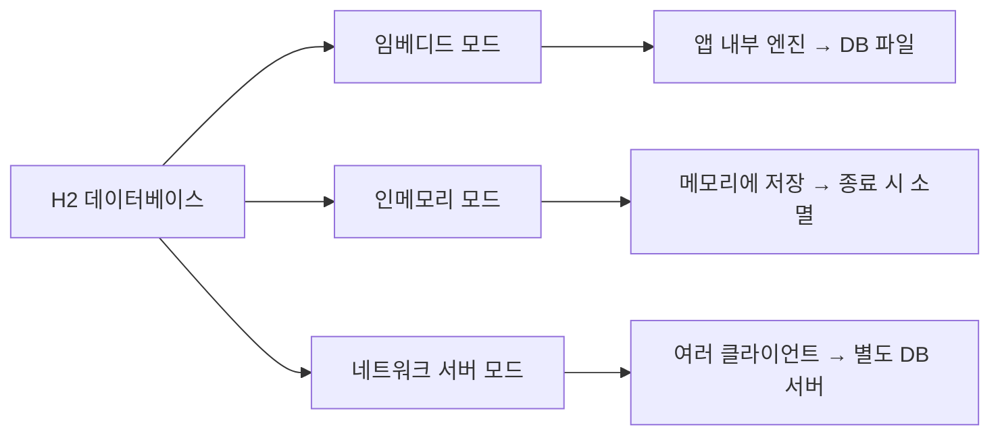
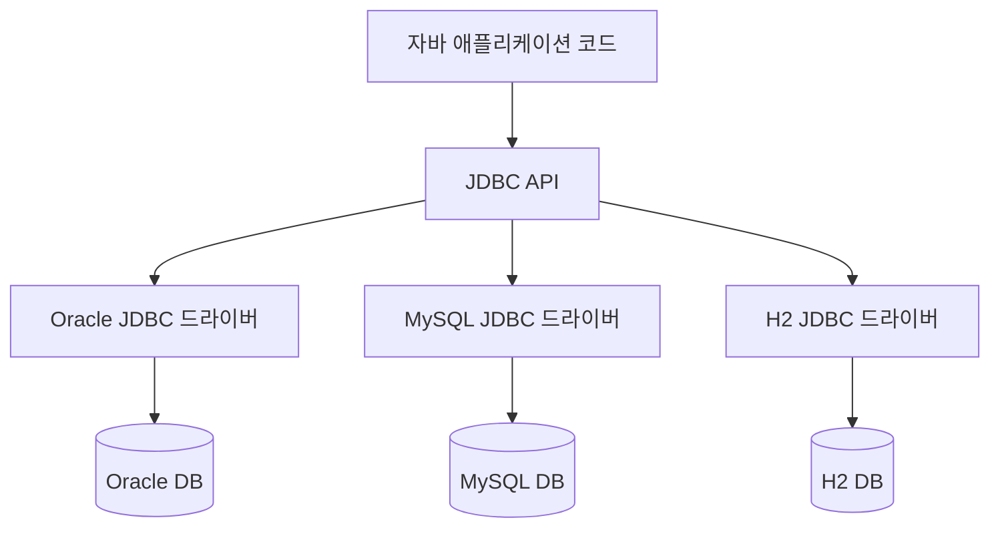
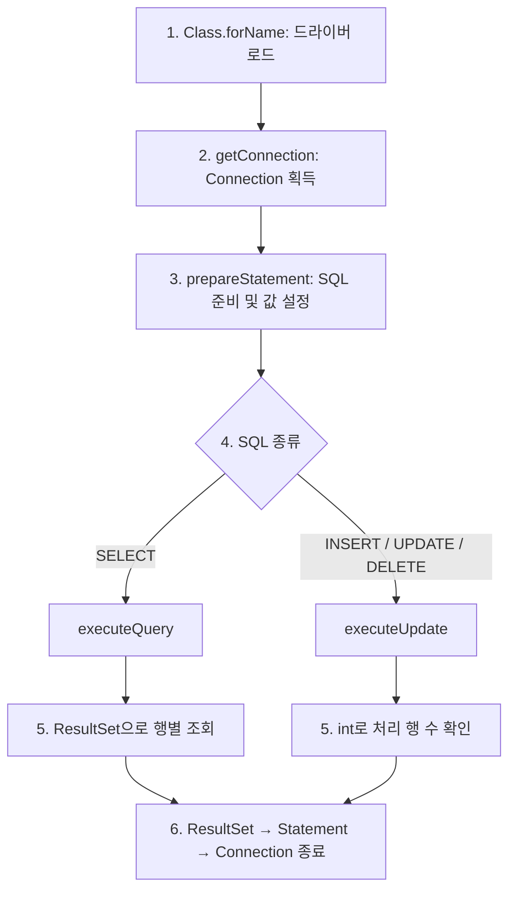
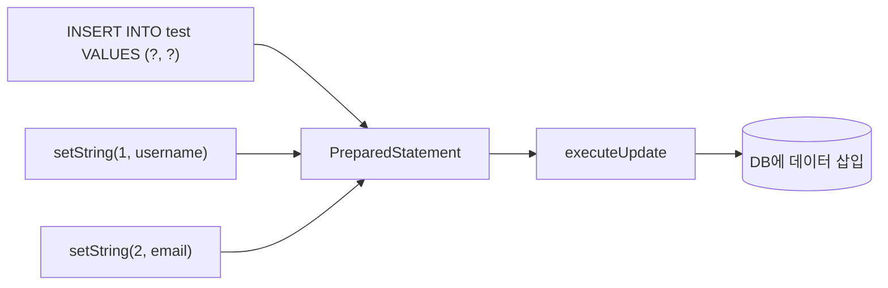
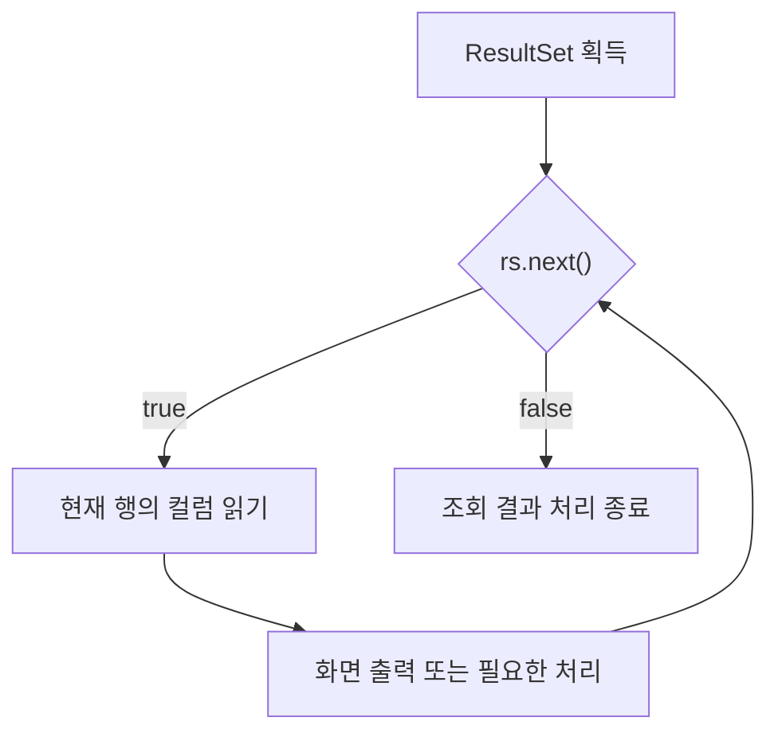

## 1. 데이터베이스 선택
### 1.1. 주요 데이터베이스 비교
| 제품       | 자료의 분류 | 핵심 특징                               | 자료의 적용 규모 |
| -------- | ------ | ----------------------------------- | --------- |
| Oracle   | RDBMS  | 대표적인 상용 DB, 비용과 전문 관리 부담            | 대규모       |
| MySQL    | RDBMS  | 널리 쓰이는 공개 DB, 커뮤니티 버전으로 학습 가능       | 중소규모      |
| MariaDB  | RDBMS  | MySQL의 대안으로 소개되는 오픈소스 DB            | 중소~대규모    |
| H2       | RDBMS  | 가벼운 자바 기반 DB, 여러 실행 모드 지원           | 소규모       |
| MongoDB  | NoSQL  | 상용·클라우드 등 다양한 이용 옵션                 | 중소~대규모    |
| Firebase | NoSQL  | 구글의 클라우드 DB, 모바일·프런트엔드 및 구글 클라우드 연계 | 중소~대규모    |
- 대형 상용 DB의 예: Oracle, MS SQL, IBM DB2

### 1.2. 학습용 DB의 선택 기준
- 설치와 관리가 간단해야 한다.
- 저장 공간과 메모리 사용 부담이 작아야 한다.
- 운영 문제 해결보다 프로그래밍 학습에 집중할 수 있어야 한다.

**MySQL**
- 자바·JSP·서블릿 학습에 자주 사용되며 관리 도구와 참고 자료가 풍부하다.
- 설치 및 네트워크 서버 관리가 필요하다.

**H2**
- JDBC 드라이버가 포함된 라이브러리로 사용할 수 있다.
- 앱에 함께 배포하기 쉬워 실습 DB로 선택된다.

## 2. H2 데이터베이스
### 2.1. 특징
- 경량 RDBMS로 용량과 메모리 사용량이 작다.
- 표준 SQL을 지원하며 JDBC·JPA와 연계하기 쉽다.
- 특정 DB에 종속된 기능을 쓰지 않는 관계형 DB 개발에 활용할 수 있다.

### 2.2. 세 가지 실행 모드
파일 기반으로 애플리케이션에 포함해 배포하거나, 메모리에서 실행하거나, 서버로 운영할 수 있다.

| 구분       | 인메모리 모드         | 임베디드 모드                     | 네트워크 서버 모드         |
| -------- | --------------- | --------------------------- | ------------------ |
| 기본 동작    | 데이터를 메모리에 저장    | 앱 내부에서 DB 엔진을 실행하고 파일에 접근   | 별도 DB 서버에 네트워크로 접속 |
| 데이터 저장   | 메모리             | 파일                          | 서버 측 파일            |
| 종료 후 데이터 | 일반적으로 소멸        | 파일에 유지                      | 파일에 유지             |
| 별도 서버 실행 | 앱 내부 사용 시 필요 없음 | 필요 없음                       | 필요                 |
| 주요 장점    | 빠른 처리           | 간단한 실행과 배포                  | 여러 클라이언트의 동시 접속    |
| 주요 주의점   | 영구 저장용으로 부적합    | 동일 파일에 대한 다른 프로세스의 직접 접근 제한 | 서버 실행·관리 필요        |

*cf. 임베디드 모드*
- 정확히는 같은 JVM 안에서 여러 연결이 가능하며, 일반적인 임베디드 모드에서는 **여러 프로세스가 같은 DB 파일을 동시에 직접 여는 것**이 제한된다. [H2 공식 문서](https://h2database.com/html/features.html#connection_modes)
- 인메모리 모드도 연결 종료 설정에 따라 DB 수명이 달라질 수 있다. [H2 인메모리 DB 문서](https://h2database.com/html/features.html#in_memory_databases)



### 2.3. 모드별 JDBC URL
일반 구조:
```text
jdbc:하위프로토콜:데이터원본식별자
```

| 모드      | URL 예시                           | 의미                                 |
| ------- | -------------------------------- | ---------------------------------- |
| 인메모리    | `jdbc:h2:mem:test_mem`           | 이름이 `test_mem`인 메모리 DB             |
| 임베디드    | `jdbc:h2:~/test`                 | 사용자 홈 디렉터리의 `test` DB              |
| 임베디드    | `jdbc:h2:e:/Dev/test`            | Windows E 드라이브의 `Dev` 폴더에 있는 DB    |
| 네트워크 서버 | `jdbc:h2:tcp://localhost/~/test` | 로컬 H2 TCP 서버에 접속, 서버 측 홈 경로의 DB 사용 |

### 2.4. 주요 자료형
| 자료형          | 용도           |
| ------------ | ------------ |
| `INT`        | 정수           |
| `DOUBLE`     | 실수           |
| `DATE`       | 날짜           |
| `CHAR(n)`    | 고정 길이 문자열    |
| `VARCHAR(n)` | 가변 길이 문자열    |
| `CLOB`       | 대용량 문자열      |
| `BLOB`       | 대용량 바이너리 데이터 |
> H2에서 날짜와 시각을 함께 저장하려면 `TIMESTAMP` 등의 자료형을 사용한다.
> [H2 자료형 공식 문서](https://www.h2database.com/html/datatypes.html#date_type)

## 3. JDBC
### 3.1. JDBC의 개념
**JDBC(Java Database Connectivity)**
- **자바 프로그램**이 표준화된 방법으로
- **데이터베이스**에 **접근**하도록 제공하는 API

### 3.2. JDBC의 구조


DB마다 연결·처리 방식이 다르므로,
프로그램은 공통 JDBC API를 사용하고
실제 DB와의 통신은 각 DB의 드라이버가 담당한다.

| 구성 요소         | 역할                       |
| ------------- | ------------------------ |
| 자바 애플리케이션     | JDBC API를 호출하여 DB 작업 요청  |
| **JDBC API**  | DB 접근을 위한 공통 규격 제공       |
| **JDBC 드라이버** | DB별로 API를 구현하고 실제 DB와 통신 |
| DBMS          | SQL을 실행하고 데이터 저장·조회      |

*cf. API가 같아도 DB별 SQL 문법이나 기능 차이는 남을 수 있다.*

### 3.3. JDBC 드라이버 설치
설치 방법
- **Maven 사용**: `pom.xml`에 의존성을 추가한다.
```xml
<dependencies>
    <dependency>
        <groupId>com.h2database</groupId>
        <artifactId>h2</artifactId>
        <!-- 강의 자료 실습 버전 -->
        <version>1.4.200</version>
    </dependency>
</dependencies>
```
- **Maven 미사용 웹 프로젝트**: 관련 JAR 파일을 `WEB-INF/lib`에 복사한다.
- 일반적으로 DB 엔진과 드라이버는 분리되어 있지만, H2 패키지는 드라이버 클래스를 함께 포함한다.

- 저장 후 라이브러리가 다운로드된다.

## 4. JDBC 프로그래밍 과정
웹 프로그램과 일반 자바 프로그램에서 공통으로 적용된다.

| 단계  | 수행 내용               | 주요 API                                        |
| --- | ------------------- | --------------------------------------------- |
| 1   | JDBC 드라이버 로드        | `Class.forName()`                             |
| 2   | 데이터베이스 연결           | `DriverManager.getConnection()`, `Connection` |
| 3   | SQL 실행 객체 생성 및 값 설정 | `Statement`, `PreparedStatement`              |
| 4   | SQL 실행              | `executeQuery()`, `executeUpdate()`           |
| 5   | 결과 처리               | `ResultSet` 또는 영향받은 행 수                       |
| 6   | 자원 및 연결 해제          | `close()`                                     |



### 1단계: JDBC 드라이버 로드
```java
final String JDBC_DRIVER = "org.h2.Driver";
final String JDBC_URL    = "jdbc:h2:tcp://localhost/~/jspbook";

Class.forName(JDBC_DRIVER);
```
- `org.h2.Driver`는 H2의 JDBC 드라이버 클래스 이름이다.
	- DB마다 드라이버 클래스 이름이 다르다.
- `jdbc.drivers` 시스템 속성을 이용하는 방법과 `Class.forName()`으로 직접 로드하는 방법을 소개한다.
- 잘못된 클래스 이름 또는 누락된 드라이버 라이브러리는 로드 오류의 원인이 된다.

*cf.*
- JDBC 4 이후의 표준 서비스 제공 방식으로 등록된 드라이버는 자동 탐색된다.
- 환경에 따라 `Class.forName()`을 생략할 수 있다.
- [DriverManager 공식 문서](https://docs.oracle.com/en/java/javase/21/docs/api/java.sql/java/sql/DriverManager.html)

### 2단계: 데이터베이스 연결
*DriverManager*
- 데이터베이스 드라이버를 관리하고, DB와의 연결(Connection) 객체를 생성한다.
- 현대 애플리케이션에서는 성능(연결 재사용)을 위해 DataSource 및 커넥션 풀(HikariCP 등)을 주로 사용한다.

*Connection*
- 특정 데이터베이스와의 물리적인 세션(연결)을 나타낸다.
- 트랜잭션 관리(setAutoCommit, commit, rollback)를 수행한다.

```java
// Connection 참조를 얻은 후 SQL 실행 객체를 생성한다.
Connection conn = DriverManager.getConnection(
    JDBC_URL, "DB 사용자 아이디", "비밀번호"
);
```

### 3단계: Statement 생성
*Statement*
- 데이터베이스로 SQL 문을 전달하고 실행하는 객체이다.

*PreparedStatement*
- `Statement`를 확장하는 **인터페이스**다. [Java 공식 API](https://docs.oracle.com/en/java/javase/21/docs/api/java.sql/java/sql/Statement.html)
- SQL을 미리 컴파일하여 캐싱하므로 반복 실행 시 성능이 우수하다.
- 바인딩 변수(`?`)로 SQL과 입력값을 분리하여 SQL Injection 공격을 차단한다.

| 구분     | Statement               | PreparedStatement                  |
| ------ | ----------------------- | ---------------------------------- |
| SQL 작성 | 실행할 SQL 문자열 사용          | `?`가 들어간 SQL을 먼저 준비                |
| 데이터 전달 | SQL 문자열에 값을 조합하는 방식이 흔함 | `setString()`, `setInt()` 등으로 값 설정 |
| 자료의 권장 | 기본 실행 객체                | 효율성과 유지보수 측면에서 권장                  |

```java
// 예
PreparedStatement pstmt = conn.prepareStatement(
	// 값이 들어갈 자리에 ?를 쓴다. 인덱스는 1부터 시작한다.
	"insert into test values(?, ?)"
);

// setString(), setDate() 등으로 순서에 맞게 바인딩한다.
pstmt.setString(1, request.getParameter("username"));
pstmt.setString(2, request.getParameter("email"));
```
- `request`는 웹 요청 객체이므로 위 코드는 JSP·서블릿 맥락의 조각 코드다.



### 4단계: SQL 실행
| 메서드               | 주 용도                                  | 반환 타입       | 반환 의미    |
| ----------------- | ------------------------------------- | ----------- | -------- |
| `executeQuery()`  | `SELECT`                              | `ResultSet` | 조회 결과    |
| `executeUpdate()` | `INSERT`, `UPDATE`, `DELETE`          | `int`       | 영향받은 행 수 |
| `executeUpdate()` | `CREATE`, `DROP` 등<br>결과를 반환하지 않는 DDL | `int`       | `0`      |

```java
/* SQL 종류별 사용법 예시 */

// SELECT
ResultSet rs = pstmt.executeQuery();

// INSERT, UPDATE, DELETE
int count = pstmt.executeUpdate();
```

### 5단계: 결과 받기
**ResultSet**
- 조회 결과를 **행 단위로 순회하는 커서**를 제공한다.
- 커서는 처음에 첫 행의 앞에 있다.
- `next()`로 다음 행에 이동하며, 행이 있으면 `true`, 없으면 `false`를 반환한다.
- 현재 행의 컬럼 값을 `getInt()`, `getString()`, `getDate()` 등의 메서드로 읽는다.



```java
// 예: test 테이블에 username, email 컬럼이 있다고 가정
while (rs.next()) {
    String username = rs.getString("username");
    String email    = rs.getString("email");
    System.out.println(username + ": " + email);
}
```

### 6단계: 연결 해제
- 사용이 끝난 `ResultSet`, `Statement` 또는 `PreparedStatement`, `Connection`을 닫는다.
- 보통 **생성 순서의 역순**으로 종료한다.
- 자원이 해제되지 않으면 다른 요청이 연결을 기다리는 등 문제가 발생할 수 있다.

```java
rs.close();     // ResultSet
pstmt.close();  // PreparedStatement
conn.close();   // Connection

// 실제 구현에서는 중간에 예외가 발생해도 자원이 닫히도록 처리해야 한다.
```
