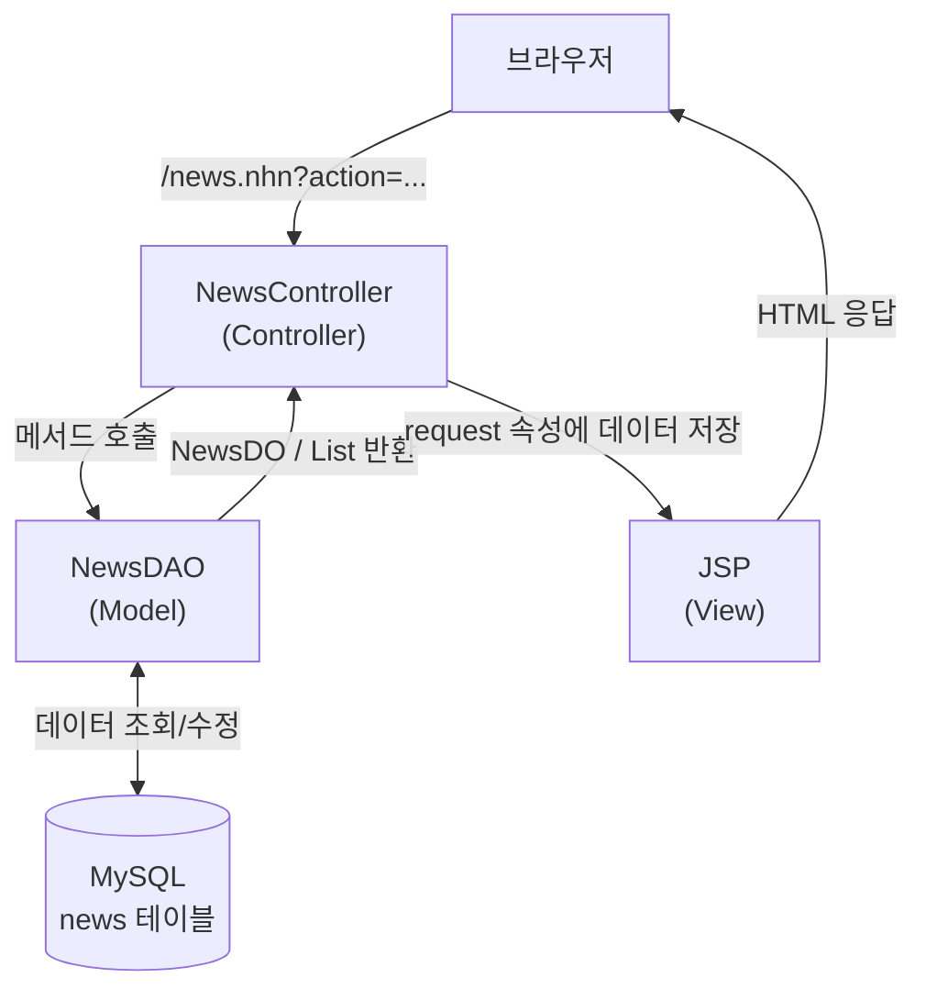
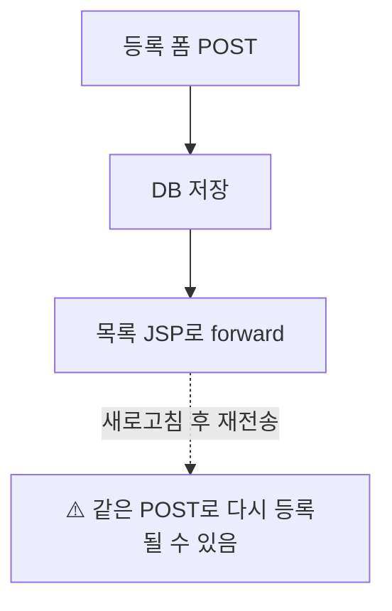
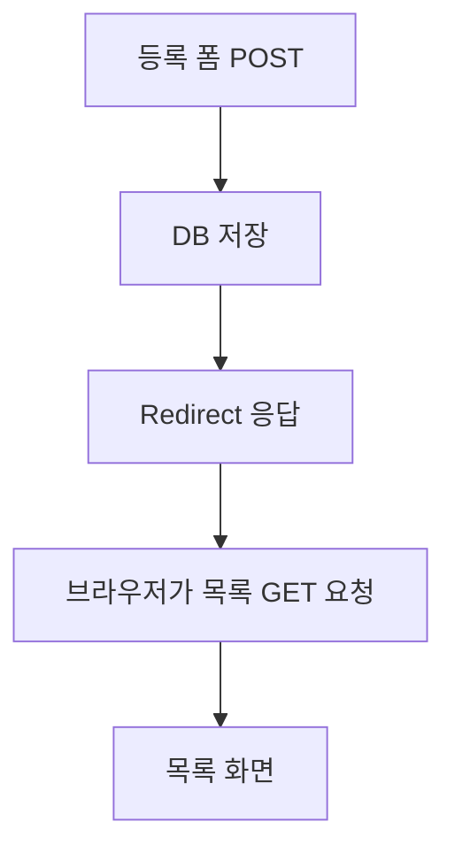

> 브라우저의 요청을 서블릿이 받아 DAO로 DB를 처리하고,
> JSP로 결과를 보여주는 MVC 흐름을 이해한다.

## 1. 프로젝트의 목표와 전체 구조
### 1.1. 무엇을 만드는가?
- 웹 화면에서 뉴스 기사를 **등록하고, 목록과 상세 내용을 조회하고, 삭제하는 서비스**를 만든다. 이미지 첨부와 오류 메시지도 처리한다.
- 수정(Update) 기능은 이번 구현 범위에 포함되지 않는다.

| 기술 | 이 프로젝트에서 맡는 역할 |
|---|---|
| Java Servlet | 요청 분석, 처리 메서드 실행, 화면 이동 |
| JSP · EL · JSTL | 데이터와 조건에 따라 HTML 화면 출력 |
| JDBC · MySQL | 뉴스 데이터 저장·조회·삭제 |
| Bootstrap | 목록, 카드, 버튼, 입력 폼, 알림 등의 화면 구성 |
| Multipart · Part | 업로드된 이미지 파일 처리 |
| BeanUtils | 폼 파라미터를 자바 객체의 속성에 매핑 |

### 1.2. MVC의 역할 분담


- **Model**
	- `NewsDO`는 뉴스 한 건의 데이터를 담는다.
	- `NewsDAO`는 SQL을 실행한다.
- **Controller**
	- `NewsController`는 요청에 맞는 DAO를 호출하고 결과 화면을 결정한다.
- **View**
	- `newsList.jsp`는 목록·등록·삭제 UI를 제공한다.
	- `newsView.jsp`는 기사 상세 화면을 제공한다.

**역할을 나누는 이유**
- DB 처리 코드를 화면에서 분리하면 모델을 다른 자바 프로그램에서도 재사용할 수 있다.

### 1.3. 파일 구성
```
자바 소스의 ch10 패키지
├── NewsDO.java          # 기사 데이터를 담는 DO
├── NewsDAO.java         # JDBC로 DB 작업 수행
└── NewsController.java  # 요청 분기와 화면 이동

webapp/ch10/
├── newsList.jsp  # 목록·등록·삭제·오류 표시
└── newsView.jsp  # 기사 상세 표시
```
- DO (Data Object; 데이터 객체)
- DAO (Data Access Object; 데이터 접근 객체)

## 2. 데이터베이스와 데이터 객체
### 2.1. news 테이블
```sql
CREATE TABLE news (
    aid INT NOT NULL PRIMARY KEY AUTO_INCREMENT,
    title VARCHAR(255) NOT NULL,
    img VARCHAR(500) NOT NULL,
    date TIMESTAMP,
    content TEXT NOT NULL
);
```

### 2.2. 데이터 객체
| 컬럼        | Java 타입              | 의미                  |
| --------- | -------------------- | ------------------- |
| `aid`     | `int`                | 기사 식별자. 기본키이며 자동 증가 |
| `title`   | `String`             | 기사 제목               |
| `img`     | `String`             | 이미지의 웹 접근 경로        |
| `date`    | `java.sql.Timestamp` | 등록 날짜와 시간           |
| `content` | `String`             | 기사 본문               |

`NewsDO`에는 이 다섯 필드와 getter/setter를 작성한다.
**DO는 데이터를 운반하는 객체이며 SQL을 실행하지 않는다.**

주의할 점은 이미지 자체를 DB에 넣는 것이 아니라는 것이다.
**이미지 파일은 디스크에, 접근 경로는 DB의 `img` 컬럼에 저장한다.**
예제에서는 이미지가 없으면 빈 문자열을 저장한다.
빈 문자열은 `NULL`과 다르므로 `NOT NULL` 컬럼에도 저장할 수 있다.

## 3. DAO: DB 처리를 한곳에 모으기
### 3.1. 메서드별 역할
| 메서드                 | 입력    | 반환             | 핵심 동작      |
| ------------------- | ----- | -------------- | ---------- |
| `open()`            | 없음    | `Connection`   | JDBC 연결 생성 |
| `addNews(NewsDO n)` | 뉴스 객체 | 없음             | 기사 등록      |
| `getAll()`          | 없음    | `List<NewsDO>` | 목록 조회      |
| `getNews(int aid)`  | 기사 ID | `NewsDO`       | 상세 조회      |
| `delNews(int aid)`  | 기사 ID | 없음             | 기사 삭제      |

### 3.2. 연결과 자원 관리
`open()`은 MySQL JDBC 드라이버와 `DriverManager.getConnection()`을 사용한다.
자료의 DB 이름은 `jspdb`이다.
계정과 비밀번호는 실습 환경에 맞춰 설정해야 한다.

- `Connection`: DB 연결
- `PreparedStatement`: SQL 준비와 파라미터 바인딩
- `ResultSet`: 조회 결과를 순서대로 읽는 객체

```java
try (conn; pstmt; rs) {
    // 조회 결과 처리
}
```

**try-with-resources**
- 블록이 끝나거나 예외가 발생하면 등록한 자원을 자동으로 닫는다.
- 실무 환경에 커넥션 풀 사용을 권장한다.

### 3.3. 등록: addNews()
```sql
INSERT INTO news(title, img, date, content)
VALUES (?, ?, CURRENT_TIMESTAMP(), ?)
```

- `aid`는 자동 증가하므로 전달하지 않는다.
- `date`는 DB의 현재 시각을 사용한다.
- `?`에는 제목, 이미지 경로, 본문을 순서대로 넣는다.
- 바인딩 위치는 **1부터 시작**한다.
- 등록·삭제처럼 데이터를 변경할 때 `executeUpdate()`를 사용한다.

### 3.4. 목록 조회: getAll()
```sql
SELECT aid, title, date AS cdate FROM news
```

```java
while (rs.next()) {
    NewsDO n = new NewsDO();
    n.setAid(rs.getInt("aid"));
    n.setTitle(rs.getString("title"));
    n.setDate(rs.getTimestamp("cdate"));
    newsList.add(n);
}
```

목록 화면에 필요한 항목만 조회하여 객체의 리스트로 반환한다.
`AS cdate`는 **조회 결과의 컬럼 별칭**이며 원래 테이블의 컬럼명을 변경하지 않는다.

> 예제 SQL에는 `ORDER BY`가 없으므로 출력 순서가 보장되지 않는다.
> 최신순 정렬이 필요하면 정렬 조건을 명시해야 한다.

### 3.5. 상세 조회: getNews(aid)
```sql
SELECT aid, title, img, date AS cdate, content
FROM news WHERE aid = ?
```

기본키로 조회하므로 최대 한 건을 읽는다.
따라서 목록의 `while`과 달리 `next()`를 한 번 확인한다.

```java
if (!rs.next()) {
    throw new SQLException("해당 뉴스가 없습니다. aid=" + aid);
}
```

`rs.next()`는 다음 행이 있으면 `true`, 없으면 `false`를 반환한다.
`throws SQLException`은 발생한 예외를 호출한 쪽에서 처리하도록 전달한다는 의미다.

### 3.6. 삭제: delNews(aid)
```sql
DELETE FROM news WHERE aid = ?
```

```java
if (pstmt.executeUpdate() == 0) {
    throw new SQLException("DB에러");
}
```

`executeUpdate()`의 반환값은 영향을 받은 행 수다.
여기서 0이면 삭제 대상이 없다는 뜻이다.
예를 들어 화면을 연 뒤 다른 경로에서 기사를 삭제한 경우 발생할 수 있다.

## 4. 컨트롤러: 요청을 처리하고 화면 결정하기
### 4.1. URL 매핑과 생명주기
```java
@WebServlet("/news.nhn")
```

- `init()`: 서블릿 초기화 시 실행된다. DAO와 `ServletContext`를 준비한다.
- `service()`: 요청마다 실행된다. 인코딩과 action을 확인하고 처리 메서드를 호출한다.
- `ServletContext.log()`: 서버 로그에 처리 오류 등을 기록한다.

### 4.2. action으로 기능 선택
| action           | 컨트롤러가 수행하는 일                      | 성공 시 이동          |
| ---------------- | --------------------------------- | ---------------- |
| 생략 또는 `listNews` | `dao.getAll()` → `newslist` 속성 저장 | 목록 JSP로 forward  |
| `getNews`        | `aid` 파싱 → 상세 조회 → `news` 속성 저장   | 상세 JSP로 forward  |
| `addNews`        | 파일 저장 → 폼 매핑 → DB 등록              | 목록 요청으로 redirect |
| `deleteNews`     | `aid` 파싱 → DB 삭제                  | 목록 요청으로 redirect |

예: `news.nhn?action=getNews&aid=3`은 **3번 기사의 상세 내용을 조회**하라는 요청이다.

### 4.3. 리플렉션으로 메서드 호출
```java
if (action == null) {
    action = "listNews";
}

Method m = this.getClass()
               .getMethod(action, HttpServletRequest.class);
String view = (String) m.invoke(this, request);
```

1. `getMethod()`는 action과 이름이 같고 `HttpServletRequest`를 인자로 받는 public 메서드를 찾는다.
2. `invoke()`가 찾은 메서드를 실제로 실행한다.
3. 메서드가 반환한 문자열을 화면 이동에 사용한다.

여기서 `getMethod()`는 **검색**, `invoke()`는 **실행**이다.
존재하지 않는 action이면 `NoSuchMethodException`을 처리하고 시작 화면과 오류 메시지를 지정한다.

### 4.4. 파라미터와 속성 구분
| 구분      | 쓰는 코드                             | 목적              |
| ------- | --------------------------------- | --------------- |
| 요청 파라미터 | `request.getParameter("aid")`     | 브라우저가 보낸 문자열 읽기 |
| 요청 속성   | `request.setAttribute("news", n)` | 서버에서 JSP에 객체 전달 |

폼의 `title`, `content`는 파라미터이고, DAO가 반환한 뉴스 객체나 목록은 request 속성에 담는다.

## 5. forward와 redirect, 중복 등록 방지
| 구분         | forward              | redirect              |
| ---------- | -------------------- | --------------------- |
| 동작         | 서버 내부에서 처리 대상에 요청 전달 | 브라우저에 새 URL로 요청하도록 응답 |
| 요청         | 같은 요청 유지             | 새 요청 생성               |
| 주소창        | 기존 URL 유지            | 이동한 URL로 변경           |
| request 속성 | 전달받아 사용 가능           | 새 요청에 자동 유지되지 않음      |
| 예제 용도      | 목록·상세 표시, 오류 표시      | 등록·삭제 성공 후 목록 재조회     |

### 5.1. 등록 후 forward하면 생기는 문제


### 5.2. 등록 후 redirect하는 흐름


이 방식은 **PRG(Post/Redirect/Get)** 패턴이다.
새로고침이 목록 조회 요청을 반복하도록 하여 POST 재전송으로 인한 중복 등록을 줄인다.

자료의 컨트롤러는 반환값이 `redirect:/`로 시작하면 접두어를 제거하고 `sendRedirect()`를 호출한다.
그 외에는 JSP로 forward한다.

> 자료의 구현은 `redirect:/`를 잘라낸 후 `news.nhn?...`를 전달하므로 결과는 상대 경로다.
> 접두어 자체가 서블릿의 내장 기능인 것은 아니며, 이 컨트롤러가 정한 규칙이다.

## 6. 이미지 업로드: 파일과 URL 연결하기
### 6.1. 업로드에 필요한 설정
```html
<form method="post"
      action="/jspbook/news.nhn?action=addNews"
      enctype="multipart/form-data">
    <input type="text" name="title">
    <input type="file" name="file">
    <textarea name="content"></textarea>
    <button type="submit">저장</button>
</form>
```

- `POST`: 등록할 데이터 전송
- `multipart/form-data`: 텍스트와 파일을 함께 전송
- `name="file"`: `request.getPart("file")`과 일치해야 함
- `/jspbook`: 자료의 예시 애플리케이션 컨텍스트 경로

```java
@MultipartConfig(
    maxFileSize = 1024 * 1024 * 10,
    maxRequestSize = 1024 * 1024 * 20,
    location = "c:/Temp/img"
)
```

파일 하나는 10MB, 전체 요청은 20MB로 제한한다.
저장 경로는 자료의 Windows 환경 기준이다.

### 6.2. addNews()의 처리 순서
1. `request.getPart("file")`로 파일 Part를 가져온다.
2. `getFilename(part)`로 업로드 파일명을 추출한다.
3. 파일명이 있으면 `part.write(filename)`으로 디스크에 저장한다.
4. `BeanUtils.populate(n, request.getParameterMap())`로 제목·본문 등을 `NewsDO`에 매핑한다.
5. 이미지가 있으면 `n.setImg("/img/" + filename)`, 없으면 빈 문자열을 넣는다.
6. `dao.addNews(n)`으로 DB에 저장한다.
7. 성공하면 목록으로 redirect하고, 실패하면 오류 속성을 설정한 뒤 `listNews(request)`를 반환한다.

**BeanUtils의 매핑 기준**: 폼 입력의 `name`과 자바빈 속성명이 연결된다.
예를 들어 `title`은 `setTitle()`에 대응한다.
파일 저장은 BeanUtils가 아닌 `Part`가 담당한다.

### 6.3. 실제 디스크 경로와 웹 경로
| 구분    | 예시                      | 사용하는 곳                 |
| ----- | ----------------------- | ---------------------- |
| 물리 경로 | `c:/Temp/img/photo.jpg` | 서버가 파일을 저장·읽음          |
| 웹 경로  | `/img/photo.jpg`        | 브라우저의 ``에서 요청 |

외부 폴더에 저장했다는 사실만으로 브라우저에서 접근할 수 있는 것은 아니다.
자료에서는 Tomcat의 `server.xml`에서 `</Host>` 앞에 별도 Context를 추가한다.

```xml
<Context docBase="c:/Temp/img" path="/img" reloadable="true" />
```

이 설정은 `/img` 요청을 실제 이미지 저장 폴더와 연결한다.
**업로드 저장 위치, Tomcat의 `docBase`, DB에 저장하는 URL의 관계가 맞아야 이미지가 표시된다.**

## 7. JSP 화면 이해하기
### 7.1. newsList.jsp
| 요소                 | 역할                            |
| ------------------ | ----------------------------- |
| `c:redirect`       | 목록과 오류 속성이 모두 없으면 컨트롤러에 목록 요청 |
| `c:forEach`        | `${newslist}`의 기사를 반복 출력      |
| `${status.count}`  | 화면에 표시할 순번. 실제 DB의 `aid`와 다름  |
| `${news.aid}`      | 상세·삭제 요청에서 대상을 식별             |
| `c:if`             | 오류 메시지 등을 조건부 출력              |
| Bootstrap Collapse | 뉴스 등록 폼을 접거나 펼침               |

```jsp
<c:forEach var="news" items="${newslist}" varStatus="status">
    <a href="news.nhn?action=getNews&aid=${news.aid}">
        [${status.count}] ${news.title}, ${news.date}
    </a>
</c:forEach>
```

서버의 속성명은 **`newslist`**이다. 자바 지역변수 `newsList`와 철자를 혼동하지 않는다.

오류 메시지는 `${error != null}`일 때 Bootstrap의 `alert`로 표시한다.
등록 폼의 버튼과 펼칠 영역은 `data-bs-target="#addForm"`과 `id="addForm"`으로 연결한다.

### 7.2. newsView.jsp
컨트롤러가 request에 넣은 `news` 객체를 EL로 읽는다.

| EL                | 출력 내용  | Bootstrap 구성          |
| ----------------- | ------ | --------------------- |
| `${news.title}`   | 제목     | 제목 영역                 |
| `${news.date}`    | 등록 시각  | `card-title`          |
| `${news.content}` | 기사 본문  | `card-text`           |
| `${news.img}`     | 이미지 경로 | `card-img-top`의 `src` |

이미지 경로가 비어 있거나 `/img/`만 있는 경우 이미지를 출력하지 않는다.

### 7.3. 자주 쓰는 Bootstrap 클래스
| 클래스                                                 | 의미                             |
| --------------------------------------------------- | ------------------------------ |
| `container w-75 mt-5 mx-auto`                       | 화면 영역, 너비 75%, 위쪽 여백, 좌우 자동 여백 |
| `list-group`, `list-group-item`                     | 목록 스타일                         |
| `d-flex justify-content-between align-items-center` | 항목을 가로로 배치하고 양끝·세로 중앙 정렬       |
| `badge bg-secondary`                                | 회색 배지                          |
| `alert alert-danger`                                | 오류 알림                          |
| `form-control`                                      | 입력 필드 스타일                      |

## 8. 통합 테스트 순서
| 순서  | 수행할 작업                                    | 확인할 결과                 |
| --- | ----------------------------------------- | ---------------------- |
| 1   | 컨트롤러 실행                                   | 빈 목록이 표시되고 콘솔 오류가 없음   |
| 2   | 제목·본문·이미지를 넣고 등록                          | 목록에 새 기사가 표시됨          |
| 3   | 기사 제목 클릭                                  | 제목·사진·본문·등록 시각이 표시됨    |
| 4   | 등록 후 목록 새로고침                              | POST 재전송에 의한 중복 등록이 없음 |
| 5   | 기사 삭제                                     | 목록과 DB에서 해당 행이 사라짐     |
| 6   | 목록을 연 상태에서 DB에서 기사를 직접 삭제한 뒤 화면의 삭제 버튼 클릭 | 삭제 행 수 0을 감지해 오류 표시    |
| 7   | `action=kkk`처럼 없는 action 요청               | 잘못된 action 오류 표시       |

DB 확인 SQL:
```sql
SELECT * FROM news;
DELETE FROM news WHERE aid = 3; -- 오류 재현용 예시 ID
```

보충 확인 항목
- 이미지 없이 등록하기, 업로드 제한 초과하기, 없는 `aid` 조회하기, 숫자가 아닌 `aid` 보내기
