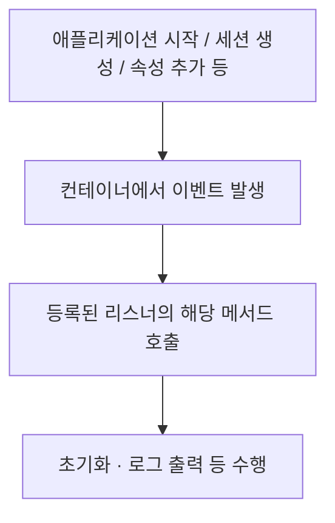
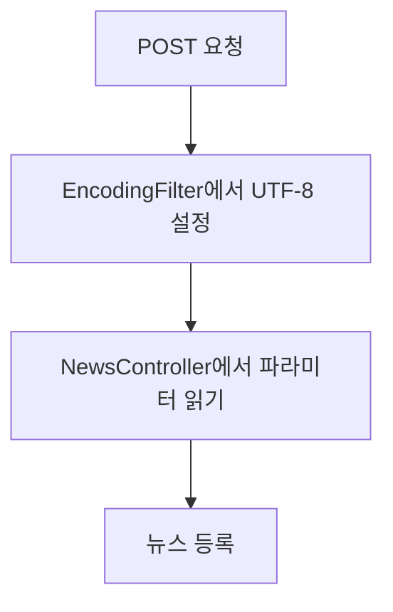

> 리스너는 **이벤트가 발생했을 때** 동작한다.
> 필터는 **매핑된 요청을 처리하는 과정에 끼어들어** 공통 작업을 수행한다.

## 1. 먼저 전체 그림 잡기
| 구분       | 리스너 (Listener)                               | 필터 (Filter)            |
| -------- | -------------------------------------------- | ---------------------- |
| 핵심 역할    | 이벤트에 반응                                      | 요청·응답 처리에 공통 기능 적용     |
| 동작 계기    | 애플리케이션·세션의 생성/소멸, 속성 변화 등                    | 설정한 URL 등에 해당하는 요청     |
| 대표 용도    | 초기 설정 로딩, 자원 초기화, 세션 관련 로그                   | 인증, 로깅, 다국어 처리, 한글 인코딩 |
| 구현 방식    | 감지할 이벤트의 리스너 인터페이스 구현                        | `Filter` 인터페이스 구현      |
| 등록 어노테이션 | `@WebListener`                               | `@WebFilter`           |
| 핵심 메서드   | `contextInitialized()`, `attributeAdded()` 등 | `doFilter()`           |

**판단 연습**
- 웹 애플리케이션이 시작되면 설정 파일을 읽는다 → **리스너**
- 세션이 만들어지면 세션 ID를 로그로 남긴다 → **리스너**
- 특정 URL 요청에서 로그인 여부를 확인한다 → **필터**
- 여러 서블릿의 POST 요청을 UTF-8로 처리한다 → **필터**

### 리스너
웹 애플리케이션 내부에서 **특정 사건(Event)이 일어나는 순간을 감지하고 반응**하여 코드를 실행하는 컴포넌트이다.
요청의 흐름을 가로채거나 막는 것이 아니라, 컨테이너나 세션, 요청 등의 생명주기 변화를 수동적으로 관찰한다.

**동작 패턴**
- 옵저버(Observer) 패턴 기반으로, 이벤트가 발생하면 컨테이너가 해당 리스너의 메서드를 자동으로 호출한다.

**핵심 기능**
- 웹 애플리케이션, 세션, 요청 객체의 생성/소멸 및 속성(Attribute) 추가/삭제 감지
- 요청의 흐름을 제어하거나 요청/응답 데이터를 직접 변형하지는 않는다.

**주요 리스너 종류**:
- **애플리케이션(컨텍스트) 수준**: `ServletContextListener`
	- 웹 애플리케이션이 시작되거나 종료될 때 동작
	- *예: DB 커넥션 풀 초기화, 스프링 `ContextLoaderListener`를 통한 루트 컨텍스트 로딩*
- **세션 수준**: `HttpSessionListener`, `HttpSessionAttributeListener`
	- 세션이 생성되거나 만료될 때, 혹은 세션에 데이터가 바뀔 때 동작
	- *예: 현재 접속자(로그인 사용자) 수 카운팅, 세션 타임아웃 처리*
- **요청 수준**: `ServletRequestListener`
	- 새로운 HTTP 요청이 들어와 `ServletRequest` 객체가 메모리에 생성되거나 소멸할 때 동작

### 필터
클라이언트의 요청이 서블릿(Spring의 경우 `DispatcherServlet`)에 도달하기 전이나, 서블릿이 처리를 끝내고 클라이언트에게 응답하기 직전에 **요청(Request)과 응답(Response)을 가로채서 특정 작업을 수행**한다.

**동작 패턴**
- 체인(Chain) 구조로 동작한다.
- 여러 개의 필터가 연속해서 연결(`FilterChain`)되어 실행될 수 있다.

**핵심 기능**
- 요청/응답 객체의 내용을 변형하거나 가공할 수 있다.
- 조건에 맞지 않을 경우 다음 단계로 요청을 넘기지 않고 차단(예: 인증 실패 시 에러 반환)할 수 있다.

**주요 메서드 (`Filter` 인터페이스)**
- `init()`: 필터 초기화(서버 실행 시 1회)
- `doFilter()`: 실제 필터링 로직 수행. `chain.doFilter()`를 기준으로 전처리/후처리가 나뉜다.
- `destroy()`: 필터 종료 및 자원 반납

## 2. 리스너
> 이벤트가 발생하면 실행되는 코드

### 2.1. 개념과 동작 구조
리스너
- 컨테이너에서 발생하는 특정 이벤트를 감지하여 실행되는 클래스다.
- 일반적인 서블릿처럼 URL 요청을 직접 처리하는 방식이 아니라, **이벤트에 대응하는 인터페이스의 메서드를 구현**한다.



주로 두 종류의 변화를 감지한다.
1. **생명 주기 변화**: 객체가 생성되거나 소멸한다.
2. **속성 변화**: 객체에 저장한 속성이 추가·교체·삭제된다.

### 2.2. ServletContext와 Session 구별하기
| 대상               | 의미                          | 저장 예시                |
| ---------------- | --------------------------- | -------------------- |
| `ServletContext` | 웹 애플리케이션 단위의 공유 객체          | 애플리케이션 공통 설정, 공유 데이터 |
| `HttpSession`    | 여러 요청에 걸쳐 클라이언트 상태를 유지하는 객체 | 로그인 정보 등 세션별 데이터     |

**보충 설명**
- `ServletContext`의 시작·종료를 톰캣 시작·종료와 연결해 설명한다.
- 정확히는 **해당 웹 애플리케이션의 초기화·종료**에 대응한다.
- 따라서 톰캣 전체를 종료하지 않아도 애플리케이션 재배포 등으로 이벤트가 발생할 수 있다.

### 2.3. 리스너 종류
| 감지 대상      | 인터페이스                             | 주요 메서드                                                                |
| ---------- | --------------------------------- | --------------------------------------------------------------------- |
| **컨텍스트 생명 주기** | `ServletContextListener`          | `contextInitialized()`,<br>`contextDestroyed()`                       |
| **컨텍스트 속성**    | `ServletContextAttributeListener` | `attributeAdded()`,<br>`attributeReplaced()`,<br>`attributeRemoved()` |
| **세션 생명 주기**   | `HttpSessionListener`             | `sessionCreated()`,<br>`sessionDestroyed()`                           |
| **세션 속성**      | `HttpSessionAttributeListener`    | `attributeAdded()`,<br>`attributeReplaced()`,<br>`attributeRemoved()` |
| **요청**         | `ServletRequestListener`          | -                                                                     |

패키지는 앞의 두 인터페이스가 `javax.servlet`,
뒤의 두 인터페이스가 `javax.servlet.http`다.

### 2.4. 대표 활용
- **초기화 매개변수 연동**: 시작할 때 `web.xml`의 설정을 읽고 필요한 객체를 초기화한다.
- **실습 환경 준비**: DB 연결 준비, 테이블 생성, 샘플 데이터 로딩 등을 자동화한다.
- **환경 설정 제공**: 서버별 DB·외부 서비스 연동 설정 등을 파일에서 읽어 제공한다.
- **외부 서비스 확인**: 애플리케이션 시작 시 함께 필요한 프로그램이나 서비스의 상태를 확인한다.

### 2.5. 구현 순서
1. 감지하려는 이벤트를 정한다.
2. 해당 리스너 인터페이스를 구현한다.
3. 클래스에 등록 어노테이션 `@WebListener`를 붙인다.
4. 필요한 이벤트 메서드에 코드를 작성한다.

```java
import javax.servlet.ServletContextEvent;
import javax.servlet.ServletContextListener;
import javax.servlet.annotation.WebListener;

@WebListener
public class ListenerExam implements ServletContextListener {
	@Override
	public void contextInitialized(ServletContextEvent event) {
		event.getServletContext().log("ServletContext 시작됨!!");
	}
	
	@Override
	public void contextDestroyed(ServletContextEvent event) {
		event.getServletContext().log("ServletContext 종료됨!!");
	}
}
```

`event.getServletContext()`는 이벤트가 발생한 웹 애플리케이션의 `ServletContext`를 가져온다.

## 3. 필터
> 요청 처리 앞뒤의 공통 작업

### 3.1. 개념과 활용
필터는 서블릿이나 JSP에 도달하는 요청에 대해 `request`, `response`를 다루거나 추가 처리를 수행한다.
여러 곳에서 반복하는 공통 작업을 필터 한 곳으로 모을 수 있다.

| 활용 분야 | 필터에서 수행하는 작업 |
|---|---|
| 인증 | 요청 처리 전에 로그인 여부 등 확인 |
| 로깅·감사 | 특정 기능의 접근·이용 내역 기록 |
| 국제화 | 언어에 맞는 메시지 등을 준비하여 전달 |
| 한글 인코딩 | 요청 데이터를 읽기 전에 문자 인코딩 설정 |

### 3.2. 필터의 생명 주기
| 메서드          | 호출 시점              | 역할         |
| ------------ | ------------------ | ---------- |
| `init()`     | 필터 인스턴스 초기화 시 한 번  | 초기 설정 및 준비 |
| `doFilter()` | 필터 적용 대상 요청을 처리할 때 | 실제 필터 작업   |
| `destroy()`  | 필터가 서비스에서 제거될 때    | 자원 정리      |

```
필터 초기화: init()
       ↓
매핑에 해당하는 요청: doFilter()
       ↓
이후 매핑에 해당하는 요청마다 doFilter() 실행
       ↓
필터 종료: destroy()
```

### 3.3. 핵심은 chain.doFilter()
```java
public void doFilter(
	ServletRequest request,
	ServletResponse response,
	FilterChain chain
	) throws IOException, ServletException {
	
	// 1. 다음 단계 실행 전 처리
	
	chain.doFilter(request, response);
	
	// 2. 다음 단계가 정상적으로 반환된 뒤 처리
}
```

- `chain.doFilter()`는 **다음 필터**로 전달한다.
- 다음 필터가 없으면 **대상 서블릿/JSP**로 전달한다.
- **보충 설명**: 호출 앞에는 전처리, 뒤에는 후처리를 둘 수 있다. 호출하지 않으면 뒤의 필터와 대상 자원으로 진행하지 않으므로 인증 실패 등의 경우 요청 처리를 중단할 수 있다.

필터 A와 B가 이 순서로 적용되고 각각 전처리·후처리를 수행한다면 다음과 같다.
```
요청 → A 전처리 → B 전처리 → 서블릿
응답 ← A 후처리 ← B 후처리 ← 서블릿에서 반환
```
> 위 흐름은 각 필터가 `chain.doFilter()`를 호출하고 정상 반환되는 경우다.
> 후처리의 실행 순서는 전처리의 역순이다.

### 3.4. URL 매핑
등록 어노테이션 `@WebFilter`에 필터를 적용할 URL 패턴을 설정한다.

| 설정 | 적용 대상 예시 |
|---|---|
| `@WebFilter("/ch11/*")` | `/ch11/` 아래 경로 |
| `@WebFilter("*.jsp")` | `.jsp`로 끝나는 요청 경로 |
| `@WebFilter("*.nhn")` | `.nhn`으로 끝나는 요청 경로 |
| `@WebFilter("/EncodingFilter")` | 정확히 `/EncodingFilter`인 요청 경로 |
> 클래스 이름이 `EncodingFilter`라고 해서 모든 요청에 자동 적용되는 것은 아니다.
> 필터 적용 범위는 **매핑**으로 결정된다.

### 3.5. 여러 필터의 적용 범위와 순서
예시에서는 A → B → C 순서로 필터가 배치되어 있다.

| 요청 대상 | 적용되는 필터 |
|---|---|
| 서블릿 a, b | A → B → C |
| 서블릿 c | A → C |
| 서블릿 d | A |

각 요청에는 **매핑 조건에 맞는 필터만** 적용된다.

`@WebFilter`만으로 필터 간 실행 순서를 지정할 수 없으므로, `web.xml`의 매핑 순서를 사용한다.

```java
@WebFilter(filterName = "filterOne")
public class FirstFilter implements Filter {
    // doFilter() 구현
}
```

```xml
<!-- web.xml 내부에 넣는 매핑 부분의 예시 -->
<filter-mapping>
    <filter-name>filterOne</filter-name>
    <url-pattern>/ch11/*</url-pattern>
</filter-mapping>

<filter-mapping>
    <filter-name>filterTwo</filter-name>
    <url-pattern>/ch11/*</url-pattern>
</filter-mapping>
```

위 예시는 두 필터가 모두 해당 요청에 매핑되는 경우 `filterOne` → `filterTwo` 순서를 지정한다. `filterTwo`도 해당 이름으로 등록되어 있어야 한다. 예시 XML은 `web.xml` 전체가 아니다.

## 실습 11-1: 리스너로 변화 확인하기
### 1. 실습 목표
`ListenerExam`에서 아래 네 인터페이스를 구현하여 ServletContext와 Session의 생명 주기·속성 변화를 감지한다.

```java
@WebListener
public class ListenerExam implements
        ServletContextListener,
        ServletContextAttributeListener,
        HttpSessionListener,
        HttpSessionAttributeListener {
    // 각 이벤트 메서드 구현
}
```

이클립스에서는 `src/main/java` → `New` → `Listener`에서 패키지 `ch11`, 클래스 `ListenerExam`을 지정하고 필요한 이벤트를 선택한다.

### 2. ServletContext 이벤트
리스너에는 시작·종료 로그와 속성 추가 로그를 구현한다.
다음은 속성 추가 메서드다.
```java
@Override
public void attributeAdded(ServletContextAttributeEvent event) {
    event.getServletContext().log(
        "ServletContext 속성 추가: " + event.getValue()
    );
}
```

테스트 서블릿에서 공유 속성을 저장한다.
```java
@WebServlet("/ListenerTestServlet")
public class ListenerTestServlet extends HttpServlet {
	private ServletContext sc;
	
	@Override
	public void init(ServletConfig config) throws ServletException {
		super.init(config);
		sc = getServletContext();
	}
	
	@Override
	protected void doGet(HttpServletRequest request,
						 HttpServletResponse response)
			throws ServletException, IOException {
		sc.setAttribute("name", "홍길동");
	}
}
```

**관찰할 흐름**
1. 애플리케이션 시작 → `contextInitialized()` → 시작 로그
2. 서블릿에 최초 요청 → 새 속성 저장 → `attributeAdded()` → 속성 추가 로그
3. 애플리케이션 종료 → `contextDestroyed()` → 종료 로그

브라우저에 응답 내용을 작성하지 않았으므로 **빈 화면이어도 정상**이다.
이 실습에서는 서버 콘솔의 로그를 확인한다.

### 3. Session 이벤트
리스너에 세션 생성·속성 추가 로그를 구현한다.
```java
@Override
public void sessionCreated(HttpSessionEvent event) {
    event.getSession().getServletContext().log(
        "Session 생성됨: " + event.getSession().getId()
    );
}

@Override
public void attributeAdded(HttpSessionBindingEvent event) {
    event.getSession().getServletContext().log(
        "Session 속성 추가: " + event.getValue()
    );
}
```

테스트 서블릿의 `doGet()`을 다음과 같이 변경한다.
```java
sc.setAttribute("scName", "홍길동");

HttpSession session = request.getSession();
session.setAttribute("ssName", session.getId() + ": 세션 속성 저장!!");
```

| 코드 | 의미 | 처음 실행될 때의 이벤트 |
|---|---|---|
| `sc.setAttribute(...)` | 애플리케이션 공유 속성 저장 | Context 속성 추가 |
| `request.getSession()` | 기존 세션 반환, 없으면 생성 | 새로 생성할 때 Session 생성 |
| `session.setAttribute(...)` | 해당 세션에 속성 저장 | Session 속성 추가 |

**보충 설명: 새로고침 결과가 처음과 다른 이유**
- 같은 이름의 속성이 이미 있으면 `setAttribute()`는 **추가가 아니라 교체** 이벤트를 발생시킨다.
- 기존 세션을 계속 사용하면 `sessionCreated()`는 다시 호출되지 않는다.
- 따라서 추가 이벤트에만 로그를 작성했다면 새로고침 시 같은 로그가 나오지 않을 수 있다.
- 다른 브라우저로 접속하여 새 세션 생성을 확인한다. 브라우저 종료만으로 서버의 세션이 즉시 소멸한다고 생각하면 안 된다. 세션 종료에는 타임아웃이나 `invalidate()` 등이 관련된다.

**추가와 교체 구분하기**
```java
session.setAttribute("user", "홍길동"); // 키가 없었다면 attributeAdded
session.setAttribute("user", "김철수"); // 같은 키가 있으면 attributeReplaced
session.removeAttribute("user");        // 존재하던 키 삭제 시 attributeRemoved
```

**보충 설명**
- Context 속성 리스너와 Session 속성 리스너는 메서드 이름이 같아도 매개변수 타입이 다르다.
- 한 클래스에서 각각 구현할 수 있다.

## 실습 11-2: 한글 인코딩 필터
> 원문은 이 구간의 슬라이드 제목에 실습 번호를 `11-1`로 표기했지만, 목차에 맞추어 `11-2`로 정리했다.

### 1. 해결하려는 문제
기존에는 `NewsController`의 `service()`에서 다음 코드를 실행했다.
```java
request.setCharacterEncoding("utf-8");
String action = request.getParameter("action");
```

실습에서는 인코딩 설정을 주석 처리하고 한글 뉴스를 등록하여 문제를 관찰한 다음, **인코딩 처리를 필터로 옮긴다.**



### 2. 필터 구현
이클립스에서 `New` → `Filter`를 선택하고 패키지는 `ch11`, 클래스는 `EncodingFilter`, URL 패턴은 `*.nhn`으로 지정한다.

다음은 예제의 핵심 동작을 정리한 코드다.
```java
package ch11;

import java.io.IOException;
import javax.servlet.Filter;
import javax.servlet.FilterChain;
import javax.servlet.ServletException;
import javax.servlet.ServletRequest;
import javax.servlet.ServletResponse;
import javax.servlet.annotation.WebFilter;
import javax.servlet.http.HttpServletRequest;

@WebFilter("*.nhn")
public class EncodingFilter implements Filter {
	@Override
	public void doFilter(
		ServletRequest  request,
		ServletResponse response,
		FilterChain     chain
	) throws IOException, ServletException {
		HttpServletRequest httpReq = (HttpServletRequest) request;
		
		if (httpReq.getMethod().equalsIgnoreCase("POST")) {
			request.setCharacterEncoding("utf-8");
		}
		
		chain.doFilter(request, response);
	}
}
```

| 코드 | 역할 |
|---|---|
| `@WebFilter("*.nhn")` | `.nhn` 요청 경로에 필터 적용 |
| `(HttpServletRequest) request` | HTTP 요청 메서드를 확인하기 위해 형 변환 |
| `getMethod().equalsIgnoreCase("POST")` | 대소문자 구분 없이 POST 요청인지 확인 |
| `setCharacterEncoding("utf-8")` | 요청 본문을 읽을 때 사용할 인코딩 설정 |
| `chain.doFilter(...)` | 다음 필터 또는 서블릿으로 전달 |

### 3. 가장 중요한 실행 순서
```
올바른 순서: 인코딩 설정 → 파라미터 읽기
잘못된 순서: 파라미터 읽기 → 인코딩 설정
```

> 파라미터가 이미 해석된 뒤에 인코딩을 설정해도 앞선 해석을 되돌릴 수 없다.
> 다른 필터가 먼저 파라미터를 읽는 경우에도 순서에 주의한다.

### 4. 실행 결과와 적용 범위
1. 컨트롤러의 인코딩 설정을 주석 처리한다.
2. 필터 적용 전 한글 뉴스를 등록하여 결과를 확인한다.
3. `EncodingFilter`를 구현하고 애플리케이션을 다시 실행한다.
4. 새 한글 뉴스를 등록하여 정상 저장 여부를 확인한다.

- 필터는 **새 요청**을 처리한다. 이전에 깨져 저장된 데이터를 복구하지는 않는다.
- 이 예제에서 UTF-8 설정을 수행하는 대상은 **`.nhn` 경로로 들어온 POST 요청**이다.
- POST가 아니어도 `chain.doFilter()`는 실행되므로 다음 단계로 진행한다.

> 인코딩 설정을 제거하면 한글이 깨지는 환경을 전제로 한다.
> 실제 재현 여부는 서버의 기본 인코딩 설정 등에 따라 달라질 수 있다.
> 이 예제는 요청 본문 인코딩을 다루며, GET 쿼리 문자열이나 응답 인코딩까지 모두 해결하는 코드는 아니다.
